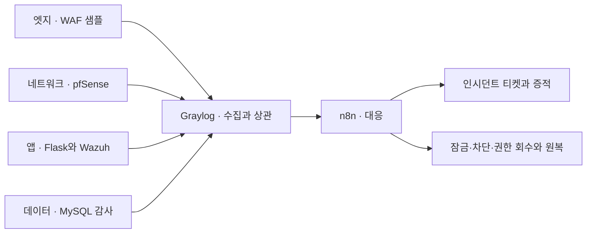

# NoBugs · ALEPH SOAR Capstone

> **지금 진행 상황은 [PROGRESS](docs/PROGRESS.md)에서 먼저 확인하세요.** 새 일일 기록은 [멤버별 work-log](work-log/members/README.md)에 작성합니다. [기존 개발 일지](docs/devlog/members/)는 이력으로 보존합니다.

**해담시청 포털 저장소 분리(10/19 사용자 결정):** [프론트·백엔드 분리 안내와 복사용 스켈레톤](docs/haedam/README.md)에 AI 지침, 폴더 구조, 공통 제약과 작업 순서를 정리했습니다. 프론트·백엔드 비공개 저장소를 생성했으며 포털 기능은 아직 구현 전입니다.

팀 캡스톤 주제는 **공공기관 민원 서비스·원격 유지보수 접속 보안 관제 및 자동 대응 시스템**입니다(2026-10-19 도메인 팀 합의). 가상 OO시청의 민원 포털과 내부 업무 시스템, 외주 유지보수 VPN을 대상으로 공격을 탐지하고 자동 대응한 뒤, 실제로 막혔는지와 서비스가 복구됐는지를 내부망에서 실측합니다.

**현재 단계: 도메인 확정 → 필수 케이스·역할 확정(10/20 회의) → 기획서 제출 10/23 / 갱신일: 2026-10-19 (Asia/Seoul)**

- 기획서: [whiteclover0542 초안](team_docs/기획서.md), [검토 메모](docs/11-team-feedback.md#whiteclover0542--2026-10-16--기획서-초안), 결정 기록은 [주제 결정 기록](docs/07-topic-decision.md)
- 일정(공식 공지): 기획서 10/23(금), 리허설 11/5(목), 본발표 11/6(금)
- 참여자 4인. Wazuh·Graylog·pfSense·Suricata·n8n·Kali Linux·Docker를 사용할 예정입니다.
- 현재는 실행 가능한 최소 앱과 공통 계약·AI 협업 뼈대가 있습니다. 로그인·탐지·대응 업무 기능과 외부 도구 연동은 미구현입니다.

아래는 10/16까지의 논의 이력입니다(통신 포털 준비안, 12종 계획 등). 현재 방향은 위 내용을 따릅니다.

[R08 Claude 회신](work-log/2026-10-16-claude-telecom-portal-plan-review.md)과 [후속 판단](docs/21-telecom-portal-defense-plan.md#11-claude-회신과-codex-후속-판단)을 확인했습니다. [리뷰 프롬프트](prompts/claude-telecom-portal-plan-review.md)는 요청 이력입니다. [과거 후보 8개](docs/10-topic-candidates.md)는 논의 기록이며 현재 배경 투표를 다시 시작하는 자료가 아닙니다.

이어서 작업할 때는 [P01 권한표·G1 사전 점검](docs/22-p01-access-and-g1-preflight.md)에서 현재 PC 확인 결과, 업체별 권한 초안, 실제 시험 순서와 남은 결정을 확인합니다. 계약·제품 연동은 아직 적용하지 않았습니다.

강사 조언·Kubernetes와 실제 사고 기반 제안의 후속 검토는 [가용성 아키텍처 비교](docs/23-availability-architecture-review.md), [실제 사고·서비스·보안 네트워크 MVP 제안](docs/24-real-incident-network-mvp-proposal.md)에 정리했습니다. 기본 Compose·조건부 앱 Kubernetes를 제안하며 팀 채택·구현 전입니다.

최신 팀 논의 자료는 [핵심 범위 합의 준비·Claude 회신 정리](docs/27-core-scope-agreement-review.md)입니다. 팀원의 MockTel 원안과 기존 외주 포털을 구분하고, 대표 사고 하나의 기본/보강 탐지 비교부터 대응·복구까지 먼저 완주하도록 추천합니다. 서비스 변경·대표 사고·망 배치는 합의 전이며, [망 허용표](docs/26-network-allow-table-s1-s10.md)는 적용·시험 전 초안입니다.

후속 사용자 방향은 **10종 이상 구상·4인 분담·공통 기반부터 단계적 구현**입니다. [12종 단계별 계획](docs/29-twelve-ticket-phased-plan.md)에 후보·주담당·선행 조건·완료 증거와 다른 팀 정보의 확인 한계를 정리했습니다. 대표 하나는 첫 통합 순서이며 전체 범위를 한 종류나 네 종류로 제한하지 않습니다. [Claude R10 검토 요청 상태](work-log/2026-10-16-twelve-ticket-review-handoff.md)는 계획·실제 회신을 구분합니다.

## 팀원이 바로 시작하기

저장소를 받은 뒤 Python 3.12 이상의 환경에서 실행합니다. 운영체제별 설명은 [팀 작업 시작 안내](docs/08-team-workspace.md)에 있습니다.

```powershell
python tools/bootstrap.py
.\.venv\Scripts\python.exe -m flask --app aleph_soar:create_app run --host 127.0.0.1 --port 5000
```

`http://127.0.0.1:5000`은 시작 화면, `/api/v1/health`는 상태 API입니다. 역할별 위치와 명령은 [AI 협업·작업 조율](docs/09-ai-collaboration.md), 공통 규칙은 [AGENTS.md](AGENTS.md)에 있습니다.

## 먼저 읽을 문서

| 문서 | 내용 |
| --- | --- |
| [최신 통신 포털·4계층 증적 준비안](docs/21-telecom-portal-defense-plan.md) | 정상 업무·권한·공방전·WAF·DB 직접 감사·실제 증적·역할·Claude 리뷰 질문 |
| [P01 권한표·G1 사전 점검](docs/22-p01-access-and-g1-preflight.md) | 작업 재개 상태·현재 환경·업체/객체 권한 초안·위험 시험 카드·남은 결정 |
| [가용성 아키텍처 비교](docs/23-availability-architecture-review.md) | Compose/K8s/하이브리드 평가·NIDS/HIDS·가용성·티켓·실험·SPOF |
| [실제 사고 기반 보안 네트워크 제안](docs/24-real-incident-network-mvp-proposal.md) | 공식 사건 3개 비교·서비스·통신 허용표·접근/반출 통제·K8s 판정·팀 공유 초안 |
| [팀원 MockTel 제안 검토](docs/25-chacha-proposal-review.md) | 원본 PDF·도식 검토, 자원·상태·지표·증거 보완 사항 |
| [망 허용표·S1~S10 시험 초안](docs/26-network-allow-table-s1-s10.md) | 연결별 허용/거부·로그·참고 시나리오·실제 시험 후보 |
| [핵심 범위 합의 준비](docs/27-core-scope-agreement-review.md) | Claude 회신 후속 판단·필수/확장·대표 사고 선택·완료 증거·공유 문구 |
| [12종 구상·4인 단계별 구현](docs/29-twelve-ticket-phased-plan.md) | S1~S10+송신/가용성 후보·개인/공통 책임·선행 조건·타 팀 정보·Claude 검토 |
| [프로젝트 기획](docs/01-project-plan.md) | 문제 정의, 목표, MVP 제안, 역할·일정 |
| [아키텍처 설계](docs/02-architecture.md) | 4계층 구성, 로그 흐름, 설계 결정 사항 |
| [탐지·대응 시나리오](docs/03-scenarios.md) | 참고 자료의 S1~S10, 검증·증적 기준 |
| [준비 백로그](docs/04-backlog.md) | 첫 회의 안건과 단계별 작업 목록 |
| [참고 자료](docs/05-references.md) | Notion·HTML 출처와 해석 범위 |
| [Claude와 주제 논의](docs/06-topic-discussion.md) | 논의 배경, 후보·비교 기준, 시작 방법 |
| [주제 결정 기록](docs/07-topic-decision.md) | 합의된 범위와 미정 사항을 기록하는 틀 |
| [팀 작업 시작](docs/08-team-workspace.md) | 설치·실행·담당별 작업 위치·인수인계 |
| [AI 협업·작업 조율](docs/09-ai-collaboration.md) | 공통 규칙·스킬·역할·작업 DAG 사용법 |
| [팀 투표용 후보 8개](docs/10-topic-candidates.md) | 사용자·시연·MVP·범위·확인 과제·투표 양식 |
| [팀원 의견 기록](docs/11-team-feedback.md) | 팀원별 주제 의견 원문과 검토 메모 |
| [4계층 가정 검토](docs/12-four-layer-topic-review.md) | A+B+G의 계층별 인수 기준과 Claude 검토 질문 |
| [주제 심화·Codex 추천](docs/13-topic-differentiation-proposal.md) | 구체적 예시 3개, 대응·복구 검증 추천과 비교 실험 |
| [스마트팩토리 로드맵](docs/14-smart-factory-roadmap.md) | 생산관리·협력사 포털·가상 설비 데이터의 4계층 구성과 2주 단계 |
| [개발 전 시장 조사](docs/15-market-research.md) | 수요 근거·기존 제품·고객 가설·차별점·인터뷰와 검증 지표 |
| [Claude 시장 조사 검토 재리뷰](docs/16-market-research-rereview.md) | 수정 5건의 독립 확인·추가 발견·반영 결과 |
| [유사 사이트·화면 구성 검토](docs/17-reference-sites-review.md) | Claude 회신·추천 참고 사이트·화면 책임·조건부 의견 |
| [보안 네트워크 직무 관점 보강안](docs/18-security-network-career-direction.md) | 협력사 원격 접속 통제·관제 보강안, 벤치마킹 자료, 포트폴리오 산출물 |
| [금융 배경 전환안 검토 요청](docs/19-finance-background-review.md) | 은행 내부 업무망 + 외주 업체 원격 접속 전환안과 Codex 검토 질문 |
| [통신 배경 전환안 검토 요청](docs/20-telecom-background-review.md) | 통신사 운영망의 외주·장비 원격접속 통제와 민관 협력 층, Codex 검토 질문 |
| [작업 기록·핸드오프](work-log/README.md) | 날짜별 상세 작업·검증 결과·다음 세션 인수인계 |
| [API·이벤트 계약](docs/API-CONTRACT.md) | 현재 경로와 미구현 후보, 공통 스키마·예시 |
| [협업 방법](CONTRIBUTING.md) | 문서 변경, 이슈, PR 규칙 초안 |

## Claude와 논의 시작

프로젝트 폴더의 PowerShell에서 실행합니다.

```powershell
.\Start-ClaudeDiscussion.ps1
```

실행 정책 때문에 스크립트가 막히면 아래 명령을 사용합니다.

```powershell
powershell -ExecutionPolicy Bypass -File .\Start-ClaudeDiscussion.ps1
```

`CLAUDE.md`가 공통 `AGENTS.md`를 불러오며, [시작 프롬프트](prompts/claude-topic-discussion.md)에 주제 논의 요청을 준비했습니다. 실행하면 사용자 기본 모델로 Claude Code가 계획 모드에서 시작됩니다.

## 이전 참고안의 흐름

아래 그림은 초기 자료의 참고 구성입니다. 현재의 웹 중심 배치·실제 WAF·DB 감사 후보와 미정 사항은 [R08](docs/21-telecom-portal-defense-plan.md#3-4계층의-정의와-실제-통신-경로)을 기준으로 봅니다.



## 첫 회의에서 정할 것

- 팀 서비스명, 사용자와 해결할 문제, 필수 제출 요건
- MVP 시나리오와 확장 범위
- 팀원별 담당, 사용 가능한 장비, 마감일
- 기존 `flask-board-team` 실습 코드의 재사용 범위

참고 자료의 ‘실측 완료’는 원본 작성 환경의 상태입니다. **우리 팀의 구현·시험 완료를 의미하지 않습니다.** 팀 진행 상태는 [백로그](docs/04-backlog.md)에 기록합니다.

검증 환경은 팀이 관리하는 격리 랩으로 설계하며, 자격 증명과 실제 개인정보는 Git에 저장하지 않습니다. 상세 실행·배포 절차는 구현 단계에서 작성합니다.
