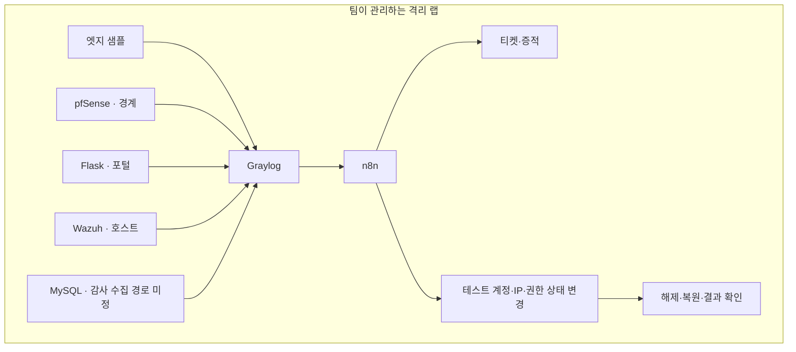

# 아키텍처 설계 초안

아래 구성은 참고 자료를 바탕으로 한 후보입니다. 설치 버전, 장비, IP, 포트 공개 범위는 아직 확정하지 않았습니다.

## 구성과 책임

| 영역 | 후보 기술 | 책임 | 팀 상태 |
| --- | --- | --- | --- |
| 엣지 | Cloudflare WAF 샘플 | 엣지 이벤트 제공 | 미구현 |
| 네트워크 | pfSense | 경계 제어와 filterlog 제공 | 미구현 |
| 앱 | Flask 게시판 | 인증·인가 이벤트와 대응 대상 상태 제공 | 미구현 |
| 호스트 | Wazuh | 파일 변경과 호스트 이벤트 탐지 | 미구현 |
| 데이터 | MySQL | 테스트 데이터와 감사 이벤트 제공 | 미구현 |
| 수집·상관 | Graylog | 정규화된 신호 수집과 사건 후보 생성 | 미구현 |
| 자동화 | n8n | 잠금·차단·권한 회수·티켓 처리와 원복 | 미구현 |
| 검증 환경 | 격리된 테스트 호스트 | 통제된 테스트 신호 제공 | 미구현 |

원본의 `Graylog2` 표기는 출처에 사용된 이름입니다. 제품 버전으로 확정하지 않으며 구현 전에 호환성을 확인합니다.

## 논리 구조

공장 생산망, 본사 관리망, 관제 관리망의 경계와 통신 허용 표는 장비 확인 후 작성합니다. 원본의 IP와 포트를 팀 환경의 값으로 그대로 사용하지 않습니다. 엣지는 우선 샘플 로그를 사용하는 안으로 검토합니다.

## 이벤트 필드 제안

| 필드 | 용도 |
| --- | --- |
| `event_id`, `timestamp` | 중복 확인과 이벤트 발생 시각 |
| `source`, `layer`, `rule` | 로그 출처, 계층, 탐지 신호 |
| `src_ip`, `username` | 사건별 상관 기준; 해당하는 경우만 사용 |
| `outcome`, `signal_kind` | 인증 결과와 신호 종류 |
| `asset_id`, `correlation_id` | 자산 구분과 사건 연결 |

필드명은 논리 설계안입니다. GELF 매핑, 시간대, 누락 필드, 수집 지연과 이벤트 순서 처리 방법은 구현 설계에서 정합니다.

## 대응 설계에서 결정할 것

- 각 대응 API의 인증, 최소 권한, 테스트 대상 식별 방법
- 중복 이벤트·재시도 시 잠금이나 티켓이 반복되지 않게 하는 기준
- 대응 전 상태 저장, 해제 조건과 복원 실패 시 처리 방법
- 한 침해를 한 티켓으로 묶는 키와 시간 범위
- 자동 대응과 사람이 검토할 대응의 경계
- MySQL 감사 방식, 수집 경로, 비밀값 제외 방법과 보관 기간
- VM·Docker·WSL2 배치, 자원 요구량과 제품별 호환 버전

## 결정 기록

| 날짜 | 항목 | 상태 | 근거 |
| --- | --- | --- | --- |
| 2026-10-15 | 계획·설계 문서로 저장소 시작 | 초기 설정 | 사용자 요청 |
| 2026-10-15 | 참고 구성으로 4계층 SOAR 검토 | 제안 | 자료 167·168 |
| 미정 | 팀 주제·최종 스택·망 구성 | 미정 | 첫 회의에서 결정 |
