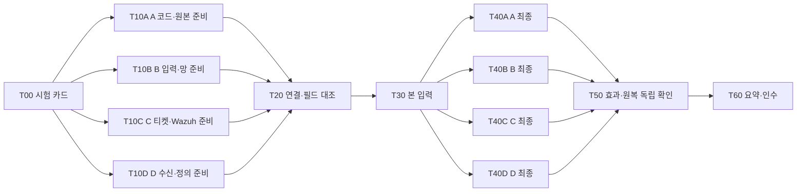

# Claude·Codex 협업과 작업 조율

## 공통 원본과 도구별 진입점

| 대상 | 원본 | 도구가 읽는 위치 |
| --- | --- | --- |
| 항상 적용할 규칙 | AGENTS.md | Codex: AGENTS.md / Claude: CLAUDE.md의 @AGENTS.md |
| 반복 작업 스킬 | .agents/skills/ | Codex: 원본 / Claude: .claude/skills/ |
| 역할 | ai/roles/ | Claude: .claude/agents/ / Codex: .codex/agents/ |

도구별 파일은 `python tools/sync_ai_assets.py`로 생성하고 커밋합니다. 첫 clone에서 별도 복사는 필요 없습니다. `--check`와 테스트가 원본과 생성물의 차이를 찾습니다. 역할과 스킬은 모델·전역 권한·계정을 설정하지 않습니다.

확인한 로컬 CLI는 Claude Code 2.1.252, Codex CLI 0.160.1입니다. 팀원 버전의 차이는 각 도구의 도움말과 공식 문서에서 확인합니다. 새 디렉터리의 역할이 보이지 않으면 해당 세션을 다시 시작합니다. 역할 프로필은 플랫폼의 파일 접근 제한을 대신하는 샌드박스가 아닙니다.

## 스킬 5개

| 작업 | 스킬 | Claude 직접 호출 | Codex 직접 호출 |
| --- | --- | --- | --- |
| 작업 분할·인수 기준 | aleph-task-plan | `/aleph-task-plan` | `$aleph-task-plan` |
| API·이벤트·사건 계약 변경 | aleph-contract-change | `/aleph-contract-change` | `$aleph-contract-change` |
| 구현된 탐지·대응 검증 | aleph-scenario-check | `/aleph-scenario-check` | `$aleph-scenario-check` |
| 다음 담당에게 결과 전달 | aleph-handoff | `/aleph-handoff` | `$aleph-handoff` |
| 팀 Notion 회의록·결정 기록 | aleph-team-notion | `/aleph-team-notion` | `$aleph-team-notion` |

스킬 설명은 자동 선택에도 사용할 수 있습니다. 작은 문구 변경에 모든 스킬을 실행하는 구조는 아닙니다.

팀 Notion 작업은 `aleph-team-notion` 스킬과 서기 역할 `aleph-scribe`를 함께 씁니다. 예: Claude에서 `claude --agent aleph-scribe` 뒤 "오늘 오전 회의록 팀 노션에 써줘", Codex에서 `$aleph-team-notion 오늘 회의 결정 칸 채워줘`. Notion 커넥터가 개인 워크스페이스에만 연결된 경우에는 이미 로그인한 브라우저로 작업합니다(스킬 1단계).

## 역할 사용

Claude Code는 예를 들어 `claude --agent aleph-backend`로 프로젝트 역할을 선택할 수 있습니다. 세션 안에서 특정 역할에게 검토를 요청하는 방식도 사용할 수 있습니다.

Codex에서는 역할 파일을 활용하는 하위 에이전트 작업을 직접 요청할 수 있습니다. 단일 세션에서는 `ai/roles/aleph-backend.md와 B01 brief를 읽고 이 범위에서 작업해줘`처럼 역할을 읽도록 요청해도 됩니다. Claude 전용 팀 기능이나 특정 모델 구매를 필수 조건으로 삼지 않습니다.

## 사람 자리와 개발 역할

자리 A~D는 사람·장비·케이스 책임입니다. backend/detection/dashboard는 개발 관점의 역할이며 작업 ID B01/D01도 자리 이름이 아닙니다. 아래 대응은 연결 책임을 설명하며 새 인력 배정이나 실장비 접근 권한을 주지 않습니다.

| 사람 자리 | 사람·케이스·실제 연결 책임 | 관련 개발 역할·범위 |
| --- | --- | --- |
| A | whiteclover0542 · S1/S4 · 포털 VM 배포/원본·대응 API 운용 | backend와 연결. 포털 코드 구현 책임 B와 구분, A↔D 이벤트/대응 직접 대조 |
| B | myeongjundev · S8/S10 · pfSense/VPN/DB/Kali·Suricata | 포털 구현은 backend 관점, 망/수집은 detection 관점. B↔D 경계/Suricata 직접 대조. 구간 조율은 coordinator 관점 |
| C | shk12170-dev · S7 · Wazuh/117·티켓/보안 대시보드 | detection·dashboard와 연결. C↔D 티켓/Wazuh/인증 직접 대조 |
| D | chacha1650a · S12 · Graylog 수신/정규화/정의·n8n | detection과 연결. A/B/C와 각 인터페이스 대조, 모든 개발 역할을 D에게 배정하는 뜻은 아님 |
| 구간별 지정 | 입력 담당과 다른 독립 검토자 1명, 요약 편집자 1명 | reviewer는 실제 효과/원복 독립 확인, coordinator는 일정/의존성/공통 요약 관리. 상세 회신의 중계인이 되지 않음 |

포털은 별도 `NoBugs-Aleph/haedam-portal-backend:src/haedam_portal/`와 `NoBugs-Aleph/haedam-portal-frontend:src/`입니다. capstone은 연결 계약·증적·보안 도구 준비를 관리합니다. workplan의 `external_refs`는 외부 참조이며 이 도구가 파일을 열거나 구현/배포를 검증하지 않습니다. 이 저장소의 read/write 경계는 유지합니다.

## 병렬 준비와 병렬 대조

최신 상태는 [PROGRESS](PROGRESS.md) 한 곳에 작업/사람 담당/상태/남은 조건/다음 행동/근거/확인 시각으로 요약합니다. 일지는 상세 이력, workplan은 정적 DAG·인수 조건, 실행별 시험 카드는 증적입니다. 준비·입력 완료·외부 대조 대기·최종 완료를 나누고 미확인·실패를 0건으로 채우지 않습니다.

1. [시험 카드](../orchestration/handoff-template.md)에 시험 ID·출발지·대상·버전·입력 수·실측/관측창·예상 결과·미측정/null 정책과 파일별 소유자를 고정합니다.
2. A 포털/원본, B 입력/망/전송기, C Wazuh/티켓/인증, D 리스너/정규화/정의/n8n이 **동시에 준비**하고 각각 준비 회신 1회를 남깁니다. 준비됨/작업 필요/미확인과 근거·필요 입력을 한 번에 전달합니다.
3. 연결 당사자가 준비 표본을 대조합니다. 코드·리스너 준비와 실제 수신/필드 대조를 구분합니다. 필요한 연결의 미확인 상태가 남으면 본 입력을 권하지 않습니다.
4. 승인된 구간에서 카드대로 입력하고, A 원본/앱·DB, B 입력/경계, C 티켓/가동 상태, D 수신/필드/정의/n8n을 **동시에 최종 대조**합니다. 각자 최종 회신 1회를 남기고 원본 ID·출발지·관측창을 맞춥니다.
5. 보강 후는 실제 효과·원복·정상 대조를 독립 확인한 뒤 최종 완료로 요약합니다. 보강 전 완료는 해당 카드의 관측 완료에 한정합니다. 다음 담당·필요 입력·미검증을 인수합니다.

오류·조건 변경은 즉시 알립니다. 이미 받은 확인은 정보 변화 없이 반복 요구하지 않습니다. 실측 중 관련 서비스·VPN·파서·대응 변경은 조율하고 영향받은 준비만 다시 확인합니다. 연결 대기와 무관한 문서/격리 개발은 진행할 수 있습니다. 양식과 역할은 실제 메시지 발송 권한이 아니며 발송은 사용자 명시 지시가 있을 때만 합니다.

| 증적 항목 | 반드시 구분할 내용 |
| --- | --- |
| 수신 | 원문 도착 수·고유/중복과 정규화 필드/값 대조 결과. TCP send 완료만으로 색인 완료가 아님 |
| 정의·0건 | 미정의/비활성/미확인과 정의된 규칙의 고정 창 조회 0건. 정의 없음의 시간값은 null/해당 없음, 미측정은 미측정 |
| 대응 | n8n 실행 ID·dry_run·실제 HTTP 노드 실행/응답·대상 효과·원복을 따로 기록 |
| 티켓 | 저장소 미가동으로 생성 불가, 조회 실패, 가동 중 조건부 0건을 구분 |
| 범위 | 직접 측정/담당 보고/코드 검사/합성 시험/실제 연결. 다른 시간창·출발지의 후속 시험을 합산하지 않음 |

10/23 사례 재생: S8은 `.21` 15:15 입력·5/5 ID 대조, n8n 관측창 15:15~15:30 실행0이며 뒤의 16:11 dry_run은 별도입니다. 티켓0은 15:37 미가동 사유입니다. S10은 16:45 `.10` ICMP ID25265/seq164의 D 고유1건·정규화 회신 대기이므로 `.22` 본 입력은 미실행입니다. 학원 원본 경로는 집에서 미열람이며 [B 마감 기록](../work-log/members/myeongjundev/2026-10-23.md#오후-작업-마감--1700-kst-기준-codex-s8s10-세션)의 보고 범위만 사용합니다. S8 첫 자동 대응 완주는 제안이며 팀 합의·실행 완료가 아닙니다.

개선 효과는 실제 운용 뒤 준비 누락 재시험 수·회신 왕복 수·입력부터 최종 대조까지 시간·통합 완주 케이스 수로 비교합니다. 이번 문서/격리 검증만으로 단축률을 확정하지 않습니다.

## 로컬 오케스트레이터

`tools/team.py`는 선언된 작업 그래프를 검사하고 준비 후보와 인수 조건을 출력합니다. AI 세션 생성·모델 API 호출·팀원 메시지·공유 작업 상태 저장은 수행하지 않습니다.

기존 P01~V01은 `legacy`로 보존합니다(주제/계약 → 앱·탐지·화면 → 통합 → 독립 검증). 현재 연결은 `integration` 트랙이며 과거 작업 전체 완료를 통합의 선행 조건으로 묶지 않습니다.



가상 환경에서 실행합니다.

```powershell
python tools/team.py validate
python tools/team.py ready --track integration
python tools/team.py inspect T30
python tools/team.py brief T00
# 실제 카드 근거를 확인한 경우에만 완료 ID를 제공
python tools/team.py ready --track integration --done T00
python tools/team.py ready --track legacy
python tools/team.py brief B01 --done P01
```

`--done`은 조율 담당이 검증한 선행 ID를 입력하는 수단입니다. 누락된 의존성·순환·잘못된 ID·막힌 작업은 오류로 알려줍니다. 입력만으로 실제 업무를 완료 처리하지 않습니다. 생성한 brief를 각자의 AI 세션에 제공하고 결과를 PR과 인수인계로 모읍니다.

`--done T00` 예시는 시험 카드의 실제 근거를 확인한 경우에만 사용합니다. `inspect`는 누락 의존성·미확인 준비 조건·다음 사람 담당·외부 참조·같은 트랙의 다른 준비 후보를 조회합니다. 막힌 `brief`는 계속 오류로 종료합니다. 조건 충족이나 실장비 접근 승인을 자동 판정하지 않습니다. 필터 없는 `ready`는 두 트랙의 후보를 모두 보여 주므로 현재 통합은 `--track integration`으로 조회합니다.

후속 [병렬 점검·증적 대조 CLI](lab-check-design.md)는 카드·영수증 검증/비교, 제한된 filterlog/JSONL 파일 어댑터, 필요한 자리만 병렬 실행하는 `gather`, 공통 보고서의 `share`·`status --seat`까지 구현했습니다([팀 실행 안내](lab-check-team-run.md), [학원 준비](lab-check-quickstart.md)). 팀이 실행 ID·묶음 경로를 공유한 뒤 각 담당 LLM이 같은 결과를 직접 읽으면 답변을 반복 복사할 필요가 줄어듭니다. 자동 채팅 발송·상주 감시 기능은 없습니다. 실제 제품별 API/DB·원격 수집과 학원 경로는 후속 검증이며 파일 대조 결과로 장비 준비/완료를 자동 승인하지 않습니다. 기존 team.py와 분리하고 좁은 준비 표본 대조에 무관한 자리의 회신을 요구하지 않습니다.

조율 담당은 계약·담당·의존성을 연결하고 검토 결과를 모읍니다. 병렬 작업은 파일 범위가 분리된 경우에 진행하며 통합 시점에 실제 검증 결과를 확인합니다. AI 결과 검토와 팀의 사람 리뷰를 구분합니다.

## 참고 자료의 적용

사용자 제공 [협업 프로젝트 시작 가이드](https://dazzling-objective-ee3.notion.site/38bfbcbf8a0880f88e02ec057e5ac991)의 Part 1~5에서 공통 규칙의 단일 원본, 계약 우선, 작은 작업·PR, 검증·인수인계를 참고했습니다. 자료의 React·Spring·MyBatis 구성, 두 저장소 분리, 예제 인증 코드와 승인 규칙을 확정 요구사항으로 옮기지는 않았습니다.

연결 계약은 capstone에서 공유하고 포털 구현은 별도 React/Flask 저장소에서 진행하는 10/19 결정을 따릅니다. 도구의 실제 배포 버전·연결 성공·시험 완료는 각 근거로 확인합니다.

발견 경로와 역할 형식은 [OpenAI Skills](https://learn.chatgpt.com/docs/build-skills), [Codex Subagents](https://learn.chatgpt.com/docs/agent-configuration/subagents), [Claude Skills](https://code.claude.com/docs/en/skills), [Claude Subagents](https://code.claude.com/docs/en/sub-agents)를 확인했습니다. 최소 앱에는 Flask의 [app factory](https://flask.palletsprojects.com/en/stable/tutorial/factory/)를 사용했습니다.
