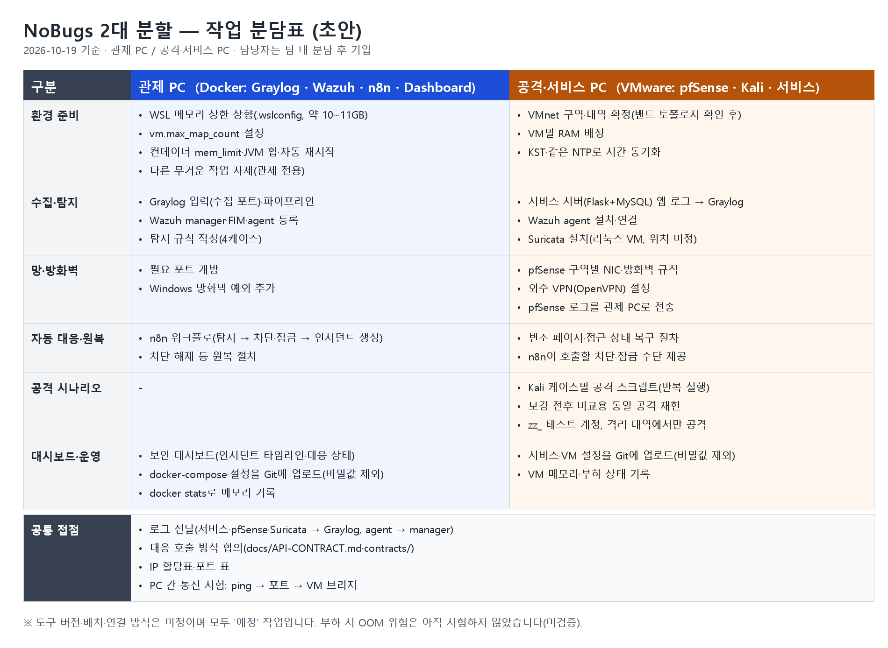

# 팀원 주제 의견 기록

[후보 8개와 투표 양식](10-topic-candidates.md)에 대한 초기 답변부터 실제 사고 기반 상세 제안까지, 사용자가 전달한 팀원 대화를 정리합니다. 원문은 받은 그대로 두고 요약·검토 의견을 분리합니다. 여기 있는 의견과 메모는 팀 합의가 아닙니다. 합의와 최종 결정은 [주제 결정 기록](07-topic-decision.md)에 적습니다.

## 현재 논의 요약 · 2026-10-16

**최신 사용자 방향:** ‘10종 이상 구상·4인 분담·공통 기반부터 단계적 구현·Claude 검토’로 진행한다. [12종 단계별 계획](29-twelve-ticket-phased-plan.md)을 준비했으며 아래 4종은 최소 기준/이전 추천이다. 사용자는 다른 팀 주제로 Kubernetes 전체 현황 대시보드 같은 주제(추정), 통신 1팀, 은행 1팀을 추가 전달했다. 상세 기능·실행 결과는 확인하지 않았으므로 주제만으로 우열·독창성을 단정하지 않는다.

**추가된 강사 조언:** 사용자는 ‘티켓을 4가지 이상으로 구상할 것. 이유는 팀원 4명이 각자 맡을 수 있게’라는 말씀을 전달했다. 이에 따라 ‘대표 하나’는 첫 통합 순서로 조정하고, 최종 구상은 4인 담당 티켓 최소 4종으로 준비한다. [4종 구성안](28-four-ticket-scope-plan.md)은 AI 제안이며 실제 유형·담당·필수 구현 범위는 팀 합의 전이다. 아래의 이전 ‘대표 하나’ 요약은 이 후속 조건과 함께 읽는다.

**논의의 초점은 ‘어떤 배경을 고를까’에서 ‘어떤 정상 서비스를 어떤 망에서 보호하고, 개선 효과를 무엇으로 증명할까’로 옮겨가고 있다.** 이는 대화에 대한 정리이며 팀 전체가 같은 방향에 동의했다고 확인된 것은 아니다.

### 누가 어떤 의견을 냈는가

| 구분 | 실제 전달된 의견 | 강조점 | 아직 확정되지 않은 것 |
| --- | --- | --- | --- |
| whiteclover0542 | 쇼핑몰 관리자 계정 보호를 중심으로 자료 조회·반출 탐지, 조치 후 상태 확인, 간단한 반복 재현을 기능으로 묶자. 10/16에는 팀 진행 방식(PROGRESS·개발 일지·모닝 미팅·평가지표)을 제안하고 공공기관 기획서 초안을 작성 | 차단 명령 실행에 그치지 않고 실제 차단·해제 후 업무 복귀까지 확인 | 현재 통신 배경에 대한 후속 동의, 담당 역할 |
| chacha1650a | 실제 SKT 또는 국제 침해 사고를 참고해 모의 공격·방어 프로젝트를 하자. 이후 MockTel·INC-01~06·도식·역할·로드맵 자료 공유 | 실제 사고의 교훈, HIDS/NIDS, 기본 탐지와 보강 후 비교, 가용성 | 원안 채택 여부, 실제 구축 상태, 이름별 담당 |
| shk12170-dev | 10/16 강사님 캡스톤 설명 필기 공유(3대 원칙, 팀당 4케이스, NIDS, 보안 대시보드, VMnet, 밴드 토폴로지) | 평가에서 보는 구현·실측 장면 | 13가지 티켓 목록, 토폴로지 그림, 일부 표현의 의미 |
| 사용자 | 제공하는 서비스가 무엇인지, 네트워크를 어떻게 구성할지 구체화하자. 보안 네트워크 구조 설계가 중요 | 정상 업무·보호 자산, 통신 경계, 탐지와 차단이 가능한 실제 경로 | 팀 차원의 서비스·망·대표 사고 최종 합의 |
| Codex·Claude 검토 | 대표 사고 하나의 기본/보강 탐지 비교부터 티켓·승인·대응·복구까지 먼저 완주하는 안 추천 | 원안의 탐지 비교를 살리면서 범위·자원·증거를 관리 | AI 추천이며 팀원에게 발송·동의 확인된 내용이 아님 |

### 대화가 진행된 순서

1. **초기 기능 제안:** whiteclover0542가 계정 보호 서비스에 자료 접근 탐지와 실제 조치·복귀 확인을 묶는 안을 전달했다.
2. **사용자 준비 방향:** 사용자는 통신사 외주 유지보수 포털을 배경으로 작은 정상 업무·방어 흐름을 준비하도록 지시했다. 팀 전체의 채택 여부와는 구분한다.
3. **실제 사고 제안:** chacha1650a가 실제 침해 사고를 참고하는 주제를 제안했다.
4. **사용자 질문:** ‘무슨 서비스를 제공하는가’, ‘보안 네트워크를 어떻게 구성하는가’를 팀원에게 물었다고 설명했다.
5. **상세 자료 도착:** chacha1650a가 MockTel·6개 사고 실습·네트워크/탐지 흐름·역할·일정 자료를 공유했다. 자료를 전달한 사실과 구축·시험 결과는 구분한다.
6. **후속 검토:** 사용자가 범위 축소 설명과 Claude 검토를 요청했다. AI 검토는 서비스 혼용을 고치고 탐지 비교를 유지하도록 권고했다. 망 허용표 초안도 작성했지만, 이 추천을 팀원들이 수용했다는 회신은 아직 전달받지 않았다.

### 두 팀원 제안에서 연결할 수 있는 부분

whiteclover0542의 **‘조치가 실제로 효과가 있었는지와 정상 복귀 확인’**, chacha1650a의 **‘실제 사고에서 얻은 교훈과 기본/보강 탐지 비교’**, 사용자의 **‘보안 네트워크 구조와 실제 통신 검증’**은 함께 설계할 수 있다.

이 세 관점을 연결하는 검토용 흐름은 다음과 같다.

**정상 서비스·허용 통신 확인 → 교육용 사고 입력 → 기본/보강 탐지 비교 → 근거 분석·티켓 → 승인 후 대응 → 실제 차단 효과 → 복구·정상 사용자 업무 확인**

이 흐름 자체가 합의된 것은 아니다. 자동화·도구·구역 수는 목표와 평가·자원에 따라 정하며, 처음부터 모든 시나리오를 합치는 뜻도 아니다.

### 다음 팀 대화에서 정할 것

| 순서 | 합의할 질문 | 기록할 결과 |
| --- | --- | --- |
| 1 | 어떤 정상 서비스와 데이터를 보호할까? | 기존 외주 포털의 업체 작업·결과 또는 MockTel의 합성 고객정보 중 하나, 정상 사용자·업무 |
| 2 | 대표 사고 하나를 무엇으로 할까? | 계정 악용·권한 밖 조회 또는 무해한 호스트 행위 탐지 등에서 선택, 나머지는 확장/보류 |
| 3 | 사고를 관측·통제하는 최소 망은 무엇일까? | 구역·출발/목적·허용 포트·차단점·수집점, 실제 평가 필수 조건 |
| 4 | 무엇을 보여주면 성공인가? | 보강 전후 결과·미탐/오탐/미관측·실제 대응 효과·정상 사용자 영향·복구 증거 |
| 5 | 누가 어디서 언제까지 맡을까? | 장비/RAM·배치·담당자·기간·첫 통합 확인 시점 |

Kubernetes, 자동 대응, 다중 웹서버, 추가 사고는 위 결정에 필요한지 보고 판단한다. 사용 예정 도구와 필수 평가 도구도 구분한다. 상세 근거는 [범위 합의 준비](27-core-scope-agreement-review.md), 경로·시험 후보는 [망 허용표](26-network-allow-table-s1-s10.md)를 참조한다.

### 팀에 공유할 요약 초안

> 지금까지 나온 의견을 정리하면, 계정 이상을 탐지하고 실제 차단·복귀까지 확인하자는 의견, 실제 통신사 사고를 참고해 기본 탐지와 보강 후 결과를 비교하자는 의견이 있었습니다. 저는 이 흐름을 받쳐 주는 보안 네트워크 구조와 허용·차단 경로를 명확히 설계하는 게 중요하다고 생각합니다. 다음에는 정상 서비스와 보호할 데이터, 대표 사고 하나를 먼저 정하고, 필요한 망 구성과 성공 기준을 같이 맞추면 좋겠습니다. 그 기준으로 장비·기간·역할을 정한 뒤 나머지 시나리오를 확장하는 순서를 논의해 보면 어떨까요?

사용자 명의로 보낼 수 있도록 작성한 초안이며 실제 전송하지 않았다. 추가로 받은 팀 대화가 있으면 원문·날짜·발언자를 아래에 이어 기록한다.

## 초기 후보 투표 요약 · 과거 기록

| 팀원 | 받은 날 | 1순위 | 2순위 | 맡고 싶은 작업 |
| --- | --- | --- | --- | --- |
| whiteclover0542 | 2026-10-15 | A (B·G는 MVP 기능, H는 여유가 있으면 추가) | E | 미기재 |

2026-10-15 후보 투표 당시 아직 받지 못한 의견: 3명. 2026-10-16 chacha1650a의 실제 사고 기반 신규 제안은 아래 별도 항목에 기록하며 기존 후보의 순위 투표로 환산하지 않습니다.

## whiteclover0542 · 2026-10-15

### 원문

> 명준님 보내주신 프로젝트 후보 읽어보고 클로드랑 대화를 조금 해봤는데 A 쇼핑몰 관리를 메인으로 잡고 B, G, H같은 주제들을 기능으로 넣는건 어떨까 싶은데 한번 읽어봐주실 수 있으실까용
> B, G 같은 기능을 MVP로 넣고 H를 여유되면 넣는 정도로 생각해봤어요
>
> [캡스톤 주제 제안 정리]
>
> ■ 제안
> A(쇼핑몰 관리자 계정 보호)를 주제로 정하고, B·G·H는 별도 주제가 아니라 A 안의 기능으로 넣는 방향
>
> ■ 이유
> 우리가 정한 시연 흐름(반복 로그인 실패 → 로그인 성공 → 권한 변경 → 제한 자료 조회 → 사건 생성 → 계정 차단 → 해제 확인)이 A와 그대로 맞음
> 연습용 쇼핑몰을 직접 만들면 로그 생성, 차단, 해제를 모두 우리가 제어할 수 있음
> E(클라우드)는 실무 느낌이 강하지만 비용과 설정 부담이 있어 2순위로 둠
>
> ■ A에 넣을 기능
> B(자료 조회·반출): 고객 자료를 대량으로 조회하거나 내보내면 탐지하는 규칙 1~2개 (필수)
> G(조치 후 상태 확인): 차단 후 실제로 로그인이 막혔는지, 해제 후 정상으로 돌아왔는지 자동으로 확인하고 기록. 조치가 실패하면 재시도 (필수, 차별화 포인트)
> H(시나리오 재생): 녹화한 로그를 다시 실행해 시연을 언제든 똑같이 보여줌 (간단하게만 구현)
> → G는 깊게, H는 얕게
>
> ■ 전체 흐름
> 쇼핑몰(공격 대상) → 탐지(B 규칙 포함) → 사건 타임라인 → 차단 → 상태 확인(G) → 해제 → 같은 흐름 반복 재생(H)
>
> ■ 2주 안에 끝내기 위한 조건
> SOAR 엔진을 직접 만들지 않음. Python 서버로 단순하게 만들거나, Shuffle 같은 도구를 쓰더라도 연동은 3일 안에 끝냄
> 쇼핑몰은 로그인, 권한 변경, 고객 목록 조회 API 3~4개와 로그 출력만 만듦
> 탐지는 규칙 4~5개로만 함 (머신러닝 제외)
>
> ■ 일정 예시
> 1~3일: 쇼핑몰 API와 로그 형식 확정, 공격·정상 시나리오 스크립트 작성
> 4~6일: 탐지 규칙, 사건 생성, 로그를 하나의 타임라인으로 연결
> 7~9일: 차단·해제 조치와 상태 확인(재로그인 테스트, 재시도)
> 10~11일: 대시보드(타임라인, 판단 근거, 조치 결과), 시나리오 재생
> 12~14일: 통합 테스트, 시연 다듬기, 발표 준비
>
> ■ 위험 요소
> 로그를 하나의 흐름으로 연결하는 작업이 생각보다 오래 걸림 → 첫날 공통 필드(계정 ID, IP, 시간)를 정해 둠
> 대시보드 꾸미기에 시간을 많이 쓰기 쉬움 → 표 하나와 타임라인 하나로 시작
> 범위가 계속 늘어날 수 있음 → 오탐률 같은 지표, 사람 승인 단계, MITRE ATT&CK 매핑, 세션 탈취 탐지는 10일차까지 기본 흐름이 다 돌아갈 때만 추가
>
> ■ 최소 성공 기준
> 공격 시나리오 1개와 정상 시나리오 1개를 같은 화면에서 비교할 수 있음
> "차단 → 실제로 막혔는지 확인 → 해제 → 정상으로 돌아왔는지 확인"이 끊기지 않고 시연됨

### 검토 메모 · 명준·Claude · 2026-10-15

합의 전 검토 의견입니다.

**맞는 점**

- 현재 계약의 이벤트 4종(로그인 실패·성공, 권한 변경, 자료 조회)이 A의 시연 흐름과 맞아 후보 중 계약 수정이 가장 적습니다.
- G는 깊게·H는 얕게, 머신러닝 제외, 대시보드 최소화, 10일차 전 확장 금지 기준이 2주 일정에 맞습니다.
- 차단 후 재로그인으로 실제 차단을 확인하고 해제 후 정상 복귀를 확인하는 G가 시연의 차별점입니다.

**조정 제안**

1. 첫 통합 시점: 단계별로 쌓으면 전체 흐름이 9일차 이후에 처음 이어집니다. 3~4일차에 규칙 1개 → 사건 → 차단 → 재로그인 확인을 먼저 연결합니다. 앱·탐지·화면은 병렬로 진행하고, 화면은 `contracts/examples`로 2일차부터 시작할 수 있습니다.
2. H 방식: 녹화한 로그를 그대로 다시 넣으면 `event_id` 중복 확인에 걸립니다. 시나리오 스크립트를 다시 실행하고, 실행마다 ID를 새로 붙이고 시작 상태를 초기화합니다.
3. 계약 추가: B에는 내보내기 이벤트 종류와 조회 건수 칸이 필요합니다. G에는 조치 실행과 실제 차단 확인을 구분하는 칸과 재시도 횟수가 필요합니다.
4. 대응 범위: 계정 차단만 할지, 바뀐 권한도 되돌릴지 정합니다. 해제 후 정상 복귀를 확인하는 기준이 이에 따라 달라집니다.
5. SOAR 도구: 평가 필수 여부를 확인하기 전에는 Flask 뼈대 안의 Python 대응을 우선합니다. 필수라면 연동 기간을 3일로 제한합니다.

공통 필드(계정 ID·IP·시간)는 계약에 이미 있습니다(`username`, `src_ip`, `timestamp`, `event_id`).

## chacha1650a · 2026-10-16 · 실제 사고 기반 신규 제안

### 원문 · 사용자가 전달한 내용

> 프로젝트 생각 해봤는데
>
> 다들 취업 쪽으로 생각 있으시면
>
> SK가 침해 당했던 실제 보안 사고나
>
> 국제적으로 큰 사건이었던 것들을
>
> 모의로 재현해서 거기 안에서 있었던 공격이나
>
> 정보 방어로 프로젝트를 해보는건 어떨까요
>
> 어제 저도 그냥 비슷한
>
> 사이트 방어나
>
> 그런거 좀 알아봤는데
>
> 아까 말한거처럼
>
> 실제 침해 사고나
>
> 그런거 관련된거 하면 어떨까요?

### 사용자 회신과 검토 메모

사용자는 네트워크 구조를 어떻게 구성할지 물으며 다음 두 항목을 전달했다고 설명했습니다.

> 1. 너가 구상하고 있는 주제를 가지고 어떤 서비스 를 제공하는건지
> 2. 이번 팀프로젝트는 보안 네트워크 구조 설계가 중요하다고 생각해

Codex는 실제 사건의 확인 사실·랩 가정·정상 서비스·보호 자산·허용 통신·탐지/복구 증거를 연결하는 방향으로 검토했습니다. [실제 사고 기반 제안](24-real-incident-network-mvp-proposal.md)은 SKT 사건을 참고하는 통신 포털과 Compose 우선·Kubernetes 조건부 확장안입니다. 팀원의 원문에 특정 사건·서비스·Kubernetes 채택이나 팀 합의가 담겨 있었다고 해석하지 않습니다.

## chacha1650a · 2026-10-16 · 상세 제시안 전달

### 원문 · 사용자가 전달한 내용

> 제가 생각해본 실제 SKT 침해 사건을 바탕으로 그걸 재현하여 보안 취약점을 강화하는 프로젝트 제시안 공유 해드립니다. pdf 안에 팀원 별 역할 분담 저장 해두었고 png에 실제 네트워크 구조랑 workflow 기록 해뒀습니다, 이걸 제외하고도 생각해보신 아이디어나 해당 아이디어 외의 이견이 있다면 말씀 부탁드립니다.

### 검토 상태

[원본 PDF](<../통신사 보안 강화 프로젝트 제시안 모음/통신사-침해사고-보안강화-프로젝트.pdf>)와 도식·하네스를 공유 자료로 보존했다. 팀원이 말한 ‘실제 네트워크 구조’는 제안 도식으로 확인했으며 실제 배치·시험 완료로 확인한 것은 아니다. 역할 초안은 있으나 이름별 배정은 미정이다. [Codex 검토](25-chacha-proposal-review.md)·[Claude 회신](../work-log/2026-10-16-claude-core-scope-review.md)과 [최신 범위 합의 준비](27-core-scope-agreement-review.md)를 구분해 읽는다. 팀원 의견을 최종 서비스·도구·시나리오의 팀 합의로 표시하지 않는다.

## whiteclover0542 · 2026-10-16 · 팀 진행 방식 제안

### 원문 · 사용자가 전달한 대화

제안 자료: [팀프로젝트_제안사항.md](../team_docs/팀프로젝트_제안사항.md) (PROGRESS 파일, 개인 개발 일지, 모닝 미팅, 평가지표 / 아키텍처 문서, 협업 규칙). 작성자는 whiteclover0542다(사용자 확인). 아래 대화의 팀원 발언도 자기 프로젝트를 예시로 들었다는 내용이라 같은 팀원의 발언으로 기록한다.

> **whiteclover0542:** 안그래도 제가 많이는 아니지만 개발 프로젝트 조금 해볼때 아 이런건 팀플 할때 필수로 해야겠다 싶었던 것들이 몇개 있어서 나중에 말씀드려도 될까요? 제가 했던 프로젝트를 예시로 잡았어요 부분부분 캡처하는것보다 직접 확인하시는게 좋을것 같아서용
>
> **사용자:** 평가지표 작성은 개발하고 난 다음에 해보는거야? 아님 개발중에 지속적으로 추가하는 거야?
>
> **whiteclover0542:** 개발을 하고 발표 3~4일 전쯤에 개발 마무리를 하고 발표 준비를 했거든요 저는 그때 이제 ppt 만들고 대본 짜면서 한쪽에서는 평가 지표 작성했어요 발표 준비랑 비슷하게 시작한 느낌?? 테스트하는게 좀 귀찮긴 해도 증명할 수 있는 결과물 만드는게 중요하다고 생각해요

### 검토 메모와 반영

- 사용자는 PROGRESS 파일과 개인 개발 일지를 도입하기로 하고, 이름은 GitHub 닉네임(myeongjundev, whiteclover0542, chacha1650a, shk12170-dev)으로 정했다. [진행 현황](PROGRESS.md)과 [개발 일지](devlog/members/)를 만들었다.
- 평가지표: "증명할 수 있는 결과물이 중요하다"는 의견에 동의한다. 다만 공지의 기획서 ⑤ 실측 검증 계획(10/23)과 리허설(11/5) 일정 때문에, 측정 방법은 기획서 때 정하고, 케이스를 끝낼 때마다 시험 결과를 쌓고, 리허설 전에 종합하는 안을 제안했다. 팀 합의 전이다.

## whiteclover0542 · 2026-10-16 · 기획서 초안

### 원문

[기획서 초안](../team_docs/기획서.md)을 받은 그대로 보존한다(사용자 전달). 공지의 기획서 6개 항목(개요, 시나리오, 시스템 구성, 구현 계획, 실측 검증 계획, 진행 계획)을 모두 갖춘 초안이며, `(팀 확정 필요)` 항목은 회의에서 채운다고 적혀 있다.

주요 내용은 다음과 같다.
- 프로젝트명: 공공기관 민원 서비스·원격 유지보수 접속 보안 관제 및 자동 대응 시스템
- 가상 OO시청: 민원 포털(DMZ), 내부 업무 시스템(업무망), 외주 유지보수 OpenVPN(작업 승인 시간에만 허용), 보안관제(관리망)
- 케이스: S1~S10, 팀 확장 S9-B(개인정보 대량 조회), 팀 추가 S11(무승인 VPN)·S12(요청 폭주)
- 대응 봇: 108·111·112·113·114와 신규 115(VPN 세션 회수)·116(서비스 회복 확인)
- 검증: 정상 / 임계 바로 아래 / 임계 충족 3회, 조치 후 차단 확인, 원복, 정량 지표(탐지율·오탐·MTTD·MTTR·보강 전후)

### 검토 메모 · 명준·Claude · 2026-10-16

합의 전 검토 의견이다. 초안을 기획서의 뼈대로 쓰고 아래를 보완하는 것을 제안한다.

**잘된 점**
- 공지 순서 그대로의 구성, 대응 봇마다 짝지은 확인 방법(423·403·세션 끊김·응답시간 복귀)과 원복 절차
- n8n 자기 차단, KST/UTC 차이, VPN 세션 강제 종료 방법 같은 위험을 1주차 검증으로 둔 점
- 처음 의견(자료 대량 조회 탐지)을 S9-B로 공공기관 맥락에 맞춘 점

**보완 제안 (중요한 순서)**
1. **범위와 역할:** 13개 케이스 전체를 계획하고 역할을 기술 영역 8개로 나눴다. 강사님의 "팀당 4개, 각자 1개"와 공지의 "개수보다 완성도"에 맞춰 필수 4종(1인 1종)과 확장으로 나누고, 역할을 "필수 케이스 + 공통 기반 하나"로 바꾼다. 3대 원칙 조정안을 쓰면 A S1·S4, B S8·S10(NIDS), C S7(무결성), D S12(가용성)이다.
2. **보안 3대 원칙:** 케이스 표에 3대 원칙 열을 추가한다. 기밀성 S1~S4·S9·S11, 무결성 S7, 가용성 S12.
3. **게시판 보안 대시보드:** 강사님이 확인한다고 한 항목이 없다. Flask 앱 안의 보안 대시보드(탐지 이벤트, 티켓, 대응·원복 상태)를 핵심 기능과 구성에 넣는다.
4. **보강 전후 비교:** 지표 표 한 줄뿐이다. 케이스마다 보강 전(기본 설정)과 보강 후에 같은 공격을 돌리는 절차를 실측 검증 계획에 명시한다.
5. **망 구성:** 밴드 토폴로지와 대조, VMnet1~8의 구역 배정, VM 대수·RAM 배치표(16GB 제약), Cloudflare(엣지)의 포함 여부, 본청↔지사 VPN을 설계도에 넣을지 정한다.
6. **S1·S4 대응과 복구:** 둘 다 111(잠금)이다. S1의 잠금은 공격자가 피해자 계정을 일부러 잠그는 데 악용될 수 있어 출발지 제한이나 알림으로 바꾸고, S4의 원복은 비밀번호 재설정 후 해제와 기존 세션 회수로 바꾼다.
7. **S12 조건 구현:** 출발지별 요청 수(묶기 src_ip)와 응답시간 초과는 묶기 키가 다른 두 신호라, Graylog 무료판의 이벤트 정의 하나로 함께 판정하기 어려울 수 있다(미확인 위험). 이벤트 두 개로 나누고 n8n에서 결합하는 대안을 함께 적는다.
8. **시연 범위:** 통합 스토리라인(9개 케이스)을 한 번에 라이브로 보여주기는 위험하다. 각자 필수 케이스를 짧게 라이브로 보여주고, 전체 흐름은 녹화와 증적으로 대체하는 안을 검토한다.

**Codex 검토에서 추가된 의견** ([PR #5 코멘트](https://github.com/NoBugs-Aleph/aleph-soar-capstone/pull/5), 합의 전)

위 메모와 같은 방향의 의견(필수 4종은 첫 완주 목표이며 전체 범위의 상한이 아님, 역할 분담, 자동 대응과 실제 효과의 분리)은 생략하고, 위 메모에 없던 세 가지만 옮긴다.

9. **권한 변경 없는 타인 자료 조회:** 권한을 바꾸지 않고 다른 사용자의 자료를 조회하는 경우는 권한 상승 후 조회(S9)나 정상 권한자의 대량 조회(S9-B)와 다르다. 별도 후보로 검토한다.
10. **번호와 대응 봇 정의:** 이번 S11(무승인 VPN)은 [12종 계획](29-twelve-ticket-phased-plan.md)의 PLAN-11(허용 밖 송신)과 다른 후보다. 수업에 S11이 이미 있는지 확인하고, 신규 봇 115(VPN 세션 회수)·116(서비스 회복 확인)의 정의와 등록 방법도 정한다.
11. **이벤트 계약 확장:** 현재 [이벤트 계약](../contracts/event.schema.json)은 인증·권한·조회 4종에 `username`·`src_ip`가 필수다. FIM·경계·VPN·가용성 입력은 아직 받을 수 없으므로, 계약 확장과 예시·소비자·검증을 첫 구현 단계의 명시적 작업으로 둔다.

## shk12170-dev · 2026-10-16 · 강사님 캡스톤 설명 필기

### 원문 · 사용자가 전달한 필기

> 파이널 프로젝트 캡스톤 설명
> 3대 원칙 기밀성 무결성 가용성 반영
> 클라우드 플레어, pfsense
> 앱을 이용했을 때 graylog 사용 -> 플라스크 서버에 뜨나
> 하프오프스캔
> 티시피 악수 3번 스리앱
> 스노트 수리카타 네트워크 기반 침입 탐지 시스템
> 본사랑 통신을 어떻게 할건지
> wazuh snote siem 7계층에서 애플리케이션을 따서 작업하ㄹ거야
> 케이스 - 그레이로그 13가지 티켓 확인함ㅕㄴ 됨 기본으로 하고 보안 3대 원칙으로 다른 취약점 진해도됨
> 팀 당 4개씩 했으면 좋겠다. 그래야 각자 1개씩 작업 할 수 있음
> 구현테스트 실측 미니실습 전 후 공격 했을 때 결과 티켓 생성 했냐. 게시판 보안대시보드 만들어서 나오는지
> 와주르 그레이로그 뜨는지
> 엣지 두드림 피에프센스
> 내부네트워크 사용할거야. vmnet1~ 8
> 방어 신호 자동 대응 잘하고 있음
> 밴드 첨부한 토폴로지 망구조가 캡스톤 프로젝트에 반영이 되는 그림이다
> vpn

### 정리 메모 · Claude 해석 포함

| 필기 | 해석 | 계획에 주는 영향 |
| --- | --- | --- |
| 보안 3대 원칙 반영 | 케이스가 기밀성·무결성·가용성을 모두 다뤄야 함(해석) | 기존 필수 4종 제안(S1·S4, S11, S9, S12)에는 무결성 케이스가 없음 |
| 팀당 4개, 각자 1개 | 1인 1케이스 필수 | 1인 1종 필수 4종 방향과 일치 |
| 그레이로그 13가지 티켓이 기본, 다른 취약점도 가능 | Graylog에 준비된 13가지가 기본(해석) | 13가지 목록 확인 필요. 가이드는 S1~S10, 공지는 "S1~S11 미니실습" |
| 미니실습 전·후 공격 결과, 티켓 생성 | 보강 전후 같은 공격을 비교하고 티켓 생성 확인 | chacha1650a의 보강 전후 비교 방향과 같음 |
| 게시판 보안 대시보드 | 앱 안에 탐지·티켓을 보여 주는 화면(해석) | 보안 대시보드 화면 필요 |
| Wazuh·Graylog가 뜨는지 | 두 도구 화면의 탐지 확인 | 공지의 시연 항목과 같음 |
| 하프오픈 스캔, 3-way handshake, Snort·Suricata | 네트워크 기반 침입 탐지(NIDS)로 스캔 탐지 | NIDS 케이스 필요(S8·S10 계열) |
| 엣지 두드림 → pfSense, Cloudflare | 엣지 접근 시도를 경계에서 관측·차단 | 망 설계에 반영 |
| 7계층 애플리케이션 | 앱 계층 로그와 탐지 | 게시판 앱 로그 → Graylog |
| 내부 네트워크, VMnet1~8 | VMware 내부 가상망으로 구역 분리 | 구역별 VMnet + pfSense 구성 |
| 본사와 통신, VPN | 본사↔지사(외주) VPN 설계 | VPN을 망 설계 요소로 반영 |
| 밴드 첨부 토폴로지 | 강사님 기준 망 구성도 | 그림을 받아 망 설계 기준으로 사용. **이후(10/19, 사용자 확인): 참고용이며 그대로 만들지 않는다** |
| 방어 신호 자동 대응 잘하고 있음 | 의미 불명확 | 필기한 팀원에게 확인 |

**3대 원칙 조정안(Claude 제안, 팀 합의 전):** A S1·S4 계정 탈취(기밀성, Graylog), B S8·S10 스캔→침입 연쇄(기밀성, NIDS·pfSense), C S7 홈페이지 변조(무결성, Wazuh FIM), D S12 서비스 장애(가용성). S9 개인정보 조회와 S11 VPN은 확장으로 두고, VPN은 망 설계에 넣는다.

## 팀 회신 · 2026-10-19 · 공공기관 동의

사용자가 "팀원들은 공공기관에 동의해"라고 전달했다. 팀원별 회신 원문과 담당 희망·PC 사양은 아직 받지 않았다. 이 합의는 [주제 결정 기록](07-topic-decision.md#2026-10-19-팀-합의--공공기관-도메인)에 반영했고, 필수 케이스·역할은 10/20 회의에서 정한다.

## chacha1650a · 2026-10-19 · 2대 분할 작업 분담표

### 원문

사용자가 전달한 이미지를 [원본 그대로](../team_docs/2026-10-19-2대분할-작업분담표-chacha1650a.png) 보존한다. 10/19 회의의 "관제 PC와 서비스 PC 분리"를 작업 단위로 나눈 표다.

| 구분 | 관제 PC (Docker: Graylog·Wazuh·n8n·Dashboard) | 공격·서비스 PC (VMware: pfSense·Kali·서비스) |
| --- | --- | --- |
| 환경 준비 | WSL 메모리 상한(.wslconfig, 약 10~11GB), vm.max_map_count, 컨테이너 mem_limit·JVM 힙·자동 재시작, 관제 전용 | VMnet 구역·대역 확정(밴드 토폴로지 확인 후), VM별 RAM 배정, KST·같은 NTP |
| 수집·탐지 | Graylog 입력·파이프라인, Wazuh manager·FIM·agent 등록, 탐지 규칙(4케이스) | 서비스 서버(Flask+MySQL) 앱 로그 → Graylog, Wazuh agent, Suricata(리눅스 VM, 위치 미정) |
| 망·방화벽 | 필요 포트 개방, Windows 방화벽 예외 | pfSense 구역별 NIC·방화벽 규칙, 외주 VPN(OpenVPN), pfSense 로그를 관제 PC로 전송 |
| 자동 대응·원복 | n8n 워크플로(탐지 → 차단·잠금 → 인시던트), 차단 해제 등 원복 절차 | 변조 페이지·접근 상태 복구 절차, n8n이 호출할 차단·잠금 수단 |
| 공격 시나리오 | — | Kali 케이스별 공격 스크립트, 보강 전후 동일 공격, zz_ 테스트 계정·격리 대역 |
| 대시보드·운영 | 보안 대시보드, docker-compose 설정 Git 업로드(비밀값 제외), docker stats 메모리 기록 | 서비스·VM 설정 Git 업로드(비밀값 제외), VM 메모리·부하 기록 |
| 공통 접점 | 로그 전달, 대응 호출 방식 합의(docs/API-CONTRACT.md·contracts/), IP 할당표·포트 표, PC 간 통신 시험(ping → 포트 → VM 브리지) | |

표 아래 메모: 도구 버전·배치·연결 방식은 미정이며 모두 예정 작업이다. 부하 시 OOM 위험은 아직 시험하지 않았다.

### 반영과 검토 메모 · 명준·Claude

- [기획서 합의본](../team_docs/기획서_합의본.md) ③에 반영했다: 관제 PC를 Docker(WSL2)로, 관리망을 두 PC 사이 전용 연결과 관제 PC 호스트 주소로 정의하고 Windows 방화벽은 관리망 출발지만 허용, PC별 배치표.
- ⑥에 반영했다: 자리 A~D에 실행 PC를 붙인 역할표(제안: A·B 공격·서비스 PC, C·D 관제 PC), 사전 시험 순서(PC 간 통신 → Docker 메모리 → n8n IP 차단), 위험 표(OOM, Docker 포트·Windows 방화벽).
- 결정이 필요한 두 가지는 `(팀 확인)`으로 남겼다.
  - **보안 대시보드 위치:** 분담표는 관제 PC Docker, 강사님 필기는 "게시판 보안 대시보드"다. 관제 PC에서 돌리더라도 게시판 관리자 메뉴에서 열리게 하는 안을 제안한다.
  - **Suricata 위치:** pfSense 패키지(추천, VM 추가 없음)와 리눅스 VM(VMware 미러링 설정 필요) 중 선택.

## whiteclover0542 · 2026-10-19 · 기획서 합의본 리뷰

### 원문 요약

원문은 [PR #10 코멘트](https://github.com/NoBugs-Aleph/aleph-soar-capstone/pull/10#issuecomment-6258346597)에 있다.

- **동의:** 3대 원칙, 보강 전후 비교, 관제·서비스 PC 분리, S1 출발지 차단·S4 세션 회수, S9-B 확장, 보안 대시보드는 관제 PC에서 돌리고 게시판 관리자 메뉴에서 여는 안.
- **요청:** ①에 필수 시연에 개인정보 조회가 없는 이유와 VPN 위치 한 줄, 확장 표 S11에 초안 ④ 링크, 공통 기반에 n8n의 포털·pfSense 호출 방식 합의.
- **질문:** 필수 "4종"의 단위(케이스 ID로는 6개), 연쇄에서 앞 단계 차단 뒤 뒤 단계 재현, 통합 스토리라인 유지 여부.
- **제안:** MVP(~10/28) → 필수(~11/01) → 검증·확장(~11/03) 기준선.

### 반영 · 명준·Claude

- 요청 네 가지는 [기획서 합의본](../team_docs/기획서_합의본.md) ①·②·④·⑥에 그대로 반영했다.
- 사용자가 정한 것:
  - **필수 범위:** 케이스 ID 6개를 유지하고, 10/28 MVP 시점에 밀렸으면 S1·S8을 확장으로 내린다(②, ⑥ 위험 표).
  - **연쇄 검증:** 케이스 판정은 단계별로 따로 하고, 연쇄 전체는 앞 단계 자동 차단을 끈 시험으로 1회 확인한다(②, ⑤ 5.10에 S8·S10 사전 시험 추가).
  - **통합 스토리라인:** 하지 않는다. 라이브·녹화 모두 넣지 않고, 티켓 묶기는 같은 src_ip·username만 쓴다(②·④·⑥).
  - **MVP 기준선:** ⑥에 단계별 완료 기준 표를 넣고 ⑤ 5.8의 첫 케이스를 MVP로 불렀다. MVP 케이스는 `(팀 확인)`.
- 보안 대시보드 위치는 whiteclover0542가 동의했지만 다른 팀원 확인 전이라 `(팀 확인)`으로 두고, ③ 그림도 그대로 둔다.
- **이후 결정(10/19):** 사용자가 보안 대시보드를 관제 PC 안으로 정했다. 대시보드와 티켓 저장소를 관제 PC Docker에서 돌리고 포털 관리자 메뉴에는 링크만 둔다. 포털 안에 두면 S12 장애 때 대시보드와 티켓 기록도 함께 멈추기 때문이다. 기획서 ①·②·③·④를 맞추고 ③ 그림의 중복 대시보드를 정리했다.

## Codex · 2026-10-19 · 기획서 합의본 교차 검토

### 원문 요약

사용자가 Claude가 쓴 요청문으로 Codex에 읽기 전용 교차 검토를 맡겼다(기준 b7075c5). 원문은 사용자의 Codex 세션과 Codex가 만든 PDF(`NoBugs_기획서_교차검토_b7075c5.pdf`, 저장소 밖)에 있다. 공식 문서와 대조했고 랩 시험은 하지 않았다.

- **높음:** 관제 PC 방화벽의 관리망 출발지 제한이 DMZ·업무망 로그와 충돌, S1 집계에 차단할 src_ip가 남지 않음, S10 card(rule)>2가 pfSense 신호 없이 충족 가능, S7 FIM 경로와 웹 URL 경로가 다른 키이고 FIM 실시간 설정 없음, S12 두 Webhook 결합 방법 없음.
- **중간:** pfSense 기존 연결 처리, filterlog 출발지 필드, S4 완료·원복 기준 불일치, 티켓 묶기와 대응 반복, 케이스별 시연 장면, S7 새 파일·바뀐 파일 복구, 사건 계약 확장, MTTD 시각 필드, 사전 시험 일정 역전.
- **낮음:** 제출본에 남은 내부 표시와 오래된 문장.

### 반영 · 명준·Claude

Claude가 15개를 합의본과 대조해 12개는 맞고 3개는 일부만 맞다고 판단했고, 사용자가 추천안대로 모두 반영하기로 했다.

- **설계 변경(사용자 결정):** S1 묶기 키를 username + src_ip로, S12는 출발지별 요청 이벤트 하나로 시작하고 n8n이 헬스체크로 응답시간을 직접 잼, 티켓은 같은 자리의 케이스 묶음 안에서만 합치고 이미 실행한 대응은 다시 실행하지 않음.
- **확정:** S4 세션 회수를 완료 조건으로(A 담당 whiteclover0542가 리뷰에서 동의). S4 원복 때 회수한 세션은 되살리지 않음.
- **수정:** 관제 PC 방화벽은 랩 대역 출발지 허용과 정적 경로, S10 검색 rule 3개 고정, S7 파일 키와 realtime FIM, 112의 pfSense state 삭제, filterlog 본문 출발지, S7 바뀐 파일 복구·새 파일 격리, 이벤트·사건 계약 확장, MTTD는 `timestamp_processing`, 응답 없음은 기준선 초과, 5.1·5.7 케이스별 장면, 5.10 사전 시험을 10/24~10/28로 옮기고 S1·S7·S12 줄 갱신.
- **보류·제외:** pfSense anti-lockout(인터페이스 배정 뒤 확인), 관제 PC 메모리 부족 대안(실측 뒤), 임계값·기준선(실측 뒤 확정), S4·S8 순서 조건(5.9에 이미 있음). 나머지 내부 표시는 제출본을 만들 때 정리한다.

## chacha1650a · 2026-10-19 · 기획서 합의본 리뷰

### 원문 요약

원문은 [PR #10 코멘트](https://github.com/NoBugs-Aleph/aleph-soar-capstone/pull/10#issuecomment-6259187585)에 있다.

1. 앞쪽에 그림 + 필수 케이스 표 + 3대 원칙 연결을 담은 한 장 요약. ⑤가 길고 밀도가 높다.
2. MTTD·MTTR, FIM, SOAR, 봇 번호(111~117)의 용어·번호표.
3. `(팀 확인)`·`(공식 자료 확인 후 기입)`·"합의 전 제안이다" 9곳을 10/23 전에 정리. ①의 공공 서비스 사례 담당자 지정.
4. ⑥ 일정은 10/28 판단 장치가 있어 현실적. N=5 반복 측정과 S1 30분 창 같은 대기 시간을 일정표에 표시.
5. 관리망 전용 연결을 위한 PC별 랜 포트 수(필요하면 USB 이더넷) 확인, 관제 PC WSL2/Docker 시계를 동기화 오차 측정에 포함.

### 반영 · 명준·Claude

- **1·2:** 기획서 앞에 "한눈에 보기"(흐름 그림, 자리별 케이스·3대 원칙·대응 표, ⑤ 읽는 순서)와 "용어와 번호" 표를 넣었다. ⑤ 본문은 줄이지 않았다.
- **3:** 남은 확인 표시를 "제출 전 정할 것" 표에 위치·정할 사람·기본안과 함께 모았다. 관제 PC 선정 표시는 PC 사양 확인으로 없앴고, 관리망 연결 수단은 새로 넣었다. 공공 서비스 사례는 이후 사용자가 맡기로 해, 정부·수사기관 발표를 보도한 기사로 3건(온나라시스템 해킹, 법원 전산망 해킹, 지방행정전산서비스 장애)을 ①에 넣었다. 같은 날 Suricata 위치도 pfSense 패키지로 정했다.
- **4:** ⑥ 일정 아래에 측정 대기 시간(전체 조건 충족 60회, 미발동 입력의 집계 창 대기, S1 보강 전후 10회 약 5시간)을 적고 S1 반복 측정을 11/02 첫 작업으로 두었다. 자리별 측정을 겹쳐 돌릴 때는 출발지 IP를 나눈다.
- **5:** 명준 PC에서 확인한 결과 유선 랜 포트는 1개(Realtek 1GbE)이고 강의실 망에 쓰고 있다. PC마다 USB 이더넷 어댑터를 하나씩 쓰는 안을 기본으로, 안 되면 시험 시간에만 강의실 랜을 빼고 직결하는 안을 ③·⑥에 넣었다. 시계 동기화 대상에 관제 PC WSL2를 넣었다(5.1·5.2·5.6·5.9, 위험 표).
- **같이 반영한 PC 사양(10/19, 사용자 확인):** 학원 PC 4대가 같은 사양(i7-10700 8코어 16스레드, RAM 16GB, SSD 500GB × 2)이라 "RAM이 가장 큰 PC를 관제 PC로" 기준을 없앴다. 메모리 부족은 PC를 바꿔 풀 수 없어 위험 표에 Wazuh manager만 남기는 대안을 적었다(실측 뒤 판단).
- **이후(10/19):** chacha1650a의 10/16 구성도(`통신사 보안 강화 프로젝트 제시안 모음/security-lab-diagrams/01-network.png`)에서 장비별 IP·포트 표기와 선 범례를 가져왔다. ③ 그림에 계획 주소와 로그 점선을 넣고 IP 할당표(계획값)를 추가했다. 그 구성도의 평평한 단일 망과 VirtualBox 1대 구성은 지금 설계(구역 분리, pfSense, PC 2대)와 달라 쓰지 않았다. 명준 PC의 VMnet2가 수업용 172.16.50.0/24로 설정돼 있어 바꾸기 전에 확인할 항목으로 적었다.

## whiteclover0542 · 2026-10-19 · 기획서 합의본 A 확인 (c373b83)

### 원문 요약

원문은 [PR #10 코멘트](https://github.com/NoBugs-Aleph/aleph-soar-capstone/pull/10#issuecomment-6261097557)에 있다. 합의본 문서만 확인했고 랩 시험은 하지 않았다.

- **확인:** S1 출발지 차단(112)·S4 잠금 + 세션 회수, S1·S4 탐지 조건, A 티켓 묶기 키 username, 봇 111·112, A 출발지 203.0.113.11~19, S1 반복 측정 일정.
- **결정 요청:** S4 경계 입력(합계 5건을 경계 아래로 두는 쪽 제안), MVP 전제 "n8n IP 차단 1회"가 앱 차단 기준인지, A 라이브에 S1이 없는 것(녹화·증적 보완으로 이해).
- **미확인:** S4 순서 판정 수단(사전 시험 S4에서 확인), 게시판 코드(10/21 전에 결정).
- **A가 할 일:** 포털 쪽 대응 API(잠금·세션 회수·앱 IP 차단)를 `docs/API-CONTRACT.md`에 먼저 제안, 10/24~10/28에 5.10 사전 시험 S1·S4.

### 반영 · 명준·Claude

- **S4 경계:** A 제안대로 조건은 그대로 두고 실패·성공을 합쳐 센다. 합계 5건(실패 4 + 성공 1)이 경계 바로 아래, 합계 6건은 발동(④ S4 줄, ⑤ 5.2 경계 입력, 5.9 표).
- **MVP 전제:** MVP 케이스가 S1이면 "n8n IP 차단 1회"는 앱 IP 차단 API(112, A)이고, pfSense 차단은 사전 위험 시험 ①(B)에서 따로 본다고 ⑥에 적었다.
- **시연:** A 라이브는 S4이고 S1은 녹화·증적으로 보완한다고 ⑥ 시연 범위에 자리별 라이브 케이스를 적었다.
- **순서 판정:** 5.10 S4 사전 시험에 순서 판정 수단 확인을 더했다.

## shk12170-dev · 2026-10-19 · S7 작업 방향과 합의본 S7 점검 (PR #14)

### 원문 요약

원문은 [PR #14](https://github.com/NoBugs-Aleph/aleph-soar-capstone/pull/14)의 `작업방향-S7.md`, `docs/s7-draft/합의본-S7-점검.md`, FIM 이벤트 계약 확장안(`docs/s7-draft/`)이다. 계약 초안은 기존 계약 테스트와 함께 40개가 통과했고, 실제 Wazuh·Graylog 연동은 하지 않았다.

- **합의본 점검 9건:** 대응 유형에 복구가 없음, 복구 변경의 FIM 재탐지, S7 묶기 키, S7 입력표, 5.10에 S7 없음, S7 측정 시각과 시험 주체, 복구 봇 번호, 자동 차단 유형 충족, 정상 변경 허용 방식.
- **기술 의견:** Wazuh → Graylog는 `syslog_output`(JSON), 복구는 n8n이 Wazuh API로 active response를 실행하는 혼합 방식, Docker 웹 디렉터리는 bind mount + 호스트 에이전트.

### 반영 · 명준·Claude

- 점검 9건 중 6건(복구 측정 기준, 재탐지 중복 방지, 파일 키, 5.10 S7, 117 가칭, 자동 차단 충족)은 이전 버전을 보고 쓴 것으로 이미 합의본에 있었다.
- **반영:** 5.2 대응 유형에 "자동 복구"를 두고 5.4·5.5·5.9의 자동 차단 기준을 자동 복구에도 적용했다. 5.10 S7에 bind mount 경로 감시와 복구 수단 확인을 더했다. 5.5에 S7 조건 충족 시각(나중 신호), 5.3 시험 주체에 파일 경로를 더했다.
- **C에게 요청([PR #14 리뷰](https://github.com/NoBugs-Aleph/aleph-soar-capstone/pull/14#pullrequestreview-5567719028)):** 공통 기반에 보안 대시보드 추가, DB·권한은 C 몫이 아님, 정상 배포 허용 방식 결정, 사건 계약 `anyOf`에 `src_ip` 추가, Wazuh API active response는 5.10에서 확인한 뒤 ③ 그림·④ 대응 호출 방식에 반영.

## chacha1650a · 2026-10-19 · 교차검토 PDF 통합과 기획서 피드백 (PR #15)

### 원문 요약

원문은 [PR #15](https://github.com/NoBugs-Aleph/aleph-soar-capstone/pull/15)의 `team_docs/기획서-피드백-chacha1650a.md`와 `team_docs/통합-교차검토와S12계획-chacha1650a.md`다. 합의본 `2a6e2da`와 교차검토 PDF(`ef3e546` 기준)를 대조했고 랩 시험은 하지 않았다.

- 이전 의견 5개는 모두 반영됨을 확인.
- 남은 확인 8개: 순서 조건(S4·S8), pfSense 인터페이스 배정·anti-lockout·규칙 순서, filterlog 정규화 샘플, S7 파일 키의 자산 충돌, 티켓 재전송·재시도·동시 실행 중복, 평가 단위의 강사님 확인, 자리별 반복 측정 총 소요, 제출본 내부 표시.
- 제안: S12 MTTD는 "조건 충족 → n8n 최종 판정", Graylog 이벤트는 후보 탐지 지연으로 따로.

### 반영 · 명준·Claude

- **반영([PR #15 리뷰](https://github.com/NoBugs-Aleph/aleph-soar-capstone/pull/15#pullrequestreview-5567803872)):** 순서 조건 기본안(요구하지 않음, 10/21 A·B 확정)과 5.10 S8·S10 순서·filterlog 샘플 확인, ③ pfSense 인터페이스 배정 기본안(관리망 = LAN, anti-lockout)과 IPv4만 사용, ④ S7 묶기 키 "자산 + 파일 키", ④ 티켓 저장소 유일 제약(재전송·재시도·동시 실행), "제출 전 정할 것"에 순서 조건과 강사님께 물을 것, ⑥ 자리별 반복 측정 합계(어림), 5.5 S12 MTTD·MTTR 종점은 n8n 판정.
- 내부 표시 정리는 10/22 제출본에서 한다.

## whiteclover0542 · 2026-10-19 · A 자리 최종 확인

### 원문 요약

원문은 [PR #10 코멘트](https://github.com/NoBugs-Aleph/aleph-soar-capstone/pull/10#issuecomment-6261391820)의 "[자리 A] 확인"(기준 커밋 `2a6e2da`)이다.

- **동의:** A 체크리스트 전부, MVP 케이스 S1(차단은 앱 IP 차단 API 112), ⑤ 5.9 기본안(보강 전 = 팀 추가분이 없는 상태), 자리별 라이브 케이스(A는 S4, S1은 녹화).
- **게시판 코드 결정:** 수업 `_7_board_test`를 확보했고, 통째로 재사용하지 않고 로그인·GELF 송신, 계정 잠금 API, IP 차단 API만 저장소 Flask 앱으로 옮긴다. 세션 회수(토큰 무효화)와 출발지 IP 해석(`X-Forwarded-For` 위조 방지)은 새로 만든다.
- **팀 확인 요청:** 수업(강사) 커밋인 코드를 팀 저장소에 올려도 되는지, Flask 3.0.2 고정 의존성 때문에 필요한 부분만 옮기는 방식이 괜찮은지.

### 반영 · 명준·Claude

- ④ 공통 기반 7을 A 결정대로 고치고, 포털 앞에 프록시가 없으므로 출발지는 연결 주소를 쓰고 `X-Forwarded-For`는 믿지 않는다고 적었다.
- "제출 전 정할 것"에서 게시판 코드 줄을 빼고, 수업 코드 업로드 가능 여부를 "강사님께 물을 것"에 더했다. MVP·⑤ 줄에 A 동의를 적었다.
- A 확인은 `2a6e2da` 기준이라, 그 뒤 `d9fd86d`에서 바뀐 A 관련 두 가지(S4 순서 기본안, 티켓 저장소 유일 제약)는 답글로 확인을 요청한다.

## shk12170-dev · 2026-10-19 · C 자리 기획서 확인

### 원문 요약

원문은 [PR #10 코멘트](https://github.com/NoBugs-Aleph/aleph-soar-capstone/pull/10#issuecomment-6261719381)와 main의 `docs/s7-draft/기획서-피드백-shk12170-dev.md`, `docs/s7-draft/C자리-S7-확인.md`다. 기준은 합의본 `2a6e2da`와 교차 검토 PDF(`ef3e546`)이며 랩 시험은 하지 않았다.

- **확인:** S7 자동 복구 유형, 변경·신규 파일 구분, 격리 파일 원복 예외, 파일 키 + realtime, 조건 충족 시각, 시험 주체 파일 경로, 사전 시험, 복구 재탐지 억제, 티켓 묶기.
- **수정 요청:** 정상 배포 허용 방식, 원본 보관 위치·권한, 복구 수단은 Wazuh active response 제안, 파일 키에 `asset_id`.
- **전체 의견:** 순서 조건, anti-lockout·규칙 순서, 티켓 중복, S12 MTTD 종점, 사전 시험 합격선이 열려 있음. 관제 PC 메모리를 제출 전에 한 번 재기를 제안.
- **미확인:** 117 번호와 수업 봇 번호 충돌(수업 자료 확인 후 회신).

### 반영 · 명준·Claude

- `asset_id`, 순서 조건, anti-lockout·규칙 순서, 티켓 중복, S12 MTTD 종점은 `d9fd86d`에 이미 반영돼 있었다(C 확인 기준 `2a6e2da` 이후).
- **반영:** ④ S7 정상 배포 기본안(배포 스크립트가 기준본·해시 목록을 먼저 갱신, Graylog lookup table로 허용 변경 제외), ③ 117에 원본 보관 위치·권한과 실행 1안 Wazuh active response(2안 포털 API), ③ 그림의 복구 경로를 n8n → Wazuh → 포털 VM 에이전트로, ④ 공통 기반 4에 Wazuh 호출, 5.2 정상 입력에 S7 정상 배포, 5.10 S7에 active response 실행·정상 배포 미발동 확인, ⑥ 사전 위험 시험 ③ 통과 기준(기본안).

## 새 의견 추가 방법

요약 표에 한 줄을 더하고, `## 팀원 · 받은 날` 아래에 원문과 검토 메모를 같은 형식으로 붙입니다. 투표 양식을 쓰지 않은 답변도 원문 그대로 보관합니다.

## P01 전에 남은 확인

- 이 문서에 원문이 있는 팀원은 whiteclover0542·chacha1650a·shk12170-dev다(shk12170-dev는 강사님 설명 필기). 다른 팀원 의견과 두 사람의 최신 범위 축소안에 대한 회신은 추가 확인한다. 이전 ‘나머지 3명’은 초기 후보 투표 시점의 상태다.
- 수업 요건: 일정·제출물·평가 기준은 2026-10-16 공식 공지로 확인했다([요약](../work-log/2026-10-16-claude-topic-direction.md#2-공식-공지-요약-1016-수신)). 4계층 구성이나 특정 도구의 필수 여부는 공지에 명시되지 않았다.
