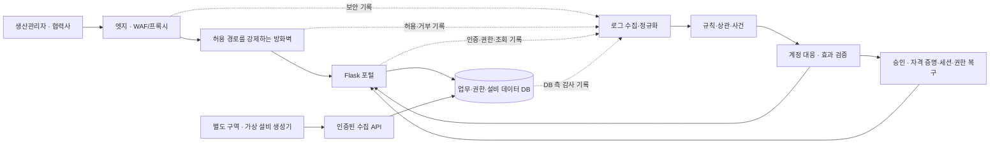

# 스마트팩토리 포털 보안·업무 복귀 검증 로드맵

상태: 설계 초안 · 2026-10-15 · 4인·2주

사용자가 선택한 구현 배경은 **생산관리·협력사 포털 + 가상 설비 데이터**입니다. 이 문서의 주제명·제품·작업 배정·일별 일정은 제안입니다. 수업의 4계층·특정 제품 의무 여부, 장비와 실제 가용 시간은 아직 확인이 필요합니다. 쇼핑몰 사례의 사용자·자료를 공장 업무로 재정의하며, [앞선 심화 후보](13-topic-differentiation-proposal.md)의 대응 효과·안전한 복구 검증을 이어갑니다.

## 1. 서비스와 핵심 질문

잠정 주제: **“스마트팩토리 생산관리·협력사 계정의 접근 이상을 탐지하고, 설비 데이터 수집을 유지하며 안전한 업무 복귀를 검증하는 4계층 대응 시스템”**.

가상 라인 A·B를 가진 공장 하나를 모델링합니다. 핵심 질문은 “침해된 협력사 계정의 자료 접근을 끊는 동안, 정상 직원의 업무와 가상 설비 데이터 수집은 유지되는가?”입니다.

| 주체 | 허용 업무 제안 | 대응에서 구분할 점 |
| --- | --- | --- |
| 생산관리자 | 담당 라인 현황·작업지시·품질 이력 조회, 승인된 사용자 권한 관리 | 복구 시 정상 관리자의 후속 권한 변경을 덮어쓰지 않음 |
| 협력사 정비 담당자 | 배정된 라인의 설비 상태·정비 이력 조회 | 다른 라인의 제한 자료·공정 레시피 자료에는 접근 불가 |
| 보안·복구 담당자 | 사건 확인, 테스트 계정 대응, 본인 확인 후 자격 증명 재설정·복구 승인 | 일반 포털 사용자와 대응 권한 분리 |
| 설비 데이터 수집 계정 | 가상 설비 데이터 전송·저장 | 사람 계정의 잠금·비밀번호 재설정에 영향받지 않게 분리 |

한 사람이 여러 역할을 구현할 수 있지만 시험 계정·권한은 분리합니다. 공정 레시피는 접근 통제용 합성 문서이며 실제 설비 설정값이 아닙니다.

## 2. 실제로 만들 최소 기능

화면은 네 개로 제한합니다.

1. 로그인·재인증: 계정 상태와 현재 권한 확인, 기존 세션 무효화.
2. 생산 현황: 라인별 설비 상태, 마지막 수집 시각, 생산 수량 추이.
3. 자료 조회: 담당 라인의 작업지시·정비 이력과 제한된 레시피 문서. MVP는 조회 중심.
4. 사건 상세: 탐지 근거·타임라인·대응 요청/효과/복구 결과·업무 연속성 증적.

가상 설비 생성기는 설비 2개에서 `machine_id`, `line_id`, `sequence`, `observed_at`, `temperature`, `produced_total`, `state`를 생성합니다. 값·주기·실행 식별자는 재현 가능하게 정합니다. 예를 들어 2초 간격은 시험 설정값이며 실제 공장 주기나 성능 요구사항이 아닙니다.

포털과 수집기는 서로 다른 서비스 계정을 사용하고, 수집 API와 사용자 API의 인증·권한을 분리합니다. 생성기는 설비 제어 명령을 받지 않으며, 센서 이상 탐지는 이번 보안 규칙의 대상이 아닙니다. 전체 MES, PLC 제어, SCADA, 실제 공정 복구, 디지털 트윈 정합성 검증은 이 범위에 포함하지 않습니다. 이후 가상 PLC는 추가 단계로 검토할 수 있습니다.

## 3. 4계층과 데이터 흐름

그림은 논리 경로입니다. 네트워크 방화벽은 실제 트래픽이 경유하도록 배치하고 우회 시험으로 확인해야 합니다. 생성기→수집 API, 앱→DB, 관리→관제 경로에도 통신 허용 정책을 적용합니다. 네 개 제품을 실행하거나 Docker 네트워크 이름만 나누는 것으로 계층별 제어 검증을 대신하지 않습니다.

| 계층 | 첫 구현 후보·필수 확인 | 완료 증거 |
| --- | --- | --- |
| 엣지 | WAF 기능을 가진 프록시 또는 과제에서 요구한 Cloudflare 구성. 제품·플랜·로그 수집 가능 여부를 1~2일차 확인 | 요청 기록과 지정 규칙 차단 시험. 직접 앱 접속 우회는 네트워크에서 거부 |
| 네트워크 | pfSense 등 실제 경유하는 방화벽. 대체 수단 인정 여부·Windows 가상화·필요 권한 확인 | 허용 경로 연결 성공, 금지된 앱·DB·가상 설비 구역 접근 거부와 로그 |
| 앱 | 기존 Flask 뼈대에 인증·인가·세션 버전·조회·계정 대응 구현 | 정상·거부 이벤트, 기존 세션 차단, 계정별 대응·복구 시험 |
| 데이터 | DB 최소 권한과 실제 DB 측 감사 방식 선정. MySQL 감사 기능의 사용 가능 범위·비용·민감값 제거 확인 | 허용 조회와 금지 작업, 요청 1건의 앱·DB 기록 대조. SQL 수신과 실행 성공은 구분 |

수집·관제는 Graylog 후보, 자동화는 n8n 후보이며 실제 필수 제품인지 먼저 확인합니다. 상관 기능의 버전·라이선스·실행 가능성을 작은 입력으로 검증하고, 자체 Python 규칙을 쓴다면 Graylog 검색·수집 기능과 책임을 구분합니다. 특정 도구가 선택 사항일 때만 팀 합의로 축소합니다. Wazuh는 호스트/FIM 보조 신호이며, 과제 필수가 아니라면 핵심 흐름 뒤에 배치합니다.

## 4. 한 사건의 시연

1. 정상 생산관리자와 협력사가 허용된 자료를 조회합니다. 가상 설비 수집은 계속됩니다.
2. 통제된 시험 계정에서 반복 인증 실패→성공→정책 위반 권한 변경→담당 외 자료 조회를 발생시킵니다. 취약한 공개 API를 필수로 만들지 않고 격리 시험용 상태·시나리오 입력을 명시합니다.
3. 시간 순서·계정·대상 자산·조회 정책을 근거로 사건을 생성합니다. 실패 후 성공만으로 실제 침해를 확정하지 않습니다.
4. 사람 계정을 잠그고 발급된 세션의 자료 접근과 신규 로그인이 모두 거부되는지 확인합니다. 같은 IP의 정상 직원과 별도 수집 계정은 정상 업무를 이어갑니다.
5. 복구 담당자가 별도 신뢰 경로로 사용자를 확인하고 테스트 비밀번호를 재설정합니다. 비밀번호 유출을 가정한 사례에서는 이전 비밀번호도 거부되어야 합니다.
6. 의심 권한 변경 이전의 신뢰할 상태로 복구하되, 후속 정상 변경과 충돌하면 자동 덮어쓰기를 중단합니다. 새 세션으로 정상 업무가 가능하고, 예전 세션은 잠금 해제 뒤에도 거부되는지 확인합니다.

기존 세션 차단에는 사용자별 `session_version` 같은 방식을 검토합니다. 매 요청의 잠금 상태·현재 인가도 검사합니다. 기본 자동 대응은 계정 범위이며 공장 전체 IP 차단·설비 정지는 포함하지 않습니다. 실제 설비 운영을 유지했다고 주장하지 않고 **가상 데이터 수집과 포털 업무가 시험 중 유지됐음**을 보고합니다.

## 5. 첫 계약과 담당 경계

현재 [API 계약](API-CONTRACT.md)과 [이벤트 스키마](../contracts/event.schema.json)는 앱 4종 이벤트 초안입니다. 아래는 확장 제안이며 이 문서 작성으로 스키마·라우트·작업 DAG를 변경하지 않습니다.

- 업무 자료: 사용자/역할, 협력사, 라인·설비·자료의 접근 범위, 권한 변경 이력.
- 센서 기록: 생성 시각과 수집 시각, 실행 식별자·순번, 라인·설비 식별자. 센서 기록과 보안 이벤트를 별도 계약으로 둡니다.
- 보안 이벤트: 발생·수집 시각, 출처·계층·대상 자산, 사용자 또는 DB/서비스 계정, 관찰 IP와 신뢰할 원본 IP, 요청 ID, 접근 허용·거부 및 필요한 조회 건수. 없는 사용자명을 가짜로 채우지 않습니다.
- 사건·대응: 연결 근거와 확정/추정 구분, 조치와 효과 검증의 별도 상태, `operation_id`, 재시도 한도, 세션 폐기·자격 증명 재설정 여부, 권한 기준 이력·복구 충돌.
- 같은 논리 조치의 재시도는 같은 `operation_id`, 해제 후 새로운 재잠금 등 새 조치는 새 ID를 사용합니다.

요청 ID는 한 요청의 계층 간 연결에 사용합니다. 여러 로그인·권한·조회 요청을 한 사건으로 묶는 데는 별도 계정·자산·시간 기준이 필요합니다. DB에 요청 ID가 남는지는 감사 방식 실험으로 확인합니다. 자격 증명·세션 쿠키·조회 원문은 로그나 증적에 넣지 않습니다.

| 작업 묶음 | 주요 수정 영역 제안 | 다른 담당에게 넘길 연결 결과 |
| --- | --- | --- |
| 인프라·수집 | 새 `infra/` 제안, 설정 예시·배치 문서 | 실제 통신 경로·허용 표·로그 예시·감사 수집 방식 |
| 포털·데이터·생성기 | `src/aleph_soar/portal/`, 새 생성기 영역·DB 마이그레이션·해당 테스트 | 로그인·자료·수집·계정 상태/복구 API, 실제 상태 변화 |
| 탐지·대응 | `src/aleph_soar/detection/`, `response/`, 해당 테스트 | 규칙·사건·계정 조치·효과 검증·실패/복구 결과 |
| 화면·통합 검증 | `templates/`, `static/`, 통합 시험·증적 문서 | 실제/예시 구분 화면, 독립 재시험 결과·발표 |

4명에게 하나씩 배정하는 초안이며 실제 담당자는 미정입니다. 앱 담당 부담이 크므로 가상 생성기는 화면·검증 담당이 초기 버전을 맡고 앱 담당과 수집 계약을 합의하는 안도 가능합니다. 공통 계약·의존성·앱 초기화는 한 조율 담당이 관리하고, 관련 담당 검토 후 수정합니다. 현재 역할·DAG에는 인프라 작업이 따로 없으므로 채택 후 P01에서 추가해야 합니다.

## 6. 2주 로드맵과 통과 기준

날짜는 착수일 기준 상대 일정이며 실제 제출일은 미확인입니다. 4명×10작업일의 가용 시간을 확보했다고 가정하지 않습니다.

| 기간 | 해야 할 일 | 단계 종료 시 실제로 보여줄 결과 |
| --- | --- | --- |
| 1일 | 평가 요건·장비·제품 확인, 라인·계정·자료 정책·담당 합의 | 범위·필수 제품·통신 허용 표, 초기 이벤트/센서 예시와 인수 기준 |
| 2일 | 세션 폐기/재인증, WAF·방화벽 경유, 앱·DB 감사 연결 작은 실험. 생성기 시작 | 기존 세션 거부 결과, 요청 1건의 계층별 기록, 생성기 데이터 저장. 막힌 항목을 명시 |
| 3~4일 | 자료 API·이벤트 1종·규칙 1개·사건·계정 잠금·접근 재시험 첫 통합 | 실제 계정 상태와 사건을 연결. 잠금 중 정상 동료·가상 수집 유지. 화면은 예시 계약으로 먼저 병행 |
| 5~6일 | 인증 실패→성공과 권한·자료 접근 규칙 연결, 4계층 수집·제어 시험 보완 | 자료 접근 탐지 최소 1개, 사건 근거·시간 순서, 엣지·네트워크·DB 증거 |
| 7~8일 | 비밀번호 재설정·예전 세션 폐기·권한 복구·충돌 중단, 중복 안전성 | 새 자격 증명·새 세션 정상 복귀, 이전 비밀번호/세션 거부, 충돌은 검토 대기 |
| 9~10일 | 효과 미적용·중복·정상 대조 시험, 같은 조건의 기본/검증 방식 비교 | 대응 상태와 실제 접근 결과의 불일치, 정상 업무·수집 연속성 측정 |
| 11~12일 | 다른 팀원 PC에서 재현, 실패 처리·문서·시연 고정 | 초기화부터 사건·복구까지 재실행, 실행 명령·증적·제약 일치 |
| 13~14일 | 결함 수정·발표 연습·여유 시간 | 실제 결과에 기반한 시연, 재현 실패 시 사용할 정직한 녹화 증적과 미검증 목록 |

2일차에 필수 제품·DB 감사가 막히면 대체 수단 인정 여부를 즉시 확인하고 배치를 조정합니다. 4일차 첫 통합이 안 되면 전체 작업지시 관리·내보내기·추가 규칙·꾸밈 화면·H 전용 UI를 줄입니다. 필수 계층은 샘플로 바꾸고 실제 제어 완료로 표시하지 않습니다. 10일차 이후 새 기능 대신 재현·결함 수정에 집중합니다.

## 7. 최종 검증 묶음

| 시험 | 합격을 판단할 관찰 |
| --- | --- |
| 정상 업무·같은 IP | 대상 계정 대응 중 다른 직원의 허용 업무 성공 |
| 기존 세션 차단 | 잠금 전 발급한 세션으로 잠금 중·해제 후 제한 자료 접근 거부 |
| 자격 증명·권한 복구 | 유출 가정 사례의 이전 비밀번호 거부, 새 인증 성공, 위험 권한 미복원 |
| 대응 효과 미적용 | 같은 조건의 실패를 기본/검증 흐름에 주입하고 실제 접근 결과와 상태 기록의 불일치를 독립 시험으로 확인 |
| 중복·복구 충돌 | 재시도 중복 부작용 없음, 정상 후속 변경 충돌 시 자동 덮어쓰기 중단 |
| 가상 수집 연속성 | 대응 전·중·후 일정 시험 구간의 생성·저장 순번과 누락·지연을 대조. 단순 그래프 애니메이션으로 대체하지 않음 |
| 계층별 실제 제어·관찰 | WAF 차단, 경로 우회 거부, DB 최소 권한·감사, 요청 1건의 계층 간 연결 |

기본/검증 방식은 가능한 한 같은 구현에서 확인 단계만 다르게 하고, 동일 초기 상태·입력·실패 조건을 사용합니다. 정상 조치도 함께 시험합니다. 각 시험은 예상값을 먼저 적고 실제값·판정·이벤트/조치 ID를 남깁니다. 데이터 수집 연속성은 가상 랩의 관측 결과이며 실제 생산 무중단이나 안전성을 보증하는 지표가 아닙니다.

## 8. 다음 작업과 근거

현재 `tools/team.py ready`는 P01을 반환합니다. 검증되지 않은 작업을 `--done`으로 넣지 않았습니다. 다음 구현 전 행동은 P01에서 서비스 정책·계약·제품을 합의하고 인프라 작업·생성기·위 인수 기준을 실제 DAG와 역할 원본에 반영하는 것입니다. 이 문서는 로드맵만 추가하며 구현 완료·PR 병합을 뜻하지 않습니다.

OT는 성능·신뢰성·안전을 함께 고려해야 하므로, 이 로드맵은 사람의 자료 접근·계정 대응과 가상 수집 업무의 연속성을 범위로 삼습니다. [NIST SP 800-82 Rev. 3](https://csrc.nist.gov/pubs/sp/800/82/r3/final)은 이 배경을 위한 참고이며, 가상 랩을 실제 OT 보호 체계로 인증하는 근거는 아닙니다. 망 분리와 원격 접근 설계의 추가 참고는 [CISA ICS 권고 자료](https://www.cisa.gov/resources-tools/resources/ics-recommended-practices)입니다.
