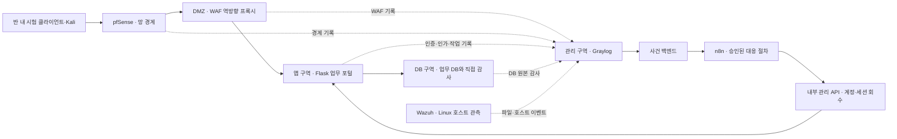

# 통신 외주 유지보수 포털 · 정상 업무·공방전·4계층 증적 준비안 R08

기준일: 2026-10-16 (Asia/Seoul) · 작성: Codex · 상태: 사용자 방향 고정 / Claude 회신·Codex 후속 판단 기록 / 기능 미구현

R08 [Claude 리뷰 전문](../work-log/2026-10-16-claude-telecom-portal-plan-review.md)을 수신했다. 지적별 수용·정정·조건부 판단은 [11절](#11-claude-회신과-codex-후속-판단)에 기록했으며, 아래 준비안에 반영했다. 계약·제품 배치·팀 합의는 아직 확정하지 않았다.

다음 P01의 [권한표·G1 사전 점검](22-p01-access-and-g1-preflight.md)에 작업 재개 환경·구체 시험 카드·남은 결정을 정리했다. 실제 시험 결과는 아직 없다.

## 1. 이번에 고정하는 문제와 범위

사용자는 배경 선택을 멈추고 **통신사 외주 유지보수 업무 포털**을 유지하면서, 정상 업무가 있는 작은 웹서비스와 공격·방어 시나리오를 먼저 완성하는 방향으로 준비하도록 요청했다. 4계층 실제 연동·DB 감사에 가산점이 있다고 가정하고 추가 증적도 설계한다. 가산점·필수 요건을 강사에게 확인한 상태는 아니며, 팀 전체의 역할·설계 합의와 구분한다.

**한 문장 목표:** 외주 업체가 승인된 담당 자산의 유지보수 업무를 처리하는 작은 포털에서, 계정 악용과 담당 외 접근을 탐지·대응하고 실제 접근 회수·정상 업무 유지·안전한 복귀를 검증한다.

확정된 입력은 4인과 Wazuh·Graylog·pfSense·n8n·Kali Linux·Docker 사용 예정이다. 반 내 팀 간 공방전은 예정되어 있지만 각 팀 웹서비스가 공격 대상인지는 미정이다. 따라서 **웹서비스만으로 핵심 시험을 수행할 수 있는 안**으로 준비하고 VPN은 추가 경로로 둔다. 프로젝트 실제 기간(2주 여부), 장비·배치·버전, 공방전 규칙·점수·제공 계정은 미정이다.

이번 산출물은 검토 가능한 설계와 작업 경계다. 앱은 여전히 시작 화면·상태 API만 제공한다. API·스키마·제품 설치·실행·공방전 결과는 이 문서 작성으로 바뀌지 않는다. 예시 167·168 원본의 재열람은 불가능했고, 저장소에 남은 [참고 자료 해석](05-references.md), [계층별 검토](12-four-layer-topic-review.md), [시나리오 정리](03-scenarios.md)를 사용했다.

## 2. 정상 업무가 먼저 있는 작은 서비스

### 사용자와 권한

| 사용자 역할 | 허용 업무 | 금지·분리할 업무 |
| --- | --- | --- |
| 외주 A | A 소속 작업 신청·조회, 승인된 담당 자산 A의 합성 점검 결과 조회 | B의 작업·자산·결과, 승인 결정, 보안 조치·관제 관리 |
| 외주 B | B 소속의 같은 업무 | A의 자료와 관리 기능 |
| 업무 운영자 | 담당 작업의 대상·종류·유효기간을 검토·승인/반려 | 외주 계정으로 승인하기, 승인 없이 새 자산 권한 부여 |
| 보안 담당자 | 사건 조사, 범위를 제한한 대응 승인·재시험·복귀 승인 | 공개 수집·대응 API를 무인증으로 사용하기 |

역할은 사용자 권한이며 사람 배정표가 아니다. 랩에서 한 사람이 두 담당을 겸하더라도 계정·역할·승인 이력을 나눈다. 업무 요청 승인과 보안 조치 승인은 서로 다른 작업이다.

### 정상 업무 3개

1. **작업 신청:** 외주 A가 담당 자산 A를 선택하고 고정 작업 `health_check`를 신청한다. 소속 업체와 담당 자산은 서버가 권한으로 확인한다.
2. **작업 승인·처리:** 운영자가 대상·기간을 승인하면 정해진 합성 점검 작업을 처리한다. 임의 명령·스크립트 업로드·실제 장비 제어는 넣지 않는다. 같은 작업 ID의 중복 요청이 결과를 중복 생성하지 않아야 한다.
3. **자기 작업 결과 조회:** A는 자기 요청의 승인 상태·처리 결과만 조회한다. B는 독립적인 정상 사용자·작업 생성기로 동작하며 A와 같은 공개 WAF 경로를 사용한다. 기준선에 B의 WAF 오탐·거부·지연도 포함한다.

초기 데이터는 업체 A/B, 자산 A/B, 합성 작업·결과, 사용자·승인·사건 이력으로 제한한다. 실제 가입자·전화번호·유심 인증키·과금 정보는 쓰지 않는다. HSS·UDM·개통·과금 서버 전체를 만들었다고 표현하지 않는다.

작업의 논리 상태는 `요청 → 승인/반려 → 처리 → 완료/실패`로 제안한다. 이는 아직 기존 공통 스키마에 추가된 상태가 아니다. 유효기간이 지난 승인과 조치된 사용자의 새 작업 요청·실행은 거부하도록 설계한다. 이미 처리 중인 요청·작업의 종료 경계와 잔여 영향도 시험에서 따로 기록한다.

## 3. 4계층의 정의와 실제 통신 경로

강사 참고 자료의 정리 기준에 맞춰 **엣지 → 네트워크 → 앱 → 데이터**로 센다. OSI의 4계층을 뜻하지 않는다. Wazuh의 호스트 관측은 앱 실행 환경을 보강하는 별도 증거이며 WAF 대신 네 번째 계층으로 계산하지 않는다. Graylog·n8n은 계층을 연결하는 공통 관제·자동화 기능이다.



위는 논리 흐름이다. **구역 간 통신은 pfSense를 경유하도록 실제 라우팅을 검증**해야 한다. 그림의 화살표나 Docker network 이름만으로 망 분리 증거를 대신하지 않는다. DMZ·앱·DB·관제 구역의 별도 서브넷/가상 NIC·라우팅 방식은 장비 확인 후 고정한다. 같은 Docker bridge·호스트 공개 포트·다중 NIC·IPv6로 우회할 수 있으면 경계 시험은 실패다.

G1 배치 후보 A는 구역별 VM과 pfSense의 구역별 가상 NIC를 두고 각 VM 안에서 Docker를 사용하는 방식이다. 후보 B는 WAF·앱을 한 VM, DB를 별도 VM에 두고 최소 앱–DB 구간만 pfSense로 연결한다. 관제는 별도 구역에 둔다. B를 선택하면 WAF–앱 망 경계는 검증 범위에서 빠진 것으로 명시한다. 장비 사양 확인 전 특정 배치의 구동·완전 격리를 확정하지 않는다.

경로 시험은 허용 연결의 패킷·규칙·상태를 기록하고, 해당 허용 규칙을 제거한 **새 연결**의 거부를 대조한다. 기존 연결은 별도 시험이다. pfSense는 기존 state가 있으면 새 차단 규칙만으로 연결이 종료되지 않을 수 있으므로 대상 state만 제거하는 시험을 분리한다. B 연결까지 끊는 전체 상태 초기화를 계정 A 조치로 사용하지 않는다. [공식 state 설명](https://docs.netgate.com/pfsense/en/latest/troubleshooting/firewall.html#check-the-state-table)

| 출발 → 목적 | 허용표 초안 | 성공/거부를 확인할 지점 |
| --- | --- | --- |
| 반 내 클라이언트 → WAF | 랩의 공개 웹 포트만. HTTPS 종료·인증서는 랩 구성에서 명시 | 클라이언트 결과·WAF access/audit·pfSense 경유 |
| 외부 → 앱 원본·DB·관제·n8n | 거부. 외부에서 직접 관리 API 호출도 거부 | 접속 실패·경계 로그. DB 로그가 없을 수 있음 |
| WAF → 앱 | 지정한 앱 포트만 | WAF upstream·앱 수신·방화벽 경로 |
| 앱 → DB | 선택한 DB 포트·앱 DB 계정으로 제한 | DB CONNECT/QUERY·실제 결과 |
| 승인된 내부 DB 시험 호스트 → DB | DB 직접 감사 시험 동안 제한된 계정·경로만 | 승인 범위·DB 원본 기록·시험 클라이언트 결과 |
| 각 소스 → 수집기 | 선택한 로그 전달 포트만 | 소스 기록·중앙 수신·표식 이벤트 대조 |
| 관리 역할 → 내부 관리 API | 인증·역할·대상 제한, 공개 포털의 외주 세션으로는 불가 | 승인 이력·API 거부/허용·상태 변화 |

pfSense는 HTTPS 안의 로그인·소속·SQL 내용을 판별하는 장비로 가정하지 않는다. 허용 연결도 증적에 필요하면 해당 규칙의 로깅을 명시적으로 켜고 확인한다. 클라이언트 IP 헤더·요청 ID는 신뢰할 프록시가 덮어쓰고 앱은 그 프록시만 신뢰하도록 설계한다. [pfSense 공식 방화벽 로그 문서](https://docs.netgate.com/pfsense/en/latest/monitoring/logs/firewall.html)

## 4. 계층별 제품 후보·인수 기준

확정 사용 예정 6종은 유지한다. WAF와 업무 DB·로그 전달기는 이를 보완하는 의존성이며 추가 설치·버전 고정·리소스 비용이 발생한다. 아래 후보는 설치 완료가 아니다.

| 계층·역할 | 우선 준비 후보 | 실제 인수 증거 |
| --- | --- | --- |
| 엣지 | OWASP CRS 공식 컨테이너의 Apache+ModSecurity 계열을 먼저 검토 | 정상 요청 통과, 선택한 규칙 요청 차단, 같은 WAF transaction의 규칙 ID·결과·시각. 차단 요청의 앱 미도달 대조 |
| 네트워크 | pfSense의 구역·허용표 | 허용 경로 성공, 앱/DB 직접 경로 거부, 실제 경계 경유와 규칙 로그 |
| 앱 | Flask 인증·업체/객체 권한·작업 승인·계정 잠금·세션 회수 | 정상 A/B 결과, B 자료 요청 거부, 잠금 후 신규 로그인·기존 세션 거부, 복귀 후 이전 수단 거부 |
| 데이터 | MariaDB Community Server+Community Audit Plugin을 우선 검토 | DB 직접 접속·허용 조회·금지 조회의 서버 원본 감사, 결과 코드와 클라이언트 결과, 권한·잔여 데이터 상태 확인 |
| 호스트 보강 | Wazuh 에이전트를 둘 Linux 호스트와 전용 시험 파일 | 파일 변경 전후 해시·에이전트/호스트·경로·경보·원복. who-data는 별도 지원 조건 확인 전 필수로 삼지 않음 |
| 수집·사건 | Graylog + 사건 백엔드 | 출처별 원본 ID·수신 시각, 근거와 사건 연결. 로그 수신과 사건 상태를 구분 |
| 대응 | n8n → 내부 대응 API 한 경로부터 | 승인·요청·적용 보고·효과·복귀 상태를 분리, 중복·재시도 안전성 |

[CRS 공식 이미지 저장소](https://github.com/coreruleset/modsecurity-crs-docker)는 Apache/nginx 계열과 버전 태그·설정 차이를 안내한다. 구현 때 실제 pull 가능한 고정 태그·digest, blocking 모드, 로그 위치와 리소스를 기록한다. `latest`나 예시 태그가 현재 환경에서 작동한다고 가정하지 않는다. WAF는 업체별 객체 권한 판단을 대신하지 않는다.

DB는 기존 참고안의 MySQL에서 **감사 기능 검증을 위한 MariaDB 후보**로 제안한다. 현재 DB 업무 기능은 미구현이므로 기존 운영 DB를 이전한 상태는 아니다. MySQL이 필수라면 지원되는 감사 수단을 먼저 확인하고 후보를 바꾼다. 단순 앱 로그나 SQL 수신 로그로 직접 감사 완료를 대체하지 않는다. [MariaDB Community Audit 공식 개요](https://mariadb.com/docs/server/reference/plugins/mariadb-audit-plugin)

Wazuh FIM은 파일 변화 관측이고 SQL 조회 감사가 아니다. [Wazuh 공식 FIM 설명](https://documentation.wazuh.com/current/user-manual/capabilities/file-integrity/). 컨테이너 내부 변경을 감시하려면 실제 파일·호스트/볼륨 위치를 연결해야 한다. 최소 호스트 시험은 전용 합성 설정 파일에서 수행하고 악성코드·실제 비밀 파일은 사용하지 않는다.

로그 운반은 pfSense remote syslog → Graylog의 해당 input, WAF·앱·DB 파일 → 파일 전달기 → Graylog, Wazuh manager의 경보 → 전달기 → Graylog를 후보로 둔다. 파일 전달기 종류·전송 형식·버전은 준비 시험에서 하나로 선택한다. 파일을 읽을 주체·권한·회전 후 수집·오류 처리까지 검증하기 전에는 화살표를 실제 연결로 표시하지 않는다.

모든 소스에 생성·수신 대조와 단절·재개·회전·중복 시험을 둔다. pfSense 기본 원격 syslog는 UDP지만 아직 선택하지 않은 Wazuh 전달기까지 UDP라고 가정하지 않는다. 전송 경로·관리망 허용표를 기록하고 소스 원본과 중앙 수신을 비교한다. 표식 1건의 도착만으로 전체 로그 무손실을 보장하지 않으며 소스가 제공하지 않는 연속 번호를 만들어 원본 완전성을 주장하지 않는다. 누락·관측 공백이 있으면 해당 구간은 미확인이다. [pfSense 원격 로그](https://docs.netgate.com/pfsense/en/latest/monitoring/logs/remote.html)

## 5. DB 감사는 무엇으로 증명할 것인가

### 서로 다른 증거 네 종류

- 앱 `data.read`: 앱이 기록한 사용자·요청·권한 판단이다. DB에 직접 접근한 모든 행위를 보여주지 않는다.
- DB 감사 QUERY: DB 계정·연결·질의·결과를 서버가 기록한 자료다. 웹 사용자와 자동으로 같아지지 않는다.
- DB TABLE/READ: 테이블 접근 기록이다. SELECT가 반환한 모든 행의 내용·개수나 실제 외부 유출량을 뜻하지 않는다.
- 결과·상태 확인: 시험 클라이언트의 성공/거부, 별도 확인 연결의 최종 작업 상태·건수/해시다. QUERY 성공만으로 트랜잭션 최종 커밋을 입증하지 않는다.

[MariaDB Community Audit 로그 형식](https://mariadb.com/docs/server/reference/plugins/mariadb-audit-plugin/mariadb-audit-plugin-log-format)은 서버·DB 사용자·접속 호스트·connectionid·queryid·operation·DB·object·retcode를 구분한다. QUERY 결과 코드와 TABLE 이벤트의 빈 결과 필드를 섞어 해석하지 않는다. 버전에 따라 host 필드 형식 등이 바뀌므로 선택 버전의 실제 줄을 파서 입력으로 검증한다.

MySQL general query log는 클라이언트가 보낸 SQL과 연결을 기록하며 수신 순서와 실행 순서가 다를 수 있다. SELECT는 binary log에 남지 않는 경우도 있어, general/binlog 하나를 조회 성공·유출·최종 커밋의 완전한 증거라고 하지 않는다. [MySQL 8.4 공식 general query log 설명](https://dev.mysql.com/doc/refman/8.4/en/query-log.html)

### 최소 직접 감사 시험

| 시험 | 기대 결과 | 반드시 구분할 것 |
| --- | --- | --- |
| DB-01 정상 앱 조회 | 허용된 A 작업 조회 성공 + 앱 요청 기록 + DB 감사 기록 | 웹 사용자 A와 DB의 공유 `portal_app` 계정은 다름 |
| DB-02 내부 시험 호스트의 직접 조회 | 별도 제한 DB 계정으로 허용 합성 뷰 조회 성공, 금지 B 자료 조회 거부 + DB 감사·클라이언트 결과 | 앱을 거치지 않아 앱 요청 로그가 없는 정상적인 시험. 외부 팀에 DB 포트를 공개하지 않음 |
| DB-03 외부의 직접 연결 | pfSense에서 거부 + 클라이언트 연결 실패 | DB까지 도달하지 않았으므로 DB CONNECT 로그가 없다고 감사 실패로 판정하지 않음 |
| DB-04 보관·수집 장애 | 소스 표식과 중앙 수신의 누락·지연을 감지하고 증적 미완료 표시 | 장애 구간을 “위험 없음/조회 없음”으로 해석하지 않음 |

MariaDB 공식 [감사 로그 설정](https://mariadb.com/docs/server/reference/plugins/mariadb-audit-plugin/mariadb-audit-plugin-log-settings)은 QUERY가 권한·문법 오류로 실패한 질의도 기록한다고 설명한다. 따라서 권한 거부 기록은 문서상 지원되며, R08 Claude 회신의 “공식 문서로 확인되지 않음”은 보완한다. 다만 선택 이미지의 플러그인 포함·로드·필터·실제 SELECT 거부 코드·재시작 후 유지·중앙 전달은 미검증이다. G1에서 허용 SELECT·권한 거부 SELECT·존재하지 않는 테이블 질의를 각각 실행해 클라이언트 결과와 QUERY/TABLE 원본을 비교한다. 실패하면 설정·필터·버전을 먼저 진단하고 DB 감사 증거를 미완료로 남긴다. 클라이언트 오류와 GRANT 확인만으로 DB 감사 거부 시험을 통과시키지 않는다.

`portal_app`, 제한 시험 계정, DBA 설정 계정을 나누고 앱에 DBA 권한을 주지 않는다. 제한 시험 계정은 자기 합성 뷰에만 SELECT하고 금지 자료는 DB 권한으로 거부하도록 제안한다. 앱의 업체별 인가는 DB 공유 계정의 권한만으로 해결되지 않으므로 매 요청·객체마다 별도로 검사한다.

앱 경로의 연결은 서버가 생성한 request_id와 DB 호출 전후의 connectionid·시간·대상·결과 매핑을 우선 검증한다. 연결 풀의 순차 재사용·동시 요청을 시험하고, 이 정보만으로 특정 질의를 유일하게 대응시킬 수 없으면 관계를 추정으로 남긴다. `queryid`는 감사 로그의 질의/테이블 이벤트 연결에 쓰되 앱이 처음부터 그 값을 안다고 가정하지 않는다. SQL 주석·외부 입력 ID만으로 사용자를 확정하지 않는다.

강한 연결의 시험 후보는 한 요청이 독점 임대한 DB 연결에 서버 생성 ID의 시작·종료 표식을 기록하는 방식이다. `SET @aleph_request_id`는 자동 감사 태그나 권한 통제가 아니며, 실제 QUERY 로그의 SET 줄을 연결 근거로 이용한다. 공식 설정상 SET은 전체 QUERY에 포함되고 QUERY_DML 등 하위 필터만으로는 빠질 수 있다. 따라서 표식 기록·연결 독점·예외 후 정리·풀 재사용·DB 재시작을 먼저 시험한다. DB 인스턴스/기동 구분, connectionid, 표식 구간이 모두 유일하고 원본이 확보된 경우에만 해당 구간을 연결한다. 표식 누락·잘림·단절·미종료 구간은 추정 또는 연결 불가로 내린다. 작업자는 별도 작업/시도 ID를 쓰고 시작 HTTP 요청과 구분한다. 웹 사용자 귀속은 앱 기록을 신뢰하는 2단계 연결이며, DB가 웹 사용자를 직접 인증한 증거는 아니다.

원본 QUERY 로그에는 SQL 문자열·리터럴이 포함될 수 있다. 감사 시험은 합성 데이터·비밀 없는 조회만 사용하고 인증 자격 증명 변경 SQL을 중앙 로그에 흘리지 않는다. 원본은 제한된 보관 영역에 두고 발표본은 메타데이터·query fingerprint·필요한 객체명·결과 코드 중심으로 만든다. 정제본과 원본의 관계, 접근 권한·회전·보존·로그 손실을 기록한다. 플러그인의 비밀번호 마스킹을 모든 SQL의 비밀 제거 보장으로 취급하지 않는다.

## 6. 정상·공격·방어 시험과 증적

기존 강사 자료와 R07의 S1/S3/S4 번호가 서로 다른 내용을 가리키므로 이번에는 `TEL-*` 식별자를 쓴다. 이 번호는 [기존 작업 DAG](../orchestration/workplan.json)의 완료 ID가 아니다.

| ID·우선순위 | 입력·조건 | 합격을 판단할 증거 |
| --- | --- | --- |
| TEL-N01 · 핵심 | A/B 정상 로그인·신청·운영자 승인·처리·자기 결과 조회 | HTTP 결과·승인/작업 ID·최종 상태·사용자/업체별 허용표 일치 |
| TEL-A01 · 핵심 | 테스트용 A 자격 증명/세션의 악용을 가정하고 B의 작업 ID·자료 접근을 제한된 횟수로 시도 | 앱의 업체·객체 인가 거부와 정보 미반환, 규칙의 사건 근거. 정상 단발 실수·A/B 혼재 대조 |
| TEL-A02 · 핵심 | 별도 시험에서 승인된 계정 회수 후 A의 이전 세션·신규 로그인·새 작업 요청을 시도 | 조치 적용 시각 이후 실제 거부, B 접속과 작업 유지. 조치 API 응답 성공만으로 통과하지 않음 |
| TEL-R01 · 핵심 | 본인·업무 필요·원인/호스트 확인 후 복귀 승인, 새 자격 증명 발급 | 이전 비밀번호·세션 거부, 새 수단의 A만 허용/B 거부, 원래 없던 권한 추가 없음 |
| TEL-F01 · 핵심 실패 대조 | 계정 잠금만 적용하고 세션 회수를 누락하거나 검증기 로그를 끊는 시험 | 기존 세션 접근 가능은 효과 불일치, 로그 미확보는 미확인. 성공 종결·복귀 차단 |
| TEL-E01 · 가산점 대비 | 정상 요청과 선택한 CRS 규칙에 걸리는 통제 요청을 각각 WAF에 전송 | blocking 모드의 실제 차단·규칙 ID·transaction·원본 로그, 앱 미도달 대조. WAF 샘플 재생과 구분 |
| TEL-P01 · 가산점 대비 | WAF 경유 정상 웹 접속과 앱/DB 원본 직접 연결을 대조 | 실제 pfSense 경유·허용/거부 규칙, 클라이언트 결과, 우회 경로 부재 |
| TEL-D01 · 가산점 대비 | 5절 DB-01~04의 직접 감사·수집 시험 | DB 원본·중앙 수신·클라이언트 결과·권한·최종 상태를 연결한 감사 묶음 |
| TEL-H01 · 호스트 보강 | 승인된 시험에서 전용 설정 파일 변경·원복 | 실제 Wazuh 이벤트·파일 해시·경로·자산·수신 기록. 파일 변경이 SQL 조회를 뜻하지 않음 |

TEL-A01은 권한 경계 시험이며, 사전에 의도적으로 인증·인가를 무너뜨린 공개 서비스를 만들라는 지시가 아니다. 탈취 가정은 테스트 계정/세션을 제공하는 자체 시험으로 구성한다. 실제 상대 팀에게 무엇을 줄지는 공방전 규칙에 따른다. WAF에서 차단한 요청에 앱·DB 로그가 없고, 앱에서 거부한 요청에 업무 데이터 SELECT가 없는 것은 정상일 수 있다. 인증·세션 확인용 DB 조회가 발생할 수도 있으므로 “DB 이벤트 전체가 0”을 앱 거부의 기준으로 삼지 않는다.

**계정 회수 효과의 경계:** 매 요청의 계정·세션 상태 검사, 신규 작업 실행 전 검사와 적용 기준 시각을 정의한다. 조치 전에 시작된 요청·진행 중 작업의 잔여 결과는 따로 기록한다. 이전 쿠키의 재사용 거부와 기존 TCP 연결의 강제 종료, VPN 터널 종료는 다른 시험이다. VPN을 실제 사용하지 않았다면 VPN 종료 증적을 채우지 않는다.

준비 기본안은 계정 잠금·세션 버전 증가의 커밋을 적용 기준으로 삼고 A의 대기 작업을 취소하는 것이다. 실행 중인 합성 점검은 결과를 내부 보류하고 사용자에게 공개하기 전 계정·승인 유효성을 확인한다. 이 확인과 결과 공개 커밋은 같은 계정/작업에 대한 잠금 또는 버전 조건으로 조치 커밋과 직렬화해야 한다. 검사 직후 잠금이 발생하는 경쟁 조건도 시험한다. 구체 트랜잭션은 P01에서 결정한다. 이미 응답을 시작한 요청은 잔여 영향으로 기록한다. 적용 뒤 인증·상태 확인 SQL이나 진행 중 질의가 남을 수 있으므로 “A의 모든 DB 질의가 0”을 합격 조건으로 쓰지 않는다. 새 업무 진입 거부·결과 비공개·잔여 영향·B 기준선 유지로 판정한다.

TEL-E01은 차단 결정 규칙·점수/임계값·기여 규칙·엔진 모드·클라이언트 실제 응답을 구분한다. `949110`은 일반적인 인바운드 평가 규칙의 예이며 선택 CRS 버전·설정에서 실제 동작한 규칙을 보존한다. 조기 차단·검사 단계가 다르면 후속 규칙 기록을 필수라고 단정하지 않는다. 기여 규칙 누락은 미확인으로 표시한다. [CRS 이상 점수 설명](https://coreruleset.org/docs/2-how-crs-works/2-1-anomaly_scoring/)

WAF 생성 거래 ID는 클라이언트의 같은 이름 헤더를 덮어쓰고 신뢰 프록시 경로에서만 앱으로 전달하는 후보를 G1에서 시험한다. 앱 자체 request_id와 WAF 거래 ID는 구분해 매핑한다. **앱 로그의 ID 부재만으로 미도달을 확정하지 않는다.** 정상 대조 요청과 수집 상태를 확인하고, 통제 시험 시간창의 백엔드 수신 캡처·접근 기록 등 독립 관측으로 보강한다. 암호화 구간에서 패킷과 요청을 유일하게 대응할 수 없거나 관측 공백이 있으면 제한된 추정/미확인이다. 이는 시험 범위의 판정이며 모든 요청의 미도달 보장은 아니다.

탐지 임계값은 정상 기준선 뒤 정한다. 정해진 시간창·반복 횟수·중복 제거 키·목적 자산 조건과 오탐 대조를 고정하고, 시간 순서가 필요한 규칙에 단순 종류 개수만 사용하지 않는다. B의 정상 업무는 독립 생성기의 예정/발행/수락/완료/실패/미완료/중복 작업 ID와 완료 지연을 비교한다. 숫자 목표는 부하·장비·규칙 확인 후 정하며 현재 성능 수치는 없다.

### 공방전 규칙별 적용

- 외부 웹만 제공: TEL-E01/P01과 계정 없는 공개 경로 시험이 주 대상. A01의 로그인 후 권한 시험은 자체 시연으로 남길 수 있다.
- 일반 외주 계정 제공: A01·A02의 권한 경계·계정/세션 대응을 상대 팀 시도와 연결 가능하다.
- 내부 거점·VPN 허용: 허용된 범위에서 P01·D01의 내부 경로 시험을 확대한다. 웹 공개만으로 내부 거점을 얻었다고 가정하지 않는다.
- 가용성 채점이 있다면: 전체 외부 IP 차단·서비스 중지는 기본 대응으로 쓰지 않는다. NAT 공유 IP와 정상 B 영향·회복 시간을 함께 측정한다. 허용 공격률·부하·중단 기준은 규칙 확인 후 정한다.

## 7. 사건 화면과 증적 묶음

실제 구현 후보는 네 개의 독립 마법사 메뉴보다 **사건 상세 중심**으로 정리한다.

```text
외주 업무 화면: 내 작업 / 작업 신청 / 승인·결과 조회
운영 화면: 작업 승인 / 담당 자산·업체 관리
보안 화면: 관제 현황 / 사건 관리 / 정책·점검
  사건 상세: 개요 → 근거·타임라인 → 승인·조치 → 효과 재시험 → 복귀 이력
  증적: 계층별 원본 참조·수집 상태·관련성·기대 결과·실제 결과
```

화면은 `요청·승인·적용 보고`, `효과 확인/불일치/미확인`, `복귀 승인·복귀 후 확인`을 구분한다. 이 표시는 현재 `response_state`를 대체해 구현된 상태가 아니라 다음 계약 검토 항목이다. 효과·관측이 미확인이면 복귀·성공 종결을 막는다. 원본 로그는 보안 담당자만 제한적으로 조회하고 외주 화면에 노출하지 않는다.

아래는 나중에 만들 증적 묶음의 제안이다. 실제 실행 파일이나 측정 결과는 아직 없다.

```text
evidence/<run_id>/
  manifest             # 시험 ID·버전·담당·시각·기대/실제·판정·해시
  client-results        # 요청/접속 결과, 비밀·쿠키 제외
  source-references     # 계층별 원본 ID·보관 위치·원본/정제본 관계
  correlation           # 명확한 연결 / 제한된 추정 / 연결 불가
  normal-work           # 독립 작업 발행·처리 대조
  action-and-recovery   # 승인·적용·재시험·복귀의 별도 상태
```

`run_id`는 시험 묶음이고 `request_id`는 요청, `event_id`는 출처별 사건 근거다. pfSense의 암호화 트래픽 로그에 HTTP request_id가 있다고 가정하지 않는다. DB 연결·WAF transaction·호스트 경보는 각 원래 키를 보존한다. 시간·IP만 같은 다른 사용자의 이벤트를 한 사건으로 확정하지 않는다. 같은 공격 재생으로 모든 계층에서 신호가 나올 필요는 없으며 별도 계층 시험은 같은 실행 묶음에 보관하되 별도 사건/시험으로 구분한다.

## 8. 준비 시험·개발 순서와 축소 기준

| 단계 | 먼저 할 일 | 다음으로 넘어갈 조건 |
| --- | --- | --- |
| G0 방향·환경 | 기간·평가·가산점·규칙·장비 확인, Claude 리뷰, 업체/객체 권한표 | 범위와 미정 사항, 실제 제품 후보·버전 고정 절차 기록 |
| G1 위험 확인 | 배치 A/B 선택과 pfSense 새/기존 연결 대조, WAF 차단·거래 ID·백엔드 관측, DB 플러그인/필터·허용/거부·재시작 유지, 전 소스 수집을 작은 입력으로 시험 | 버전·배치·원본·실제 결과·관측 한계 기록. 불가능한 후보는 교체하거나 미완료 표시 |
| G2 정상 업무 | N01의 신청·승인·처리·조회와 독립 B 작업 | 정상 권한·재시도·업체 간 자료 분리 기준선 |
| G3 첫 통합 | A01→한 사건→승인→A02→B 유지 | 실제 HTTP/세션 결과와 상태 일치 |
| G4 증적 보강 | E01/P01/D01/H01, 풀 연결·로그 회전·누락·시간차 대조 | 4계층 각각의 제어/수집 증적. 호스트는 별도 보강 |
| G5 실패·복귀 | F01·R01, 타 담당 재현, 시연 정리 | 성공·실패·미확인 구분, 기존 수단 거부, 정상 업무 유지 |

이는 날짜 확정표가 아니다. 실제 2주라면 초반 두 작업일을 G0/G1의 위험 확인, 이후 짧은 구간을 G2/G3 첫 통합에 우선 배정하고 나머지를 G4/G5·결함 수정에 남기는 일정 후보로 검토한다. 현재 장비와 가용 시간을 모르는 상태에서 전체 완료를 약속하지 않는다.

지연되면 5G 코어·공유 표준·별도 보고 시스템·추가 탐지 규칙·VPN 신규 기능·복잡한 화면부터 줄인다. DB 감사·WAF 실제 검증이 실패하면 앱 로그·샘플을 실제 계층 증거로 대신하지 않는다. 가산점 준비 항목의 미완료를 표시하고 핵심 웹 방어 흐름은 유지한다. 강사가 필수로 확인하면 해당 계층은 축소 대상에서 제외하고 전체 범위를 다시 배분한다.

## 9. 4인 작업 경계와 기존 계약·DAG 영향

| 작업 묶음 제안 | 한 명이 소유할 주 영역 | 다른 담당에게 줄 것 |
| --- | --- | --- |
| 망·엣지 | pfSense/WAF/라우팅·해당 소스 로그 전달·재현 환경 | 허용표·버전·로그 샘플·실제 경로·실패 조건 |
| 업무 앱·DB | 정상 업무·인가·DB 계정/감사·앱/DB 로그 전달·세션 회수 | 요청·응답 제안·이벤트·상태 변화·DB 호출 연결 근거 |
| 탐지·대응 | Graylog 입력/파서·규칙·사건·n8n·Wazuh 경보 전달 | 사건 근거·중복/지연 정책·조치/효과 구분·인수 시험 |
| UI·독립 검증 | 외주/운영/보안 화면·재시험·증적 대조·발표 | 샘플 표시·미확인 처리·타 담당 재현·실패 결과 |

실제 사람 배정은 미정이다. 공통 스키마·app factory·의존성·환경은 조율 담당 한 명이 소유하고 순서대로 반영한다. 화면 담당에게 모든 검증 책임을 넘기지 않으며 각 구현 담당이 자기 계층의 실제 증거를 먼저 남긴다.

| 현재 연결 기준 | 확인된 한계 | 다음 변경 때 함께 맞출 것 |
| --- | --- | --- |
| `contracts/event.schema.json` | 사용자/IP 필수, 앱 이벤트 4종, 추가 필드 금지 | 출처별 이벤트 종류·주체 없음·수집 시각·소스 키·연결 근거. 가짜 사용자나 IP를 채우지 않음 |
| `contracts/incident.schema.json` | 단일 response_state, 효과/복귀 검증 별도 구조 없음 | 조치·효과·관측·복귀와 근거의 분리, 소비자·예시·테스트 |
| `docs/API-CONTRACT.md` | 로그인 등 후보만 있고 정상 업무·승인·재시험 계약 없음 | 업무/내부관리 경계·인증·오류·권한·중복·기존 세션 정책 |
| `orchestration/workplan.json` | P01 뒤 B01/D01/U01 등의 기존 계획, D01의 S1/S4/S9는 과거 번호 | P01에서 R08 인수 기준·인프라/DB 작업·선행 조건·담당 쓰기 경계 반영 후 후속 작업 실행 |

이번에는 스키마·API·DAG를 변경하거나 P01 완료를 주장하지 않는다. `tools/team.py ready`에서 P01만 시작 후보임을 확인했다. 다음 구현 준비 시 `aleph-contract-change` 절차로 계약·예시·소비자·검증을 함께 변경해야 한다. R08의 검토 완료와 구현 작업의 완료는 다르다.

## 10. Claude에게 요청하는 독립 리뷰

[리뷰 프롬프트](../prompts/claude-telecom-portal-plan-review.md)를 같은 저장소를 연 Claude에 전달한다. 배경 후보를 다시 투표하지 말고 아래를 검토해 달라.

1. 작은 포털의 사용자·정상 업무·업체/객체 권한·고정 점검 작업이 구체적이고 구현 가능한가?
2. 웹 공방전과 VPN/내부 시험을 구분했는가? 공격 계정 미제공·가용성 채점 조건에서도 핵심 시연이 성립하는가?
3. 강사 자료의 엣지–네트워크–앱–데이터 정의와 실제 WAF·pfSense 경유·호스트 보강의 경계가 맞는가?
4. MariaDB Community Audit 후보가 적절한가? 앱/DB 계정, QUERY 결과·TABLE 이벤트·커밋·접속 거부의 증거를 혼동하지 않았는가?
5. 프록시 request_id·DB connectionid/queryid·연결 풀·암호화 트래픽·로그 공백에서 과도한 사용자 귀속이 있는가?
6. 계정·기존 세션·진행 중 작업·복귀·중복 조치의 경계와 실패 시 성공 오판 방지가 충분한가?
7. WAF·DB·전달기 추가 비용과 4인 분담·준비 게이트·축소 순서가 현실적인가? 가장 먼저 확인할 위험은 무엇인가?
8. 현재 계약·DAG와 충돌하는 부분을 위치·구체 수정안으로 제시하라. 검토 중 구현 계약을 임의로 바꾸지 말라.
9. 최종 판정(수용/수정 권고/판단 보류), 우선순위별 지적, 수정한 최소 시연·완료 조건을 제안하라.

완료 기준은 Claude의 실제 회신 수신·원문 보존·지적별 수용/보류와 근거 기록이다. 2026-10-16 이 검토 절차는 완료했다. 팀 합의·기능 구현·실제 연동·가산점 확인은 미완료다.

## 11. Claude 회신과 Codex 후속 판단

검토일: 2026-10-16. [Claude 원문](../work-log/2026-10-16-claude-telecom-portal-plan-review.md)은 수정하지 않았다. **판정은 방향 유지·검증 조건 수정 권고**다. 주제를 바꿀 이유는 발견하지 않았고, 설계 리뷰 통과를 제품 동작 확인으로 취급하지 않는다.

### 지적별 처리

| Claude 지적 | Codex 판단·반영 |
| --- | --- |
| P1 WAF 규칙·거래·미도달 증거 | 수용·보강. 결정/기여 규칙을 분리하되 949110 고정은 피한다. 앱 로그 부재만으로 확정하는 제안은 채택하지 않는다. 독립 백엔드 관측과 수집 상태를 추가했다(6절) |
| P1 DB 거부 기록·이미지 확인 | 실제 이미지 시험은 수용. “문서상 미확인”은 공식 감사 로그 설정의 권한 오류 설명으로 정정했다. 시험 실패를 클라이언트 오류로 대체해 DB 감사 완료로 낮추는 제안은 채택하지 않는다(5절) |
| P1 구역 배치 A/B·규칙 비활성화 시험 | 배치 대안과 조기 결정은 수용. 규칙 변경만으로 기존 연결이 끊겨야 한다는 조건은 새 연결 거부/대상 state 회수로 정정했다. B의 줄어든 경계 범위를 표시했다(3절) |
| P1 연결 풀 표식 | 조건부 수용. QUERY 필터·독점 연결·표식 구간·기동 구분·정리와 누락 시험이 선행 조건이다. connectionid와 다음 시작 표식만으로 모든 질의를 정확 귀속하지 않는다(5절) |
| P2 전 소스 수집 공백 | 수용. DB-04 밖의 모든 소스로 단절/회전/중복 대조를 확장했다. Wazuh 경로는 미선정이므로 전체가 UDP라는 진단은 제한한다(4절) |
| P2 대기/진행 작업 | 수용·보강. 적용 커밋·대기 취소·결과 보류와 공개 커밋의 경쟁 조건을 명시했다. 대응 후 A의 업무 SQL 부재를 절대 조건으로 삼는 시연 문구는 채택하지 않는다(6절) |
| P2 계약/DAG 필드 제안 | P01 입력으로 수용. actor와 출처 키·관측 시각·조치/효과/복귀 분리는 필요하다. 필드명·버전은 아직 확정하지 않는다. 기존 소비자와 함께 변경해야 한다(9절) |
| P2 망 담당 과부하 | 수용. 소스 담당이 자기 전달을 소유하고 탐지 담당이 중앙 입력/파서를 맡도록 나눴다(9절) |
| P3 B의 WAF 경유 | 수용. 같은 공개 경로의 오탐·가용성까지 측정한다(2절) |
| P3 대응/복귀 승인 분리 | 별도 승인 행위·승인자·역할·시각·근거 기록은 수용. 같은 사람이 반드시 서로 다른 계정이어야 한다는 조건은 보류한다. 한 사람의 두 계정은 독립된 2인 승인이 아니다. 계정 분리 여부는 권한표에서 결정한다 |

계약의 `effect_state=confirmed` 하나만으로 사건을 종결하지 않는다. 필요한 조치별 기대 효과·범위·관측 최신성·실제 결과·근거를 확인하고 불일치/미확인/상충 근거가 남으면 성공 종결과 복귀를 막는 조건을 P01에서 설계한다. 복귀 승인 자체와 복귀 후 새 수단 허용/이전 수단 거부 검증도 분리한다. 이는 계약 수정 제안이며 현재 스키마 동작은 아니다.

### 추가 제안의 한계

- Wazuh manager·agent만 두고 Graylog로 경보를 보내는 축소안은 **조건부 후보**다. 공식 [아키텍처](https://documentation.wazuh.com/current/getting-started/architecture.html)는 서버 분석과 Filebeat→인덱서→대시보드 경로를 구분한다. 이것만으로 인덱서 없는 구성이 필요한 기능 전부를 지원한다고 확인한 것은 아니다. 메모리·에이전트/FIM·경보 파일·전달·재시작을 실측하고 제외 기능을 명시한 뒤 선택한다.
- ModSecurity [issue #3509](https://github.com/owasp-modsecurity/ModSecurity/issues/3509)는 작성자가 Oracle Linux의 welcome.conf 설정을 원인으로 정리한 개별 보고다. 선택할 CRS Docker 이미지의 재현된 결함이라는 근거로 사용하지 않는다. 실제 백엔드 관측의 필요성을 검토하는 참고로만 쓴다.
- CRS 기여 규칙 누락에 관한 검색 요약은 이번 후속 판단에서 특정 버전의 확정 결함으로 채택하지 않았다. 선택 버전에서 실제 수집 내용을 대조한다.
- 실제 기간·장비·평가·공방전 규칙과 강사 원본은 여전히 미확인이다. 네 계층을 구현해야 하는지와 어떤 경계에 점수를 주는지는 외부 확인 사항이다.

### 수정한 다음 작업

1. P01에서 장비/배치·권한표와 계약 변경안을 구체화하고, G1 위험 시험의 선행 작업·담당·완료 조건을 DAG에 반영한다. 지금 DAG의 P01 완료를 표시하지 않는다.
2. G1에서 **pfSense 실제 경로 → DB 감사 실제 줄 → WAF 차단과 백엔드 관측**을 먼저 확인한다. 각 소스 전달과 메모리 기준선도 확보한다. 실패를 샘플 성공으로 대체하지 않는다.
3. G2/G3에서 A/B 정상 업무와 A 접근 회수까지 연결한 뒤 G4/G5로 계층 증거·경쟁 조건·실패·복귀를 완성한다. 승인→조치 API 성공만으로 시연을 끝내지 않는다.

이번 확인은 리뷰 전문·기존 준비안·공식 문서를 대조한 문서 작업이다. 제품 설치·패킷/질의 실행·WAF/DB/로그 연동·성능 측정은 하지 않았다.
