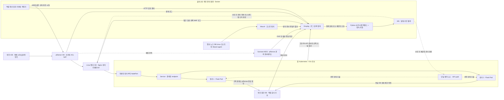

# SKT ALEPH · 가용성 사고 대응 아키텍처 분석 보고서

기준일: 2026-10-16 (Asia/Seoul) · 조사 기준: `codex/market-research`, HEAD `8ff155e` · 상태: 설계 제안, 미구현·미실측

이 보고서는 사용자에게 전달받은 강사 조언, 저장소·현재 PC의 읽기 전용 조사, 공식 기술 문서를 구분해 작성했다. 실행 코드·계약·작업 DAG·제품 설정은 변경하지 않았고 신규 설치·공격·장애 주입도 수행하지 않았다. 아래 점수·자원 예산·임계값은 설계 판단이며 측정 결과가 아니다.

## 1. 추천 주제와 결론

**주제: 통신사 외주 유지보수 포털의 가용성 침해 탐지·티켓 기반 대응·정상 업무 복구 검증.**

기존 업체 A/B의 작업 신청→운영자 승인→고정 합성 점검→자기 결과 조회를 정상 업무로 유지한다. 기존 계정·세션 회수와 B 업무 유지에, 서비스 가용성·복구 실험을 추가하는 제안이다. Kubernetes 운영 기능을 외주 계정에 제공하는 서비스로 바꾸지는 않는다.

핵심 목표는 세 가지다.

1. NIDS·HIDS·앱·가용성 관측을 근거 수준에 맞게 연결하고, 탐지 이벤트와 담당·승인·진행 상태가 있는 인시던트 티켓을 구분한다.
2. 서비스 자동 복구와 공격 원인 차단을 분리해, 승인된 대응·업무 복귀·실패/미확인 판정까지 검증한다.
3. 같은 정상 업무·장애 입력으로 Compose와 Kubernetes를 비교해 실패 요청, 복구 시간, 정상 B 업무 성공률을 측정한다.

**추천 목표 구조는 C(앱 Kubernetes + 외부 보안/티켓 계통)이며, A(Compose)를 먼저 비교 기준으로 완성한다.** 실제 장비·기간이 부족하면 A를 최종 범위로 삼는다. 현재 16GB PC 한 대만을 전제로 C 전체를 즉시 실행할 수 있다고 판단하지 않는다. B처럼 보안 검색·자동화·DB까지 모두 Kubernetes로 옮기는 것은 이번 팀에 권하지 않는다.

Kubernetes 채택 조건은 다음과 같다. 두 워커에 분산된 앱, readiness 기반 트래픽 제외, 장애 후 재배치, 제한된 HPA 중 적어도 핵심 비교 실험을 재현할 수 있어야 한다. 단일 Pod를 재시작하는 시연만 남는다면 도입 효과보다 운영 부담이 크다.

## 2. 강사 조언·우리 해석·확인이 필요한 것

| 구분 | 확인된 입력 | 해석 또는 남은 질문 |
| --- | --- | --- |
| 강사 키워드 | 사용자가 전한 SDI, NIDS, HIDS, 장비 부족, LB 어려움, Availability, 티켓 대응 | 강사 원문·평가표를 직접 확인한 것은 아님 |
| 조언의 취지 | 사용자는 사고 시나리오와 탐지→분석→대응→복구를 중시한다고 해석 | 설계에 적합한 해석이지만 강사에게 확인받은 결론은 아님 |
| SDI | 정확한 확장어 미확인 | Software-Defined Infrastructure가 유력한 후보. SDN이나 Kubernetes 필수 지시로 확정하지 않음 |
| 네트워크 장비 부족 | 물리 장비가 부족하다는 사용자 입력 | VMware 가상 NIC·가상 스위치·pfSense로 경로/ACL/NAT 시험을 구성하는 제안 |
| 가용성 | 사고 시나리오로 다루려는 방향 | 물리 장비·망·DB 전체 HA를 필수로 요구했다는 근거는 없음 |

SDI를 Software-Defined Infrastructure로 사용하는 1차 자료는 존재한다. 컴퓨트·네트워크 등의 구성을 소프트웨어로 다루는 방향으로 이해할 수 있지만, 강사가 같은 뜻으로 말했는지는 별도 확인이 필요하다. 이번에는 VM 구성·Compose/매니페스트·방화벽 정책의 재현성을 연결하고, SDI라는 약어만을 이유로 Terraform·OpenStack·SDN 컨트롤러를 추가하지 않는다. [IBM Research: Software defined infrastructures](https://research.ibm.com/publications/software-defined-infrastructures)

## 3. 저장소와 실행 환경 조사

| 조사 대상 | 실제 확인 | 아직 확인되지 않은 것 |
| --- | --- | --- |
| 저장소 | `codex/market-research`, HEAD `8ff155e` | 팀 최종 합의·정확한 프로젝트 기간 |
| 앱 | Python ≥3.12, Flask ≥3.1,<4. `create_app`, `/`, `/api/v1/health` | 로그인·업체 인가·DB·업무 기능·사건 처리 |
| 상태 API | `stage=scaffold` 고정 응답 | DB 사용 가능·업무 처리 가능을 보장하는 readiness가 아님 |
| 계약 | 이벤트 4종, username/IP 필수. 사건은 단일 `response_state` | NIDS·호스트·K8s 이벤트, 효과·관측·복귀의 별도 표현 |
| 인프라 코드 | 조사한 저장소에 Compose/K8s 배포 파일 없음 | 실행 중인 컨테이너의 원본 구성·본 프로젝트 연결 여부 |
| 호스트 | i7-10700, 8코어/16스레드, RAM 15.8 GiB | 팀원 PC 사양·공용 자원·물리 장애 도메인 |
| Docker | Linux/WSL2 서버 응답, 메모리 보고값 약 5.8 GiB | 추가 구성의 지속 부하·자원 여유 |
| 기존 컨테이너 | Wazuh 4.9.0 계열 3개, Graylog 6.1/MongoDB 6.0/OpenSearch 2.5.0, n8n, MySQL 8.0 | 선택 버전의 지원·호환성·에이전트·입력·실제 로그 전달 |
| 메모리 단면 | `docker stats --no-stream`에서 8개 사용량 단순 합계 약 3.9 GiB | 호스트 전체 사용량과 다름. 순간값이며 피크·요구량 보장 아님 |
| Kubernetes | Docker 번들의 kubectl 존재, `config get-contexts`에 등록 항목 없음 | 다른 환경의 클러스터 존재 여부. 이 PC의 사용 가능한 클러스터는 확인 못 함 |
| VMware | 앞선 오전 조회에서 실행 FreeBSD 이름 VM 1개 관찰 | pfSense 여부·NIC·라우팅. VM 이름만으로 제품을 확정하지 않음 |

확인 파일: [앱 라우트](../src/aleph_soar/web.py), [앱 팩토리](../src/aleph_soar/__init__.py), [의존성](../pyproject.toml), [이벤트 계약](../contracts/event.schema.json), [사건 계약](../contracts/incident.schema.json). 기존 테스트 29개 통과는 앞선 오전 복구 세션의 결과이며 이번 분석에서 새 기능 시험을 수행한 것은 아니다.

Docker 실행 상태는 기술 사용 경험의 근거일 뿐 통합 완료 증거가 아니다. 현재 태그를 새 배포의 권장 버전으로 그대로 확정하지 않는다. 앞서 만든 권한표·G1 문서 등 미커밋 변경은 그대로 보존한다.

## 4. A/B/C 비교와 10점 평가

| 방안 | 배치 | 적합한 목표 | 부담 |
| --- | --- | --- | --- |
| A · Compose | 앱·Nginx·보안·티켓을 Compose 서비스로 구성. 경계는 VM/pfSense로 별도 확보 | 사고 대응의 전체 흐름을 빨리 완성하고 기준선 확보 | 다중 호스트 자동 배치·HPA는 제공하지 않아 직접 운영 필요 |
| B · Kubernetes 중심 | 앱·보안 검색·자동화·영속 데이터까지 클러스터로 운영 | 충분한 자원·시간이 있는 플랫폼 운영 프로젝트 | 스토리지·상태 저장 서비스·권한·업그레이드·관제 복구까지 학습 범위 확대 |
| C · 하이브리드 | 앱만 K8s, 보안/티켓/업무 DB는 외부 환경 | 앱 복구·재배치와 독립적인 사고 분석 비교 | 두 운영 환경의 라우팅·로그·인증과 자원 배치 필요 |

아래는 4인·기존 Docker 경험·기간 미정·현재 16GB PC와 추가 장비 가능성 미확인 조건의 **설계 적합도**다. 전 항목 10점이 유리하다. 따라서 ‘난이도’는 쉬울수록, ‘자원’은 적게 요구할수록 높다. 완성도는 현재 구현 평가가 아니라 해당 범위를 완성할 가능성과 설계 일관성에 대한 판단이다.

| 기준 | A | B | C | 평가 근거 |
| --- | ---: | ---: | ---: | --- |
| 기술적 완성도 | 7 | 8 | 9 | A는 범위가 작고, C는 앱 복구와 관제 분리를 함께 검증 가능. B는 이론적 범위는 넓으나 구현 부담 큼 |
| 네트워크·보안 직무 연관성 | 8 | 9 | 9 | 세 안 모두 경로·탐지·티켓 구현 가능. B/C는 컨테이너 망·제어 API 보안 추가 |
| 구현 난이도: 쉬움 | 9 | 3 | 6 | A는 기존 기술 재사용, B는 상태 저장 플랫폼까지, C는 앱 K8s로 한정 |
| 자원 요구: 적음 | 8 | 3 | 5 | C도 전체 메모리는 필요. 외부 배치가 사용량 자체를 없애지는 않음 |
| 실습 가능성 | 9 | 4 | 7 | A 우세. C는 VM/추가 PC·노드 간 경로 확인 조건 |
| 장애 대응 검증 가능성 | 7 | 9 | 9 | A도 대응 검증 가능하나, B/C는 선언 상태·노드 재배치 비교가 용이 |
| 4인 협업 적합성 | 8 | 6 | 9 | C는 망/앱/탐지/검증 경계를 나누기 좋음. 공통 계약 소유자는 필요 |
| 포트폴리오 가치 | 7 | 8 | 9 | 사용 도구 수보다 비교 실험·근거·한계 설명을 평가한 점수 |
| 합계 / 80 | 63 | 50 | 63 | 동일 가중치 |
| 평균 / 10 | 7.9 | 6.3 | 7.9 | 소수점은 계산값이며 객관적 성능 측정이 아님 |

A와 C는 동점이다. **현재 장비 한 대에서 완주 확률을 우선하면 A, Kubernetes의 효과를 실험으로 보여주는 목표와 추가 자원이 확보되면 C**를 선택한다. 추천은 A를 폐기하는 전면 이전이 아니라 A를 기준선으로 남기는 단계적 C다. Kubernetes 사용 자체를 채점 우위나 취업 성과로 보장하지 않는다.

## 5. Kubernetes가 제공하는 것과 제공하지 않는 것

| 기능 | 프로젝트 사용 | 한계·검증 |
| --- | --- | --- |
| Deployment/ReplicaSet | 앱 목표 replica 2, 장애 후 개수 복원 | 같은 노드에 2개면 노드 장애는 함께 영향. 초기 분산과 남은 노드 수용량 필요 |
| kubelet 재시작 | 프로세스 종료·liveness 실패 시 컨테이너 재시작 | 같은 Pod 안의 재시작과 새 UID Pod 생성·다른 노드 배치는 구분 |
| readiness | 업무를 받을 수 없는 Pod를 Service 대상에서 제외 | 이미 처리 중인 요청·기존 연결·앱 데이터 일관성까지 보장하지 않음 |
| startup/liveness | 느린 기동 보호·프로세스 교착 복구 | DB 일시 장애를 liveness로 연결해 모든 Pod를 반복 재시작하지 않음 |
| Service | Pod 변화 뒤에도 안정된 접근점과 준비된 endpoint 사용 | 외부 VIP·L7 보안·서비스 전체 HA를 자동 제공하지 않음 |
| HPA | CPU 기반 2→최대 4 replica의 제한 실험 후보 | Metrics API, CPU requests, 수용 자원 필요. 노드 수·물리 CPU 자동 증가 아님 |
| NetworkPolicy | 기본 거부와 필요한 앱/DB/DNS/로그 경로 허용 | 지원 구현이 필요. 사용자·HTTP URL 권한·TLS 내부 검사와 다름 |
| RBAC | 배포·조회·대응 권한을 별도 주체로 제한 | K8s API 권한이며 업체별 업무 데이터 인가를 대신하지 않음 |

프로브의 대상 제외와 재시작 역할은 공식 문서에 구분돼 있다. 이 저장소의 현재 `/api/v1/health`를 그대로 업무 readiness로 사용하는 것은 부적합하다. 향후 저비용 생존 검사와 업무 준비 상태를 분리해야 한다. [Kubernetes 프로브](https://kubernetes.io/docs/tasks/configure-pod-container/configure-liveness-readiness-probes/)

HPA의 CPU 사용률 방식은 requests 설정과 메트릭 공급이 필요하다. 일반적인 공급자는 Metrics Server이며 선택 K3s 구성의 포함·동작을 실제 확인한다. Prometheus/Grafana는 기본 CPU HPA의 필수 조건이 아니다. 공격 트래픽을 무조건 확장하면 자원 소모를 늘릴 수 있어 차단·속도 제한과 별도 실험한다. [HPA](https://kubernetes.io/docs/concepts/workloads/autoscaling/horizontal-pod-autoscale/)

Compose도 프로세스 종료에 대한 restart policy와 healthcheck를 제공한다. `depends_on: service_healthy`는 기동 의존성 처리이며, healthcheck만으로 운영 중 unhealthy 컨테이너의 자동 교체·LB 제외·다른 호스트 배치가 완성되는 것은 아니다. 비교군 A에도 Nginx·restart policy를 넣어 공정하게 비교한다. [Docker 재시작 정책](https://docs.docker.com/engine/containers/start-containers-automatically/), [Compose 기동 순서](https://docs.docker.com/compose/how-tos/startup-order/)

두 워커를 쓰더라도 상태를 앱 메모리나 워커 로컬 파일에만 두면 복구가 끊긴다. 계정·세션 회수 버전·작업·결과는 외부 DB에 두고 모든 replica가 같은 상태를 검사한다. 고정 합성 작업의 중복 처리는 작업 ID/멱등 키·DB 조건으로 막는다. replica를 늘리는 것으로 중복 승인·중복 실행을 해결했다고 주장하지 않는다.

## 6. 추천 C 구성도와 통신 흐름

아래는 목표 논리도이며 구축 완료 그림이 아니다. 보안/티켓 계통은 앱 클러스터 밖에 두고, 가능하면 별도 물리 PC에 배치한다.



### 실제 배치 원칙

- pfSense가 시험 클라이언트–엣지, 엣지–노드, 앱–DB 등의 선택 구역 경계를 실제로 중계하도록 VM NIC·서브넷·라우트를 확인한다. 한 Docker bridge에 이름만 나눠 붙이는 방식은 이 증거가 아니다.
- NodePort는 엣지의 허용 주소에서만 접근한다. 외부 사용자가 WAF/게이트웨이를 우회해 워커·DB·관리 UI·K8s API에 접근하지 못하는지 별도 시험한다.
- 클러스터 밖 n8n이 ClusterIP나 변하는 Pod IP에 직접 접속한다고 가정하지 않는다. 앱 조치는 관리망에서만 접근하는 Nginx 리스너→허용 NodePort→앱 관리 API 경로와 별도 인증/인가로 연결한다. 공개 리스너에는 해당 관리 경로를 노출하지 않는다. 엣지 자체가 장애인 경우의 설정 복원은 별도 관리 접속을 통한 수동 절차로 남긴다.
- 워커 간 CNI 통신은 필요한 노드 간 경로를 명시적으로 허용한다. 같은 노드의 Pod 통신과 overlay 내부가 pfSense에 모두 보인다고 가정하지 않는다.
- Nginx를 기존 R08의 WAF라고 부르지 않는다. WAF 증적이 필요하면 CRS 공식 Nginx/ModSecurity 또는 Apache 계열 이미지를 한 가지 선택해 실제 blocking을 시험한다. 기본 LB와 WAF 기능을 구분하고 다중 upstream 설정의 호환성도 G1에서 확인한다. [CRS 공식 이미지](https://github.com/coreruleset/modsecurity-crs-docker)
- 앱 개발은 기존 Flask를 재사용한다. React·Spring Boot·서비스 메시·별도 APM을 동시에 추가하지 않는다.
- DB는 외부 단일 인스턴스로 시작한다. 기존 MySQL 실습 컨테이너와 새 업무 DB를 동일시하지 않는다. 기존 R08의 MariaDB Audit 후보는 유지하되 별도 작은 검증 후 선택한다. DB 이중화는 MVP 범위 밖이다.
- 티켓 백엔드와 저장소는 앱 Pod 장애와 분리한다. 단일 프로세스 MVP의 SQLite 또는 별도 제한 DB를 후보로 삼고 영속화·재시작 복원을 시험한다. n8n 실행 이력이나 Graylog 알림만을 티켓 원장으로 사용하지 않는다.

### 컴포넌트와 경로

| 컴포넌트 | 소유할 책임 | 주요 통신 |
| --- | --- | --- |
| pfSense | 경계 허용/거부, NAT, 경로 증거 | 지정 웹 경로, 노드 간 필수 경로, 앱→DB, 관리 전용 경로 |
| Suricata | 관측 지점의 NIDS 경보·flow/packet 증거 | 관측 인터페이스→원본 로그→중앙 입력 |
| Nginx | TLS 종료·L7 접근점·워커 upstream 분산·로그 | 공개 HTTPS→허용 NodePort. HTTP 앱 구간은 격리 랩에 한정해 선택 |
| K3s/Flask | 앱 replica·프로브·계정/객체 인가·업무 처리 | Service/Pod→DB, 제한된 로그 전달 |
| Wazuh | 호스트 FIM·선택 OS/인증/감사 로그 분석 | Linux agent→manager, 탐지 경보→중앙 수집 |
| Graylog | 파싱·검색·시간축·임계 집계·알림 | 소스 입력→사건 계통에 이벤트 전달 |
| Python 티켓 백엔드 | 다중 이벤트 연결·중복 방지·담당·승인·상태·증적 참조 | 인증된 이벤트 수신/조회, 영속 저장, n8n |
| n8n | 자동 등록 후 알림·승인 대기·제한된 실행 절차 | 티켓 ID/operation ID를 전달, 결과를 티켓에 환류 |
| 독립 측정기 | 정상 B 업무·HTTP 결과·지연·예정 작업 대조 | 실제 공개 경로 사용, 관측 결과를 클러스터 외부에 저장 |

방화벽 포트표는 설치 버전·CNI·선택 전달 방식에 따라 확정한다. 예를 들어 K3s API 6443/TCP와 기본 Flannel VXLAN의 노드 간 경로 등은 관리/노드 주소에 한정한다. 광범위한 포트 개방이나 방화벽 해제를 설계 전제로 삼지 않는다. [K3s 요구사항](https://docs.k3s.io/installation/requirements)

## 7. NIDS·HIDS·상관 분석의 역할과 한계

**NIDS는 Suricata 한 종류만 추가 검토한다.** pfSense는 Snort/Suricata 패키지로 IDS 역할을 구성할 수 있다. 실제 pfSense 여부·버전·패키지·vNIC 캡처·양방향 트래픽·드롭률을 확인하고 초기에는 탐지 전용으로 둔다. 가상 환경에서 인라인 IPS가 자동으로 동작한다고 가정하지 않는다. [Netgate IDS/IPS](https://docs.netgate.com/pfsense/en/latest/packages/snort/index.html)

**Wazuh는 호스트 탐지, Graylog는 공통 로그 분석 진입점으로 배정한다.** Wazuh 자체도 로그 분석·SIEM 기능을 갖지만 이 설계에서는 중복된 사건 원장을 만들지 않도록 역할을 나눈다. Linux 엣지/노드/DB VM에 agent를 두고 실제 설정 경로·OS 로그·선택 감사 파일을 관측한다. Wazuh FIM은 파일 속성·해시 변화와 서버 분석 경보를 연결한다. FIM 경보만으로 프로세스 행위 전체, SQL 조회, 모든 Pod 내부 변경을 보았다고 주장하지 않는다. [Wazuh FIM](https://documentation.wazuh.com/current/user-manual/capabilities/file-integrity/how-it-works.html), [아키텍처](https://documentation.wazuh.com/current/getting-started/architecture.html)

Kubernetes API 감사는 명시적인 정책·출력 설정이 필요하다. 기본 활성 상태를 가정하지 않는다. Metadata 수준으로 행위자·동작·객체·응답을 우선 남기고, scale 값 등 필요한 요청 내용은 비밀이 없는 선택 리소스에 한해 추가 수집을 검토한다. `kubectl get events`는 보안 API 감사 로그의 대체물이 아니다. [Kubernetes Auditing](https://kubernetes.io/docs/tasks/debug/debug-cluster/audit/)

Wazuh 경보→Graylog, Suricata→Graylog, 앱 CRI 로그→Graylog는 각각 전달 설정과 파서가 필요하다. 자동 연결된 상태가 아니다. 기존 에이전트·전달기를 재사용할 수 있는 경로를 먼저 시험하고, 불가능한 소스에만 전달기 한 종류를 추가한다. 호스트 CPU/cgroup 측정은 선택 수집·맞춤 규칙이 필요하며 FIM에 기본 제공되는 부하 탐지로 설명하지 않는다.

Graylog 공식 문서는 복합 이벤트 상관을 Enterprise 기능으로 안내한다. 설치된 6.1의 라이선스·기능을 확인하기 전 기본안에서 의존하지 않는다. 단일 집계는 Graylog 후보, 여러 소스·순서·사건 상태 연결은 작은 Python 모듈 후보로 둔다. 기본 HTTP 알림으로 인증된 수신 경로를 연결할 수 있는지 먼저 시험하며, 실제 지원이 다르면 제한된 API 조회 방식을 검토한다. [상관 기능](https://go2docs.graylog.org/current/interacting_with_your_log_data/correlation_engine.html), [HTTP 알림](https://go2docs.graylog.org/current/interacting_with_your_log_data/alert_types.htm)

### 상관 키 설계

| 근거 | 연결에 보존할 키 | 주의점 |
| --- | --- | --- |
| 모든 소스 | source instance + source event ID, 발생/관측/수집 시각, 서비스·자산 | UTC 저장·KST 표시, 시계 오차와 수집 지연을 별도 기록 |
| Suricata/pfSense | 센서 ID·기동 구분·flow_id, 5-tuple, 관측 구역, NAT/state 대응 | IP만으로 계정/Pod 동일시 금지. flow_id의 전역 유일성도 가정하지 않음 |
| Nginx/앱 | 신뢰 프록시가 생성/덮어쓴 request ID, upstream 주소, 앱 계정·업체·작업 ID | 원본 client IP와 프록시 IP 구분. 외부 입력 헤더를 그대로 믿지 않음 |
| Kubernetes | cluster·namespace·workload UID·Pod UID·node, 그 시점의 IP 매핑 | Pod IP 재사용·Service NAT·overlay로 시간에 따라 연결이 바뀜 |
| Wazuh/감사 | agent ID·host·경로·hash, auditID·주체·verb·object | 노드 로그와 Pod/컨테이너 ID의 연결을 실제 수집 범위에서 검증 |
| 티켓 | 서비스·관련 자산·규칙/원인 가설·사건 episode, 관련 event ID | 시험 run_id를 알아야만 탐지할 수 있는 방식으로 만들지 않음 |

증거 관계는 `확인 / 후보 / 연결 불가`로 나눈다. ‘같은 서비스에서 30초 안에 발생’은 조사 후보이며 동일 공격의 인과관계 확정이 아니다. 공격 담당자만 아는 `run_id`는 사후 정답 대조용으로 두고 탐지 규칙의 정답 입력으로 사용하지 않는다.

### Kubernetes 네트워크 가시성

- pfSense NIDS는 실제 통과한 트래픽만 본다. 같은 노드 Pod 간 통신·다른 vSwitch 우회·overlay 내부 흐름을 자동으로 모두 보지 못한다.
- TLS 구간에서는 L4 연결 패턴·일부 TLS 메타데이터를 관측할 수 있지만 HTTP URL·계정·본문을 읽는다고 설명하지 않는다. Suricata 자체의 일반 TLS 복호화를 전제로 삼지 않는다. [Suricata TLS 관측 한계](https://docs.suricata.io/en/suricata-7.0.13/3rd-party-integration/symantec-sslv.html)
- 요청 수준 증거는 TLS 종료점의 Nginx와 앱에서 보완한다. 격리 랩에서만 내부 HTTP를 선택해 캡처하거나, 암호화를 유지하면 내부 패킷 내용 가시성 한계를 남긴다.
- NetworkPolicy는 지원 컨트롤러가 있어야 효력이 있다. K3s는 기본 네트워크 정책 컨트롤러를 제공하지만 선택 설치에서 활성 상태와 실제 TCP 허용/거부를 확인한다. 정책 YAML 존재·ping 결과만으로 검증하지 않는다. [NetworkPolicy](https://kubernetes.io/docs/concepts/services-networking/network-policies/), [K3s 네트워크](https://docs.k3s.io/networking/networking-services)
- Cilium/Hubble·서비스 메시·eBPF 센서는 기본안에서 제외한다. 전체 동서 트래픽 관측이 필수로 확정되면 기존 센서로 충족하는지부터 재평가한다.

모든 사고에서 NIDS와 HIDS 경보가 동시에 나와야 하는 것은 아니다. 부하 사고는 네트워크·호스트 증거를 함께 얻을 수 있지만, 설정 변조는 FIM/감사 중심일 수 있다. 없는 신호를 만들어 한 티켓에 끼워 넣지 않는다.

## 8. 물리 LB 없는 구성과 가용성 범위

| 구성 요소 | 역할 | 이번 기본안 | 한계 |
| --- | --- | --- | --- |
| Service ClusterIP | 안정된 내부 접근점·준비 endpoint 연결 | 사용 | 외부 클라이언트가 바로 접근하는 VIP가 아님 |
| Service NodePort | 지정 node IP/port로 외부 진입 | 엣지에서만 접근하도록 제한해 사용 | 노드 장애·노출 범위·원본 IP/NAT 해석 필요 |
| Nginx OSS | L7 프록시·TLS·여러 워커 주소의 upstream 분산 | 사용 | 단일 Nginx는 SPOF. 장애 전환 중 요청 실패 가능 |
| MetalLB | 온프레미스 LoadBalancer IP 할당·광고 | 기본안 제외, VIP 실험이 필요할 때 추가 | L2/BGP 도달성·IP 충돌·VM/WSL 경계 확인 필요 |
| K3s ServiceLB | K3s가 제공하는 LoadBalancer 구현 | 위 NodePort 경로와 중복 배치를 피하도록 구성 검토 | MetalLB와 무계획 중복 금지. 선택 K3s 기본 서비스 확인 |

NodePort를 향하는 Nginx는 고정 워커 주소를 사용하고 Pod 변경은 Service가 처리한다. 연결 장애 감지·timeout·재시도 설정은 시험한다. Nginx OSS의 기본 수동 상태 확인과 Nginx Plus의 능동 health check를 혼동하지 않는다. 비멱등 작업 POST를 무조건 다른 upstream으로 재전송하지 않으며 앱의 멱등 키를 별도로 둔다. [Service](https://kubernetes.io/docs/concepts/services-networking/service/), [Nginx HTTP health checks](https://docs.nginx.com/nginx/admin-guide/load-balancer/http-health-check/)

MetalLB L2는 VIP 하나를 광고하는 노드가 입구가 되고 이후 Service 경로가 Pod로 분배한다. 모든 노드의 외부 대역폭을 합치거나 Nginx·방화벽·DB까지 이중화하는 도구가 아니다. 이 프로젝트의 외부 진입은 Nginx→NodePort로 먼저 완성할 수 있다. [MetalLB L2](https://metallb.io/concepts/layer2/)

### 장애 시 실제 동작

1. 한 프로세스 장애: 정상 replica가 요청을 처리하는 동안 kubelet 재시작·프로브 결과를 관찰한다. readiness 반영 전과 처리 중 요청은 실패할 수 있다.
2. Pod 삭제: Deployment가 다른 UID의 Pod를 생성한다. 기존 Pod가 다른 노드로 이동했다고 표현하지 않는다. [Pod 생명주기](https://kubernetes.io/docs/concepts/workloads/pods/pod-lifecycle/)
3. 워커 장애: 정상 워커 endpoint와 Nginx의 실패 upstream 처리가 업무를 이어가도록 설계한다. 새 replica 생성에는 노드 상태 감지·퇴거 대기·스케줄·이미지 기동 시간이 필요하다. 기본 not-ready/unreachable toleration은 보통 300초이므로 즉시 재배치를 약속하지 않는다. [Taints/Tolerations](https://kubernetes.io/docs/concepts/scheduling-eviction/taint-and-toleration/)
4. 자원 부족: 새 Pod가 Pending이면 개수 목표가 있어도 처리 용량은 회복되지 않는다. HPA가 증가를 요청한 시각과 Ready replica 증가 시각을 분리한다.

### SPOF와 주장 가능한 범위

| 배치·장애점 | 실제 가능한 주장 | 남는 한계 |
| --- | --- | --- |
| 단일 노드·여러 Pod | 프로세스/Pod 장애의 복구 실험 | 노드·물리 PC 장애 시 함께 중단 |
| 단일 PC의 여러 VM 노드 | 워커 VM 장애·재배치의 논리 실험 | 물리 PC·메모리·전원·NIC 공통 SPOF |
| 여러 물리 PC의 워커 | 선택 워커/호스트 장애 시 앱 연속성 시험 | 네트워크·외부 진입·DB·제어 노드 등 전체 HA와 다름 |
| 단일 제어 노드 | 제어 노드가 정상인 조건의 배치·확장 | 제어 노드 중단 시 기존 트래픽 일부가 살아도 신규 스케줄/HPA 등 보장 불가 |
| 단일 DB | 외부 DB 상태를 공유한 앱 replica 복구 | DB 장애 때 업무 중단. Pod replica로 해결되지 않음 |
| 단일 pfSense/Nginx | 각 장비가 정상인 조건의 앱 복원 | 해당 경계/게이트웨이 장애는 별도 중단 원인 |
| 관리 스택·티켓 저장소 | 앱 클러스터와 분리된 관측 | 같은 물리 PC면 독립 장애 도메인이 아님. 관제 장애는 미확인으로 표시 |

이번 목표 표현은 **“명시한 장애 범위의 앱 가용성·복원력 검증”**이 적절하다. 운영 수준의 전체 고가용성이나 SLA를 주장하지 않는다. K3s embedded etcd 제어 계층 HA는 3개 이상 server 등 별도 구성이 필요하며 MVP에서 제외한다. [K3s HA](https://docs.k3s.io/datastore/ha-embedded)

## 9. 가용성 침해 시나리오 3가지

모든 시나리오는 소유한 격리 랩·합성 데이터·제한된 대상에서 준비한다. 공격 경로가 실제로 발견된 것과 테스트 계정/운영 권한 침해를 가정한 것을 구분한다. 아래 규칙 수치는 초기 후보이며 정상 기준선·장비·시계/수집 지연 측정 뒤 고정한다.

### AV-01 · 테스트 계정 악용에 의한 제한 부하와 정상 B 업무 침해

- 조건: 테스트 A 자격 증명 악용을 가정해 허용된 합성 작업/조회에 제한 요청을 보낸다. B는 별도 생성기로 같은 WAF/게이트웨이 경로에서 정상 신청·조회한다.
- 입력: 저부하부터 보정하고 전용 앱 자원 제한 내에서 단계적으로 올린다. 시작 상한 후보는 동시성 4·20 RPS·60초이며 포화가 안 되면 실패 주입 미성립으로 기록한다. 그 수치가 반드시 장애를 일으킨다고 가정하지 않는다. 호스트 메모리 90% 등 사전 중단 조건·대상·최대 지속 시간을 정하고 외부 주소에는 실행하지 않는다.
- 탐지: NIDS의 선택 L4 패턴 임계 경보, Nginx 요청/오류 집계, 호스트 cgroup/CPU의 선택 수집, 독립 B 지연·실패를 대조한다. Suricata 규칙은 `count/seconds/track` 등을 선택 버전에 맞춰 검증한다. HTTP keep-alive에서는 연결 수만으로 요청량을 알 수 없다. [Suricata 임계 규칙](https://docs.suricata.io/en/suricata-8.0.6/rules/thresholding.html)
- 초기 경보 후보: 5초 간격 업무 프로브 3회 연속 실패로 가용성 이벤트 생성. 고부하 경보만 있으면 원인을 확정하지 않고 부하 이상 후보로 등록한다.
- 증거: 센서 원본·캡처 손실, Nginx access/error, 앱 계정/작업, 실제 CPU·replica/Ready/메트릭, 독립 B 예정/완료/지연·실패.
- 대응: 티켓 자동 등록·증적 참조 수집은 자동. 운영 담당이 영향 확인, 보안 담당 승인 후 A 계정·기존 세션 회수 또는 좁은 속도 제한을 적용한다. 공유 NAT의 전체 IP 자동 차단은 기본 대응으로 쓰지 않는다.
- 복구: 공격 입력 중지와 실제 차단 효과를 구분한다. 부하를 중지해서 회복된 것을 차단 성공으로 기록하지 않는다. 승인 후 같은 제한 입력으로 A의 거부와 B 유지 재시험.
- K8s 실험: 고정 2 replica와 HPA 2→4를 별도 반복. HPA는 가용성 보조이며 공격 분류·원인 제거가 아니다. 물리 자원이 부족하거나 DB가 병목이면 개선되지 않을 수 있다.

### AV-02 · 제한된 운영 권한 악용으로 앱 실행 단위 제거

- 조건: 랩 전용 운영 테스트 주체의 권한 악용을 가정해 지정 앱 Pod 하나를 삭제한다. 외주 업무 계정에 K8s 권한을 부여하지 않는다. 실제 초기 침투 경로·취약점 발견 시나리오와는 다르다.
- 탐지: K8s 감사의 actor/verb/object/auditID와 선택 OS/컨테이너 로그를 Wazuh/중앙에서 관측한다. 외부 프로브·Nginx upstream 오류·Ready/replica 변화를 연결한다. 암호화된 API 트래픽의 NIDS가 삭제 명령 내용을 알았다고 주장하지 않는다.
- 증거: 삭제 API 감사·허용 범위, 기존/새 Pod UID·노드·시각, 컨테이너 재시작 횟수, 정상 B 작업 ID와 실제 응답. 단순 가용성 이벤트와 권한 악용 후보는 별도로 표시한다.
- 자동: K8s가 목표 개수를 복원하고 새 Pod가 준비되면 트래픽에 참여한다. 그 전에 서비스가 정상이라면 사고 영향도는 실제 실패 요청 수로 평가한다.
- 보안 대응: 티켓에서 운영 변경 승인 여부와 행위자를 조사하고, 보안 담당 승인 후 테스트 운영 자격 증명을 회수한다. Pod가 재생성됐다는 이유로 침해 원인 해결·성공 종결하지 않는다.
- 실패 대조: 올바른 승인 변경은 낮은 우선순위/운영 이벤트로 분류. HPA를 끈 별도 시험에서 목표 replica 자체가 0으로 바뀌면 자동 복구가 2로 되돌리지 않음을 확인한다. 선언 상태 변조는 승인된 기준 복원이 필요하다.
- 확장 장애 주입: 보안 공격과 구분한 워커 VM 중단 시험으로 실제 다른 노드의 복원·유지 능력을 확인한다. 제어 노드 정상·남은 워커 용량·외부 진입 조건을 고정한다.

### AV-03 · 엣지 설정 변조로 정상 업무를 잘못된 upstream에 전달

- 조건: 엣지의 시험 관리자 권한 침해를 가정하고, 전용 Nginx 설정의 upstream 하나를 존재하지 않는 시험 목적지로 바꾼다. 정상 경로·원본 설정·허가 변경 창을 먼저 기록한다.
- 탐지: Wazuh FIM의 경로·전후 해시와 허가 변경 기록을 대조하고, Nginx 연결 오류·독립 업무 프로브 실패로 영향을 검증한다. FIM만으로 악성 의도를 확정하지 않는다.
- 증거: 제한된 감사/로그의 주체, 변경 파일·해시·시각, 적용 결과·upstream 오류, B 업무 실패/회복 기록. NIDS는 보이는 흐름의 보강 증거이며 경보가 필수는 아니다.
- 대응: 분석 담당이 신뢰 기준과 후속 정상 변경 충돌을 확인한다. 보안 담당 승인 뒤 이전 설정의 무조건 덮어쓰기가 아니라 검증된 기준으로 복원하고, 설정 검사·reload를 수행하는 제한 절차를 둔다. 초기 MVP는 수동 실행이 적절하다.
- 복구: 실제 공개 경로의 로그인·신청·결과 조회, 원래 권한·설정 해시, 이전 잘못된 경로 부재를 독립 검증한다. 로그가 끊겼으면 미확인으로 유지한다.
- 의미: 클러스터 밖의 설정은 앱 Pod restart·HPA로 복구되지 않는다. Kubernetes 자동 복구와 보안 사고 복구의 경계를 보여주는 사례다.

## 10. 티켓 자동 생성·승인·데이터 구조

흐름은 **원본 관측→탐지 이벤트→사건 후보 연결→티켓 등록/갱신→담당 배정→승인→조치→효과 검증→복귀 승인/검증→종결**이다. 운영 장애도 티켓은 만들 수 있으며 security cause는 미확인으로 둔다.

Graylog HTTP 알림→인증된 사건 수신부→멱등 저장→n8n 절차를 목표로 한다. n8n 웹훅은 인증을 구성할 수 있으나 현재 인스턴스에 해당 절차가 있는지는 확인하지 않았다. HTTP 수신 200만으로 티켓 영속 저장을 성공 처리하지 않는다. [n8n Webhook](https://docs.n8n.io/integrations/builtin/core-nodes/n8n-nodes-base.webhook/)

소스 이벤트는 `(source_instance, source_event_id)`로 중복 제거한다. 티켓은 서비스·규칙군·대상·열린 episode 기준으로 생성/추가하고 DB 유일성·트랜잭션으로 동시 중복을 막는다. 단순 고정 시간 버킷 경계 때문에 같은 사건이 두 장으로 나뉘지 않는지, 다른 원인이 한 장으로 섞이지 않는지 시험한다. 늦게 온 증거·조치 재시도·관제 재시작도 동일 티켓에 안전하게 반영한다.

아래는 **새 계약 제안용 합성 구조**다. 현재 incident v1.0에 넣을 수 있는 실제 응답이 아니며 ID는 예시, 시각·측정값은 미실행을 나타내는 null이다.

```json
{
  "design_version": "proposal-av-1",
  "incident_id": "example-inc-av01",
  "service_id": "telecom-maintenance-portal",
  "status": "new",
  "cause_assessment": "unconfirmed",
  "severity": "unassessed",
  "owner_role": "incident-analyst",
  "scope": {
    "environment": "isolated-lab",
    "cluster_id": null,
    "namespace": "portal-lab",
    "workload_uid": null,
    "account_id": null
  },
  "correlation": {
    "episode_key": "example-service-rule-scope-episode",
    "rule_ids": ["proposal-av01-impact"],
    "confidence": "candidate",
    "reason": "Proposed schema example; no detector has run."
  },
  "evidence": [
    {"source": "nids", "source_event_id": "example-nids-1", "collected": false},
    {"source": "host", "source_event_id": "example-host-1", "collected": false},
    {"source": "business-probe", "source_event_id": "example-probe-1", "collected": false}
  ],
  "timestamps": {
    "injected_at": null,
    "first_impact_at": null,
    "detected_at": null,
    "ticket_created_at": null,
    "approved_at": null,
    "service_recovered_at": null,
    "closed_at": null
  },
  "orchestration_observations": [],
  "actions": [{
    "operation_id": "example-op-1",
    "kind": "revoke_test_account_sessions",
    "status": "not_requested",
    "approval": {"state": "required", "actor": null, "at": null},
    "effect": {"state": "not_tested", "evidence_ids": []}
  }],
  "observation": {"state": "not_collected", "gaps": []},
  "recovery": {"approval_state": "not_requested", "validation_state": "not_tested"},
  "metrics": {"mttd_seconds": null, "restore_seconds": null, "business_success_ratio": null}
}
```

`injected_at`는 시험 정답과 지표 계산용 메타데이터다. 일반 탐지의 필수 입력이 아니며 실제 운영 사건에는 알 수 없을 수 있다. Kubernetes의 restart/scale 이력은 `orchestration_observations`에 두고 승인된 보안 조치와 구분한다.

승인 행위·실행 보고·효과·복귀 검증은 독립 상태다. 같은 조치 재시도는 같은 operation ID를 사용하고, 원복 뒤 새 조치는 새 ID를 쓴다. 효과 불일치·관측 공백·검증 실패가 남으면 성공 종결하지 않는다. 본 프로젝트의 현재 스키마는 이 구조를 지원하지 않으므로 이후 문서·스키마·예시·소비자·검증의 동시 변경이 필요하다.

## 11. 자동/수동 경계와 Kubernetes 보안 위험

| 작업 | 초기 기본안 | 통제 |
| --- | --- | --- |
| 이벤트 수집·중복 제거·티켓 생성 | 자동 | 수신 인증·영속 저장·재시도·실패 경보 |
| Pod 재시작·readiness 제외·선택 HPA | 오케스트레이터 자동 | 자원/최대 replica/프로브 설정. 보안 해결로 표시하지 않음 |
| 원본 참조·관련 증거 추가 | 자동 또는 반자동 | 비밀값 제외·출처와 관측 상태 보존 |
| 계정/토큰 회수·영향 있는 차단 | 담당 분석 후 보안 담당 승인 | 지정 랩·대상·operation ID·TTL·실제 접근 재시험 |
| 설정 복원·운영 변경 | 초기 수동, 이후 승인된 제한 자동화 | 신뢰 기준·충돌 확인·유효성 검사·원복 |
| 복귀·성공 종결 | 수동 승인 + 독립 검증 | 정상 B 업무·권한 경계·관측 상태·잔여 영향 확인 |

Kubernetes 도입은 API 자격 증명·RBAC·컨테이너 권한·CNI·이미지·감사·영속화라는 새 운영 범위를 만든다. 방어용 n8n에 cluster-admin을 주지 않는다. namespace와 가능한 리소스/동작을 좁힌 서비스 주체, 또는 대상·파라미터가 고정된 관리 중계부를 검토한다. 앱에는 필요 없으면 K8s API token 자동 마운트를 끄고, 비특권·비루트·불필요 capability 제거·자원 제한을 적용하는 것을 구현 기준으로 삼는다. [Kubernetes RBAC](https://kubernetes.io/docs/reference/access-authn-authz/rbac/)

RBAC가 있어도 넓은 Pod 생성/exec·Secret 접근 등은 다른 권한 획득 경로가 될 수 있다. ‘namespace 한정’만으로 안전하다고 끝내지 않고 실제 거부 시험을 둔다. 외주 A의 B 자료 접근은 Flask의 서버 측 인가, Pod 간 통신은 NetworkPolicy, K8s API 호출은 RBAC로 각각 검증한다.

NetworkPolicy 변경이 기존 연결까지 즉시 끊는지, pfSense 규칙 변경이 기존 state를 회수하는지는 별도 문제다. 신규 연결 거부·기존 세션/연결 회수를 분리한다. 사고 대응용 IP 차단은 계정 세션 회수의 대체물이 아니다.

## 12. 검증·지표·복구 성공 기준

### 공정한 비교 설계

1. A와 C에 같은 앱 이미지·DB 데이터·업무 비율·Nginx 정책·총 CPU/메모리 예산·요청 스케줄을 사용한다. 기준선 측정 후 설정을 고정한다.
2. A도 앱 2개·restart policy·Nginx를 사용한다. C는 2 replica 고정과 HPA 사용을 분리한다. 단일 프로세스 A 대 여러 replica C만으로 K8s 우위를 주장하지 않는다.
3. 네트워크 구조가 달라지는 다중 노드 비교는 별도 실험으로 표시한다. Compose 단일 호스트의 한계와 오케스트레이션 차이를 설명하되 다른 CPU 총량의 효과를 섞지 않는다.
4. 각 조건 최소 5회 반복을 후보로 두고, 순서를 번갈아 실행한다. 동일 warm/cold cache·이미지 사전 확보 여부·시계 오차·관측 손실·실패 주입 시각을 기록한다.
5. 장애 없는 정상·임계 미만·승인 변경·다른 계정/자산의 대조군을 포함한다. 의도적으로 로그 전달을 끊어 ‘관측 실패인데 성공 종결’하는 오류도 시험한다.

복구 판정은 200 응답 하나가 아니다. 후보 기준은 **같은 외부 경로에서 연속 60초 정상 응답과 올바른 본문, 정상 B의 신청/조회/완료, 데이터 중복·누락 없음, 필요한 권한 거부 유지, 관측 공백 없음**이다. 지연 한도·업무 완료 기한은 기준선 후 정한다. 첫 정상 응답과 안정 구간 확인 완료 시각을 모두 남긴다.

| 지표 | 정의 | 해석 |
| --- | --- | --- |
| MTTD | 탐지 이벤트 확정 시각 − 주입/사고 시작 시각의 반복 평균 | 실제 사고 시작을 모르면 최초 확인 영향 시각을 기준으로 별도 명명 |
| 티켓 지연 | 티켓 영속 저장 시각 − 탐지 시각 | 이벤트 발생과 업무 처리 시작을 분리 |
| 승인 지연 | 승인 시각 − 승인 요청 시각 | 도구 복구 속도와 사람 대기 분리 |
| MTTR(service restore) | 안정 회복 구간 시작 시각 − 최초 업무 영향 시각의 반복 평균 | 여기서 MTTR은 서비스 복원 시간. 티켓 종결 시간과 다름 |
| 격리/차단 효과 시간 | 실제 거부가 확인된 시각 − 승인 또는 조치 요청 시각 | API 성공 응답 시각과 구분 |
| 요청 가용성 | 정상 사용자에게 기대한 응답·본문·기한을 충족한 요청 / 시험창의 유효 정상 요청 | 정상 B의 timeout·5xx·예상 밖 429는 실패. 공격 A의 의도된 거부와 분리 |
| 시간 기반 가용성 | 1 − 관측 가능한 중단 구간 / 고정 시험창 | 샘플링 간격만큼 오차가 있음. 요청 지표와 섞지 않음 |
| 업무 성공률 | 기한 내 1회 완료된 정상 작업 ID / 예정 정상 작업 ID | 생성기 미발행·미완료·중복·응답 미확인을 따로 집계 |
| 부하·복원 보조 | p50/p95 지연, 실패 요청 수, Ready 수, restart·Pending 시간, CPU/메모리 | HPA desired 증가와 실제 처리 용량 증가 구분 |
| 탐지 품질 | 시나리오별 탐지/미탐, 정상 대조의 오탐, 중복 티켓 수 | 작은 합성 표본의 결과이며 실제 공격 전체 정확도로 일반화 금지 |

프로브/생성기 자체 장애는 서비스 장애로 단정하지 않는다. 해당 구간은 미확인으로 표시하고 시험 유효성을 별도 판정한다. 회복 못 한 회차를 평균에서 조용히 빼지 않고 실패/미완료로 함께 보고한다. 짧은 시연의 가용성 수치를 월간/연간 SLA로 바꾸지 않는다.

원본 증거는 `run_id`별 manifest, 입력 설정·이미지 digest·시각, client/job 결과, 소스 원본 참조·정제 관계·해시, 티켓·승인·조치·재시험, CPU/replica 시계열로 묶는다. 로그 전달 단절·중복·회전·시계 차와 민감정보 제거를 확인한다. 원본 ID 없는 합성 JSON을 실제 증거로 제시하지 않는다.

## 13. 필요한 실행 환경과 자원 계획

| 구분 | 기본 선정 | 추가 도입 조건 |
| --- | --- | --- |
| 앱 | 기존 Python/Flask + 배포용 WSGI 실행기 후보 | Flask 개발 서버를 가용성 성능 결과의 운영 서버로 사용하지 않음 |
| 가상 네트워크 | VMware·Linux VM·pfSense | 실제 vNIC/라우팅/ACL 검증. Packet Tracer는 개념도 보조이며 live 로그 경로 대체 아님 |
| 앱 오케스트레이션 | A의 Compose, C의 K3s 1 server + 2 worker 목표 | 버전·노드·자원·프로브·로그 시험 통과 후 C 진행 |
| 네트워크 보안 | pfSense + Suricata IDS 후보 | 패키지 지원·캡처 손실 검증. 자동 IPS는 초기 제외 |
| 엣지 | Nginx OSS, 필요 시 검증된 CRS 이미지 | Nginx 자체와 WAF를 구분. MetalLB·추가 ingress controller 기본 제외 |
| 호스트·중앙 분석 | 기존 Wazuh/Graylog 계통 | 설치 버전/에이전트/입력·전달/라이선스 실확인 |
| 사건·자동화 | 작은 Python 티켓 백엔드·영속 저장 + 기존 n8n | 새 외부 티켓 제품 기본 제외 |
| 지표 | 독립 Python HTTP/업무 프로브, 선택 Metrics Server | Prometheus/Grafana는 장기 시계열·대시보드 필요와 자원 여유가 생기면 추가 |
| 업무 DB | 외부 단일 DB | 기존 MySQL 재사용 여부와 MariaDB Audit 후보를 명시적으로 결정 |

K3s 공식 최소값은 server 2 CPU/2GB, agent 1 CPU/512MB이며 워크로드 자원은 별도다. 이 숫자를 전체 프로젝트 요구량으로 쓰지 않는다. [K3s 요구사항](https://docs.k3s.io/installation/requirements)

초기 **계획 예산** 후보는 관리 Docker 계통 8~12 GiB, K3s server 3~4 GiB, worker 각 2~3 GiB, 엣지·pfSense 합계 2~4 GiB, DB 1~2 GiB, 호스트 OS/측정 여유 4~6 GiB다. 실제 지원 요구량·사용량 측정 후 조정해야 하며 합계 약 22~34 GiB로 현재 PC의 16GB를 넘는다. 일부 서비스를 다른 PC로 옮기거나 시간별로 나눠 시험해야 한다. 32GB 한 대면 모든 부하에서 충분하다는 보장도 아니다.

팀 PC가 가능하면 관리 계통, 앱 노드, 엣지/측정기를 분담한다. 현재 확인된 장비는 한 대이므로 나머지 PC가 있다고 가정해 구축 일정을 확정하지 않는다. kind/k3d 같은 단일 Docker 호스트의 다중 노드는 추가 대안이지만 실제 물리 HA를 증명하지 못하며, 본안에서 새 배포 도구를 여러 개 병행 도입하지 않는다.

## 14. 팀 4인 역할과 단계별 MVP

| 담당 예시 | 주 소유 영역 | 다른 담당에게 줄 인수물 |
| --- | --- | --- |
| 1 · 망/엣지 | VM 네트워크·pfSense·Nginx·Suricata·소스 전달 | 허용표·경로/차단·NIDS 원본·센서 손실·재현 절차 |
| 2 · 앱/플랫폼 | Flask 정상 업무·인가·DB·프로브·K8s·계정/세션 조치 | 동일 이미지의 A/C 실행·업무/상태·멱등성·실제 복구 결과 |
| 3 · 관제/사건 | Wazuh·Graylog·상관·티켓·n8n 승인 | 규칙·사건/조치 상태·실패/재시도·중복 티켓 시험 |
| 4 · 검증/UI | 독립 B 생성기·시나리오 재현·증적·티켓 UI·발표 | 분모가 있는 지표·오탐/미탐·SPOF·타 담당 재현 결과 |

실제 사람 배정은 미정이다. 앱/플랫폼 담당 과부하를 피하려면 1번이 노드 VM·네트워크 준비를, 4번이 배포 재현/프로브 시험을 분담한다. 공통 스키마·환경·앱 factory는 한 조율 책임자가 순서대로 반영한다. 각 담당이 자기 소스의 전달과 증거를 먼저 책임진다.

기간이 미확정이므로 날짜 약속 대신 완료 게이트로 제안한다.

| 단계 | 구현할 최소 결과 | 다음 단계 조건·축소 기준 |
| --- | --- | --- |
| G0 · 범위/배치 | SDI 뜻·실제 기간·평가·계정/공방전 조건·장비·장애 범위 확인 | 현재 A/C 선택과 한계를 기록. 장비 부족이면 A 유지 |
| G1 · 위험 시험 | pfSense 실제 경로, NIDS 캡처, Wazuh 전용 파일, 중앙 원본, 독립 프로브. K3s 최소 2 worker 후보 검증 | 작은 입력과 원본이 확보돼야 해당 기능 채택. 가짜 성공 샘플로 대체 금지 |
| G2 · 정상 업무·A 기준선 | A/B 인증·인가·신청/승인/결과, 티켓 영속 원장, Compose 앱 2개·Nginx | 정상 B·멱등성·재시작·원복이 먼저 재현돼야 함 |
| G3 · 한 사고 완주 | AV-03 또는 AV-01 한 개의 탐지→티켓→수동 승인/조치→독립 복구 검증 | 티켓만 생성하고 끝내지 않음. 효과/관측 실패는 종결 차단 |
| G4 · C 비교 실험 | 같은 앱을 K3s 2 replica·프로브·Service에 배치, AV-02/워커 장애 비교 | 자원·수집·두 노드 조건 불충족이면 A 결과로 마감하고 K8s는 미완료 표시 |
| G5 · 보안·확장 | RBAC/NetworkPolicy 허용·거부, 선택 HPA 2→4, 기존 WAF/DB 감사 증거 보강 | HPA/시각화 추가보다 필수 계층 요건 우선. 평가에서 필수면 축소 대상에서 제외 |
| G6 · 반복·발표 | 시나리오·실패 대조 반복, 타 팀원 재현, 수치/증거·SPOF 공개 | 실제 값·제안·미확인을 구분해 발표 |

지연 시 Prometheus/Grafana, MetalLB, 복잡한 React UI, 제어 계층 HA, DB 이중화, 추가 규칙부터 제외한다. 핵심은 작은 정상 업무와 한 사고의 완주다. Kubernetes를 끝까지 넣기 위해 티켓·분석·복구 검증을 줄이지 않는다.

현재 DAG의 P01/B01/D01/U01/I01/V01은 기존 계약·S1/S4/S9 중심이며 이 제안이 반영돼 있지 않다. 후속 구현을 선택하면 기존 R08의 TEL-*와 새 AV-*를 연결하되 서로 같은 완료 ID로 처리하지 않고 계약·소비자·담당 경계를 함께 갱신해야 한다. 이번에는 파일을 바꾸지 않는다.

## 15. 최종 시연·차별점과 Kubernetes 채택의 실험적 판정

시연은 정상 B 작업을 계속 돌리면서 시작한다. 제한 사고→NIDS/HIDS/앱 근거→하나의 티켓→승인→조치→실제 효과→업무 회복을 보여주고, 마지막에 로그 공백 또는 잘못된 설정이라는 실패 대조를 제시한다. 화면의 녹색 상태와 실제 업무 성공이 불일치할 때 성공 종결이 막혀야 한다.

차별점은 도구 목록보다 다음 결과다.

1. 자동 재시작과 공격 원인 제거의 시간축을 분리한다.
2. 탐지 이벤트·사건 티켓·조치·효과·복귀를 연결하면서 다른 상태로 관리한다.
3. A/C의 공정한 비교와 정상 B 업무의 유지 여부를 함께 보고한다.
4. 네트워크 경로·암호화·NAT·Pod 식별·관측 공백의 한계를 실제 증거 수준에 맞춰 설명한다.
5. VM 다중 노드와 물리 HA의 차이, DB·제어 노드·엣지·관제 SPOF를 공개한다.

**“Kubernetes를 사용해야만 얻는 이점”에 대한 답:** 다른 오케스트레이터나 직접 구현으로도 유사한 기능을 만들 수 있으므로 기술적으로 오직 Kubernetes만 가능하다고 말할 기능은 없다. 이번 비교의 실질적 이점은 Compose 단독에 없는 **다중 노드의 선언 상태 조율·readiness endpoint 관리·자동 재배치·메트릭 기반 replica 조절을 표준 리소스로 함께 검증하는 것**이다.

| 실험 | 비교 조건 | Kubernetes 이점을 인정할 관측 | 이점이 입증되지 않는 경우 |
| --- | --- | --- | --- |
| E1 · 프로세스 장애 | A restart policy + Nginx / C 2 replica + probes | 양쪽의 재시작·실패 요청·B 완료를 비교 | 양쪽이 유사하면 ‘재시작은 K8s 전용 가치 아님’으로 결론 |
| E2 · 살아 있으나 준비 안 된 앱 | A의 healthcheck/프록시 정책 / C readiness·Service | 준비 불가 endpoint 제외 시각과 이후 실패 요청 수 개선 | readiness가 실제 업무를 반영하지 않거나 개선이 없으면 미입증 |
| E3 · 워커 VM 중단 | 제어 노드 정상·총 자원·초기 Pod 분산·남은 용량 고정 | 정상 B 유지, 새 UID의 다른 노드 생성, 목표 개수 복원. 감지/퇴거/기동 시간 분리 | 같은 물리 PC 실험이면 VM 장애 범위만. Pending·입구/DB 장애면 전체 회복 미입증 |
| E4 · 제한 부하 | C 고정 2 / C HPA 2~4, 동일 자원 상한·입력 | 메트릭→desired→Ready 증가→처리 성공/지연 개선이 이어짐 | replica 숫자만 증가, CPU/DB 병목·오류 증가면 효과 미입증 |
| E5 · 보안/선언 상태 변조 대조 | HPA 비활성 상태의 scale=0, 또는 외부 Nginx 설정 변조 | 자동 복구의 경계와 승인된 기준 복원 필요를 입증 | 이를 K8s가 자동으로 보안 복구했다고 설명하면 잘못된 결론 |

실험 결과가 유의미하게 개선되지 않거나 C를 안정적으로 반복할 자원이 없으면 **A가 이 프로젝트의 더 적절한 최종 선택**이다. 그 판단 자체가 기술 검토의 결과이며 Kubernetes 설치 여부보다 사고 대응을 끝까지 검증한 근거가 포트폴리오의 중심이다.

## 16. 분석 작업의 실제 변경·검증 범위

이 보고서 하나만 신규 작성했다. 기존 앱·계약·DAG·미커밋 문서·컨테이너·VM·제품 설정은 그대로 두었다. 신규 설치·업그레이드·배포·장애 주입·공격·보안 조치·외부 메시지 전송은 수행하지 않았다.

이번에 실제 실행한 것은 Git 상태/이력·파일 읽기, 호스트 사양·Docker info/ps/stats, kubectl 등록 컨텍스트 조회, 공식 문서 조사다. 컨텍스트가 비어 있는 것을 클러스터가 어디에도 없다는 증거로 해석하지 않았다. 새 코드가 없으므로 기능 테스트는 재실행하지 않았다.

문서 점검 결과: UTF-8 읽기·로컬 파일 링크 5개·코드 블록 짝·줄 끝 공백 검사 통과, 티켓 JSON 예시 1개 파싱 통과, 평가 합계 A=63/B=50/C=63 확인, `git diff --check` 통과. Mermaid는 문법을 수동 검토했으며 별도 렌더러 실행은 하지 않았다. 이는 문서 검증이며 제품 동작·사고 대응 실험 결과가 아니다.
