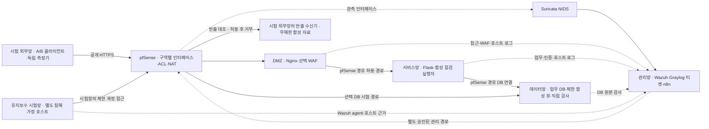

# 실제 침해 사고 기반 주제·서비스·보안 네트워크 제안

기준일: 2026-10-16 (Asia/Seoul) · 작성: Codex · 상태: 팀 검토용 설계안, 채택·구현·시험 전

## 1. 이번 검토의 결론

**추천 주제: SKT 침해 사고의 교훈을 적용한 통신 외주 유지보수 환경의 내부 접근·정보 반출 통제와 안전한 업무 복귀 검증.**

정상 서비스는 기존의 작은 통신 외주 유지보수 포털을 유지한다. 실제 사건에서 확인한 자격 증명·내부 이동·외부 송신·관측 공백의 문제를 교육용 랩에서 검증하는 제안이다. 초기 거점 확보는 통제된 시험 입력으로 제공하고, 실제 통신망·악성코드·전체 공격 체계를 구현했다고 표현하지 않는다.

기본 MVP는 Compose와 VM/pfSense 기반으로 준비하고 Kubernetes는 보류한다. 사건 대응 한 흐름을 완주한 뒤 readiness·워커 장애 재배치·HPA의 효과를 별도 비교할 자원과 시간이 확보될 때만 앱에 적용한다. 팀 전체의 최종 선택이나 P01 완료는 아직 아니다.

## 2. 팀 의견과 해석

- chacha1650a의 2026-10-16 제안: 취업을 고려해 SKT 등 실제 큰 침해 사고의 공격·방어를 모의 재현해 보자는 방향. 특정 사건·공격 단계·서비스·망 구성·담당까지 제안된 것은 아니다.
- 사용자의 회신: ① 어떤 서비스를 제공하는지 ② 보안 네트워크 구조를 어떻게 설계할지 구체화할 필요가 있다는 질문.
- 이번 해석: 실제 사고를 참고 근거로 삼고, 정상 업무·신뢰 경계·통제·복구의 검증 범위를 연결하면 두 방향을 함께 다룰 수 있다.
- 강사 조언: 사용자가 전달한 키워드와 이를 사고 대응 중심으로 이해한 해석은 [아키텍처 검토](23-availability-architecture-review.md)에서 구분했다. 실제 평가 요건·SDI의 확장어는 미확인이다.

## 3. 공식 자료로 비교한 실제 사건 3개

| 후보 | 1차 자료에서 확인한 내용 | 교육용 설계에 적용할 문제 | 현재 서비스와의 연결·부담 |
| --- | --- | --- | --- |
| SKT · 2025년 공개 조사 | 과기정통부 최종 조사에서 자격 증명 관리, 내부 접근 경로, BPFDoor 등 감염, 정보 반출과 로그 공백을 다룸 | 내부 접근 제한·호스트 관측·송신 통제·완료로 오판하지 않는 대응 | 통신 배경 유지 가능. 통신 인증 시스템·악성코드의 실제 동작은 별도 범위 |
| Change Healthcare · 2024 | 의회 제출 CEO 증언에서 탈취 자격 증명으로 MFA 없는 Citrix 포털에 접근, 내부 이동·정보 반출 후 랜섬웨어 배포를 설명 | 원격 접근·업무 중단·격리·복구 | 가용성 침해를 주제로 삼을 때 더 직접적. 의료 업무 자체로 배경을 전환할 필요는 없음 |
| Equifax · 2017 | GAO는 포털의 Apache Struts 취약점과 식별·탐지·DB 접근 분리·데이터 관리 문제를 설명 | 패치·자산 파악·망 분리·관측 공백 | 웹 진입→DB 접근 시나리오에 적합. 현재 Flask를 실제 Struts 취약점 재현으로 설명할 수는 없음 |

자료: [과기정통부 SKT 최종 조사 결과 영문](https://www.msit.go.kr/eng/bbs/view.do?bbsSeqNo=42&mId=4&mPid=2&nttSeqNo=1139&sCode=eng), [Change Healthcare 의회 증언, PDF p.5](https://www.congress.gov/118/meeting/house/117242/witnesses/HHRG-118-IF02-Wstate-WittyS-20240501-U5.pdf), [GAO-18-559 요약](https://www.gao.gov/products/gao-18-559)·[보고서 PDF pp.15~20](https://www.gao.gov/assets/gao-18-559.pdf).

선정 판단은 프로젝트 적합성에 대한 추론이다. SKT를 참고 사건으로 추천하고 Change Healthcare·Equifax는 통제 설계의 비교 사례로 남긴다. 서로 다른 세 사건의 공격 단계를 합쳐 하나의 역사적 공격 경로처럼 발표하지 않는다. 특히 가용성 부하 시험을 SKT 사건에서 확인된 공격으로 연결하지 않는다.

### 사실·추론·랩 가정의 경계

| 수준 | 이번에 사용할 내용 |
| --- | --- |
| 공식 발표 내용 | SKT 조사에서 내부 자격 증명과 송신 경로, 감염 및 로그 공백이 다뤄짐 |
| 공식 발표의 추정 | 발표 자체가 추정으로 표현한 자격 증명 재사용·일부 이동 경로는 확정 사실과 구분 |
| 팀의 교육용 가정 | 별도 유지보수 시험 호스트가 이미 침해됐다고 두고 제한된 계정·무해한 파일/송신 동작을 입력 |
| 팀의 정상 서비스 | 외주 A/B의 점검 신청·승인·결과 조회 포털. 실제 SKT 서비스나 진입 경로의 복제본이 아님 |
| 별도 확장 | 제한 부하·Pod/워커 장애·설정 변조 등 가용성 시험. 실제 SKT 사건과 동일하다고 주장하지 않음 |

## 4. 어떤 서비스를 제공하는가

서비스의 직접 사용자는 외주 정비 담당자 A/B와 업무 운영자다. 보안 담당자는 관제·사건 처리 업무를 맡는다.

1. 외주 A는 자기 담당 자산에 `health_check` 고정 합성 점검을 신청한다. 임의 명령·스크립트 업로드는 넣지 않는다.
2. 업무 운영자는 자산·기간·업무 종류를 확인해 승인/반려한다.
3. 실행자는 승인·계정 상태를 확인해 합성 결과를 1회 생성한다.
4. A는 자기 요청의 상태와 결과를 조회한다. B는 별도 정상 계정으로 같은 공개 경로에서 독립 업무를 지속한다.
5. 보안 담당자는 사건 근거·승인·조치·실제 효과·복귀 이력을 관리한다.

보호 자산은 계정/기존 세션, 업체별 작업·결과, 합성 자산 목록, 서비스 가용성, 원본 증거와 티켓 이력이다. 실제 가입자 정보·USIM 인증키·HSS/UDM 기능은 넣지 않는다. 객체별 권한 초안은 [P01 권한표](22-p01-access-and-g1-preflight.md)를 따른다.

웹 외주 계정, Linux 유지보수 시험 계정, 앱 DB 계정, 제한 DB 시험 계정, 보안 자동화 주체는 다른 신원이다. 같은 이름이나 IP라는 이유로 동일 사용자로 합치지 않는다. 웹 계정 회수만으로 OS/DB 접근까지 차단했다고 판단하지 않는다.

## 5. 보안 네트워크 구조

아래는 설계 논리도다. 모든 구역 간 허용 통신은 pfSense의 실제 경로·규칙으로 확인해야 한다. 다중 구역을 그린 것이 구축·격리 완료 증거는 아니다.

### 구역·주소·허용표 초안

아래 CIDR/주소/포트는 **적용하지 않은 설계 예시**다. 실제 VPN·WSL·Docker·VMware·선택 K8s 주소와의 중복, 장비·vNIC·라우팅 가능성을 먼저 확인한다. 논리 구역 수만큼 VM을 무조건 설치한다는 의미도 아니다.

| 구역 | 예시 주소 | 위치·주의 |
| --- | --- | --- |
| 시험 외부망 | `10.77.10.0/24` | 공격/정상 클라이언트와 별도 수신기 `.50`. 공용 인터넷 목적지가 아님 |
| DMZ | `10.77.20.0/24` | 엣지 `.10`, 외부 진입점 |
| 서비스망 | `10.77.30.0/24` | 앱 `.10`. 앱 replica 내부 구성은 선택 배치에 따라 검토 |
| 데이터망 | `10.77.40.0/24` | DB `.10`, 공개 포트 직접 노출 금지 |
| 관리망 | `10.77.50.0/24` | 로그·티켓·승인·제한된 관리 접근 |
| 유지보수 시험망 | `10.77.60.0/24` | 시험 호스트 `.20`, 정상 앱 호스트와 분리해 개별 격리 가능해야 함 |

| 출발 → 목적 | 허용 초안 | 실제 검증 |
| --- | --- | --- |
| 시험 클라이언트 → DMZ | HTTPS 443 | 정상 A/B 통과, 직접 앱/DB/관리 경로 거부 |
| 엣지 → 앱 | 선택 WSGI 포트, 예: 8000 | 지정 소스만 연결 가능, 실제 pfSense 경유 |
| 앱 → DB | 선택 MySQL/MariaDB 포트, 예: 3306 | 제한 앱 계정·업무 결과·DB 원본 |
| 유지보수 시험 호스트 → DB | 시험창에만 제한 계정·합성 뷰 접근 | 허용 A 뷰·금지 B 뷰 대조, 웹 사용자와 DB 사용자 구분 |
| 유지보수 시험 호스트 → 수신기 | 기준선 시험 때 `.50:18080`만 한시 허용, 방어 시험 때 거부 | 새/기존 연결·클라이언트·FW state·수신기 실제 결과 |
| 각 소스 → 관리 수집기 | 선택한 입력 프로토콜·포트만 | 원본/중앙 표식·손실·지연·중복 |
| 승인된 관리 주체 → 지정 대상 | 필요한 관리 포트·인증·역할로 한정 | 외주 계정 거부·관리 이력·대상 제한 |
| 기타 | 기본 거부, 상태 기반 응답과 필요한 DNS/NTP/패치 경로는 별도 정의 | 우회 NIC·IPv6·공개 Docker 포트·잘못된 route 대조 |

Suricata는 pfSense의 실제 관측 인터페이스에서 탐지 전용으로 시작한다. 선택 패키지/버전·vNIC의 양방향 캡처·손실을 확인해야 한다. TLS 내부 HTTP를 읽는다고 가정하지 않으며, 표식 규칙 시험은 격리된 전용 HTTP 경로에서 수행하는 안이다. [제품 역할·가시성 검토](23-availability-architecture-review.md#7-nidshids상관-분석의-역할과-한계)

중요한 방어는 ‘어느 구역이 누구에게 어떤 포트로 접근 가능한가’다. WAF는 웹 경로, pfSense는 실제 경계 통신, 앱은 업체/객체 인가, DB는 제한된 DB 권한과 직접 감사, Wazuh는 호스트 관측을 각각 책임진다. 동일 Docker bridge·호스트 공개 포트로 경계를 우회하면 설계를 통과시키지 않는다.

현재까지 확인한 PC는 RAM 약 16GB이고 기존 보안 Docker 계통도 실행 중이다. 여섯 구역의 동시 기동·센서/DB/서비스 부하를 감당할 자원은 미확인이다. [자원 계획](23-availability-architecture-review.md#13-필요한-실행-환경과-자원-계획)에 따라 추가 PC·관리 계통 분산을 검토한다. 별도 유지보수 호스트를 확보하지 못하면 N0/R1을 먼저 검증하고 R2의 개별 격리 효과는 미검증으로 남긴다.

## 6. 첫 정상 시험과 사고 시나리오

### N0 · 정상 업무 기준선

A/B가 같은 공개 경로로 로그인·신청·승인·처리·결과 조회를 수행한다. 예정/발행/수락/완료/실패/미완료/중복 작업 ID와 지연을 독립 생성기에 남긴다. 이 기준선이 동작하기 전 공격만 먼저 실행해 서비스 완성을 주장하지 않는다.

### R1 · 웹 계정 악용과 업체 경계 검증

- 입력: 테스트 A 자격 증명/기존 세션 악용을 가정해 제한된 B 객체 접근을 시도한다. 이는 우리 포털의 인가 시험이며 실제 사건의 웹 진입 경로라고 주장하지 않는다.
- 탐지 초안: 같은 계정·서비스·대상의 권한 거부가 30초에 3회면 후보 이벤트. 정상 단발 실수·A/B 혼재·중복 입력을 대조하고 기준선 뒤 수치를 확정한다.
- 증거: 실제 HTTP 응답·정보 미반환, 앱의 인증/권한 판단·요청/작업 ID, 규칙 이벤트·티켓 연결.
- 대응: 분석·승인 뒤 A 계정과 기존 세션 회수. 정상 B 업무는 유지한다.
- 복귀: 승인·새 인증 뒤 A의 원래 업무만 허용하고 이전 인증 수단·B 객체 접근은 계속 거부한다.

### R2 · 침해 가정 유지보수 호스트의 내부 접근·반출 대조

- 시작점: 별도 시험 호스트가 이미 침해됐다고 가정한다. 실제 취약점 익스플로잇·BPFDoor/C2 실행 대신 무해한 전용 파일 변화와 제한된 요청을 입력한다.
- 호스트 관측: Wazuh가 정한 시험 경로의 파일/해시 변화를 실제 수집한다. 임의 표식 파일 탐지는 악성코드 고유 탐지·행위 재현의 증거가 아니다.
- DB 관측: 제한 시험 계정으로 합성 A 뷰 조회 성공, B 뷰 조회 거부를 클라이언트와 서버 감사 원본에서 대조한다. 앱을 우회한 DB 시험은 앱 이벤트로 대신하지 않는다.
- 송신 기준선: 비밀·개인정보가 없는 고정 소량 합성 자료, 예: 최대 5KiB를 랩 수신기로 한 번 전송한다. 수신기 건수·바이트·해시, FW 경로/state와 관측 로그를 보존한다.
- 방어 대조: 승인 후 해당 시험 호스트의 경계 접근을 좁혀 차단하고, 필요하면 해당 DB 주체·기존 DB 세션을 별도 회수한다. 방화벽 규칙 변경만으로 기존 연결까지 종료됐다고 가정하지 않는다.
- 실제 효과: 같은 제한 송신/DB 요청을 다시 입력해 거부를 확인한다. 규칙 적용 보고와 실제 수신·DB 결과가 다르면 불일치, 관측이 없으면 미확인이다.
- 영향: 정상 앱 호스트와 B 업무를 함께 차단하지 않았는지 독립 검증한다. 시험 호스트를 앱/DB와 같은 호스트에 합쳐 개별 격리가 불가능하면 이 인수 조건을 통과시키지 않는다.
- 복귀: 시험 호스트·설정의 신뢰 기준, 새 제한 자격 증명과 허용 경로를 승인한 뒤 재시험한다. 표식 삭제만으로 실제 감염 시스템의 완전한 복구를 검증했다고 표현하지 않는다.

단일 사건으로 묶는 근거는 시험 호스트·자산·원본 ID·시각·실제 경로다. 웹 A 계정과 호스트의 관계가 입증되지 않으면 R1과 R2를 별도 티켓으로 둔다. `run_id`는 사후 대조용이며 탐지기가 정답으로 받아 사건을 만드는 조건으로 사용하지 않는다.

### A1 · 가용성 침해·복구의 별도 확장

기존 [AV-01~03 설계](23-availability-architecture-review.md#9-가용성-침해-시나리오-3가지)를 별도 교육용 확장으로 사용한다. 제한 부하·실행 단위 제거·설정 변조의 정상 B 영향과 복구를 측정한다. 첫 통합에서는 R1 또는 R2 하나를 완주하고, 평가상 가용성이 필수이면 정상 서비스 완성 후 A1을 다음 필수 단계로 올린다. 요구가 확인되지 않은 상태에서 모든 시나리오를 동시 필수로 확대하지 않는다.

## 7. 탐지→티켓→대응→복구의 완료 조건

원본 로그, 탐지 이벤트, 인시던트 티켓, 승인, 조치 실행 보고, 효과 검증, 복귀를 별도로 저장하는 것이 목표다. 현재 계약의 단일 `response_state`로 모두 표현할 수는 없다. 새 필드·API·소비자는 P01의 다음 계약 검토에서 함께 정하며 이번에는 바꾸지 않는다.

| 단계 | 최소 완료 증거 |
| --- | --- |
| 수집 | 호스트·경계·앱/DB 중 해당 시험에 필요한 실제 원본과 중앙 수신, 시각·출처 키 |
| 탐지 | 정한 규칙과 실제 입력의 일치, 정상·경계값·혼재·중복 대조 |
| 티켓 | 근거 ID·대상·담당·관련성 수준을 영속 저장, 중복 통지로 새 티켓을 반복 생성하지 않음 |
| 승인 | 승인 주체·근거·대상·시각, 운영자/보안 역할 구분 |
| 조치 | 좁힌 대상·operation ID·재시도·실행 결과. 자동화 계정에 광범위 관리 권한을 주지 않음 |
| 효과 | 실제 HTTP/DB/송신 결과로 거부 확인, 정상 B 업무 유지, 잔여 영향 기록 |
| 복귀 | 신뢰 기준·새 인증·원래 허용 범위 확인. 불일치/미확인은 성공 종결 금지 |

자동 범위는 수집·티켓 등록/갱신·증거 참조·알림부터 시작한다. 첫 MVP의 차단·회수·복구는 사람이 분석·승인하고 제한된 절차로 실행한다. n8n 실행 성공만으로 효과를 판정하지 않는다. 상세 상태·티켓 예시는 [아키텍처 보고서 10~12절](23-availability-architecture-review.md#10-티켓-자동-생성승인데이터-구조)을 참고한다.

지표는 MTTD·티켓 저장 지연·승인 지연·실제 차단 효과 시간·서비스 복원 시간과 정상 B 업무 성공률이다. 소량 반출 시험은 수신기 기준의 전달 바이트·건수·해시를 기록하며 DB 감사만으로 유출량을 추정하지 않는다. 반복 최소 5회를 후보로 두고 실패 회차·관측 공백을 제외해 좋은 평균만 제시하지 않는다. 실제 숫자는 아직 없다.

## 8. Kubernetes 판정

| 판단 질문 | 현재 답 | 결과 |
| --- | --- | --- |
| 정상 서비스와 보호 대상이 정의됐는가? | 이 문서·R08에 초안 있음, 팀 상세 합의 전 | P01 검토 입력 확보 |
| 핵심 공격·방어에 K8s 기능이 필요한가? | R1/R2는 인가·경계·호스트·DB·티켓·복구 검증 | Compose 기반으로 먼저 구현 가능 |
| Pod 재시작만으로 도입 가치를 설명하는가? | 그 수준은 Compose 재시작과 공정 비교 필요 | 도입 근거로 부족 |
| readiness·다중 노드 재배치·HPA를 별도 실험할 목표가 있는가? | 가용성 확장에 후보 있음 | 조건부 도입 후보 |
| 장비·실제 기간·운영 담당·반복 측정 조건이 확보됐는가? | 아직 미확인 | 지금 설치·채택 확정하지 않음 |

**현재 결정 제안: 기본 A(Compose), 확장 C(앱 K8s + 외부 관제), B(전체 K8s)는 제외.** C를 채택할 때는 같은 앱 이미지·업무·총 자원 조건으로 readiness 대상 제외·새 UID의 다른 워커 배치·실제 B 업무 개선을 비교한다. 여러 VM이 한 물리 PC에 있으면 VM 장애 범위로만 발표한다.

새 앱 DB·세션·작업 상태를 replica 로컬 메모리에 두고 replica만 늘리는 설계는 피한다. HPA는 원인 차단이 아니며, 클러스터 밖 엣지 설정·단일 DB·pfSense·관리 계통의 장애를 해결하지 않는다. 상세 판정 실험은 [보고서 15절](23-availability-architecture-review.md#15-최종-시연차별점과-kubernetes-채택의-실험적-판정)을 따른다.

## 9. 다음 구현을 위한 작업 경계 초안

아래는 검토용 작업 묶음이며 기존 `orchestration/workplan.json`에 등록된 완료 ID가 아니다. 현재 `team.py ready`는 P01만 반환한다. 실제 사람 배정과 선행 결과 없이 `--done`을 입력하지 않는다.

| 순서 | 맡을 영역 | 최소 산출물·인수 조건 |
| --- | --- | --- |
| 1 · P01 설계 검토 | 조율·팀 전체 | 참고 사건·R1/R2 우선순위·권한/통신표·평가 요건·장비/기간 확인. 계약·예시·소비자/DAG 변경 범위 합의 |
| 2 · 작은 환경 시험 | 망/엣지·앱/DB·관제 | 구역별 경로, DB 원본 거부 기록, NIDS 캡처, Wazuh 시험 파일, 원본→중앙 전달. 제품/버전/한계 기록 |
| 3 · 정상 업무 | 앱/DB + 검증/UI | A/B 업무·서버 측 인가·중복 작업 방지·독립 생성기·재현 문서 |
| 4 · 사건 하나 완주 | 관제/티켓 + 소스 담당 | R1 또는 R2의 실제 근거→티켓→승인→조치→효과→복귀, 정상 B 유지 |
| 5 · 반복·증거 | 검증 담당 + 각 구현 담당 | 정상/실패/미확인·오탐 대조·원본 참조·복원·지표 |
| 6 · 조건부 확장 | 앱/플랫폼 + 망/검증 | 필요 시 A1·K8s 비교. 장비/기간 부족이면 미완료로 남기고 핵심 검증 마감 |

현재 수정 범위는 설계·팀 의견·진입 링크다. 앱·API·계약·DAG·역할 원본/생성물·의존성·인프라 설정은 변경하지 않는다. 후속 계약 변경은 `aleph-contract-change`, 실제 구현 시나리오 검증은 `aleph-scenario-check` 절차를 적용한다.

## 10. 팀 공유용 요약 초안

> 실제 침해 사고를 참고해 보안 네트워크 구조와 사고 대응을 검증하는 방향으로 구체화해봤습니다.
> 참고 사건은 SKT 침해 사고를 우선 제안하고, 정상 서비스는 통신 외주 유지보수 포털로 잡았습니다.
> 외부·DMZ·앱·DB·관리·유지보수 시험 구역을 나눠, 어떤 통신을 허용하고 어느 지점에서 탐지·차단하는지 보여주려 합니다.
> 실제 사고의 전체 공격을 그대로 재현하는 범위는 아니며, 내부 접근·정보 반출 통제와 정상 업체 업무 유지·복구를 검증하는 안입니다.
> Kubernetes는 먼저 넣지 않고 Compose로 사고 대응을 연결한 뒤, 다중 노드 복구 실험이 필요하고 자원이 확보되면 앱에 한해 추가하는 것이 어떨까요?
> 참고 사건과 첫 시나리오, 실제 기간·장비·역할을 같이 정하면 다음 설계를 확정할 수 있습니다.

이 문구는 사용자가 검토·복사할 초안이며 실제 채팅·디스코드·메일로 발송하지 않았다.

## 11. 실제 확인과 남은 한계

확인: 원격 작업을 복구한 현재 브랜치·미커밋 변경, AGENTS·주제 결정·팀 의견·기존 설계·작업 DAG, P01 ready 상태, 위 세 사건의 공식 정부/의회 자료. 사건의 이후 모든 조사·법적 판단을 종합한 보고서는 아니며 선택한 공개 자료가 설명하는 범위만 설계 근거로 사용했다.

미확인: 강사 원문·평가표·SDI 뜻·제출일·실제 장비/기간·공방전 규칙·팀 상세 합의·제품/경로/센서 동작. 설치·코드 변경·실제 공격/장애·정책 적용·DB/로그 연동 시험은 하지 않았다. 이번 문서 작성으로 서비스나 공격·방어가 구현된 것은 아니다.

문서 검증: 변경 대상 4개 문서의 UTF-8·코드 블록 짝·줄 끝 공백·로컬 파일 링크 62개 확인, 새 제안서의 문서 내부 참조 제목 확인, 오류 없음. `git diff --check` 통과. 앱·계약·테스트·도구·DAG·AI 자산·의존성·API 계약은 HEAD와 동일함을 확인했다. 코드 변경이 없어 기능 테스트는 다시 실행하지 않았다. Mermaid는 수동 문법 검토이며 별도 렌더러 검증은 하지 않았다.
