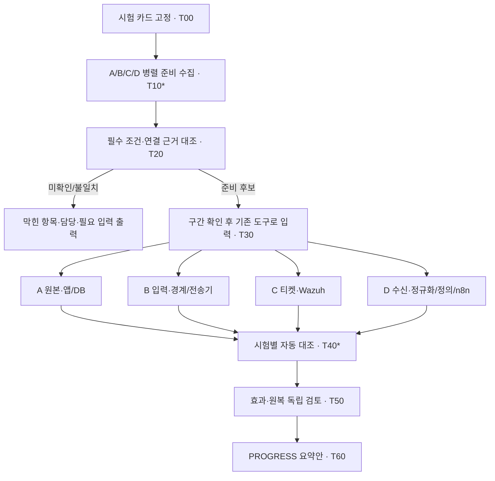

# 병렬 준비 점검·시험 증적 대조 CLI 설계

- 작성: 2026-10-23 KST, B(myeongjundev)·Codex.
- 상태: **오프라인 코어·파일 어댑터·로컬 병렬 gather·공통 보고서 구현. 원격 명령/API·학원 연결은 미검증.** 실행 예제와 팀원 행동은 [팀 실행 안내](lab-check-team-run.md), 학원 사전 준비는 [빠른 시작](lab-check-quickstart.md)을 본다.
- 목적: A 확인→B 입력→D 대조→C 확인의 메시지 왕복을 줄이고, 필요한 선행 확인은 유지한다.
- 기준: [집 인수인계](../team_docs/2026-10-23-팀-AI-통합개선-집작업-인수인계.md), [협업·사람/역할 대응표](09-ai-collaboration.md), [기존 조율 도구](../tools/team.py), [정적 작업 그래프](../orchestration/workplan.json).

## 1. 선택한 구성

**자리별 읽기 전용 수집기 + 결과를 합치는 CLI**로 시작한다. 별도 웹 서버·공유 DB·추가 포트가 없어도 각 자리에서 준비/최종 결과를 같은 형식으로 낼 수 있게 한다. 이후 기존 관리 경로가 검증된 자리부터 병렬 원격 수집을 붙인다.

| 단계 | 사람이 하는 일 | 도구가 하는 일 | 줄어드는 대기 |
| --- | --- | --- | --- |
| 1차: 로컬 수집·파일 대조 | 같은 시험 카드를 받고 자리별 준비/최종 수집을 각 1회 실행, 결과 파일 전달 | 조회·필드 추출·ID/시간창 대조·불일치/다음 담당 표 생성 | 반복 조회·해석·전달문 재작성. 파일 전달 대기는 남음 |
| 2차: 병렬 수집 연결 | 시작 조건·구간 확정, 변경/오류 때 확인 | 검증된 기존 관리 경로로 수집기 동시 실행·결과 회수 | 정상 경로의 자리별 실행/파일 전달 대기 |
| 별도 후속 | 실제 입력·효과·원복 구간 결정, 독립 검토 | 기존 입력/대응 도구의 증적 읽기 | 입력·차단·해제 자동 실행은 이 설계의 구현 범위에 포함하지 않음 |

1차부터 모든 왕복이 사라진다고 주장하지 않는다. 2차에서도 A→D 점검은 A에서, D→C 점검은 D에서 실행해야 한다. B에서 목적지 포트에 접속됐다는 결과로 다른 자리의 경로를 통과 처리할 수 없다.



## 2. 기존 도구·상태 기록과의 경계

| 대상 | 유지할 책임 |
| --- | --- |
| `team.py` / workplan | 정적 의존성·수정 범위·준비 후보·brief. 수집기 실행·실시간 상태 저장을 추가하지 않음 |
| 제안 `tools/lab_check.py` | 한 시험의 카드 검증·수집·대조·보고서 생성. `--done` 자동 입력이나 작업 완료 선언을 하지 않음 |
| `docs/PROGRESS.md` | 최신 현황의 단일 요약. 보고서가 갱신 후보 행을 만들고 지정 편집자가 반영 |
| 시험 디렉터리 | 해당 실행의 불변 입력·결과·근거. 별도 실시간 업무 상태 저장소로 사용하지 않음 |
| 개인 일지 | 실제 작업·검증·미검증의 상세 이력 |
| AI | 보고서 설명·결함 분석·수정 제안. 통과 판정은 명시한 규칙으로 수행 |

프로파일은 `precheck`(준비 표본), `baseline`(보강 전), `postchange`(보강 후)로 분리한다. 준비 표본 수신 확인과 보강 후 자동 대응 완주를 같은 완료 상태로 만들지 않는다.

**모든 작은 확인에 A/B/C/D 전원의 완료를 요구하지 않는다.** 카드가 참조하는 버전 고정 검사 프로파일에 따라 필요한 검사와 자리만 수집한다. 각 검사에는 의존 검사와 용도(입력 준비/최종 대조/참고)를 선언하고, 선행 조건이 없는 검사는 계속 진행한다.

| 판독 범위 | 필수 데이터 소유 자리·조건 | 전원 대기를 피하는 방법 |
| --- | --- | --- |
| S10 filterlog 준비 표본의 정규화만 확인 | B 원문 식별 + D 고유 수신/필드/파서 버전 | A 포털·C 티켓 회신을 이 좁은 판독의 선행 조건으로 두지 않음 |
| A→D GELF 연결·필드 확인 | A 원본/송신 위치 + D 수신/필드, 해당 경로 B 근거 | C 티켓 준비를 기다리지 않음 |
| S8/S10 전체 보강 전 관측 | 해당 카드의 A 원본·B 입력/경계·D 수신/정의/n8n·C 저장소 상태 | 각 자료를 병렬 수집, 필수 자료가 모인 범위부터 대조; 전체 판정은 필수 자료를 기다림 |
| 보강 후 자동 대응 완주 | 관련 경로 전부 + 실제 효과/티켓/원복·정상 대조·독립 검토 | 필요한 선행 조건은 유지하고 무관한 케이스의 전체 완료는 요구하지 않음 |

`required_checks`는 카드 작성자가 임의로 삭제할 수 있는 성공 우회 옵션이 아니다. 시나리오/프로파일별 최소 검사 레지스트리와 대조하고 누락을 거부한다. 좁은 precheck에는 좁은 `readiness_scope`를 표시하며, 그 결과를 S10 전체 준비나 T20 완료로 승격하지 않는다. 전체 workplan의 단계와 작은 검사 DAG는 범위가 다르고 자동 `--done` 연계도 없다.

## 3. 자리별 수집과 아직 확인할 인터페이스

사람 A~D와 개발 역할은 기존 대응표를 따른다. 아래는 새 인력 배정이 아니라 관찰 위치와 데이터 소유 경계다. 경로·제품 버전·인증 방식이 확인되지 않은 어댑터는 `NOT_CONFIGURED`로 끝낸다.

| 자리·관찰 위치 | 준비 단계 | 최종 단계 | 인터페이스 확인 필요 |
| --- | --- | --- | --- |
| A 포털 VM | 배포 커밋, health/DB 상태, 반환 경로, 실제 sender 설정·기존 차단 상태 | 원본 event_id/종류/시각/출발지·HTTP 코드, 앱/DB의 대상 상태 | JSONL 실제 경로, 상태/DB 조회 방법·권한. GET health가 남기는 이벤트도 준비 구간으로 분리 |
| B pfSense/Kali | 전송기·커서/대기, 규칙/인터페이스, 실제 입력 출발지, 시간 상태 | 기존 입력 도구의 실행 증적, filterlog/EVE 필드, 대상 차단/state 관찰 | 학원 전송기 브랜치·파일/커서 형식·읽기 명령. 없는 학원 파일을 재구성하지 않음 |
| C Wazuh/티켓 호스트 | 가동·DB/볼륨·리스너, 010 Active, API 인증/읽기 권한·버전 | 해당 시험 티켓/조치·효과 기록과 Wazuh 수신, 조회의 완전성 | 티켓 후보 PR의 수정 버전·조회 범위. 열린 티켓 목록만으로 전체 티켓0을 증명할 수 없음 |
| D Graylog/n8n 호스트 | 입력/스트림/파서·정의 활성·워크플로 버전/모드 | 원문 고유/중복·정규화, 이벤트 정의/조회, 실행 ID·dry_run·HTTP 노드 실행/응답 | Graylog 검색/페이지네이션, n8n 실행 상세의 버전별 조회/내보내기 방법·보존 범위 |

초기 어댑터는 담당자가 내보낸 파일과 검증된 읽기 명령 출력을 받아 정규화한다. API/DB 조회는 실제 배포 버전과 권한을 맞춘 뒤 추가한다. 포털·티켓·n8n의 새로운 API 경로나 DB 테이블 이름을 이 문서에서 확정하지 않는다.

네트워크 점검에는 `collector_host`, `vantage_id`, 실제 소켓 출발지, 목적지·프로토콜, 설정 버전을 기록한다. 서비스 health·읽기 요청도 로그를 만들 수 있으므로 요청량을 제한하고 본 입력의 출발지/시간창/ID 목록에서 분리한다. 방화벽·VPN·Docker 게시를 수집기가 고치지 않는다.

## 4. 실행 단위와 입력 형식

`run_id`는 한 번의 실행에 고유하다. S10의 준비 표본과 본 시험은 다른 run_id를 쓰며, 준비 근거를 참조할 때는 `readiness_refs`로 연결한다. 재시험은 새 run_id다. 파일명에 허용할 문자는 영숫자·하이픈·밑줄로 제한한다.

| 산출물 | 필수 내용·검증 |
| --- | --- |
| `card.json` | schema_version, run_id, scenario_id, profile ID/버전, environment(`fixture`/`lab`), 필수 검사와 의존성·용도/사람, readiness_scope, 입력 담당·독립 검토자, 출발지/대상, expected_signals, 버전 요구, 판독 정책 |
| 카드의 시간 정책 | 사전 확정한 입력 허용 구간·관측 종료 규칙, 검색 주기·지연/시계 오차의 값 또는 unknown/not_applicable 사유, 준비 결과 유효기간·조회 제한. 미정인 종료 조건으로 최종0건 판정 불가 |
| `input.json` | 기존 입력 도구/담당자가 제공한 실제 시작/종료·입력 수·출발지/대상·실행 ID·근거. 카드 해시와 결합. 파일을 넣는 행위는 실제 입력을 실행하지 않음 |
| 자리별 `receipt.json` | receipt_id, run_id, card_sha256, phase(`prepare`/`final`), seat, attempt_id, collector 버전, 관찰 위치/버전, 조회 시각·조건·수집 범위·검사별 결과·근거 참조 |
| `comparison.json` / `report.md` | 사용한 receipt ID/해시, 규칙별 판정·범위·누락·다음 담당, 입력 준비 후보 여부 또는 최종 관측 대조 결과. 결과 제목에 fixture/실측/보고 범위를 표시 |
| `review.json` | 해당 comparison 해시에 대한 검토자·시각·보강 전/후 판정 범위, 효과/원복/정상 대조의 증적·미검증. 독립 검토 전 자동 완료하지 않음 |

카드는 시작 전에 정규 JSON 직렬화(키 정렬·UTF-8·일관된 구분자) 후 SHA-256으로 고정한다. `card_sha256`은 자기 자신을 포함하지 않은 카드 바이트에서 계산하고 별도 manifest에 둔다. 입력·영수증은 그 해시에 연결한다. 시간은 offset이 있는 RFC3339로 저장하고 UTC로 비교하며 화면에는 KST로 보여 준다. offset 없는 시각은 거부한다.

카드의 상대 관측 종료 규칙을 실제 input 종료 시각에 대입하는 것은 허용한다. 입력 후 관측 길이나 기대 결과를 바꾸는 것은 허용하지 않는다. 해시·버전이 바뀌면 영향받는 준비를 다시 수집하고 변경 이력을 보존한다. 새 규칙 버전은 별도 판정 조건으로 구분한다.

근거에는 `origin`(직접 관찰/담당 보고/코드 검사/합성), `environment`, 원본 생성 주체·시각·참조/해시를 남긴다. 보고서를 자동으로 읽었다고 담당 보고가 직접 실측으로 승격되지 않는다. 해시는 동일성과 변조 탐지 수단이며 관찰 내용의 진실·작성자 신원을 증명하는 전자서명은 아니다.

## 5. 값과 판정을 분리하는 규칙

검사 결과는 아래 상태 축을 각각 보존한다. 각 검사가 사용하는 축과 허용 조합은 스키마/검사 레지스트리에 고정한다.

| 필드 | 값·의미 |
| --- | --- |
| `availability` | `available`, `unavailable`, `unknown`, `not_applicable` |
| `definition_state` | `active`, `inactive`, `undefined`, `unknown`, `not_applicable` |
| `query_status` | `ok`, `failed`, `incomplete`, `not_run` |
| `coverage` | `complete`, `partial`, `unknown` — 조회 창·필터·전체 페이지/커서·보존 범위 포함 |
| `count` | 확인된 수 또는 null. 부분 조회의 참고 건수는 별도 `observed_count`에만 기록 |
| `verdict` | `pass`, `fail`, `unknown`, `not_applicable` — 기대 조건과 비교한 결과 |

**확인된 0건**은 관련 서비스가 가동 중이고 조회 성공·범위 완전·관측 종료가 확인됐을 때만 쓴다. 페이지 누락·보존 기간 만료·시간창 미완료·권한 오류·출처 부재는 count=null이다. 정의 없음은 정의 목록 확인의 사실이며 정의된 규칙의 검색 결과0과 다르다.

아래 JSON은 형식을 설명하는 합성 검사 조각이며 C의 실제 증적이 아니다.

```json
{
  "check_id": "ticket.count",
  "availability": "unavailable",
  "definition_state": "not_applicable",
  "query_status": "not_run",
  "coverage": "unknown",
  "count": null,
  "reason_code": "STORE_NOT_RUNNING",
  "verdict": "unknown"
}
```

보강 전 카드가 저장소 미구축/정의 부재를 관찰 대상으로 정했다면 그 **환경 확인**은 pass일 수 있다. 이때도 티켓 기능은 미검증·티켓 수는 null, 미정의 탐지 시간은 null/해당 없음이다. 보강 후 카드의 필수 저장소가 미가동이면 준비를 막는다. 기준선 관측 완료와 대응 기능 성공은 다른 판정이다.

n8n은 `execution_id`, `dry_run`, 노드별 실제 실행 여부/응답, 대상 효과, 원복 결과를 분리한다. 실행 상세가 없으면 HTTP 노드가 실행됐는지 unknown이다. dry_run=true 또는 HTTP 노드 미실행으로 실제 차단 성공을 만들지 않는다. HTTP2xx만 있고 대상 상태 증적이 없으면 효과는 unknown이다.

## 6. 자동 대조와 시작/완료 조건

1. JSON 중복 키·스키마/버전·run_id·카드 해시·단계·필수 자리·선택 receipt를 검사한다. fixture와 lab, 준비 표본과 본 시험을 섞으면 거부한다.
2. 관찰 위치와 코드/설정/파서 버전, 준비 시각/유효기간, 실제 입력 허용 구간·수·출발지/대상을 확인한다. 다른 자리/다른 경로의 성공은 대체 근거가 아니다.
3. 원본 event_id를 기준으로 수신의 고유 ID 집합·누락·추가·중복을 대조한다. 원문 도착과 필수 정규화 필드 값의 일치는 별도 검사다.
4. event_id가 없는 filterlog는 사전 지정한 복합키를 쓴다. S10 준비 예시는 원본 시각+src/dst+IPv4/em0/in/block+tracker+ICMP ID/seq다. 일대일 대응을 특정할 수 없으면 임의 ID를 만들어 맞추지 않고 `AMBIGUOUS_MATCH`로 남긴다. JSON 공격 출발지와 TCP 전송기/컨테이너 연결 출발지를 혼동하지 않는다.
5. 고정한 관측 종료 조건 이후 관련 이벤트·n8n 실행·티켓을 조회한다. 실행 시각·원본 참조·대상으로 묶고, 창 밖/출발지 불일치 이력은 별도 목록에 남긴다. 일치 여부가 불명확한 조치는 제외해 버리지 않고 unknown으로 남긴다.
6. 준비 대조는 해당 프로파일의 모든 필수 검사가 통과한 경우에만 그 범위의 `ready_candidate`다. precheck의 matched/ready_candidate로 전체 본 시험 준비를 통과시키지 않는다. fixture/보고만 있는 결과나 오래된 준비로 현재 실측 준비를 통과시키지 않는다. 사람이 실제 시작 구간을 정하며 이 도구는 입력을 호출하지 않는다.
7. 최종 대조는 `precheck_observation`, `baseline_observation`, `postchange_observation` 중 범위를 명시한다. 필수 자료가 없으면 `incomplete`, 명확한 불일치는 `mismatch`, 조건 충족은 `matched`로 표시한다. matched도 사람의 독립 검토·실제 효과/원복 확인을 대신하지 않는다.

출력의 각 미완료 행에는 검사·현재 사실·부족한 근거·데이터 소유 자리·다음 행동을 적는다. B가 네 자리의 상세 답변을 다시 작성할 필요 없이 담당별 부분을 바로 읽을 수 있게 한다.

## 7. 제안 CLI와 실패 동작

**prepare/collect/compare와 gather/share/status는 오프라인 파일 대조로 구현했다.** 아래는 인자 구조 예시이며 바로 실행할 합성 예제는 빠른 시작·팀 실행 안내를 따른다. 현재 collect는 표준 JSON export·제한된 B filterlog·필드 대응을 정한 JSONL을 읽는다. live API/DB·SSH·서비스 명령은 실행하지 않는다. lab export도 준비 후보/최종 완료는 false다. 기존 `team.py`는 유지한다.

```powershell
# 조율 자리: 카드 검증·고정. 네트워크 접속 없음
python tools/lab_check.py prepare --card draft-card.json --out S10-example

# 각 자리: 같은 고정 card.json을 사용. A/B/C/D가 병렬로 실행
python tools/lab_check.py collect --card .local/lab-check/S10-example/card.json --seat A --phase prepare --profile .local/lab-check/A-profile.json --out S10-example/A-prepare-01

# 조율 자리: 전달받은 영수증만 대조. 네트워크 접속 없음
python tools/lab_check.py compare --card .local/lab-check/S10-example/card.json --phase prepare --receipts .local/lab-check/S10-example/inbox --out S10-example/comparison-prepare-01

# 실제 입력 증적을 받은 뒤 각 자리의 collect --phase final을 병렬 실행
# 이후 최종 대조. 이 명령은 공격·차단·해제·티켓 생성을 실행하지 않음
python tools/lab_check.py compare --card .local/lab-check/S10-example/card.json --phase final --input .local/lab-check/S10-example/input.json --receipts .local/lab-check/S10-example/inbox --out S10-example/comparison-final-01
```

`collect --phase final`도 input 증적을 입력받는다(`--input`). 준비 표본의 이미 실행한 입력을 조회하는 precheck도 해당 input 증적이 필요하다. 조회할 원본 시각·ID를 추측해서 채우지 않는다. `compare`는 기본적으로 전체 필수 자리의 결과를 요구하고 누락한 자리를 자동으로 선택 해제하지 않는다.

| 종료 코드 | 의미 |
| --- | --- |
| 0 | prepare/collect/share가 유효한 산출물을 발행, status가 보고서 조회 성공, 또는 compare/gather의 해당 범위 대조 충족. 실장비 시험 최종 완료를 뜻하지 않음 |
| 2 | 카드/스키마/해시/입력·출력 경로·버전 오류, 충돌 receipt, 관측 규칙 미정 등 설정/입력 오류 |
| 3 | 데이터 부족·권한/가동/조회 실패·관측 미종료·미설정·시계 불확실성으로 판정 보류 |
| 4 | 유효하고 충분한 근거에서 ID/필드/기대 동작 불일치 확인 |

합성 환경의 성공은 보고서에 `fixture`·`replay_only`로 표시하고 lab 준비 후보는 항상 false다. 설정상 충돌은2가 우선이며, 그 밖에는 필수 불일치4 > 판정 보류3 > 조건 충족0 순으로 집계하되 모든 개별 사유를 보존한다. 예상된 기준선 미탐은 카드의 baseline 조건으로 평가한다.

조회 실패 때도 유효한 범위의 부분 영수증을 먼저 쓰고 종료 코드3을 반환한다. gather는 자식 수집기 시간 초과/비정상 종료를 `COLLECTOR_TIMEOUT`/`COLLECTOR_FAILED` 자리별 영수증으로 남긴다. 개별 collect 결과를 수동으로 모은 경우 누락은 `MISSING_RECEIPT`다. collect의0은 수집 성공일 뿐 compare 통과가 아니다. 사람의 최종 회신은 선택한 최종 영수증에 한 번 연결하고, 내부 polling은 별도 메시지를 만들지 않는다.

## 8. 병렬 실행·재시도·증적 보존

- 각 자리 로컬 collect 또는 구현된 `gather`를 사용한다. gather는 실행 PC가 읽을 수 있는 파일에 대해 필요한 자리만 최대4개 자식 수집기로 동시 관리한다. 한 실패가 다른 자리의 결과를 지우지 않는다. 원격 명령 실행과 상주 서버/에이전트는 구현하지 않았다.
- 현재 파일 수집은 최대2MiB와 프로파일의 행 제한을 적용한다. 계획의 timeout은 자식 수집기 수명에 적용하고 만료 시 해당 프로세스를 종료/회수한다. 부모 설정 로딩·프로세스 생성까지 포함한 절대 전체 마감은 아니다. [Python subprocess 제한](https://docs.python.org/3.12/library/subprocess.html).
- 각 IO의 연결/읽기 제한·최대 페이지/바이트/행·조회 재시도 수와 간격·전체 수집 마감은 실행 전 프로파일에 명시한다. 값은 담당 확인 전 운영값으로 확정하지 않는다. 미정이면 해당 live 수집을 시작하지 않는다.
- Future의 대기 timeout만으로 진행 중 IO가 중단된다고 가정하지 않는다. 어댑터 IO 제한을 두고, 2차 관리자에는 수집기 자식 프로세스의 마감·종료·부분 결과 회수 정책을 둔다. 서비스/전송기 자체를 종료하지 않는다. [Python 실행기 취소·종료 동작](https://docs.python.org/3.12/library/concurrent.futures.html).
- 재시도는 제한된 읽기 조회에만 적용한다. 429의 재시도 지시가 있어도 전체 마감을 넘기면 중단한다. 공격 입력·준비 패킷·Webhook 대응 호출·차단/해제는 재시도하지 않는다. 관측 종료를 기다리는 동안 실패를0으로 채우지 않는다.
- run/seat/phase/attempt별 새 디렉터리에 쓰며 기존 산출물은 덮어쓰지 않는다. 미완성 임시 파일을 최종 영수증으로 읽지 않고 완료 manifest·내용 해시를 확인한 뒤 수용한다.
- 같은 자리·단계의 결과가 두 개 있으면 최신 시각을 자동 선택하지 않는다. 원래 receipt를 보존하고 명시한 supersedes 관계·사유/선택 manifest로 하나를 선택한다. 서로 충돌하면 비교를 멈춘다.
- 오래된 준비·VPN 재접속·서비스/파서/정의 변경이 감지되면 해당 검사와 의존 검사만 재확인한다. 변경 영향 관계를 판정하지 못하면 전체 필수 준비를 보류한다.

## 9. 저장 위치·연결·권한

로컬 설정·원본·실행 결과는 이미 Git 제외인 `.local/lab-check/`에 둔다. 구현된 `share`는 비교 스키마·고정 검사 범위를 검증한 뒤 보고서를 재생성해 새 묶음을 발행한다. 원본 로그·프로파일·영수증은 자동 공유하지 않는다. 기존 접근 경로나 전달 수단을 사용하며 각 LLM은 `status --seat`로 같은 묶음을 읽는다. 저장소의 `docs/capstone/evidence/integration/<run-id>/`에는 검토된 사본만 사람이 추가한다. 도구는 자동 commit/push·PR 댓글·팀 메시지를 하지 않는다.

`run_id`·근거 상대경로·출력 경로의 절대경로/`..`/드라이브 탈출·심볼릭 링크 우회를 거부하고 선택한 run-root 안에서만 산출물을 만든다. 수집 원본은 로컬 프로파일에 명시한 별도 읽기 루트 안에서만 연다. workplan의 저장소 read/write 제한은 변경하지 않는다.

프로파일에는 endpoint/source/vantage ID, 어댑터 ID·예상 버전, 허용된 읽기 작업·범위, 인증 참조와 IO 예산을 둔다. 비밀번호·토큰 값은 카드/영수증/보고서에 넣지 않고 로컬 자격 증명에서 읽는다. 문자열을 shell 명령으로 조립하지 않고 고정 어댑터·인자 배열로 실행한다. 오류 출력도 허용 필드로 제한하며 원문 HTTP 본문·JWT·전체 DB 행을 예외 메시지에 남기지 않는다.

현재 문서 기준의 VPN/허용 경로를 재사용한다. 이 도구를 위해 새 수신 포트나 NAT3개를 추가하지 않는다. [포트 검토](../team_docs/2026-10-23-팀-AI-통합개선-집작업-인수인계.md#8-추가-검토--필요한-포트-3개-포워딩-제안)의 서비스별 현재 리스너/규칙 검증은 별개다. 특히 Graylog UI9000 허용이 검색 API·읽기 권한까지 보장하지 않는다.

2차 SSH 등 원격 수집은 해당 자리의 기존 접근·호스트 검증·최소 권한과 어댑터 명령이 확인됐을 때만 등록한다. 모두 SSH 가능하다고 가정하거나 신규 관리 경로/전역 권한을 자동 설정하지 않는다. n8n/티켓/앱 DB는 실제 버전의 일관된 읽기 스냅샷/트랜잭션을 사용하고, 실행 중 DB 파일의 단순 복사나 열린 티켓 일부 조회로 전체성을 주장하지 않는다.

## 10. CI와 학원 실행의 분리

현재 [workspace.yml](../.github/workflows/workspace.yml)은 main push/PR에서 Windows·Ubuntu의 bootstrap/pytest를 실행한다. 새 테스트를 이 흐름에 넣되 fixture 기반 무네트워크 검사만 수행한다. PR이 없는 현재 작업 브랜치 push만으로 이 워크플로가 실행되는 것은 아니다.

학원 실제 조회를 GitHub 기본 실행기에서 바로 수행할 수 있다고 가정하지 않는다. 사설망 연결에는 별도 구성이 필요하다. 초기 실행 위치는 학원 자리의 CLI로 정하고 CI는 비교 규칙의 회귀를 담당한다. [GitHub 사설망 연결](https://docs.github.com/en/actions/concepts/runners/private-networking).

나중에 학원 내부 전용 실행기/접근 통제가 준비되면 수동 `workflow_dispatch`를 검토한다. 이 방식은 workflow가 기본 브랜치에 있어야 하며 GitHub CLI 등에서 시작할 수 있다. 실제 입력/대응은 별도 구간으로 유지한다. 이번 설계로 실행기 등록·workflow 변경·배포를 수행하지 않는다. [GitHub 수동 실행](https://docs.github.com/en/actions/how-tos/manage-workflow-runs/manually-run-a-workflow).

## 11. 구현 파일·분할·인수 조건

아래 표는 전체 목표다. 현재 코어와 CLI 외에 `tools/lab_checks/{collectors,runner,handoff}.py`, 파일/병렬/공통 보고서 스키마, `tests/test_lab_pipeline.py`와 합성 fixture를 구현했다. LBC03은 제한된 파일 어댑터, LBC04는 로컬 자식 수집까지 검증했다. 실제 제품별 API/DB·원격 실행·독립 검토 import는 아직 없다. 내부 카드/영수증 스키마를 기존 서비스 API·이벤트 계약과 구분한다. 서비스 계약 변경이 생기면 별도 contract-change 작업으로 처리한다.

| 순서·제안 ID | 파일 소유/기술 역할 제안 | 생성 예정 파일 | 인수 조건 |
| --- | --- | --- | --- |
| LBC01 형식·순수 대조 | B / coordinator 관점, 독립 검토자는 별도 지정 | `orchestration/lab-check/*.schema.json`, `tools/lab_checks/models.py`, `compare.py`, `report.py`, `tests/lab_check_fixtures/`, `tests/test_lab_compare.py` | JSON 검증·카드 결합·집합/필드/관측창·부재/null/실패 판정, 네트워크 없이 재현 |
| LBC02 CLI·파일 입출력 | B / coordinator 관점 | `tools/lab_check.py`, `tools/lab_checks/store.py`, `tests/test_lab_cli.py` | prepare/collect/compare·종료 코드·부분 결과·기존 산출물/경로 보호, 인자 오류에 명확한 실패 |
| LBC03 자리별 어댑터 | 코드 편집자는 1명 지정, 데이터 소유는 A/B/C/D | `tools/lab_checks/collectors/{portal,boundary,ticket,wazuh,graylog,n8n}.py`, `tests/test_lab_collectors.py` | export부터 시작, 버전/권한/완전성/실제 관찰 위치 명시. 각 담당이 fixture를 검토하고 실측은 별도 검증 |
| LBC04 기존 경로 병렬 연결 | 조율 B, A/C/D는 자기 경로 검증 | `tools/lab_checks/runner.py`, 기존 로컬 프로파일 | 준비된 경로만 최대4개 동시 수집, 한 실패가 다른 결과를 지우지 않음, 마감 내 종료·회수 |
| LBC05 운용 확인 | 해당 케이스 입력 담당과 독립 검토자 | 실제 시험별 검토된 증적·PROGRESS 요약 | 수동 결과와 자동 대조가 같은 범위를 판정. 실제 효과/원복은 독립 확인 |

제안 ID는 이번에 workplan에 등록하거나 완료 입력으로 사용하지 않는다. LBC01~02와 LBC03~04의 집 검증 범위를 구현했으며 표의 학원 인수 조건은 미완료다. A/B/C/D 전체 실장비 연결을 이 코어 구현의 선행 조건으로 두지 않는다. 기존 Python3.12+와 설치된 검증 라이브러리를 사용한다.

필수 회귀 항목:

| 입력/장애 | 기대 판정 |
| --- | --- |
| 한 자리 미회신·timeout·401/403·미설정 | 다른 결과 보존, 해당 필수 검사 unknown, 입력 준비 후보 false |
| B/D만 필요한 정규화 precheck에서 A/C 자료 없음 | 해당 좁은 범위는 대조 가능, S10 전체 준비 후보는 false |
| 카드가 프로파일 최소 필수 검사를 삭제 | 검증 오류, 부분 자료를 전체 성공으로 만들지 않음 |
| B의 경로 성공을 A 경로 확인으로 제출 | vantage 불일치 거부 |
| 원문5/5·공통 필드1개 불일치 / 중복 ID | 수신과 정규화/중복 판정 분리, mismatch |
| 정의 없음 vs 활성 정의 조회0 | 전자는 정의 상태·시간null, 후자만 완전한 조회 조건에서 count0 |
| 티켓 미가동 / 일부 열린 티켓0 / 전체 조건부 조회0 | 각각 생성 불가 / coverage partial / 조건부0. 기능 성공으로 합치지 않음 |
| n8n 실행은 있으나 dry_run 또는 HTTP 노드 미실행 | 실제 호출/대상 효과 통과 불가 |
| S8 관측창 뒤 동일 출발지 수동 dry_run | 창 밖 이력으로 분리, 앞선 창/하루 전체0으로 합산 금지 |
| .10 준비 표본과 .22 본 입력·다른 카드/해시 혼합 | 거부, S10 입력/완료를 만들지 않음 |
| 관측 미종료·검색 페이지 누락·로그 보존 만료·시계 불확실 | incomplete/unknown, 최종0건·MTTD 산출 금지 |
| stale 준비·버전 변경·충돌 receipt·fixture의 lab 제출 | 입력 준비 후보 false 또는 오류, 기존 증적 보존 |
| 경로 탈출·심볼릭 링크·같은 출력 재실행·비밀값 포함 오류 | 쓰기/공유 차단, 안전한 사유만 출력 |
| 내부 호출 실패/응답 제한·전체 마감 | 실제 입력 재시도 없음, 부분 결과와 실패 사유 보존 |

구현 후 필수 검증은 `python -m pytest -q`, `python tools/sync_ai_assets.py --check`, `python tools/team.py validate`다. 원본 AI 자산이 바뀌면 sync를 먼저 실행한다. 구현 인수 때에는 Windows/Ubuntu·다른 작업 디렉터리·UTF-8·읽기 전용 동작도 확인한다.

## 12. 첫 적용과 남은 입력

첫 자동 대조 인수 예시는 **합성 S10 준비 표본**으로 정한다. 10/23 원본 ID25265/seq164는 재개 대조의 식별자이며 학원 원문을 새로 만든다는 뜻이 아니다. 학원 원본/실제 D 검색 근거를 받기 전에는 fixture나 담당 보고만으로 과거 미회신을 해소하지 않는다. 과거 표본 확인도 오늘의 장비 준비·가동을 보장하지 않는다.

다음으로 S8의 5/5 수신·정의 없음·미가동 티켓·관측창 뒤 dry_run 사례를 **합성 ID로 만든 테스트 데이터**로 재생한다. 학원 증적을 재구성하지 않고 판정 규칙만 검증한다. 실제 적용은 별도 준비 구간에서 수동 대조 결과와 비교하고, 이후 S8 보강 후→효과/원복 완주 후보에 연결한다.

오프라인 검증/대조·파일 어댑터·병렬 gather·공통 보고서까지 집에서 구현했다. 절대 관측 종료 시각과 고정 프로파일3종을 지원하며 상대 종료 규칙·supersedes 선택·지원 범위 밖 제품별 변환은 후속이다. schema의 실제 필드가 현재 구현 기준이고, 카드에는 정책 내용의 policy_sha256도 결합한다. 합성 및 lab export 모두 실제 준비 승인은 하지 않는다. 학원 연결에는 각 담당의 실제 버전/조회·내보내기 방법/읽기 권한, 정확한 원본 위치, 시간/조회 제한, 현재 접속 가능 경로가 필요하다. 없는 값은 NOT_CONFIGURED로 남기고 장비 시험·NAT/방화벽 적용·팀 메시지를 실행하지 않는다.

효과는 같은 범위의 시험에서 준비 누락 재시험 수·담당별 메시지 왕복 수·입력→최종 대조 시간·완주 케이스 수로 비교한다. 고정 관측창 자체가 줄었다는 성능으로 오해하지 않도록 실제 작업/전달 대기 시간을 따로 기록한다. 이 문서 작성으로 시간 단축이나 통합 완주를 실측한 것은 아니다.
