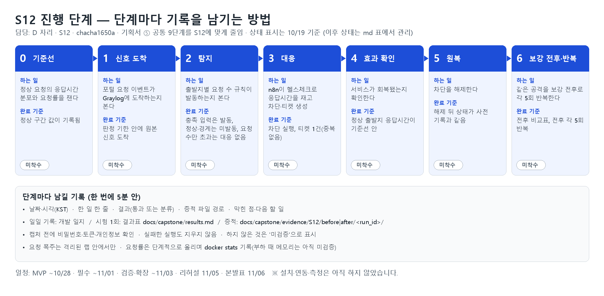
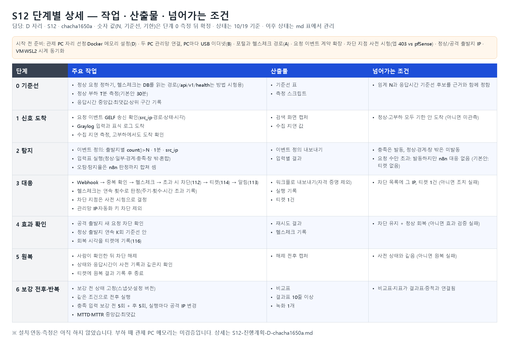

# S12 진행 단계와 기록 방법 (D · chacha1650a)

| 자리 | 케이스 | 3대 원칙 | 담당 | 공통 기반 | 실행 PC |
| --- | --- | --- | --- | --- | --- |
| **D** | **S12 요청 폭주로 인한 서비스 장애** | 가용성 | **chacha1650a** | Graylog 입력·파이프라인, n8n 워크플로, Docker 메모리 설정 | 관제 PC |

자리 담당은 10/19 회의에서 정했다(기획서 ⑥ 역할 분담).



S12(민원 서비스 장애, 가용성)를 어떤 단계로 진행하고, 단계마다 무엇을 만들고 무엇을 남길지 정한 문서입니다. 기획서 ⑤의 공통 9단계와 증적 위치를 S12에 맞게 줄인 것이고, 새 체계를 만들지 않습니다. 현재 모든 단계는 **미착수**입니다. D PC의 Graylog 수신 기반은 10/22에 이 PC 안에서 표식 로그로 확인했고([PR #38](https://github.com/NoBugs-Aleph/aleph-soar-capstone/pull/38), Draft), 실제 포털·pfSense·Wazuh 로그 수신, n8n 연동, 측정은 아직 하지 않았습니다.

## 목적

- 진행 과정을 기록으로 남겨 결과 리포트(~11/03)와 발표 자료(11/05~06)에 그대로 쓴다.
- 기획서 ⑤의 원칙("결과표에는 실제로 돌린 결과만 적는다")을 지킨다. 계획과 실제를 섞지 않고, 하지 않은 것은 `미검증`으로 적는다.
- 10/23 기획서에는 이 문서의 단계와 현재 상태만 넣을 수 있고, 시험 결과는 구현 뒤에 쌓인다.

## S12 한 줄 요약 (기획서 ②·④ 기준)

한 출발지의 과도한 요청으로 민원 포털이 느려지거나 실패하면, Graylog가 **출발지별 요청 수**로 발동하고, n8n이 **헬스체크로 응답시간을 직접 재서** 기준선을 넘을 때만 출발지를 차단(112)하고 티켓(114)을 만든 뒤 회복을 확인(116)한다. 원복은 차단 해제와 응답시간 기준선 확인이다.

## 진행 단계 요약

| 단계 | 하는 일 | 완료 기준 | 상태 |
| --- | --- | --- | --- |
| 0 기준선 | 정상 요청의 응답시간과 요청률을 잰다 | 정상 구간의 응답시간 분포와 요청률이 기록됨 | 미착수 |
| 1 신호 도착 | 포털의 요청 이벤트가 Graylog에 도착하는지 본다 | 판정 기한 안에 원본 신호가 도착(5.9 기한) | 미착수 |
| 2 탐지 | 출발지별 요청 수 규칙이 발동하는지 본다 | 전체 조건 충족 입력에서 발동, 정상·경계 입력에서는 미발동. 요청 수만 초과하면 발동하지만 n8n이 대응하지 않음 | 미착수 |
| 3 대응 | n8n이 헬스체크로 응답시간을 재고 출발지를 차단, 티켓을 만든다 | 차단 실행과 티켓 1건 생성(중복 없음) | 미착수 |
| 4 효과 확인 | 서비스가 회복됐는지 확인한다 | 정상 출발지의 응답시간이 기준선 안으로 돌아옴(5.4) | 미착수 |
| 5 원복 | 차단을 해제한다 | 해제 뒤 상태와 정상 동작이 사전 기록과 같음 | 미착수 |
| 6 보강 전후·반복 | 같은 공격을 보강 전과 후에 돌리고, 전체 조건 충족을 반복한다 | 보강 전 1회, 보강 후 반복, 전후 비교표 작성(5.3·5.5) | 미착수 |

- 단계 번호는 기획서 ⑤ 5.2의 공통 9단계와 대응한다: 0은 1단계(사전 상태), 1~2는 2~4단계, 3은 5~6단계, 4는 5단계의 효과 확인, 5는 7~8단계, 6은 9단계와 5.3.
- 단계는 앞 단계가 끝난 뒤에만 완료로 표시한다. 분류는 기획서 5.2의 결과 분류를 쓴다(통과, 미입력, 미관측, 미탐, 오탐, 조치 실패, 효과 검증 실패, 효과 미확인, 정상 업무 영향, 원복 실패).

## 시작 전 준비 (단계 0 이전)

단계에 들어가기 전에 갖춰야 하는 것이다. 대부분 다른 자리의 공통 기반이므로 D는 확인과 요청을 맡는다.

| 준비 | 지금 상태 | 담당·근거 |
| --- | --- | --- |
| Docker 메모리 설정(WSL 상한, 컨테이너별 메모리 제한, JVM 힙) | 10/20~21 결정으로 4PC 분산이다: A 포털 VM, B pfSense·DB·Kali·팀 VPN, C Wazuh·대시보드·티켓, D Graylog·n8n. 이 PC의 Docker 한도는 기본 7.7GiB(`.wslconfig` 없음)이고, 수업 Wazuh를 멈춘 부하 없는 상태에서 호스트 여유 2.0GB였다. 부하 때 메모리는 미검증 | D(⑥ 공통 기반), 자리는 `(팀 확인)` |
| PC 사이 연결(팀 VPN `HAEDAM_TEAM_TRANSIT`, UDP 1195, 터널 10.250.0.0/24) | 10/22 확인: A(10.250.0.2)·C(10.250.0.3)·D(10.250.0.100)가 모두 팀 VPN에 연결됐다. D→A 포털 `5000/tcp`는 B의 허용 규칙 적용 뒤 연결되며(15:31 `GET /api/v1/health` 200), 포트는 터널 주소에만 연다 | B(⑥), D는 프로필을 받은 뒤 확인 |
| 민원 포털 서비스(Flask + MySQL)와 헬스체크 경로 | 포털은 별도 저장소 `haedam-portal-backend`다. 보고 커밋 `47be008`에서 `/api/v1/health`가 `SELECT id FROM petitions LIMIT 1`로 민원 테이블을 조회하는 것을 D가 코드로 읽어 확인했다(오늘 실제 배포 커밋은 A 재확인). 이 저장소 앱의 `/api/v1/health`는 DB를 거치지 않는 스켈레톤이라 구분한다 | A(⑥). 헬스체크 경로는 단계 0 참고 |
| 차단 지점(앱 403 또는 pfSense 차단 + 기존 연결 상태 삭제) | 미정. `47be008`에는 앱 차단(`IP_BLOCKED` 403)이 있다(A가 10/22 배포 커밋이 `47be008`이라고 확인했다). 앱에서 막으면 요청이 여전히 포털까지 와서 Flask가 처리하므로 폭주 중 응답시간이 돌아오지 않을 수 있다 | 5.10 사전 시험에서 둘 다 재고 정한다. pfSense 쪽은 B의 호출 방식과 이어진다 |
| 요청 이벤트 계약 | 현재 이벤트 계약(`contracts/event.schema.json`)은 인증·권한·조회 4종만 있고 `username`이 필수라 요청 이벤트를 담지 못한다. 사건 계약도 `username`이 필수다 | 기획서 ④ 공통 기반 3(계약 확장). 바꿀 때는 `docs/API-CONTRACT.md`와 `contracts/`를 함께 맞춘다 |
| n8n이 부를 차단 수단과 호출 방식 | 앱 차단은 아래 "대응 호출 방식(10/23 D 잠정안)"으로 정했다. pfSense 쪽 수단(SSH `easyrule` 또는 REST 패키지)은 미정 | pfSense는 B의 사전 위험 시험 ①. 앱 차단 호출은 기획서 ④ 공통 기반 4 |
| 정상 출발지와 공격 출발지 IP | 잠정: 정상 `203.0.113.100~109`, 공격 D 몫 `.41~.49`(기획서 ③). 추가 주소가 pfSense 뒤에서도 포털에 `src_ip`로 보존되는지는 미확인(확인된 것은 Kali 본체 `.10`뿐) | 기준선 전에 B와 1회 확인한다 |
| 시계 동기화 | 미착수 | 모든 VM과 관제 PC의 WSL2(Docker) 시계를 같은 NTP에 맞추고 각각의 오차를 기록(5.1·5.9). Graylog·n8n 시각은 WSL2 시계를 따른다 |

## 단계별 상세



각 단계는 **작업 → 산출물 → 넘어가는 조건** 순서로 적는다. 숫자 값(N, 기준선, 기한)은 단계 0의 측정 뒤에 정하고, 여기 적힌 예시는 확정값이 아니다.

### 단계 0 · 기준선

- 작업
  - [ ] 정상 출발지에서 보낼 정상 요청을 정한다(민원 조회처럼 포털의 일반 화면 몇 개).
  - [ ] 헬스체크 대상 경로를 정한다. 판정에는 정상 요청과 같은 자원을 쓰는 경로(민원 조회처럼 DB를 읽는 화면)를 쓴다. 포털의 `/api/v1/health`는 `47be008`에서 민원 테이블을 조회하므로 후보가 되지만, 실제 배포 커밋에서 다시 확인한다. 관리 경로 판정과 정상 사용자 공개 경로의 회복 측정은 따로 남긴다(B 인수인계 6절). DB를 거치지 않는 경로는 포털이 느려져도 빠르게 응답할 수 있어서 판정에 쓰지 않는다.
  - [ ] 정상 부하로 일정 시간(기본안 T=30분, 5.9) 요청을 보내 응답시간과 요청률을 잰다. 잠정 조건은 아래 "기준선 측정값(10/23 D 잠정안)"을 따른다.
  - [ ] 응답시간은 중앙값·최댓값과 상위 구간(예: 95번째 백분위)을 함께 남긴다.
- 산출물: 기준선 표(측정 조건, 요청률, 응답시간 분포), 측정 스크립트, 측정 시각(KST)
- 넘어가는 조건: 요청 수 임계 N(1분당)과 응답시간 기준선 후보가 정해짐. 정한 근거를 함께 적음.

#### 기준선 측정값 (10/23 D 잠정안)

기획서 5.9가 기준선 측정 때 D가 정하라고 한 항목이다. 방법과 식은 정했고 숫자는 측정 뒤에 채운다(10/29~11/01).

| 항목 | 잠정안 | 확정 시점 |
| --- | --- | --- |
| 측정 경로 | 두 경로를 따로 잰다. ① 정상 출발지(`.100`) → pfSense → 포털: 회복 판정용(경로 `/login`, 도구 `tools/s12_probe.py`, #84). ② n8n → 팀 VPN → 포털 `/api/v1/health`: 대응 판정용. 폭주 중 정상 측정도 ①과 같은 `/login`을 유지한다(10/28 B 리뷰) | 정함 |
| 정상 부하 | 정상 출발지 1개, 2초 간격 단일 요청 30분(표본 약 900개). 이어서 동시 3명 5분 | 정함 |
| 기준선 산정 | 정상 구간의 중앙값·p95·최댓값을 기록한다. 초과 판정은 `응답 > max(p95×3, p95+300ms)` 또는 시간 초과 | 식은 정함, 숫자는 측정 뒤 |
| 헬스체크 | 간격 2초, 시간 초과 3초, 연속 K=3회 초과로 판정. 대응 지연은 최대 약 6초이고 MTTR에 넣는다 | 측정 뒤 조정 |
| 회복 기준 | 정상 출발지에서 연속 K=3회가 기준선 안, 제한 시간 60초 | 측정 뒤 조정 |
| 요청 임계 N | 정상 구간의 "1분당 최대 요청 수" × 3 이상. 경계 입력은 N회(미발동), N+1회(발동) | 측정 뒤 |
| 공격 단계 | 요청률을 단계적으로 올리며 포털 JSONL 건수와 D Graylog 도착 수를 함께 기록해 UDP 유실을 잰다. N은 이 유실 측정 뒤에 확정한다 | 5.10에서 |

### 단계 1 · 신호 도착

- 작업
  - [ ] 포털이 요청마다 이벤트를 GELF로 보내는지 확인한다. 필요한 필드는 최소 `src_ip`, 경로, 상태 코드, 시각이다(계약 확장과 맞춤).
  - [ ] Graylog에 GELF 입력을 만들고 표식 로그를 보내 도착을 확인한다.
  - [ ] 원본 시각과 Graylog 수신 시각의 차이를 재서 판정 기한(5.9)의 수집 지연 값으로 쓴다.
  - [ ] 포털이 느린 상태(단계 0보다 높은 요청률)에서도 이벤트가 기한 안에 도착하는지 본다(5.10 S12 사전 시험).
- 산출물: Graylog 검색 화면 캡처, 수집 지연 측정값, 입력 설정 내보내기(비밀값 제외)
- 넘어가는 조건: 정상·고부하 두 조건에서 이벤트가 기한 안에 도착함. 도착하지 않으면 분류는 `미관측`이고 송신 설정부터 본다.

### 단계 2 · 탐지

- 작업
  - [ ] Graylog 이벤트 정의를 만든다: 출발지별 `count() > N` · 1분 · 묶기 `src_ip`(기획서 ④).
  - [ ] 기획서 5.2 입력표대로 실행한다: 정상, 조건 일부만(요청 수만·응답시간만), 경계 바로 아래(N회), 전체 조건 충족(N+1회 이상), 시간 창 밖, 혼합(정상·공격 출발지 동시). "순서 반대"는 S12에 순서 조건이 없어 사유를 적고 뺀다.
  - [ ] 정상 업무 T분 동안 발동 수(오탐)를 센다.
  - [ ] Graylog 이벤트 검색 주기를 기록한다(시간 지표의 해상도).
- 산출물: 이벤트 정의 내보내기, 입력별 결과(결과표 줄), 오탐 수
- 넘어가는 조건: 전체 조건 충족에서 발동, 정상·경계·창 밖에서 미발동. 아니면 `미탐` 또는 `오탐`으로 분류하고 임계·창·묶기를 고친다(고칠 때마다 한 줄 기록).
- **S12의 "발동" 기준:** Graylog는 요청 수만 보고 발동하고 응답시간은 n8n이 잰다. 그래서 입력별 기대값을 아래처럼 나눠 적고, 오탐·탐지율은 **n8n 판정까지 합친 결과**로 센다(기획서 5.2 입력표와 같은 기준).

| 입력 | Graylog 이벤트 | n8n 판정 | 대응 |
| --- | --- | --- | --- |
| 정상, 경계 바로 아래, 시간 창 밖 | 미발동 | 실행 없음 | 없음 |
| 요청 수만 초과(응답시간은 기준선 안) | 발동 | 기준선 안 | **없음** |
| 응답시간만 느림(요청 수는 임계 이하) | 미발동 | 실행 없음 | 없음 |
| 전체 조건 충족 | 발동 | 기준선 초과 | 차단·티켓 |

- "요청 수만 초과"에서 티켓을 만들지 여부: 기본안은 **티켓을 만들지 않고** n8n 실행 기록에 "판정: 기준선 안, 대응 없음"과 측정한 응답시간을 남긴다. 티켓은 대응이 필요한 사건에만 두어 대시보드와 중복 확인(6단계)을 단순하게 하기 위해서다 `(팀 확인)`.

### 단계 3 · 대응

- 작업
  - [ ] n8n 워크플로를 만든다: Webhook 수신 → 같은 자리·같은 `src_ip`의 열린 티켓 확인(중복 방지) → 헬스체크 → 기준선 초과일 때만 출발지 차단(112) → 티켓(114) → 알림(113).
  - [ ] 헬스체크 판정은 한 번이 아니라 연속 횟수로 정한다(5.9의 회복 기준 K=3과 짝, 값은 `(팀 확인)`). 응답 없음(시간 초과)은 기준선 초과로 본다. 연속 횟수 × 헬스체크 주기만큼 대응이 늦어져 MTTR에 들어가므로, 실행마다 헬스체크 주기·연속 횟수·시간 초과 값을 기록한다.
  - [ ] 차단 지점은 시작 전 준비의 사전 시험 결과로 정한다(앱 403과 pfSense 차단 + 기존 연결 상태 삭제를 둘 다 재 본다).
  - [ ] 아래 "대응 호출 방식(10/23 D 잠정안)"대로 호출한다.
  - [ ] 관리망 IP와 자동화 키는 차단 대상에서 뺀다(자기 차단 방지, 기획서 ④).
  - [ ] 같은 티켓에서 이미 실행한 차단은 다시 실행하지 않는지 확인한다.
- 산출물: 워크플로 내보내기(자격 증명 제외), n8n 실행 기록 캡처, 티켓 1건
#### 대응 호출 방식 (10/23 D 잠정안)

기획서 ④ 대응 호출 방식과 S12 차단 전환에 맞춘 D의 호출 규칙이다. 포털 API는 `docs/haedam/PORTAL-API.md`를 따른다.

| 항목 | 내용 |
| --- | --- |
| 호출 순서 | 헬스체크가 기준선 초과를 연속 K회 확인하면 `POST /api/v1/response/ips/block`을 부른다 |
| 차단 기간 | `minutes`를 보내지 않는다(계약상 선택값, 없으면 해제할 때까지 차단). 측정 중 저절로 풀리면 효과 확인이 흔들린다 |
| 키 | `X-Response-Key`는 n8n 자격 증명에만 둔다. `Idempotency-Key`는 `{ticket_id}-112-{src_ip}-block` |
| 재시도 | 시간 초과 5초, 같은 키로 1회만 다시 보낸다. 400·403·404는 다시 보내지 않는다 |
| pfSense 전환 ① | 앱 차단이 시간 초과와 재시도 안에 성공하지 않으면 전환(최악 약 12초) |
| pfSense 전환 ② | 차단은 성공했으나 정상 출발지가 60초 안에 K=3으로 회복되지 않으면 전환 |
| 둘 다 실패 | 같은 차단을 반복하지 않고 티켓에 "대응 실패"를 남기고 알림만 보낸다 |
| 차단 제외 | `10.250.0.100`(n8n), 팀 VPN 대역, Kali 본체 `203.0.113.10`, 정상 출발지 `.100~.109`. 포털도 허용 CIDR의 차단을 거부한다 |
| 해제 | 담당자가 원복 단계에서 한다. 순서는 경계(pfSense) → 앱. 다른 자리의 열린 티켓이 같은 IP를 쓰면 보류한다 |
| 헬스체크 경로 | D→A 팀 VPN 경로로 고정한다(허용 대역이라 차단 영향을 받지 않음) |

pfSense 호출 노드: 10/27에 `haedam-14`(n8n SSH 노드 → B의 forced command `haedam-pf-response`)가 만들어져 적용돼 있다(dry_run 기본, 아직 한 번도 실행하지 않음). 단 forced command는 현재 대상 `203.0.113.22`(S10)만 허용하므로 S12 공격 출발지(`.41~.49`)를 막으려면 B가 허용 대상을 넓혀야 한다. 전용 SSH 키와 D→`10.250.0.1:22` 허용도 아직 없다. 폭주 도구는 `tools/s12_flood.py`(#87, 기본 `/api/v1/health`)를 쓴다.

- 넘어가는 조건: 전체 조건 충족에서 차단 실행과 대상 상태 변화(차단 목록에 그 IP), 티켓 1건. "요청 수만 초과" 입력에서는 차단·티켓이 없어야 한다(있으면 `오탐`). 아니면 `조치 실패`로 분류하고 n8n 실행 기록과 차단 수단 응답을 본다.

### 단계 4 · 효과 확인

- 작업
  - [ ] 공격 출발지의 새 요청이 막히는지 확인한다(5.4 IP 차단 행).
  - [ ] 정상 출발지에서 연속 K회 응답시간이 기준선 안인지 확인한다(5.4 서비스 회복 행).
  - [ ] 회복 시각을 티켓에 남긴다(116).
- 산출물: 재시도 결과, 헬스체크 기록, 회복 시각
- 넘어가는 조건: 공격 차단 유지 + 정상 출발지 회복. 상태는 바뀌었는데 서비스가 회복되지 않으면 `효과 검증 실패`로 분류하고 차단 지점을 본다.

### 단계 5 · 원복

- 작업
  - [ ] 사람이 확인한 뒤 차단을 해제한다(기획서 ④ 자동 대응 6).
  - [ ] 해제 뒤 상태(차단 목록)와 정상 동작(응답시간)이 단계 0·사전 기록과 같은지 본다.
  - [ ] 원복 결과를 티켓에 남기고 티켓을 닫는다.
- 산출물: 해제 전후 상태 캡처, 원복 뒤 응답시간
- 넘어가는 조건: 사전 상태와 같음. 아니면 `원복 실패`.

### 단계 6 · 보강 전후 비교와 반복

- 작업
  - [ ] 보강 전 상태를 정하고 스냅샷·설정 버전으로 고정한다(기본안: 팀이 추가한 탐지 규칙·자동 대응이 없는 상태, 5.3).
  - [ ] 보강 전과 후에 같은 스크립트·간격·정상 부하·VM 자원으로 실행한다.
  - [ ] 전체 조건 충족 입력은 보강 전 1회를 먼저 측정하고 보강 후에 반복한다(10/21 팀 결정. 보강 후 반복 횟수는 5.9 기본안 N=5를 따르며 확정 전). 실행마다 시험 주체(공격 출발지 IP)를 바꿔 앞 실행의 집계·티켓 묶기가 섞이지 않게 한다(5.3).
  - [ ] MTTD·MTTR을 중앙값·최댓값과 성공 수로 정리한다(5.5).
- 산출물: 보강 전후 비교표, 결과표(전체 조건 충족만, 보강 전 1회 + 보강 후 반복), 지표 요약, 시연용 녹화 1개
- 넘어가는 조건: 비교표와 지표 요약이 결과표·증적과 연결됨.

## 단계마다 남길 기록 (한 번에 5분 안)

| 항목 | 내용 |
| --- | --- |
| 날짜·시각 | KST |
| 한 일 | 한 줄 |
| 결과 | 통과 또는 분류(위 목록) |
| 증적 | 파일 경로 |
| 막힌 점·다음 할 일 | 있으면 한 줄 |

- 일일 기록은 [개발 일지](../docs/devlog/members/chacha1650a.md)의 "한 일"·"막힌 점과 해결"에 쓴다.
- 시험 1회(실행)는 결과표 `docs/capstone/results.md`에 한 줄 남긴다. 기획서 5.9에서 정한 위치이며, 이 문서와 함께 만들지 않는다.
- 증적은 `docs/capstone/evidence/S12/before/<run_id>/`와 `S12/after/<run_id>/`에 실행별로 둔다. 파일 이름은 시연 장면 순서로 번호를 붙인다(예: `01-attack.png`).
- 캡처하기 전에 비밀번호·토큰·개인정보가 화면에 없는지 확인하고, 있으면 가린다. 실패한 실행도 지우지 않는다.

### 실행 1회 기록 양식

```markdown
### <run_id> · S12 · 보강 전/후

- 날짜·시각(KST):
- 입력: 정상 / 조건 일부 / 경계 아래 / 전체 충족 / 창 밖 / 혼합
- 사전 상태: 차단 목록, 앱 커밋, 규칙·워크플로 버전, VM·WSL2 시계 오차
- 시각: 첫 공격 · 조건 충족 · 이벤트 생성 · 조치 완료 · 회복 확인
- 단계 결과: 0~5 각각 통과/분류
- n8n 판정: 기준선 안 / 기준선 초과, 측정한 응답시간
- 분류:
- 시험 조건: 요청률, 지속 시간, 정상 부하, VM 자원, Graylog 검색 주기, 헬스체크 주기·연속 횟수·시간 초과 값, 차단 지점
- 관제 PC 메모리: 시작·최대(docker stats)
- 증적 경로:
- 막힌 점·다음 할 일:
```

## 일정과 연결

| 시점 | S12에서 할 일 |
| --- | --- |
| ~10/23 | 기획서의 S12 부분 확인, 이 문서의 단계 합의, 시작 전 준비 항목의 담당 확인 |
| 10/24 ~ 10/28 | 단계 0·1(기준선, 신호 도착). MVP 케이스가 S12이면 단계 5까지 |
| 10/29 ~ 11/01 | 단계 2~5 완주, 단계 6의 보강 전후 비교 |
| 11/02 ~ 11/03 | 단계 6의 반복 측정과 결과 정리 |
| 11/05 ~ 11/06 | 리허설·본발표. 증적과 녹화를 시연에 사용 |

- MVP 케이스는 기획서의 "제출 전 정할 것"에 기본안 S1로 올라가 있고 10/21까지 함께 정한다. S1으로 정해지면 10/24~10/28의 S12 목표는 단계 0·1이다.

## 안전 규칙과 중단 기준

- 요청 폭주는 격리된 랩(내부 VMnet) 안에서만 일으킨다. 학원 공용망으로 내보내지 않는다.
- 계정은 `zz_` 테스트 계정, IP는 랩 대역만 쓴다.
- 요청률은 단계적으로 올리고, 시험 중에는 관제 PC의 컨테이너 메모리를 `docker stats`로 기록한다. 부하 때의 메모리는 **아직 재지 않았다(미검증)**.
- 다음 중 하나가 보이면 그 실행을 멈추고 요청률을 낮춘다(제안): 관제 컨테이너가 종료됨(종료 코드 137 또는 `OOMKilled`), 관제 쪽 WSL 메모리 여유가 거의 없음, 관제 도구 화면이 응답하지 않음. 멈춘 실행도 기록에 남긴다.
- 시연용 요청률은 시험에서 확인한 한계보다 낮게 잡는다.

## 정할 것 (팀 확인)

- 단계 이름과 완료 기준이 팀의 공통 9단계 표기와 맞는지
- MVP 케이스(기획서 기본안 S1, 10/21까지)
- "요청 수만 초과"에서 티켓을 만들지(기본안: 만들지 않고 n8n 실행 기록만)
- 차단 지점(앱 403 또는 pfSense 차단, 사전 시험 뒤)
- 정상 출발지·공격 출발지 IP(추가 주소의 출발지 보존 확인 포함), 중단 기준 값. 헬스체크 연속 횟수·주기·시간 초과 값은 위 잠정안을 기준선 측정 뒤 확정
- 결과표·증적 폴더를 만드는 시점과 담당

## 확인한 것과 하지 않은 것

- 문서와 이미지만 추가한다. 앱·계약·DAG는 바꾸지 않았다.
- 이 문서는 팀 문서를 모으는 `team_docs/`에 둔다. 결과표와 증적 위치는 기획서 5.9대로 `docs/capstone/` 아래다.
- 기획서 `team_docs/기획서_합의본.md`(PR #10 브랜치, `ef3e546` 기준)의 ②·③·④와 ⑤ 5.2·5.3·5.4·5.5·5.7·5.9·5.10을 기준으로 작성했다. 해당 내용은 이 브랜치의 기준(`main`)에는 아직 없다.
- 그림 두 장의 상태 표시("미착수")는 10/19 기준이다. 앞으로 진행 상태는 이 문서의 진행 단계 요약 표만 고친다.
- 저장소에서 확인한 사실: 앱의 `/api/v1/health` 경로(`src/aleph_soar/web.py`), 이벤트·사건 계약의 필수 필드(`contracts/event.schema.json`, `contracts/incident.schema.json`).
- 10/22 갱신: B의 D 인수인계(4PC 분산, 보강 전 1회, 대응은 출발지 차단만, 헬스체크 DB 조회, `web.request`만 집계)에 맞춰 위 항목을 고쳤다. 요청 수는 `web.request` 이벤트만 센다. 한 요청에서 `web.file_access`·인증 이벤트까지 합치면 중복 집계다. 속도 제한은 처음에는 쓰지 않는다. 포털 저장소 코드는 읽기만 했고 실행하지 않았다.
- 설치·연동·측정은 하지 않았다(Graylog 수신 기반은 PR #38). 10/22에 포털(`web.request`·`web.file_access`), Wazuh 경보, pfSense filterlog가 D Graylog에 실제로 도착하는 것은 확인했으나 이는 연결 확인이며 기준선·보강 전 측정이 아니다.
