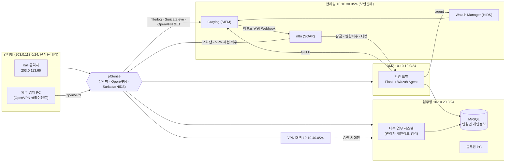

# 파이널 프로젝트 기획서 — 1조 NoBugs

> 제출일: 2026-10-23(금) · 리허설 2026-11-05(목) · 본발표 2026-11-06(금)
> 상태: **초안** — `(팀 확정 필요)` 표시 항목은 회의에서 정한 뒤 채운다.

---

## ① 프로젝트 개요

### 프로젝트명
**공공기관 민원 서비스·원격 유지보수 접속 보안 관제 및 자동 대응 시스템**

### 선정 배경
- 공공기관은 **민원인 개인정보**를 대량으로 보유하고, 홈페이지·민원 포털이 **24시간 대국민 서비스**라 침해 시 피해가 바로 시민에게 간다.
- 시스템 유지보수를 **외주 업체가 VPN으로 원격 접속**하는 구조가 일반적이며, 승인되지 않은 원격 접속은 대표적인 침투 경로다.
- 공공기관은 **인터넷망·업무망 분리**가 기본이라 경계 설계(pfSense)와 계층별 탐지를 보여주기 좋다.
- 수업 케이스 S1~S10(계정 악용, 권한 상승 후 조회, 웹셸·변조, 전 계층 관통)이 공공기관 상황에 그대로 대응되고, 팀이 S11(무승인 VPN)·S12(서비스 장애)를 추가해 **원격접속 통제와 가용성**까지 다룬다.
- 실제 공공 서비스 장애·개인정보 유출 사례: `(공식 자료 확인 후 기입)`

### 목적
"OO시청 민원 포털과 내부 업무 시스템에 대한 공격을 **탐지 → 자동 대응 → 차단 확인 → 서비스 복구 확인**까지 내부망에서 직접 실측한다."

### 핵심 기능
1. 망 분리(인터넷/DMZ/업무망/관리망/VPN) + 외주 VPN 원격접속 — pfSense
2. 앱·호스트·네트워크 로그 통합 수집과 상관분석 — Graylog(SIEM), Wazuh(HIDS), Suricata(NIDS)
3. S1~S12 탐지 규칙(조건·창·묶기) — Graylog 이벤트 정의 + Wazuh 규칙
4. 자동 대응 — n8n: 계정 잠금, IP 차단, 권한 회수, VPN 세션 회수, 알림, 인시던트 티켓
5. **조치 후 검증** — 실제로 막혔는지(재시도 403/423, 세션 끊김), 서비스가 회복됐는지(응답시간) 자동 확인
6. **원복 절차** — 모든 대응은 해제 절차와 한 세트

---

## ② 프로젝트 시나리오

### 가상 환경: OO시청
| 구분 | 내용 |
| --- | --- |
| 민원 포털 (DMZ) | 시민이 민원 신청·조회하는 웹 서비스 (Flask + MySQL) |
| 내부 업무 시스템 (업무망) | 공무원이 민원을 처리하고 민원인 개인정보를 조회 (같은 Flask 앱의 관리자·등급 영역) |
| 외주 유지보수 | 유지보수 업체가 OpenVPN으로 원격 접속. **작업 승인서가 등록된 시간에만** 접속 허용 |
| 보안관제(관리망) | Graylog · Wazuh Manager · n8n |

### 보호 자산
| 자산 | 중요도 | 위협 |
| --- | --- | --- |
| 민원인 개인정보 (MySQL) | 최상 | 무단 조회·대량 조회(S9) |
| 공무원·관리자 계정 | 상 | 브루트포스·탈취(S1~S4) |
| 민원 포털 웹 콘텐츠 | 상 | 웹셸·홈페이지 변조(S7) |
| 민원 서비스 가용성 | 상 | 요청 폭주(S12) |
| 원격 유지보수 경로 (VPN) | 상 | 무승인 접속(S11) |
| 관리 API 키 | 중 | 키 추측(S6) |

### 공격 시나리오 및 대응 (S1~S12)
| 케이스 | 공공기관 상황 | 신호 → 조건 · 창 · 묶기 | 대응 |
| --- | --- | --- | --- |
| S1 저속 브루트포스 | 공무원 계정에 천천히 비밀번호 추측 | `login-bruteforce` count()>8 · 30분 · username | 111 잠금 |
| S2 심야 로그인 성공 | 업무시간 외(22~06 KST) 업무 시스템 로그인 | `night_login` count()>0 · 5분 · username | 114 티켓 |
| S3 다중 출발지 | 한 공무원 계정이 5분 안에 다른 IP에서 성공 | `login-success` card(src_ip)>1 · 5분 · username | 114 티켓 |
| S4 실패 뒤 성공 | 추측 끝에 계정 탈취 | `login-*` card(rule)>1 & count()>5 · 10분 · username | 111 잠금 + 114 |
| S5 차단 우회 | 차단된 IP가 계속 접근 | `blocked-retry` count()>19 · 10분 · src_ip | 114 티켓 |
| S6 관리 API 폭주 | 포털 관리 API 키 추측 | `admin-auth-fail` count()>9 · 5분 · src_ip | 112 IP 차단 |
| S7 웹셸·홈페이지 변조 | 웹 디렉터리에 파일 생성/변조 후 접근 | FIM + 웹 접근 card(signal_kind)>1 · 10분 · 파일 경로 | 114 티켓 (+ 변조 파일 원본 복구) |
| S8 스캐너→브루트포스 | 포털 탐색 후 로그인 반복 | `web-scan`+`login-bruteforce` card(rule)>1 · 15분 · src_ip | 112 + 114 |
| S9 권한 상승 후 개인정보 조회 | 승인 없이 등급 상승한 계정이 민원인 개인정보 열람 | `priv-unauthorized-admin`+`gold-access` card(rule)>1 · 30분 · username | 108 권한 회수 + 114 |
| S9-B 개인정보 대량 조회 *(팀 확장)* | 정상 권한자가 단시간에 개인정보를 대량 조회 | `pii-query` count()>N · 10분 · username (N은 정상 업무량 측정 후 결정) | 113 통지 + 114 (사람 검토) |
| S10 전 계층 관통 | 경계·웹·인증 신호가 같은 출발지에서 | `pfsense-block`+`web-scan`+로그인 card(rule)>2 · 15분 · src_ip | 112 + 114 + pfSense 경계 차단 |
| **S11 무승인 VPN 원격접속** *(팀 추가)* | 승인된 작업이 없는 외주 계정이 VPN 접속 | `vpn-login` & `approved:false` count()>0 · 1분 · username | **115 VPN 세션 회수 + 계정 비활성** + 114 |
| **S12 요청 폭주 서비스 장애** *(팀 추가)* | 한 출발지의 과도한 요청으로 민원 포털 지연·실패 | `http-request` count()>N · 1분 · src_ip **그리고** `svc-health` 응답시간 > 임계 | 112 차단 또는 속도 제한 + 114 + **116 회복 확인** |

> 모든 조건은 "초과(>)"다. 검증은 **정상 / 임계 바로 아래 / 임계 충족** 3회를 반드시 돌린다.

### 통합 스토리라인 (발표 시연용)
```
[외부 공격자 Kali]
  ① 민원 포털 스캔 (S8) → ② 공무원 계정 브루트포스 (S1) → ③ 계정 탈취 (S4)
  → ④ 심야 업무 시스템 접속 (S2) → ⑤ 권한 상승 후 개인정보 조회 (S9)
  → ⑥ 웹셸 업로드·홈페이지 변조 (S7)       ※ 경계까지 관통 시 S10

[외주 계정 탈취]  ⑦ 승인 없는 시간에 VPN 접속 (S11) → 세션 회수·계정 비활성
[가용성 공격]     ⑧ 민원 포털 요청 폭주 (S12) → 차단 → 응답시간 정상 복귀 확인
```
목표: 한 침해 흐름이 **인시던트 티켓 1건**으로 묶이는지 확인.

---

## ③ 시스템 구성

### 네트워크 토폴로지



**망 분리 정책 (pfSense 규칙 요약)**
| 출발 → 도착 | 허용 | 비고 |
| --- | --- | --- |
| 인터넷 → DMZ 포털 | 80/443 | 그 외 차단 |
| 인터넷 → 업무망·관리망 | 차단 | 망 분리 |
| DMZ → 업무망 DB | 3306 (포털 → DB만) | |
| VPN → 업무망 | 승인된 외주 계정만, 22/작업 대상 포트 | S11 대상 |
| 전 구간 → 관리망 | 로그 포트만 (GELF 12201, Syslog 514, Wazuh 1514) | |

> 확장(시간 여유 시): 본청 ↔ 주민센터(지사) **site-to-site VPN**. 1차 범위는 외주 원격접속 VPN 하나에 집중한다.

### 사용 기술과 역할
| 계층 | 도구 | 역할 |
| --- | --- | --- |
| 네트워크 경계 | pfSense | 망 분리 방화벽, OpenVPN 원격접속, filterlog·VPN 로그 송신, 경계 차단 |
| NIDS | Suricata (pfSense 패키지) | 스캔·요청 폭주 등 네트워크 이상 탐지 |
| 애플리케이션 | Flask + MySQL (Docker) | 민원 포털·업무 시스템, 로그인/관리 API/개인정보 조회 이벤트를 GELF로 송신 |
| HIDS | Wazuh | FIM(웹 디렉터리 변조·웹셸), 호스트 로그 다단계 탐지 |
| SIEM | Graylog | 모든 신호 수집·정규화(src_ip, username), 이벤트 정의로 S1~S12 상관 판정 |
| SOAR | n8n | 대응 봇 108·111·112·113·114 + 신규 115·116 |
| 공격 시뮬레이션 | Kali | Nmap·Hydra·hping3·HTTP 부하 도구 — **격리 랩 내부에서만** |

### 대응 봇 목록
| 번호 | 동작 | 해제 절차 |
| --- | --- | --- |
| 108 | 권한 회수(등급 원복) | 등급을 사전 상태로 |
| 111 | 계정 잠금 | 잠금 해제 |
| 112 | 앱 IP 차단 (+ S10은 pfSense 경계 차단) | 차단 해제 |
| 113 | 담당자 알림 (Discord) | — |
| 114 | 인시던트 티켓 생성 (같은 침해는 1건으로 묶음) | 티켓 종료 |
| **115** *(신규)* | VPN 세션 회수 + 외주 계정 비활성 | 계정 재활성 |
| **116** *(신규)* | 차단 후 서비스 헬스체크 반복 → 회복 시각을 티켓에 기록 | — |

### 연동 구조
```
공격 → [pfSense/Suricata · Flask · Wazuh] 로그 → Graylog 수집·정규화
     → 이벤트 정의(조건·창·묶기) 발동 → Webhook → n8n
     → 대응(잠금/차단/회수) → 검증(재시도 차단 확인·헬스체크) → 티켓·알림 → 원복
```

---

## ④ 구현 계획

### 공격·테스트 시나리오
- 케이스마다 **재현 스크립트**를 만든다: `scripts/replay/S01.sh` … `S12.sh`
- 각 스크립트는 `정상 / 임계 미만 / 임계 충족` 3모드로 실행
- 계정은 `zz_` 테스트 계정, IP는 문서용 대역만 사용. 비밀번호·개인정보·시도한 키 값은 로그에 남기지 않는다.

### 로그 수집 방법
| 출처 | 경로 | 핵심 필드 |
| --- | --- | --- |
| Flask 앱 | GELF UDP → Graylog | rule, username, src_ip, role, path, status |
| pfSense filterlog | Syslog → Graylog | src_ip(정규화), action |
| pfSense OpenVPN | Syslog → Graylog | username(CN), real_ip, vpn_ip, event |
| Suricata | eve.json → Syslog → Graylog | src_ip, signature |
| Wazuh | 알림 → Graylog | rule.id, file path, signal_kind |
| 헬스체크 | n8n/스크립트 → GELF `svc-health` | latency_ms, status |

### 신규 케이스 상세

**S11 무승인 VPN 원격접속**
1. 업무 시스템에 **작업 승인 테이블**(외주 계정, 시작·종료 시각, 승인자)을 둔다.
2. pfSense OpenVPN 접속 로그 → Graylog 파이프라인이 **lookup table(HTTP → 승인 조회 API)** 로 `approved` 필드를 붙인다.
3. 이벤트 정의: `rule:vpn-login AND approved:false` count()>0 · 1분 · username
4. n8n 115: pfSense에서 해당 세션 종료 + 계정 비활성 → 114 티켓.
5. 검증: 승인 시간 안 접속 → 이벤트 0건 / 승인 없는 접속 → 세션 끊김·재접속 실패·티켓 1건.
6. 원복: 계정 재활성, 티켓 종료.

**S12 요청 폭주로 인한 서비스 장애**
1. 헬스체크가 30초마다 민원 포털 응답시간을 `svc-health` 신호로 보낸다 (정상 기준선 사전 측정).
2. 이벤트 정의: 출발지별 요청 수 count()>N · 1분 · src_ip **그리고** 응답시간 임계 초과.
3. n8n: 112 출발지 차단(또는 pfSense limiter 속도 제한) → 114 티켓.
4. n8n 116: 차단 후 헬스체크를 반복해 **응답시간이 기준선으로 돌아온 시각**을 티켓에 기록 (MTTR).
5. 검증: 정상 사용자 요청은 계속 성공하는지 함께 확인.

### 인시던트 관리
- 티켓 필드: 케이스 ID, 묶기 키(username/src_ip), 발생·탐지·대응·복구 시각, 대응 결과, 원복 여부
- 같은 침해(같은 src_ip/username, 30분 이내)는 **티켓 1건으로 묶음** — S1·S8·S10 중복 방지
- 자동 대응: 잠금·IP 차단·VPN 회수 / 사람 검토: S2·S3·S5·S9-B (오탐 가능성이 큰 케이스)

---

## ⑤ 실측 검증 계획

### 케이스별 검증 (공통 9단계, 케이스당 기록 1장)
| 입력 | 기대 결과 |
| --- | --- |
| 정상 | Graylog 이벤트 0건, 대응 0건 |
| 임계 바로 아래 | 신호는 도착, 이벤트 0건 |
| 임계 충족 | 이벤트 1건 → n8n 성공 → 대상 상태 변화 → 티켓 1건 |
| 혼합·재전송 | 다른 사용자/IP는 따로 셈, 티켓·잠금 중복 없음 |

### "실제로 막혔는가" 확인 (조치 후 검증)
| 대응 | 확인 방법 |
| --- | --- |
| 계정 잠금 | 같은 계정 로그인 → 423 |
| IP 차단 | 같은 IP 요청 → 403, pfSense 차단 시 연결 자체 실패 |
| 권한 회수 | 개인정보 영역 요청 → 403 |
| VPN 회수 | 세션 목록에서 사라짐, 재접속 실패 |
| 서비스 회복 | 헬스체크 응답시간이 기준선 이내로 복귀 |
| 원복 | 해제 후 정상 동작이 사전 상태와 같음 |

### 정량 평가 지표
| 지표 | 측정 |
| --- | --- |
| 탐지율 | 케이스별 N회 재현 중 이벤트 발동 횟수 |
| 오탐 | 정상 업무 트래픽만 흘렸을 때 이벤트 수 |
| MTTD | 공격 로그 시각 → Graylog 이벤트 시각 |
| MTTR | 이벤트 → 대응 완료(차단) → 서비스 회복 시각 |
| 보강 전후 비교 | 임계값·규칙 조정 전후 탐지율·오탐 변화 |

### 증적
케이스마다 공격 명령 화면 → Graylog 검색·이벤트 → Wazuh 경보 → n8n 실행 기록 → 차단/잠금 상태 → 티켓 → 원복 결과를 캡처해 `docs/capstone/evidence/S##/`에 보관 (시연 실패 대비).

---

## ⑥ 진행 계획

### 일정
| 기간 | 작업 |
| --- | --- |
| 10/16 ~ 10/23 | 기획서 작성·제출, 팀 결정 사항 확정, 랩 환경(VM 구성) 결정 |
| 10/19 ~ 10/25 | pfSense 망 분리·OpenVPN, 로그 수집 경로(GELF·filterlog·Suricata·Wazuh) 연결 |
| 10/26 ~ 11/01 | S1~S12 이벤트 정의, n8n 워크플로(115·116 신규), 재현 스크립트, 케이스별 검증 기록 |
| 11/02 ~ 11/04 | 통합 스토리라인 리허설, 정량 평가, 증적 캡처, PPT·README |
| 11/05 | 리허설 (실측 시연 녹화) → 문제 수정 |
| 11/06 | 본발표 |

### 역할 분담 `(팀 확정 필요)`
역할은 아직 정해지지 않았다. 아래 작업 영역을 회의에서 나눠 담당자를 채운다.

| 작업 영역 | 담당 |
| --- | --- |
| pfSense 망 분리·OpenVPN·경계 차단 (S10·S11) | |
| NIDS(Suricata)·HIDS(Wazuh), FIM (S7·S10) | |
| Graylog 수집·정규화·이벤트 정의 (S1~S6, S8) | |
| n8n 대응 봇 (108·111~116) | |
| 조치 후 차단·복구 확인, 원복 절차 (S5·S6·S12) | |
| 개인정보 조회·대량 조회 탐지 (S9·S9-B) | |
| 실제 사고 사례 조사(공식 자료), 보강 전후 비교 | |
| 통합 스토리라인·PPT·README | |

### 팀이 먼저 정해야 할 것
| 항목 | 관련 | 결정할 내용 |
| --- | --- | --- |
| 로그인 결과 필드 | S4 | GELF에 `outcome` 추가 또는 조건을 card(rule)로 |
| 순서 판정 | S4·S8·S9 | "A 뒤에 B"를 시각 비교로 볼지 |
| 심야 판정 위치 | S2 | Graylog 파이프라인 vs Wazuh, KST 기준 |
| 출발지 IP 해석 | S3·S5·S6·S8·S10·S12 | 프록시 헤더 신뢰 여부, 테스트 출발지 구분 |
| FIM 묶기 키 | S7 | 파일 경로로 FIM과 웹 접근 연결 |
| pfSense 로그 정규화 | S10·S11 | filterlog·OpenVPN 필드를 src_ip·username으로 |
| 작업 승인 데이터 | S11 | 승인 테이블 위치와 조회 API |
| 요청 폭주 임계값 | S12 | 정상 기준선 측정 후 N·응답시간 임계 결정 |
| 자동 vs 사람 검토 | 전체 | 어떤 대응을 자동, 어떤 것을 승인 후 실행 |

### 예상 문제와 해결 계획
| 예상 문제 | 해결 |
| --- | --- |
| 랩에서 모든 요청이 127.0.0.1·같은 게이트웨이로 보임 | Kali·외주 PC를 pfSense 바깥 VM에 두고 실제 다른 IP로 접근 |
| n8n이 자기 자신(관리망)을 차단 | 관리망 IP·자동화 키 예외 규칙을 먼저 검증 |
| UTC/KST 9시간 차이 (S2) | 시간 기준을 KST로 문서화, 검증 후 시간대 원복 |
| pfSense에서 VPN 세션 강제 종료 API 부재 | 1주차에 종료 방법(REST API 패키지 / OpenVPN 관리 소켓 / SSH) 먼저 검증 |
| Flask 개발 서버가 부하에 너무 쉽게 다운 (S12) | 정상 기준선을 측정해 "지연"과 "중단"을 구분, 부하는 랩 내부에서만 |
| 시연 당일 장애 | 케이스별 증적 캡처 사전 확보, 원복 스크립트로 초기 상태 복구 |
