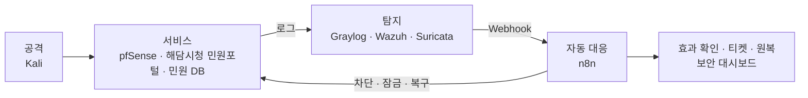
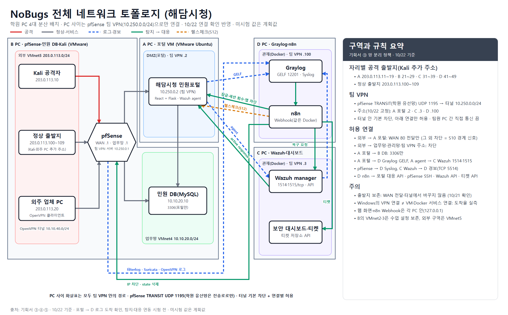

# 파이널 프로젝트 기획서 — 1조 NoBugs

> **해담시청 민원포털 보안 관제와 자동 대응 실측**
>
> 제출 2026-10-23(금) · 리허설 2026-11-05(목) · 본발표 2026-11-06(금)
>
> 팀원(자리): 반소람(A) · 김명준(B) · 김상혁(C) · 김대훈(D)

> **기준일 2026-10-23(제출일).** 실습 환경은 학원 PC 4대 분산 배치와 팀 전용 VPN이다(③). 10/22까지의 연결 시험과 보강 전 측정(S1·S4·S7) 결과를 반영했고, 아직 시험하지 않은 주소·포트는 계획값으로 표시했다. 배치 근거와 연결 순서는 [분산 배치 실행안](../docs/DISTRIBUTED-LAB-PLAN.md)에 있다.

---

## 한눈에 보기

가상 기관 **해담시청**의 민원포털·민원 DB·외주 VPN을 내부망에 만들고, 자리마다 공격을 **탐지 → 자동 대응 → 효과 확인 → 원복**까지 실측한다. 필수 4종은 보안 3대 원칙을 하나씩 덮는다.



| 자리 | 필수 케이스 | 3대 원칙 | 막는 위협 | 자동 대응 → 효과 확인 |
| --- | --- | --- | --- | --- |
| A | S1·S4 계정 탈취 | 기밀성 | 공무원 계정 비밀번호 추측과 탈취 로그인 | 출발지 차단(S1), 계정 잠금·세션 회수(S4) → 재로그인 거부 |
| B | S8·S10 스캔→침입 | 기밀성 | 포털 탐색 뒤 침입, 경계 관통 | 앱·pfSense 차단 → 같은 IP 연결 실패 |
| C | S7 홈페이지 변조 | 무결성 | 웹 파일 변조·삽입 | 바뀐 파일 원본 복구·새 파일 격리 → 원본 응답 |
| D | S12 서비스 장애 | 가용성 | 요청 폭주로 인한 민원 서비스 지연 | 출발지 차단 → 응답시간 기준선 복귀 |

- **실습 환경:** 학원 PC 4대. A 민원포털 VM, B pfSense·민원 DB·Kali, C Wazuh·보안 대시보드, D Graylog·n8n으로 나누고, PC 사이는 학원 유선망 위 팀 전용 OpenVPN 터널로만 잇는다(③).
- **검증:** 케이스마다 같은 9단계로 돌리고, 탐지율·오탐·자동 대응 성공률·원복 성공률·MTTD·MTTR을 보강 전후로 비교한다(⑤). ⑤를 처음 읽을 때는 5.1 원칙, 5.2 공통 9단계 표, 5.5 정량 지표만 보면 된다.
- **일정:** MVP(~10/28, S1 완주) → 필수(~11/01) → 검증·확장(~11/03) → 리허설(11/05) → 본발표(11/06)(⑥).

**평가 기준과 기획서 위치.**

| 평가 항목(10/16 공지) | 기획서에서 보는 곳 |
| --- | --- |
| 기획·설계 | ② 프로젝트 시나리오, ③ 시스템 구성 |
| 기술 활용·연동 | ③ 도구와 역할·연동, ④ 구현 계획 |
| 실측 검증 | ⑤ 실측 검증 계획 |
| 문제 해결 과정 | ⑥ 위험, 협업 방식(작업일지의 "문제와 해결") |
| 포트폴리오 완성도 | ⑥ 일정(최종 제출물: 포트폴리오 PPT, GitHub 코드·README, 실측 시연 녹화) |

### 용어와 번호

| 용어 | 뜻 |
| --- | --- |
| SIEM | 여러 장비의 로그를 모아 상관 분석하는 시스템. 여기서는 Graylog |
| HIDS · NIDS | 호스트 침입 탐지(Wazuh) · 네트워크 침입 탐지(Suricata) |
| SOAR | 탐지 결과를 받아 대응을 자동으로 실행하는 시스템. 여기서는 n8n |
| FIM | 파일 무결성 감시. 감시하는 파일이 바뀌거나 새로 생기면 경보를 낸다(Wazuh) |
| DMZ | 외부에 공개하는 서버를 내부망과 떼어 두는 구역 |
| Webhook | Graylog가 탐지 결과를 n8n에 HTTP로 보내는 호출 |
| 집계 창 · 묶기 키 | 조건을 세는 시간 범위(예: 30분)와, 무엇을 기준으로 따로 셀지(예: username) |
| MTTD · MTTR | 조건 충족부터 탐지까지 · 탐지부터 효과·회복 확인까지 걸린 시간. 표본이 적어 중앙값과 최댓값으로 보고한다(⑤ 5.5) |
| 원복 | 자동 대응(차단·잠금 등)을 해제해 처음 상태로 돌리는 절차 |
| MVP | 케이스 1개로 처음부터 끝까지 먼저 완주해 보는 최소 완성본 |
| 케이스 번호 | S1~S10은 수업 가이드 번호이고, 수업 Graylog의 S11은 Snort 포트스캔이다. 팀의 서비스 장애는 S12, 승인 없는 VPN 접속은 번호 충돌을 피한 VPN-01(확장)로 구분한다 |
| 대응 봇 108~117 | 수업 가이드의 108 권한 회수 · 111 계정 잠금(+ 세션 회수) · 112 IP 차단 · 113 알림 · 114 티켓에, 팀이 115 VPN 세션 회수 · 116 회복 확인(헬스체크) · 117 파일 복구·격리를 더했다. 상세는 ③ 대응 봇 |

---

## ① 프로젝트 개요

### 프로젝트명

**공공기관 민원 서비스·원격 유지보수 접속 보안 관제 및 자동 대응 시스템**

가상 기관 **해담시청**의 **해담시청 민원포털**(소개 문구 "시민의 목소리를 담다, 해담시청")을 지킬 서비스로 삼는다.

### 선정 배경

- 공공기관은 민원인 개인정보를 대량으로 보유하고, 홈페이지·민원포털은 대국민 서비스라 침해되면 피해가 바로 시민에게 간다.
- 시스템 유지보수를 외주 업체가 VPN으로 원격 접속하는 구조가 흔하며, 이 경로는 내부망으로 들어가는 통로가 된다.
- 공공기관은 인터넷망과 업무망 분리가 기본이라, 경계 설계와 계층별 탐지를 보여 주기에 알맞다.
- 수업 케이스(S1~S10)가 공공기관 상황(공무원 계정 탈취, 개인정보 조회, 홈페이지 변조, 전 계층 관통)에 그대로 대응된다.
- 실제 공공 서비스 침해·장애 사례는 아래와 같다(정부·수사기관 발표를 보도한 기사 기준).

| 사례 | 발표 내용 | 우리 설계와 연결 |
| --- | --- | --- |
| 온나라시스템 해킹(행정안전부, 2025-10-17 발표) | 외부 인터넷 PC에서 정부원격근무시스템(G-VPN)을 거쳐 업무망의 온나라시스템에 접근했다. 공무원 GPKI 인증서 약 650명분이 발견됐고, 12명분은 비밀번호 등도 함께 있었다. 7월 중순 국가정보원을 통해 정황을 확인했다 | 탈취한 인증 정보로 정상 사용자처럼 원격 접속한 사례. 계정 탈취 대응(A S4), 승인 없는 VPN 접속(VPN-01, 확장) |
| 법원 전산망 해킹(경찰청 수사 결과, 2024-05 보도) | 2021-01 이전부터 2023-02까지 침입해 1,014GB를 외부로 보냈다. 확인된 유출은 개인정보가 담긴 개인회생 문서 5,171개(4.7GB)다. 보안장비의 상세 기록이 이미 지워져 최초 침입 시점과 원인을 밝히지 못했다 | 2년 넘게 탐지하지 못한 사례. 탐지 지연(MTTD) 측정, 로그 보존, 개인정보 조회 탐지(S9, 확장) |
| 지방행정전산서비스 장애(행정안전부, 2023-11-25 발표) | 11/17 라우터 모듈의 일부 포트 이상으로 큰 패킷이 유실돼 서비스가 멈췄다. 해킹 징후는 없었다 | 공격이 아니어도 서비스가 멈추면 피해가 바로 시민에게 간다. 가용성 감시와 회복 확인(D S12, 116) |

출처: [뉴시스 2025-10-17](https://www.newsis.com/view/NISX20251017_0003366706), [뉴시스 2024-05-11](https://www.newsis.com/view/NISX20240511_0002731515), [뉴시스 2023-11-25](https://www.newsis.com/view/NISX20231125_0002534888)

### 목적

> 해담시청의 민원포털·민원 DB·외주 원격 접속 경로에 대한 공격을 **탐지 → 자동 대응 → 차단 확인 → 서비스 복구 확인**까지 내부망에서 직접 실측한다.

### 핵심 목표

1. **보안 네트워크 설계와 실측:** 인터넷·DMZ·업무망·관리망·VPN을 pfSense로 나누고, 허용·차단 규칙을 실제 연결과 로그로 확인한다.
2. **탐지와 자동 대응 연동:** 앱·호스트·네트워크 로그를 Graylog로 모아 상관 분석하고, n8n이 차단·잠금·티켓을 자동으로 실행한다.
3. **효과와 복구의 정량 검증:** 실제로 막혔는지, 정상 사용자 업무가 유지되는지, 원복이 되는지를 보강 전후로 비교하고 지표로 남긴다.

### 핵심 기능

1. **해담시청 민원포털:** 시민 민원 신청·본인 조회, 담당 공무원 배정·처리·답변, 관리자 계정 관리(React + Flask + MySQL). 보안 이벤트를 GELF로 보내고 n8n이 부를 대응 API를 둔다.
2. **망 분리와 외주 VPN:** pfSense 방화벽, OpenVPN 원격 접속, 구역별 허용 규칙
3. **로그 통합 수집·상관 분석:** Graylog(SIEM), Wazuh(HIDS), Suricata(NIDS)
4. **탐지 규칙:** 필수 4종(S1·S4, S8·S10, S7, S12)의 조건·창·묶기 기준을 Graylog 이벤트 정의와 Wazuh 규칙으로 구현
5. **자동 대응:** n8n으로 출발지 차단, 계정 잠금, 세션 회수, 변조 파일 복구, 알림, 인시던트 티켓
6. **조치 후 확인과 원복:** 다시 시도했을 때 실제로 막히는지, 서비스가 회복됐는지 확인하고, 모든 대응은 해제 절차와 한 세트로 둔다.
7. **게시판 보안 대시보드:** 탐지 이벤트, 인시던트 티켓, 대응·효과 확인·원복 상태를 한 화면에 보여 준다. C PC의 Docker에서 티켓 저장소와 함께 돌리고, 민원포털 관리자 메뉴의 링크로 연다. 포털이 느려지거나 멈추는 장애(S12) 중에도 대시보드와 티켓 기록이 남고, 보안 기록이 공격 대상인 DMZ에 놓이지 않는다.

**필수 구현 범위.** 필수 4종은 보안 3대 원칙을 하나씩 덮도록 골랐다(A·B 기밀성, C 무결성, D 가용성). 민원인 개인정보 조회(S9·S9-B)는 확장으로 둔다. 개인정보로 들어가는 앞 단계인 계정 탈취(A)와 외부 침입(B)을 필수에서 먼저 끊고, 조회 단계의 탐지는 그 뒤에 더한다. 원격 유지보수 접속(VPN)은 망 구성(③)으로 다루고, 승인 없는 VPN 접속 탐지는 확장 케이스 VPN-01로 둔다.

---

## ② 프로젝트 시나리오

### 기업·서비스: 해담시청

| 구분 | 내용 |
| --- | --- |
| 해담시청 민원포털 (DMZ) | 시민이 민원을 신청하고 본인 민원을 조회하는 웹 서비스(React + Flask). 담당 공무원은 미배정 민원을 자기에게 배정해 처리·답변하고, 관리자는 계정·권한·잠금을 관리한다. 관리자는 민원 원문을 볼 수 없다. 관리자 메뉴에 보안 대시보드(C PC) 링크 |
| 민원 DB (업무망) | MySQL. 민원과 민원인 정보를 둔다(합성 데이터). 포털 서버만 접속 |
| 외주 유지보수 | 유지보수 업체가 OpenVPN으로 원격 접속. 작업 승인 시간에만 허용 |
| 보안관제 (C·D PC) | C: Wazuh, 보안 대시보드와 티켓 저장소 · D: Graylog, n8n (모두 Docker) |

민원포털은 10/19에 1차 구현했다(⑥ 진행 현황). 시민은 본인 민원만, 담당 공무원은 미배정 대기열과 자기에게 배정된 민원만 볼 수 있고, 다른 사람의 민원 번호로 요청하면 404로 응답한다.

### 보호 자산과 보안 3대 원칙

| 자산 | 중요도 | 지켜야 할 원칙 | 주요 위협(케이스) |
| --- | --- | --- | --- |
| 공무원·관리자 계정 | 상 | 기밀성 | 비밀번호 추측·계정 탈취(S1·S4) |
| 내부 업무망·DB | 최상 | 기밀성 | 스캔 뒤 침입, 경계 관통(S8·S10) |
| 민원포털 웹 콘텐츠 | 상 | **무결성** | 홈페이지 변조(S7) |
| 민원 서비스 | 상 | **가용성** | 요청 폭주에 따른 서비스 장애(S12) |
| 민원인 개인정보(MySQL) | 최상 | 기밀성 | 권한 상승 뒤 조회·대량 조회(S9·S9-B, 확장) |
| 원격 유지보수 경로(VPN) | 상 | 기밀성 | 승인 없는 VPN 접속(VPN-01, 확장) |

### 위협

공격은 모두 격리 랩 안에서 Kali와 재현 스크립트로 재현한다(④ 공격·테스트).

| 위협 | 공격 방법 | 노리는 자산 | 원칙 | 케이스 |
| --- | --- | --- | --- | --- |
| 계정 탈취 | 공무원 계정에 비밀번호를 천천히 대입하다가 로그인에 성공 | 공무원 계정 | 기밀성 | S1·S4 |
| 스캔 뒤 침입 | 포털의 없는 경로를 훑은 뒤 로그인을 반복하고, 막힌 포트까지 두드림 | 포털, 업무망 경계 | 기밀성 | S8·S10 |
| 홈페이지 변조 | 웹 디렉터리의 파일을 바꾸거나 새 파일을 넣은 뒤 그 경로로 접근(침해 뒤 단계를 재현) | 포털 웹 콘텐츠 | 무결성 | S7 |
| 서비스 거부 | 한 출발지에서 포털로 요청을 몰아 보내 응답을 늦춤 | 민원 서비스 | 가용성 | S12 |
| 개인정보 무단 조회(확장) | 권한을 올리거나, 정상 권한으로 개인정보를 대량 조회 | 민원인 개인정보 | 기밀성 | S9·S9-B |
| 승인 없는 원격 접속(확장) | 작업 승인이 없는 외주 계정으로 VPN 접속 | 원격 유지보수 경로 | 기밀성 | VPN-01 |

### 탐지·대응: 필수 케이스 4종

필수 4종은 **자리별 시나리오 4개**이고, 케이스 ID로 세면 6개(S1·S4·S8·S10·S7·S12)다. 각 자리는 자기 케이스 ID마다 공격 실행부터 탐지, 자동 대응, 효과 확인, 원복, 보강 전후 비교, 증적까지 끝까지 맡는다. 탐지 조건의 상세는 ④에 있다.

| 자리 | 케이스 | 공공기관 상황 | 3대 원칙 | 주된 탐지 | 자동 대응 | 원복 |
| --- | --- | --- | --- | --- | --- | --- |
| A | S1 저속 브루트포스 · S4 실패 뒤 성공 | 공무원 계정에 천천히 비밀번호를 추측하다가 결국 로그인에 성공 | 기밀성 | 앱 로그 → Graylog | S1: 출발지 차단(112, 자동 만료 없음) + 티켓(114). S4: 계정 잠금(111) + 기존 세션 회수 + 티켓 | 출발지 차단 해제(담당자). S4는 탈취면 비밀번호 재설정 뒤 해제, 오탐이면 관리자 해제 |
| B | S8 스캐너→브루트포스 · S10 전 계층 관통 | 같은 출발지가 포털을 탐색한 뒤 로그인을 반복하고, 경계까지 두드림 | 기밀성(네트워크) | Suricata·pfSense 로그 + 앱 로그 | 앱 IP 차단(112) + pfSense 경계 차단(S10) + 티켓 | 경계 차단 → 앱 차단 순서로 해제 |
| C | S7 홈페이지 변조 | 민원포털 웹 디렉터리의 파일이 바뀌거나 새 파일이 생긴 뒤 그 경로로 접근 | **무결성** | Wazuh FIM + 웹 접근 로그 | 티켓(114) + 바뀐 파일은 원본 복구, 새 파일은 격리 | 격리한 시험 파일 삭제, 원본 해시 확인 |
| D | S12 요청 폭주로 인한 서비스 장애 | 한 출발지의 과도한 요청으로 민원포털이 느려지거나 실패 | **가용성** | 요청 수 + 헬스체크 응답시간(+ Suricata) | 출발지 차단(112. 앱 차단이 안 되면 pfSense 경계 차단, 속도 제한은 확장) + 티켓(114) + 회복 확인(116) | 차단 해제, 응답시간 기준선 확인 |

- S1에는 계정 잠금을 쓰지 않는다. 실패만 반복해도 잠기면 공격자가 정상 공무원의 계정을 일부러 잠글 수 있기 때문이다. 잠금은 실제 로그인 성공이 확인된 S4에만 쓴다.
- S1 출발지 차단은 자동 만료 없이 두고 원복 단계에서 담당자가 해제한다. 측정 중에 차단이 저절로 풀리면 효과 확인이 흔들리기 때문이다(④ 대응 호출 방식).
- S4의 기존 세션 회수를 탈취 대응의 완료 조건으로 둔다. 탈취가 의심되거나 확인되면 공격자가 이미 비밀번호를 알고 있으므로 비밀번호를 재설정(reset)한 뒤 잠금을 푼다. 오탐으로 확인되면 승인된 관리자가 비밀번호를 그대로 두고 잠금만 푼다(unlock, 10/22 결정). 어느 쪽이든 회수한 세션은 되살리지 않고, n8n이 자동으로 해제하지 않는다(④ 대응 호출 방식).
- C의 원본 복구는 팀이 더한 대응 봇 117이 맡는다. 수업 가이드의 봇 번호(108·111~114)와 구분한 팀 번호다.
- **A·B 연쇄의 검증:** 앞 단계(S1·S8)가 출발지를 먼저 막으면(112) 같은 출발지로는 뒤 단계(S4·S10) 조건이 채워지지 않을 수 있다. 그래서 케이스 판정은 단계별로 따로 한다. S4는 S1 기준에 못 미치는 실패 뒤 성공으로 시험하고, S10은 S8의 앱 차단 뒤에도 pfSense 차단 로그로 조건이 채워지는지 사전 시험(⑤ 5.10)으로 확인한다. 연쇄 전체는 앞 단계 자동 차단을 끈 시험으로 따로 1회 확인한다.
- **범위 조정 조건:** 10/28(MVP 시점, ⑥)에 일정이 밀렸으면 S1·S8을 확장으로 내리고, 자리별 대표 케이스(S4·S10·S7·S12)만 필수로 둔다.

### 확장 케이스 (필수 4종 완료 후)

| 케이스 | 공공기관 상황 | 3대 원칙 | 대응 |
| --- | --- | --- | --- |
| S2 심야 로그인 성공 | 업무시간 외(22~06시 KST) 공무원 계정의 포털 로그인 | 기밀성 | 티켓(114) |
| S3 한 계정 다중 출발지 | 한 공무원 계정이 5분 안에 다른 IP에서 로그인 | 기밀성 | 티켓(114) |
| S5 차단 우회 시도 | 차단된 IP가 계속 접근 | 기밀성 | 티켓(114) |
| S6 관리 API 폭주 | 포털 관리 API 키 추측 | 기밀성 | IP 차단(112) |
| S9 권한 상승 뒤 개인정보 조회 | 승인 없이 등급을 올린 계정이 민원인 개인정보 열람 | 기밀성 | 권한 회수(108) + 티켓 |
| S9-B 개인정보 대량 조회 | 정상 권한자가 단시간에 개인정보를 대량 조회 | 기밀성 | 통지(113) + 사람 검토 |
| 권한 변경 없는 타인 자료 조회 | 권한을 바꾸지 않고 다른 민원인의 자료를 조회 | 기밀성 | 번호·대응은 확장 때 정함 |
| VPN-01 승인 없는 VPN 접속 | 작업 승인이 없는 외주 계정의 VPN 접속. 작업 승인 테이블을 Graylog lookup으로 대조해 판정 | 기밀성 | VPN 세션 회수·계정 비활성(115) + 티켓 |

수업 Graylog에는 S11 Snort 포트스캔이 있으므로, 팀의 승인 없는 VPN 접속은 VPN-01로 표기한다. S12는 팀의 서비스 장애 케이스다. 수업 이벤트·알림·파이프라인은 구현 시 참고하고, 해담시청의 탐지 조건은 ④에 따른다.

---

## ③ 시스템 구성

### 망 구성도

학원 PC 4대에 기능을 나눠 실행한다(10/20 결정). A는 민원포털 VM(VMware Ubuntu), B는 pfSense·민원 DB·Kali, C는 Wazuh·보안 대시보드·티켓 저장소, D는 Graylog·n8n을 맡는다. PC 사이는 B의 pfSense에 둔 **팀 전용 OpenVPN 터널**로만 잇는다. 그림의 주소와 포트는 계획값이다(아래 IP 할당).



**PC 사이 연결(팀 VPN).** 추가 랜카드·스위치 없이 기존 학원 유선망을 전송로로만 쓴다. 두 PC 배치 때 정하려던 관리망 전용 연결(USB 이더넷 어댑터·직결 케이블)은 4대 분산 배치로 바꾸면서 쓰지 않는다(10/22 결정).

- B의 pfSense에 학원 유선망으로 브리지한 전송 인터페이스(TRANSIT)를 두고, 팀 전용 OpenVPN 서버(UDP 1195, 터널 10.250.0.0/24)를 연다. 서비스가 실행되는 곳이 직접 이 터널에 접속한다. A는 포털 VM(VMware Ubuntu) 안, C·D는 Docker를 실행하는 Windows 호스트이며, 접속 계정마다 고정 주소를 준다(아래 IP 할당).
- 터널 안은 기본 차단이다. 아래 망 분리 정책의 연결만 주소·포트별로 허용하고, 팀원 PC 사이의 직접 통신(inter-client)은 끈다. 그래서 PC 사이 통신은 모두 pfSense 규칙과 로그를 지난다.
- Windows에서 VPN이 붙었다고 VM·Docker 서비스까지 연결된 것은 아니다. A는 포털 VM 안에서 접속하고(같은 계정으로 두 곳에서 동시에 접속하면 세션이 바뀌므로 한 곳에서만), C·D는 Docker 포트를 터널 주소에만 공개한 뒤 표식 로그로 실제 도착을 확인한다.
- **출발지 보존:** pfSense의 WAN 전달과 터널 구간에서 출발지 주소를 바꾸지 않는다. 포털과 Graylog가 Kali 주소를 그대로 봐야 출발지 차단(112)이 맞는 IP를 막는다. 포털은 Kali 대역(203.0.113.0/24)과 업무망(10.10.20.0/24)으로 가는 경로를 터널로 받는다(10/21은 Kali 주소 하나만 임시 경로로 둠, 영구 설정 예정).
- **실측(10/20~10/21):** 10/20에 B 호스트의 시험 계정으로 터널 접속(AES-256-GCM), 터널 서버 ping 4/4, 기본 차단(TCP 443 접속 실패)을 확인했다. 10/21에는 A(`team-a`)와 C(`team-c`)가 접속했고, 허용 규칙을 더한 뒤 A → DB TCP 3306과 A → C TCP 1514·1515 연결이 성공했다. 처음 WSL에 띄운 포털로 Kali(`203.0.113.10`) → pfSense WAN 80 요청이 HTTP 200을 받았고, 포털 로그의 `src_ip`가 `203.0.113.10`으로 남아 **출발지 보존을 확인했다**(A 보고). 오후에 포털을 A의 VMware Ubuntu VM 하나로 옮긴 뒤, A는 DB 연결·로그인·민원 저장·재시작 유지를, C는 VM agent(010) 등록과 FIM 경보를 확인했다고 보고했다. B는 Kali → 포털 HTTP 200을 다시 확인했다(17:05). 10/22에는 D(`team-d`)가 접속했고, A 포털 VM의 GELF가 D Graylog에 도착해 원본과 같은 `event_id`, `src_ip`(`203.0.113.10`)로 남은 것을 확인했다(A·D 확인). D → A 포털 헬스체크(`GET /api/v1/health`)는 허용 규칙을 더한 뒤 200을 받았다(15:31). C → D Wazuh 경보는 1,400B를 넘는 UDP가 팀 VPN 구간에서 전달되지 않아 TCP로 바꿨고, 변경 경보(550)까지 3종이 유실 없이 도착했다(⑥ 위험). 저녁에 B가 팀 VPN 주소를 고정했고(아래 IP 할당), A는 재접속 뒤 주소 유지와 S1·S4 시험 출발지(203.0.113.11·12)의 반환 경로를 확인했다.
- 공격 트래픽은 B PC 안(Kali → pfSense WAN)에서만 오간다. 학원 유선망에는 팀 VPN 포트 말고 서비스·관리 포트를 공개하지 않는다.

#### 구역과 배치

| 구역 | 대역 | 위치 | 들어가는 것 |
| --- | --- | --- | --- |
| 외부(공격·외주) | 203.0.113.0/24 | B PC VMnet5 | Kali, 외주 업체 PC(확장) |
| DMZ(포털) | 팀 VPN 안 포털 고정 주소 | A PC 포털 VM(VMware Ubuntu) | 해담시청 민원포털(Flask + React 빌드), Wazuh agent |
| 업무망 | 10.10.20.0/24 | B PC VMnet4 | 민원 DB(MySQL) |
| 관제(수집·대응) | 팀 VPN 안 C·D 고정 주소 | C·D PC 호스트(Docker) | C: Wazuh·보안 대시보드·티켓 저장소, D: Graylog·n8n |
| B 관리망 | 10.10.30.0/24 | B PC VMnet7(Host-only) | pfSense 웹 관리·SSH, B 관리 호스트 |
| 팀 VPN | 10.250.0.0/24(터널) | pfSense ↔ A·C·D | 위 구역 사이의 모든 PC 간 통신 |
| 학원 유선망 | 192.168.3.0/24 등(DHCP) | 4대 | 팀 VPN 전송(UDP 1195)만 |
| 설치용 인터넷 | VMware NAT | 각 PC | 패키지 설치 때만 연결하고 시험 중에는 끊음 |
| 외주 VPN(터널) | 10.10.40.0/24 | pfSense | OpenVPN 접속 대역(VPN-01, 확장) |

포털이 다른 PC에 있어 VMnet으로는 DMZ를 만들 수 없다. 그래서 DMZ 정책(외부에서는 포털만, 포털에서는 DB 3306과 로그 포트만)은 포털의 팀 VPN 고정 주소에 pfSense 규칙으로 건다.

#### IP 할당

장비마다 주소와 받는 포트를 적는다. 팀 VPN 주소는 10/22에 고정한 값이다. 그 밖에 아직 시험하지 않은 값은 계획값이며 사전 시험에서 실제 설정과 맞춘다.

| 위치 | 장비 | IP | 받는 것(허용 출발지) |
| --- | --- | --- | --- |
| B 외부(VMnet5) | pfSense WAN | 203.0.113.1 | 포털 80 전달(→ A 포털 5000), 외주 OpenVPN 1194/udp(VPN-01, 확장) |
| B 외부 | Kali | 203.0.113.10 | 없음(공격 출발지, 시험용 추가 주소는 아래) |
| B 외부 | 외주 업체 PC | 203.0.113.20 | 없음(OpenVPN 클라이언트, 확장) |
| B 업무망(VMnet4) | pfSense 업무망 / 민원 DB(MySQL 8.4) | 10.10.20.1 / 10.10.20.10 | DB 3306(A 포털만) |
| B 관리망(VMnet7) | pfSense LAN / B 관리 호스트 | 10.10.30.1 / 10.10.30.10 | 웹 관리 화면·SSH(B 관리 호스트만) |
| 학원 유선망 | pfSense TRANSIT | DHCP(10/20 관찰 192.168.7.174) | 팀 VPN 1195/udp(팀원 PC 주소만) |
| 팀 VPN | pfSense 터널 | 10.250.0.1 | SSH 22(D n8n만, 차단 수단 1안) |
| 팀 VPN | A 포털 VM | 10.250.0.2 | 5000(외부 전달, D 헬스체크), 대응 API(D n8n만) |
| 팀 VPN | C PC(Wazuh·대시보드) | 10.250.0.3 | Wazuh 1514·1515/tcp(A 포털만), Wazuh API 55000·티켓 API(D n8n만. 55000은 아직 공개 전) |
| 팀 VPN | D PC(Graylog·n8n) | 10.250.0.100 | GELF 12201/udp(A 포털. 큰 메시지용 12201/tcp 허용 규칙도 둠), Syslog 514/udp(pfSense, 컨테이너 1514/udp), Wazuh 경보 Raw TCP 5514/tcp(C 중계) |
| 외주 VPN | pfSense 외주 터널 / 외주 접속 | 10.10.40.1 / 10.10.40.2부터 | 승인된 작업 대상 포트만(VPN-01, 확장) |

- **시험용 출발지 주소:** Kali에 추가 주소를 두어 실행마다 공격 출발지를 바꾸고(⑤ 5.3), 자리마다 범위를 나눈다(⑥ 측정 대기 시간). A 203.0.113.11~19, B 21~29, C 31~39, D 41~49. 정상 출발지는 203.0.113.100~109로 두고 Kali나 외주 업체 PC VM에 추가 주소로 단다(S12의 정상·공격 출발지 분리, ⑤ 5.10).
- **팀 VPN 주소:** 10/22 저녁 B가 그날 쓰던 주소를 접속 계정별 고정 주소로 지정했다(A .2, C .3, D .100). 허용 규칙·수신 주소가 모두 이 주소 기준이라, 10/21에 계획한 자리 번호 주소(A .10, C .30, D .40)로는 바꾸지 않는다. A는 재접속 뒤 .2 유지를 확인했고, C·D는 다음 접속 때 같은 주소를 받는지 확인한다. 학원 유선망 주소는 DHCP라 시험 전에 다시 확인하고, 바뀌면 접속 프로필의 목적지를 고친다. D의 입력 포트는 Syslog 호스트 514/udp → 컨테이너 1514/udp, Wazuh 경보 Raw TCP 5514/tcp다(10/22, UDP에서 TCP로 변경). 수신 포트는 D의 팀 VPN 주소에만 공개한다.
- **호스트 가상 어댑터:** B의 VMnet4·5·6은 VMware 가상 네트워크 편집기에서 호스트 가상 어댑터 연결과 DHCP를 끈다. 켜 두면 Windows 호스트가 랩 구역에 들어가 pfSense를 거치지 않는 길이 생긴다. VMnet7은 B 관리 호스트가 pfSense 관리 화면에 들어가는 Host-only 망이다.
- **pfSense 인터페이스 배정(10/20 확인):** WAN = 외부(VMnet5), LAN = B 관리망(VMnet7), OPT1 = DMZ(VMnet6, 분산 배치에서는 포털을 두지 않음), OPT2 = 업무망(VMnet4), TRANSIT = 학원 유선망 브리지(팀 VPN 전송). pfSense는 anti-lockout 규칙을 LAN에 자동으로 붙이므로 B 관리망에서 웹 관리 화면·SSH가 막히지 않는다. easyrule이 만드는 차단 규칙이 WAN 허용 규칙보다 위에 있는지, 공격 IP로만 state를 지운 뒤(`pfctl -k <IP>`) 관리·자동화 연결이 유지되는지 사전 위험 시험 ①에서 확인한다. 랩은 IPv4만 쓰고 IPv6는 끈다.
- **학원 PC의 수업 설정:** B PC의 VMnet2(172.16.50.0/24)·VMnet3(172.16.10.0/24)는 수업 설정이므로 건드리지 않고, 외부 구역은 **VMnet5**에 둔다. 외주 VPN(VPN-01, 확장)은 WAN의 OpenVPN(UDP 1194)을 쓰고 팀 VPN(UDP 1195, TRANSIT)과 분리한다. 지금 1194에는 수업용 설정(10.8.0.0/24)이 남아 있어 확장 때 정리한다. 다른 PC에 같은 번호의 VMnet을 만들어도 서로 연결되지 않으므로 PC 사이는 팀 VPN으로만 잇는다. 강의실 망(192.168.3.0/24)과 랩 대역은 겹치지 않는다.

#### 망 분리 정책 (pfSense 규칙 요약)

| 출발 → 도착 | 허용 | 비고 |
| --- | --- | --- |
| 외부 → A 포털 | WAN 80 전달만 | 그 외 차단(차단 기록은 S10 경계 신호). 출발지 주소를 바꾸지 않음 |
| 외부 → 업무망·관리망·팀 VPN 주소 | 차단 | 망 분리 |
| A 포털 → 업무망 DB | 3306만 | |
| A 포털 → C·D | 로그 포트만(Wazuh 1514·1515/tcp, GELF 12201/udp·tcp) | 포털은 GELF UDP로 보낸다. 큰 메시지가 생기면 쓸 TCP 규칙(`HAEDAM_A_TO_D_GELF_TCP`)을 10/22에 미리 더했다 |
| pfSense → D Graylog | Syslog(filterlog·Suricata·OpenVPN) | |
| C Wazuh → D Graylog | TCP 5514만(`HAEDAM_C_TO_D_WAZUH_TCP`) | FIM 경보만 C manager → C PC 안 중계 컨테이너(UDP syslog, JSON 본문) → D Raw TCP 입력(5514/tcp)으로 보낸다. 1,400B를 넘는 UDP 경보가 팀 VPN 구간에서 전달되지 않아 10/22에 TCP로 바꿨다(⑥ 위험) |
| D n8n → A 포털·pfSense·C | 대응 API, SSH(차단), Wazuh API, 티켓 API만 | 차단·잠금·복구·기록 경로 |
| 팀 VPN의 그 밖의 통신 | 차단 | 팀 대역 기본 차단 규칙(10/20 적용). 터널 서버 ping만 허용 |
| 학원 유선망 → pfSense TRANSIT | UDP 1195(팀원 PC 주소만) | |
| 외주 VPN → 업무망 | 승인된 외주 계정, 작업 대상 포트만 | VPN-01(확장) |

Graylog·Wazuh·n8n의 웹 화면과 보안 대시보드는 각 PC 안(127.0.0.1)에서 연다. 다른 PC에서 볼 필요가 생기면 지정한 팀 VPN 주소만 허용한다. 포털 관리자 메뉴에는 보안 대시보드 링크만 두며, 포털 서버는 대시보드를 호출하지 않는다. Wazuh agent 등록(1515)은 등록 비밀번호 없이 pfSense 규칙으로 A 포털 주소만 허용한다(10/21 결정).

### 아키텍처

기능을 네 계층으로 나누고 계층마다 놓을 PC를 정한다. 서비스와 경계는 A·B에, 탐지·대응·기록은 C·D에 둔다. 그래서 포털이 느려지거나 멈춰도(S12) 탐지와 티켓 기록은 남는다. 둘 다 검색 엔진 계열 저장소를 쓰는 Graylog와 Wazuh는 서로 다른 PC(D·C)에 둬 메모리를 나눠 쓴다.

| 계층 | 구성 | 위치 |
| --- | --- | --- |
| 서비스 | 해담시청 민원포털(React 화면 + Flask API), 민원 DB(MySQL) | A PC 포털 VM, B PC 업무망 VM |
| 경계 | pfSense(방화벽·팀 VPN·OpenVPN), Suricata(pfSense 패키지) | B PC pfSense VM |
| 수집·탐지 | Graylog(수집·정규화·이벤트 정의), Wazuh(FIM·호스트 경보) | D PC Docker, C PC Docker |
| 대응·기록 | n8n(대응 봇·효과 확인), 보안 대시보드·티켓 저장소 | D PC Docker, C PC Docker |

**민원포털 구조(10/19 구현).**

- React 빌드 결과를 Flask가 API와 함께 한 서버에서 제공한다. 정해 둔 화면 경로·정적 파일·API 밖의 요청은 404로 응답하고 `web-scan` 신호를 남긴다. 모든 경로를 화면으로 돌려 200을 주면 스캔 신호가 사라지기 때문이다.
- 포털 앞에 프록시가 없으므로 연결 주소를 출발지로 쓰고 `X-Forwarded-For`는 믿지 않는다. 로그인·접근 기록과 출발지 차단 검사가 같은 출발지 해석을 쓴다. 그래서 pfSense 전달과 팀 VPN 구간에서도 출발지를 바꾸지 않는다(위 출발지 보존).
- 브라우저용 API(세션 쿠키 + CSRF 토큰)와 n8n용 대응 API(대응 키 + 허용 대역 + 중복 방지 키)를 나눈다. 공개 화면에서는 대응 API를 부를 수 없다.
- 세션은 4시간 뒤 만료되고, 로그아웃·비밀번호 변경·계정 잠금·역할 변경 때 회수한다.
- 수업 게시판 코드는 참고만 하고, 전달 헤더 신뢰·브라우저 저장소 토큰처럼 이 설계와 맞지 않는 부분은 가져오지 않았다.
- 필요한 수업 게시판 기능은 팀 저장소에 올려도 된다. VPN은 외주 업체의 OpenVPN 원격 접속 구성으로 진행한다.

#### PC별 배치 (계획값, 실측 후 조정)

| PC | 실행할 것 | 자원(계획값) |
| --- | --- | --- |
| A | 포털 VM(VMware Ubuntu, VMware NAT): 포털(Flask + React 빌드, waitress 5000, systemd 서비스), Wazuh agent, 팀 VPN 클라이언트 | VM 자원은 실측 뒤 기록 |
| B | pfSense(+ Suricata 패키지) 2/2GB, 민원 DB VM(Ubuntu 24.04, MySQL 8.4) 2/2GB, Kali 2/2GB, 외주 업체 PC 1/1GB(확장) | VM 합계 약 7GB |
| C | Wazuh(indexer·manager·dashboard), 경보 TCP 중계(메모리 128MB), 보안 대시보드·티켓 저장소. Docker(WSL2), 팀 VPN 클라이언트 | WSL 상한 약 10~11GB |
| D | Graylog(+ OpenSearch, MongoDB), n8n. Docker(WSL2), 팀 VPN 클라이언트 | WSL 상한 약 10~11GB |

- C·D 공통: 컨테이너별 메모리 제한, JVM 힙 지정, `.wslconfig` 메모리 상한, `vm.max_map_count` 설정, 자동 재시작. 그 PC에서는 다른 무거운 작업을 하지 않는다.
- **10/20 준비 상태:** 민원 DB VM(2 vCPU / 2GB / 디스크 30GB, MySQL 8.4.11)을 B에 만들고 앱 계정 조회와 B 관리 호스트의 TCP 3306 연결을 확인했다. 10/21에는 Kali를 VMnet5 `203.0.113.10`으로 설정했고, A 포털을 WSL에서 시험한 뒤 VMware Ubuntu VM 하나로 옮겼다. 포털 → DB 연결·민원 저장·재시작 유지는 A가 확인했다고 보고했다.
- 수치는 모두 계획값이다. 10/20 B PC에 수업용 Graylog·Wazuh·n8n을 함께 띄운 1회 표본은 호스트 여유 메모리 0.9GB였다. 분산 배치로 Graylog(D)와 Wazuh(C)를 나눴다. 10/21 1회 표본은 B 호스트 여유 약 2.1~2.4GiB(수업 컨테이너 실행 중), C Docker 합계 약 5.2GiB(WSL 상한 7.7GiB)였다. 10/22 D는 부하 없이 Graylog 약 1.4GiB·OpenSearch 약 1.6GiB(각 제한 2GiB)였고, 수업 Wazuh를 멈춘 뒤 호스트 여유가 2.0GB였다. 부하 중 사용량은 아직 재지 않았다(⑥ 위험).
- **PC 사양(10/19 확인):** 팀원 4명이 쓰는 학원 PC는 모두 같은 사양이다. i7-10700(8코어 16스레드), RAM 16GB, SSD 500GB × 2, 유선 랜 포트 1개. 사전 시험에서 `docker stats`와 VM 사용량을 재어 이 표를 고친다.

### 도구와 역할

| 계층 | 도구 | 역할 |
| --- | --- | --- |
| 네트워크 경계 | pfSense | 망 분리 방화벽, OpenVPN, filterlog·VPN 로그 송신, 경계 차단 |
| NIDS | Suricata(pfSense 패키지) | 스캔·요청 폭주 등 네트워크 이상 탐지. 모든 구역 트래픽이 지나는 pfSense에서 보므로 VM이 늘지 않고, 별도 VM에 필요한 VMware 미러링(무차별 모드) 설정도 없다. pfSense VM은 2 vCPU / 2GB다(10/22 확인). 감시 인터페이스는 외부(WAN)부터 시작하고, 팀 VPN 구간 감시는 B가 시험한 뒤 정한다 |
| 애플리케이션 | React + Flask(A 포털 VM) + MySQL(B 민원 DB VM) | 해담시청 민원포털. 로그인·민원·관리 이벤트를 GELF로 보내고 n8n이 부를 대응 API를 둔다. 보안 대시보드는 C PC에서 별도 컨테이너로 실행 |
| HIDS | Wazuh | 웹 디렉터리 FIM(S7), 호스트 로그 |
| SIEM | Graylog | 모든 신호 수집·정규화(src_ip, username), 이벤트 정의로 케이스 판정 |
| SOAR | n8n | 대응 봇 실행, 효과 확인, 티켓·알림 |
| 공격 시뮬레이션 | Kali(Nmap, Hydra, hping3 등) | **격리 랩 안에서만** 공격 재현 |
| 엣지(선택) | Cloudflare WAF | 내부 네트워크 실습에서는 필수가 아니다. 도입 여부는 확장 때 검토 |

도구 버전을 수업과 동일하게 맞출 의무는 없다. 실제 사용할 버전은 호환성·자원 시험 뒤 기록하고 고정한다. 10/22 D PC 기준 Graylog 6.1.16(OpenSearch 2.5.0, MongoDB 6.0.28)과 n8n 2.39.5를 쓰고, n8n 이미지는 이 버전으로 고정했다.

#### 대응 봇

| 번호 | 동작 | 쓰는 케이스 | 해제 절차 |
| --- | --- | --- | --- |
| 111 | 계정 잠금 + 기존 세션 회수 | S4 | 탈취면 비밀번호 재설정 뒤 해제, 오탐이면 관리자 해제(unlock, 포털 PR #4 미병합) |
| 112 | 출발지 IP 차단(앱), S10은 pfSense 경계 차단 포함. S12는 앱 차단이 제한 시간 안에 되지 않으면 pfSense 경계 차단으로 바꾼다. pfSense에서 막을 때는 그 IP의 기존 연결 상태(state)도 지운다 | S1·S8·S10·S12 | 차단 해제(경계 → 앱 순서) |
| 113 | 담당자 알림(디스코드) | 전체 | — |
| 114 | 인시던트 티켓 생성(같은 침해는 1건으로 묶음) | 전체 | 티켓 종료 |
| 116 | 차단 뒤 n8n 헬스체크를 반복하고, 정상 출발지의 응답시간(⑤ 5.4 서비스 회복)과 함께 회복 시각을 티켓에 기록 | S12 | — |
| 117 | 바뀐 파일은 원본으로 복구(해시 대조), 새 파일은 웹 루트 밖으로 격리. 원본(기준본)은 감시 디렉터리 밖, 웹 계정이 쓸 수 없는 읽기 전용 위치에 둔다. 복구 실행은 포털 VM의 기준본·해시 목록을 직접 읽으므로 D Graylog의 해시 목록에 기대지 않는다(C 10/22 의견). 다만 탐지와 n8n 호출이 D에 있어 D가 멈추면 새 복구는 시작되지 않는다. 실행은 n8n이 Wazuh API로 포털 에이전트의 active response를 부르는 방식이 1안이고, 안 되면 포털 API(2안)를 쓴다. 포털이 침해되면 포털 API도 영향받을 수 있어 1안을 먼저 시험한다 | S7 | 격리한 시험 파일 삭제, 원본 해시 확인 |
| 108, 115 | 권한 회수, VPN 세션 회수 | 확장(S9, VPN-01) | 등급 원복, 계정 재활성 |

108·111~114는 수업 가이드의 봇 번호이고, 115~117은 팀이 더한 번호다. Graylog 목록 화면에는 실제 봇 URL·번호가 보이지 않으므로 연결할 때 실제 대응 경로를 확인한다.

### 연동

```text
공격(B Kali) → pfSense WAN 전달 → 민원포털(A)
[pfSense·Suricata(B) · 민원포털(A) · Wazuh(A agent → C)] 로그 → 팀 VPN → Graylog(D) 수집·정규화
     → 이벤트 정의(조건·창·묶기) 발동 → Webhook → n8n(D)
     → 대응(포털 차단·잠금, pfSense 차단, Wazuh 파일 복구) → 효과 확인(재시도·헬스체크)
     → 티켓·알림·보안 대시보드(C) 갱신 → 원복
```

---

## ④ 구현 계획

첫 주(10/24~10/28)에 공통 기반(망·VPN, 로그 수집 경로, 이벤트·사건 계약 확장, 대응 호출 방식, n8n 기본 흐름, 보안 대시보드)을 먼저 만들고, 자리별 케이스를 그 위에 올린다(⑥ 일정).

### 공격·테스트

- 케이스마다 재현 스크립트(`scripts/replay/S01.sh` 등)를 만들고, ⑤의 입력표(정상, 조건 일부만, 경계 바로 아래, 전체 조건 충족, 시간 창 밖, 순서 반대, 혼합)대로 실행한다.
- 계정은 `zz_` 테스트 계정, IP는 랩 대역만 쓴다. 비밀번호·개인정보·시도한 키 값은 로그에 남기지 않는다.

### 로그 수집

각 소스의 원본 로그가 Graylog에 도착하는지 표식 로그로 먼저 확인한다(공통 기반).

| 출처 | 경로 | 핵심 필드 |
| --- | --- | --- |
| 해담시청 민원포털(Flask, A) | GELF(UDP) → 팀 VPN → Graylog(D) | rule(`login-success`·`login-bruteforce`·`web-scan`·`request-observed`·`file-access`), username, src_ip, asset_id, status, 경로(라우트 템플릿, 없는 경로는 unmatched), `_file_key`(S7), `_target_ip`(대응 기록) |
| pfSense filterlog | Syslog → 팀 VPN → Graylog(D) | src_ip(본문의 출발지 주소. Syslog 송신자인 pfSense 주소가 아님), action, 인터페이스 |
| pfSense OpenVPN | Syslog → 팀 VPN → Graylog(D) | username(CN), real_ip, vpn_ip, event |
| Suricata | eve.json → Syslog → 팀 VPN → Graylog(D) | src_ip, signature |
| Wazuh | A agent → C manager(1514·1515/tcp) → C 중계 → TCP 5514 → Graylog(D) | rule.id, syscheck.path(S7 파일 키로 변환), syscheck.event(added·modified·deleted), signal_kind |
| 헬스체크 | n8n(대응 판정·116)과 정상 출발지 부하 스크립트(회복 확인) → GELF `svc-health` | latency_ms, status, 측정 위치(n8n·정상 출발지) |

포털 이벤트는 포털 이벤트 계약(`docs/haedam/PORTAL-API.md`)을 따른다. 표의 rule은 계약 이벤트의 GELF 값이다(예: `request-observed`는 `web.request`. 포털이 `_rule`과 `_event_type`을 함께 보냄). 포털 이벤트(별도 v1.0)는 기존 이벤트 계약과 자동으로 호환되지 않으므로, 이 대응을 Graylog 정규화와 탐지 규칙에 연결하는 일은 D가 맡는다. 비밀번호·쿠키·토큰·민원 원문·쿼리 문자열은 남기지 않는다. S7 파일 키는 계약을 병합했고(10/21) 구현은 포털 저장소 PR #2에 있다(미병합, A 포털 VM에는 배치됨). 포털은 실제로 내준 파일마다 `file-access`를 남기고, 화면 경로(`/` 등)는 `index.html` 파일 키로 기록한다. 랩에서 FIM 경로와 일치하는지는 별도 확인한다(⑥ 위험).

**포털 신호 공통 조건.** Graylog의 포털 규칙은 모두 `source:haedam-portal`(스트림 `haedam-portal`) 조건을 함께 건다. 같은 Graylog에 수업 게시판 로그가 들어와도 S1·S4 집계에 섞이지 않게 하기 위해서다(10/20 사전 점검에서 수업 이벤트 정의가 출처 조건 없이 합산되는 것을 확인).

**확장 케이스용 포털 필드(계약 변경 전).** 잠긴 계정의 로그인 실패는 화면에는 계속 같은 401로 답하되, 이벤트에는 잠긴 계정이라는 구분 값을 남긴다(수업 Graylog 목록의 잠긴 계정 이벤트용). 심야 로그인(S2)은 로그인 성공 이벤트의 시각으로 Graylog 파이프라인에서 판정하고, 부족하면 포털 필드를 더한다. A가 요구를 정리하고 김명준이 포털 계약·구현에 반영한다.

### 탐지 규칙

케이스마다 신호를 만드는 곳과 판정하는 곳을 정한다. 앱·네트워크 신호는 Graylog 이벤트 정의로 판정하고, 파일 변조는 Wazuh FIM 경보를 Graylog로 넘겨 함께 판정한다. S12만 Graylog가 후보를 내고 n8n이 헬스체크로 최종 판정한다. 조건 수치는 아래 이벤트 조건에 적는다.

| 케이스 | 신호(rule) | 신호를 만드는 곳 | 판정 |
| --- | --- | --- | --- |
| S1 | `login-bruteforce` | 포털 로그인 실패 | Graylog |
| S4 | `login-bruteforce` + `login-success` | 포털 로그인 실패·성공 | Graylog |
| S8 | `web-scan` + `login-bruteforce` | 포털 404 응답, 로그인 실패 | Graylog |
| S10 | `pfsense-block` + `web-scan` + `login-bruteforce` | pfSense filterlog 차단 기록, 포털 | Graylog |
| S7 | Wazuh FIM + 같은 파일 키의 웹 접근 | Wazuh 에이전트(realtime FIM), 포털 접근 기록 | Graylog(Wazuh 경보 포함) |
| S12 | `request-observed`(출발지별) | 포털 요청 기록 | Graylog 후보 → n8n 헬스체크 |

Suricata 경보(스캔·요청 폭주)는 같은 출발지의 네트워크 증적으로 Graylog에 함께 모은다(S8·S10·S12).

### 이벤트 조건

아래 표의 임계 조건은 "초과(>)"다. 임계값은 수업 케이스 정의에서 시작하고, 정상 기준선을 잰 뒤 고친다. 수업 Graylog 화면에는 S1의 창·실행 주기가 각각 30분이고, 다른 이벤트도 서로 다른 주기를 쓴다. 이 설정을 해담시청에 그대로 적용하지 않고, 집계 창과 검색 실행 주기를 따로 정해 실제 탐지 지연을 측정한다.

| 케이스 | 신호 | 조건 | 창 | 묶기 키 |
| --- | --- | --- | --- | --- |
| S1 | `login-bruteforce` | count()>8 | 30분 | username + src_ip |
| S4 | `login-bruteforce` + `login-success` | 두 신호가 모두 있고 count()>5(실패·성공 합계) | 10분 | username + src_ip |
| S8 | `web-scan` + `login-bruteforce` | card(rule)>1 | 15분 | src_ip |
| S10 | `pfsense-block` + `web-scan` + `login-bruteforce` | 이 세 rule만 검색해 card(rule)>2 | 15분 | src_ip |
| S7 | Wazuh FIM(웹 디렉터리) + 같은 경로 웹 접근 | card(signal_kind)>1 | 10분 | 자산 + 파일 키 |
| S12 | `request-observed`(출발지별) → n8n 헬스체크 | count()>N으로 발동하면 n8n이 헬스체크를 해서 응답시간 > 기준선(응답 없음 포함)일 때만 대응 | 1분 | src_ip |

**케이스별 근거와 한계.**

- **S1:** 차단할 출발지가 이벤트에 남도록 src_ip도 묶기 키에 넣는다(Graylog 집계 이벤트에는 묶기 필드만 남음). 여러 출발지로 나눈 추측은 S1 범위 밖.
- **S4:** 같은 출발지의 실패·성공만 묶는다. username만 묶으면 다른 출발지에서 정상 사용자가 로그인에 성공했을 때 공격 실패와 합쳐져 정상 계정을 잠글 수 있다(잠금은 공격자의 로그인 성공이 확인된 때만, ②). 여러 출발지로 나눈 공격은 S4 범위 밖이다(S1과 같음). 두 신호를 같이 검색하므로 count()는 실패와 성공을 합쳐 센다(실패 5 + 성공 1은 6건이라 발동, 실패 4 + 성공 1은 경계 바로 아래). 로그인 신호에 `outcome`이 없으면 card(rule)>1로 판정. 순서는 요구하지 않는다. 창 안에 두 신호가 모두 있으면 발동한다(⑤ 5.9). 잠금은 이벤트의 username으로 요청한다. **오탐 한계(10/23 결정):** 합계로 세므로 같은 출발지에서 정상 사용자가 실패 1회 + 성공 5회처럼 로그인을 반복해도 발동해, 계정이 잠기고 세션이 회수될 수 있다. 성공 5회 뒤 오타 1회도 같다. 이 조건은 "같은 출발지의 실패·성공 공존에 따른 탈취 의심"이며 실제 탈취를 증명하지 않는다. 조건은 그대로 두고, 이 입력을 5.10 사전 시험에서 돌려 결과를 오탐으로 기록한다. 이렇게 잠긴 정상 계정은 관리자가 비밀번호를 유지한 채 해제(unlock)한다(④ 대응 호출 방식).
- **S8:** S10과 같은 출발지면 티켓 1건으로 묶는다.
- **S10:** 세 계층 신호가 모두 있어야 발동한다(로그인 성공 rule까지 넣으면 pfSense 신호 없이도 종류가 3개가 됨). pfSense 로그는 본문의 출발지 주소를 src_ip로 정규화. S8과 티켓 중복 방지. 실제 내부 침입 성공을 요구하지 않는다. 웹 탐색·로그인 실패·방화벽 차단의 세 계층 로그를 같은 출발지로 엮는 상관 탐지이며, "전 계층 관통"은 수업 케이스 이름이다.
- **S7:** 묶기 키가 없으면 무관한 파일 변경과 접근이 합쳐진다. 감시 자산이 늘어도 같은 상대 경로가 섞이지 않게 자산(`asset_id`)을 키에 넣는다. FIM은 파일시스템 경로, 웹 접근 기록은 URL 경로를 기준으로 하므로 둘 다 웹 루트 기준 상대 경로(파일 키)로 바꿔 묶는다. 기본 FIM 스캔은 12시간 주기라 포털 웹 디렉터리(호스트 쪽 마운트 경로)는 realtime으로 감시한다. 정상 배포: 배포는 배포 스크립트로만 하고 스크립트가 기준본과 해시 목록을 먼저 갱신한다. Graylog 파이프라인이 FIM 경보의 변경 후 해시를 해시 목록(lookup table)과 대조해 같으면 허용 변경으로 표시하고 S7 판정에서 뺀다. 복구(117)한 파일도 해시가 목록과 같아 허용 변경으로 빠지므로, 복구가 낸 FIM 경보가 S7을 다시 발동하지 않는다. 웹 접근 신호는 포털이 실제로 파일을 내준 성공 응답(`file-access`)만 센다. 404는 `web.not_found`로 남고 파일 키가 없어 묶이지 않으므로, 격리 뒤 효과 확인(새 파일 경로 → 404)도 S7을 다시 발동하지 않는다. 해시 목록은 A 포털의 배포 스크립트가 만들고 D Graylog의 lookup table로 옮긴다(옮기는 주체·시점은 C·D가 5.10 사전 시험에서 정함).
- **S12:** 두 신호는 묶기 키가 달라 Graylog 이벤트 하나로 판정하지 않는다. Webhook마다 n8n 실행이 따로라 두 이벤트를 합치려면 저장소가 필요하므로, 요청 수 이벤트 하나로 시작하고 응답시간은 n8n이 직접 잰다. 1차 범위는 포털이 응답과 요청 로그를 계속 만드는 HTTP 요청 과다다(차단 전환은 아래 대응 호출 방식).

### 자동 대응

1. Graylog 이벤트 정의가 발동하면 Webhook으로 n8n에 케이스 ID와 묶기 키(username·src_ip·파일 키)를 보낸다.
2. n8n은 같은 자리·같은 묶기 키의 열린 티켓이 있는지 보고, 있으면 이벤트를 덧붙이고 없으면 새 티켓을 만든다(중복 방지).
3. 케이스의 대응 봇을 실행한다. 그 티켓에서 이미 실행한 대응(봇 번호와 대상)은 다시 실행하지 않는다. Graylog가 집계 창 안에서 같은 조건으로 반복 발동하거나, S7 복구가 FIM 경보를 다시 내는 경우를 막기 위해서다. 대응 호출자(D n8n의 팀 VPN 주소)와 관리 주소는 차단 대상에서 뺀다(자기 차단 방지). 포털은 허용 대역 안의 주소를 차단하라는 요청을 거부한다.
4. 효과를 확인한다(⑤ 5.4): 다시 시도하면 막히는지, 헬스체크가 회복됐는지.
5. 결과를 티켓과 보안 대시보드에 기록하고 담당자에게 알린다(113).
6. 원복은 사람이 확인한 뒤 해제 절차로 실행하고, 원복 결과를 티켓에 남긴다.

**대응 호출 방식(10/20 A·B 합의, 10/21 확정).** n8n이 포털(잠금·세션 회수·앱 IP 차단), Wazuh(S7 파일 복구 active response, 117), pfSense(경계 차단), 보안 대시보드(티켓 기록)를 부를 때 아래 규칙을 지킨다. 포털 대응 API의 경로·응답은 포털 계약(`docs/haedam/PORTAL-API.md`)을 따르고, n8n 쪽 규칙은 A가 `docs/API-CONTRACT.md`에 옮긴다(10/24). 첫 자동 대응의 선행 조건이다.

- **인증:** 허용 출발지(D n8n의 팀 VPN 주소) + 대상별 키 헤더(포털은 `X-Response-Key`). 하나라도 틀리면 403이다. 키는 n8n 자격 증명과 대상의 환경 변수에만 두고 저장소·로그·티켓에 남기지 않는다.
- **재시도:** 모든 조치에 `Idempotency-Key`(`{ticket_id}-{봇}-{대상}-{동작}`)를 붙인다. 5초 시간 초과·5xx·409는 같은 키로 1회만 다시 보내고, 400·403·404는 다시 보내지 않는다.
- **차단 기간과 해제:** S1 출발지 차단은 자동 만료 없이 둔다(n8n은 기간을 보내지 않음). 해제는 담당자가 원복 단계에서 한다. 해제는 케이스와 관계없이 그 IP의 차단을 풀므로, 같은 IP를 막고 있는 다른 자리의 열린 티켓이 있으면 해제를 보류하고 사유를 티켓에 남긴다.
- **S4 해제(10/22 결정):** n8n은 잠금·세션 회수까지만 하고 해제하지 않는다. 탈취가 의심·확인되면 비밀번호 재설정(reset, 구현됨) 뒤 해제한다. 오탐이 확인되면 관리자 세션으로 `POST /api/v1/admin/users/{id}/unlock`을 불러 비밀번호를 유지한 채 해제한다(`auth.account_unlocked` 이벤트. A가 구현해 포털 저장소 PR #4로 올렸고 계약은 이 저장소 PR #45, 둘 다 미병합). 해제 대상은 잠금 응답의 `user_id`로 정하고, 해제 사유·처리자·대상·시각을 감사 기록에 남긴다(비밀번호·토큰 제외).
- **대상:** S4 이벤트에는 username이 남으므로 포털 대응 API가 username으로 잠글 수 있게 했다(포털 저장소 PR #3, 미병합). S12는 처음에는 출발지 차단만 쓰고 속도 제한은 확장으로 둔다.
- **S12 차단 전환:** 포털 대응 API는 민원 서비스와 같은 포털 서버(Flask·Waitress)에서 돌아, 요청 폭주로 작업 스레드가 모두 차면 차단 요청도 대기열에서 기다릴 수 있다. 그래서 S12는 앱 IP 차단을 먼저 부르되, 시간 초과(5초)와 재시도 1회 안에 성공하지 않거나 차단 뒤에도 정상 출발지 응답시간이 기준선으로 돌아오지 않으면 pfSense 경계 차단(사전 위험 시험 ①에서 정한 수단)으로 바꾼다. 1차 범위는 포털이 응답과 요청 로그를 계속 만드는 HTTP 요청 과다이며, 포털이 로그도 남기지 못하는 수준의 폭주는 범위 밖으로 둔다.
- **효과 확인 2단계:** ① n8n의 반영 확인(IP는 차단 목록 조회, 계정은 잠금 응답과 `auth.account_locked` 이벤트), ② 시험 스크립트의 실제 효과 확인(⑤ 5.4). ①만으로 효과 확인 완료라 적지 않는다.
- **결과 기록:** 대상별 응답을 공통 결과 형식으로 바꿔 티켓에 쓰는 n8n 서브워크플로를 D가 만들고, B(pfSense)·C(Wazuh)는 호출 노드와 결과 대응표를 넘긴다. 티켓 저장소 API(경로·키·`ticket_id` 형식·열린 티켓 조회)는 C가 정하고 D가 호출 쪽을 확인한다(계약 10/24, 구현 10/26).

- **포털 대응 API:** 계정 잠금(모든 세션 회수)과 비밀번호 재설정 뒤 해제는 10/19에 구현해 main에 병합했다(10/21). 관리자 계정은 대상에서 뺀다. 앱 IP 차단·해제(112)와 S7 파일 키 이벤트는 계약을 병합했고, 구현은 포털 저장소 PR #2에 있다(미병합). A 포털 VM에는 이 코드가 배치돼 있다(10/22 `web.file_access` 도착 확인). 10/22에 n8n이 대응 키로 포털의 차단 목록 조회 API(`GET /api/v1/response/ips`)를 부른 기록을 포털 원본과 대조해 n8n → 포털 경로를 확인했다(조회만, 차단·해제 없음). 병합과 n8n 차단 연결·검증은 10/24~10/28에 한다(MVP 전제).
- **pfSense 차단:** pfSense CE에는 기본 REST API가 없으므로 차단 수단은 사전 위험 시험 ①로 정한다. 1안은 n8n이 SSH로 `easyrule block·unblock·showblock`(차단 목록 별칭에 주소 추가·삭제)과 `pfctl -k`(기존 연결 상태 삭제)를 실행하고, 2안은 REST API 패키지(pfSense CE 2.7.2 지원)를 쓴다. n8n은 팀 VPN으로 pfSense 터널 주소(10.250.0.1)에 접속한다.

### 인시던트 관리

- 티켓 필드: 케이스 ID, 묶기 키, 발생·탐지·대응·효과 확인·복구 시각, 대응 결과, 효과 확인 결과, 원복 여부
- 티켓은 같은 자리의 케이스 묶음(A S1·S4, B S8·S10, C S7, D S12) 안에서 묶기 키가 같을 때만 1건으로 합친다(30분 이내. A는 username, B·D는 src_ip, C는 자산 + 파일 키). 랩의 공격은 모두 Kali 한 출발지에서 나가므로, 자리가 다른 케이스는 출발지가 같아도 합치지 않는다(②).
- 같은 자리·같은 묶기 키의 열린 티켓은 하나만 있도록 티켓 저장소에 유일 제약을 둔다. Webhook 재전송, n8n 재시도, 동시 실행으로 같은 이벤트가 두 번 와도 새 티켓을 만들지 않고 기존 티켓에 덧붙인다. 출발지가 다르면 대응 대상이 달라 차단은 따로 실행된다(자동 대응 3).
- **보안 대시보드:** 티켓 목록과 상태(열림 → 대응 중 → 효과 확인 → 원복 → 종료)를 보여 주고, 원본 이벤트로 이동할 수 있게 한다. C PC Docker에서 티켓 저장소와 함께 돌리고 n8n(D)이 티켓과 대응 결과를 쓴다. 포털 관리자 메뉴에는 링크만 두며, 포털은 대시보드 주소를 관리자에게만 알려 준다.
- **사건 계약 확장(공통 기반):** 현재 이벤트 계약은 인증·권한·조회 4종에 `username`·`src_ip`가 필수이고, 사건 계약은 `username`이 필수이며 상태가 3개(open·contained·resolved)다. 네트워크 경계, FIM, 가용성 신호와 username이 없는 사건(S7·S12), 위의 티켓 상태 흐름을 담을 수 있게 계약·예시·검증을 먼저 넓힌다. 포털 이벤트(10/19, 별도 v1.0)는 기존 이벤트 계약과 바로 맞지 않으므로 Graylog 정규화에서 맞춘다(D).

---

## ⑤ 실측 검증 계획

> 도메인과 케이스 번호에 관계없이 필수 케이스 모두에 같은 절차를 쓴다.

### 5.1 검증 원칙

- 공지의 평가 기준은 "기능 개수보다 구현 완성도와 검증 결과"다. 케이스 하나를 끝까지 증명하는 일을 여러 케이스를 일부만 보여 주는 일보다 먼저 한다.
- 공지의 시연 필수 장면 여섯 가지(공격 실행 → Graylog·Wazuh 탐지 로그 → 규칙 발동 → n8n 워크플로 실행 → IP 차단·인시던트 생성 → 최종 정상 동작)를 필수 케이스마다 그 케이스에 맞게 기록에 담는다. 탐지는 Graylog(S7은 Wazuh 경보 포함), 대응은 IP 차단(S1·S8·S10·S12), 계정 잠금·세션 회수(S4), 파일 복구(S7)이고, 모든 케이스가 인시던트를 만든다. 시연 전체로는 공지의 장면(Wazuh 탐지와 IP 차단 포함)을 모두 보여 준다.
- 대응 성공은 n8n 실행 성공이 아니라 실제 효과로 판정한다. 무엇을 효과로 볼지는 케이스의 대응 유형(5.2)에 따른다. HTTP 상태 코드 하나로 판정하지 않는다(5.4).
- 결과표에는 실제로 돌린 결과만 적는다. 예상값이나 계획값은 적지 않는다.
- 시험은 허가된 격리 랩(내부 VMnet) 안에서만 한다. 계정은 `zz_` 테스트 계정, IP는 랩 주소 계획 안의 주소만 쓴다. 비밀번호·개인정보·시도한 키 값은 로그·캡처·결과표에 남기지 않는다.
- 시각은 KST로 표시한다. KST 표시와 시계 동기화는 별개다. 시험 전에 모든 VM과 C·D PC의 WSL2(Docker) 시계를 같은 NTP 서버에 맞추고, 각각의 오차가 허용 오차(5.9) 안인지 재서 기록한다. Graylog·n8n의 시각은 WSL2 시계를 따르는데, WSL2 시계는 호스트가 절전에서 깨어난 뒤 어긋날 수 있다. 시간 지표는 서로 다른 VM의 로그 시각을 빼서 구하므로 시계가 어긋나면 값이 틀린다.

### 5.2 시험 단위와 공통 9단계

**시험 단위.** 시험 1회는 한 케이스에 입력 하나를 넣는 한 번의 실행이다. 실행마다 시험 ID(`run_id`)를 붙이고 결과표 한 줄과 상세 기록 1장을 남긴다(5.6). 정상·경계·충족 입력은 각각 별개의 실행이며, 한 실행 안에서 누적하지 않는다.

**공통 9단계.** 수업 S1~S10 가이드의 9단계 절차를 기준으로 하고, 가이드에 없는 효과 확인과 정상 사용자 영향 확인을 5단계에 더했다.

| 단계 | 할 일 | 통과 기준 |
| --- | --- | --- |
| 1 | 사전 상태 기록 | 대상 상태(잠금·차단·등급·세션·VPN), 앱 커밋, 규칙·워크플로 버전, VM·WSL2 시계 오차를 기록. 앞 실행의 영향이 없음을 확인(5.3) |
| 2 | 재생 | 재현 스크립트를 입력 하나로 실행하고 첫 공격 시각과 조건 충족 시각을 기록 |
| 3 | 신호 도착 | 원본 신호가 판정 기한(5.9) 안에 Graylog에 도착 |
| 4 | 이벤트 판정 | 이 시험의 기대 규칙이 기대대로 발동하거나 발동하지 않음. 다른 규칙의 발동은 따로 적음(예: S10 경계 시험에서 S8 발동) |
| 5 | 대응 실행 | 대응 유형(아래)의 기준을 통과. 자동 차단·자동 복구 유형은 효과 확인(5.4)과 정상 사용자 업무 유지까지 확인 |
| 6 | 중복·혼합 확인 | 같은 침해의 티켓·조치가 중복되지 않고, 다른 사용자·출발지·실행이 한 사건으로 합쳐지지 않음 |
| 7 | 원복 | 해제 절차 실행 |
| 8 | 원복 확인 | 대상 상태와 정상 동작이 1단계 기록과 같음. 예외: S4의 회수한 세션은 되살리지 않고, S7의 격리한 새 파일은 돌려놓지 않음 |
| 9 | 판정·기록 | 결과 분류(아래)로 판정하고 결과표 한 줄, 상세 기록, 증적(5.7)을 남김 |

**대응 유형.** 모든 케이스가 차단하지는 않는다. 케이스마다 대응 유형을 하나 정하고, 5단계와 지표를 그에 맞춰 판정한다.

| 대응 유형 | 예 | 5단계 통과 기준 | 효과 확인·원복 지표 |
| --- | --- | --- | --- |
| 자동 차단 | 잠금 111, IP 차단 112, 권한 회수 108, VPN 회수 115 | n8n 실행, 대상 상태 변화, 재공격 차단(5.4), 정상 사용자 업무 유지 | 측정 |
| 통지·티켓 | S2·S3·S5(114 티켓) | 기대한 묶기 키로 티켓(과 알림) 1건 생성 | `N/A(차단 없음)` |
| 사람 승인 | S9-B(113 통지 + 사람 검토) | 통지·승인 요청이 생성되고, 승인 전에는 조치가 실행되지 않음 | 승인 뒤 조치하면 측정, 아니면 `N/A(승인 대기)` |
| 자동 복구 | S7 파일 복구(117): 바뀐 파일은 원본으로, 새 파일은 격리 | n8n 실행, 대상 상태 변화(바뀐 파일의 해시가 원본과 같고 새 파일은 웹 루트 밖 격리 폴더에 있음), 다시 접근했을 때 원본 응답·404(5.4), 정상 접근 유지 | 측정 |

**경계 입력.** 횟수 조건은 "초과(>)"이므로 임계값과 같은 횟수가 경계 바로 아래다(`count()>8`이면 8회는 미발동, 9회는 발동). 하지만 S3는 서로 다른 IP 수, S4는 실패·성공 합계와 신호 종류(합계 5건이 경계 바로 아래), S8·S9는 신호 종류, S12는 요청 수와 응답시간처럼 횟수 하나로 정해지지 않는 조건이 많다. 케이스마다 아래 입력표를 만들고, 해당하지 않는 줄은 사유를 적고 뺀다. S12는 Graylog 이벤트(출발지별 요청 수)와 n8n의 헬스체크 판정을 합친 결과를 케이스 발동으로 보고 탐지율·오탐을 센다(④).

| 입력 | 내용 | 기대 |
| --- | --- | --- |
| 정상 | 정상 업무만(S7은 해시 목록에 있는 정상 배포 포함) | 기대 규칙 미발동 |
| 조건 일부만 충족 | 결합 조건 중 하나만 충족(예: S12 요청 수만, 응답시간만) | 미발동. 단 S12 요청 수만은 Graylog 이벤트가 발동하고, n8n이 헬스체크로 기준선 안이라 판정해 대응하지 않아야 한다 |
| 경계 바로 아래 | 모든 조건이 임계 직전 | 미발동 |
| 전체 조건 충족 | 창·묶기·순서를 포함한 전체 조건 충족 | 발동 1건 |
| 시간 창 밖 | 같은 입력을 집계 창보다 길게 나눠 넣음 | 미발동 |
| 순서 반대 | 두 신호의 순서를 바꿈(S4 성공 뒤 실패, S8 로그인 뒤 스캔) | 발동. 순서는 요구하지 않는다(5.9) |
| 혼합 | 다른 사용자·출발지를 섞음 | 주체별로 따로 판정 |

**결과 분류.** 실행마다 하나로 판정한다. 원인이 다르면 고칠 곳도 다르므로 "실패" 한 가지로 적지 않는다. 문제가 여럿이면 가장 앞 단계의 원인을 분류로 적고 나머지는 상세 기록에 남긴다.

| 분류 | 뜻 | 먼저 볼 곳 |
| --- | --- | --- |
| 통과 | 모든 단계가 기대대로 | — |
| 미입력 | 입력이 대상에 들어가지 않음. 유효한 시험이 아니므로 다시 함 | 재현 스크립트 출력, 대상 앱·장비 로그 |
| 미관측 | 들어갔지만 판정 기한 안에 신호가 Graylog에 도착하지 않음 | 로그 송신 설정, Graylog 입력·스트림 |
| 미탐 | 신호는 도착했지만 기대 규칙이 발동하지 않음 | 이벤트 정의의 조건·창·묶기 키 |
| 오탐 | 정상·경계 입력에서 기대 규칙이 발동함 | 임계값, 묶기 키, 정상 업무량 |
| 조치 실패 | 발동했지만 대응이 시작되지 않았거나, 실패했거나, 대상 상태가 바뀌지 않음 | n8n 실행 기록, 대상 앱·pfSense 응답 |
| 효과 검증 실패 | 대상 상태는 바뀌었고 확인도 했지만 공격이 계속 성공함 | 차단 지점, 우회 경로(다른 세션·IP·경로) |
| 효과 미확인 | 조치 후 확인(5.4)을 하지 않았거나 할 수 없음 | 5.4 확인 절차 |
| 정상 업무 영향 | 공격과 관계없는 정상 사용자·요청이 막힘 | 차단 범위, 묶기 키 |
| 원복 실패 | 원복 뒤 상태나 동작이 1단계 기록과 다름 | 해제 절차 |

### 5.3 반복 시험과 보강 전후 비교

**실행 사이 초기화.** 앞 실행의 잠금·차단, Graylog 집계 창에 남은 신호, 티켓 중복 억제가 다음 실행에 남으면 같은 시험이 아니다. 실행마다 아래 순서를 지킨다.

1. 대상 상태를 원복한다(잠금·차단·등급·세션).
2. 앞 실행의 집계·중복 억제 영향이 없는지 확인한다. 가장 긴 집계 창이 지날 때까지 기다리거나, 실행마다 다른 시험 주체(테스트 계정·출발지 IP, S7은 파일 경로)를 쓴다. 규칙의 묶기 기준은 바꾸지 않는다. `run_id`만 새로 붙여서는 username·src_ip·파일 키 기준 집계가 그대로 남는다. 창이 긴 케이스(S1의 30분 등)는 기다리기보다 시험 주체를 바꾸는 편이 현실적이다.
3. 입력을 실행한다.
4. 판정 기한까지 관측한다.
5. 증적을 실행별 폴더에 보존한다(5.7).

**포털 로그인 속도 제한.** 포털은 같은 출발지의 최근 5분 로그인 실패가 20건 이상이면 다음 시도를 자격 증명 검사 전에 429로 거부한다. 이때 맞는 비밀번호도 막혀 `login-success`가 나오지 않으므로 S4가 발동하지 않고, 429 거부도 `login-bruteforce`(status 429)로 남아 실패 수에 섞인다. 같은 출발지를 다시 쓰는 실행은 5분 넘게 기다린 뒤 시작하고, 429가 섞인 실행은 다시 한다(whiteclover0542 10/21 로컬 확인).

**보강 전후 비교.** 강사님 설명(미니실습 전·후 공격 결과와 티켓 생성 확인)을 반영한다. 케이스마다 같은 공격을 보강 전과 보강 후에 돌려 차이를 보인다. 보강 전은 규칙이 없어 결과(미탐·대응 없음·티켓 없음)가 정해져 있으므로 **케이스마다 1회만** 돌리고, 나머지 시험은 보강 후에만 돌린다(10/22 결정).

1. 보강 전 상태(5.9)는 케이스마다 정한다. 그 케이스의 로그 수집은 연결돼 있고, 그 케이스의 탐지 규칙과 자동 대응은 아직 넣지 않은 상태다. VM 스냅샷(`S##-before`)·설정 버전·변경 목록으로 고정한다.
2. 시작 전 체크 세 가지가 모두 맞는지 확인한다.
   - Graylog 검색에 그 케이스의 로그가 보인다.
   - Graylog 이벤트 정의(Alerts → Event Definitions)에 그 케이스의 규칙이 없거나 꺼져 있다.
   - n8n에 그 케이스의 대응 워크플로가 없거나 Inactive다.
3. 그 케이스의 규칙을 넣기 직전에 전체 조건 충족 입력을 1회 돌린다. 기대 결과는 "시험 입력이 대상에 도달하고 필요한 원본 신호가 Graylog에 남지만, 팀이 추가한 탐지·자동 대응·티켓은 생기지 않음"이다. 침해가 실제로 성공했는지는 케이스마다 다르므로 비교표의 "케이스별 침해 결과"에 따로 적는다. 규칙을 넣은 뒤에는 같은 상태로 다시 할 수 없으므로 이 1회를 먼저 한다. 캡처 3장(`01-attack`, `02-graylog`, `03-no-event`)을 `S##/before/<run_id>/`에 남긴다.
4. 보강(규칙, 임계값, 대응, 설정)을 적용하고, 바꾼 항목을 변경 목록에 하나씩 적는다.
5. 아래 보강 후 시험을 돌린다. 전체 조건 충족 입력은 보강 전과 같은 조건이어야 한다. 스크립트, 공격 간격, 정상 부하, VM 자원(RAM·CPU 할당)을 결과와 함께 적는다.
6. 비교표로 비교한다.

| 입력(5.2) | 보강 전 | 보강 후 | 기대(보강 후) | 무엇을 재나 |
| --- | --- | --- | --- | --- |
| 전체 조건 충족 | 1회 | 5회 | 발동 → 대응 → 티켓 1건 → 원복 | 탐지율, MTTD·MTTR, 대응 성공률, 원복 성공률 |
| 경계 바로 아래 | — | 1회 | 미발동 | 경계 오탐 |
| 조건 일부만 충족 | — | 1회(S4·S7·S8·S10·S12만) | 미발동 | 경계 오탐 |
| 시간 창 밖 | — | 1회 | 미발동 | 경계 오탐 |
| 혼합 | — | 1회 | 주체별로 따로 판정 | 사건 묶기 |
| 정상 업무 | — | 30분 1회 | 이벤트 0건, 정상 사용자 업무 유지 | 정상 업무 오탐·영향 |

케이스 ID 하나에 보강 전 1회 + 보강 후 9회(S1) 또는 10회다. "순서 반대"(S4·S8)는 5.10 사전 시험에서 확인하고 이 횟수에 넣지 않는다. 보강 후 시험은 그 케이스가 1회 완주(공격 → 탐지 → n8n 대응 → 효과 확인 → 티켓 → 원복)한 뒤 시작한다(⑥).

**비교표.**

| 항목 | 보강 전 | 보강 후 |
| --- | --- | --- |
| 케이스별 침해 결과(S1 반복 시도가 막히지 않고 계속됨, S4 로그인 성공·발급 세션 사용, S7 변조 내용 노출, S8·S10 같은 출발지의 시도 지속, S12 정상 사용자 지연·오류) | | |
| 탐지 이벤트 | | |
| 인시던트 티켓 | | |
| 대응과 효과 확인 | | |
| MTTD · MTTR | | |
| 오탐(정상 업무·경계 입력) | | |

- 보강 전에 탐지가 없으면 시간 지표는 0초가 아니라 `N/A(미탐지)`로 적는다. 오탐 줄의 보강 전 칸은 보강 전에 돌리지 않으므로 `—`로 둔다.
- S1의 보강 전 입력(로그인 실패 9회)은 계정 탈취 성공이 아니라 반복 추측이 탐지·차단되지 않았다는 뜻이다. S10은 보강 전에도 pfSense 기본 차단 기록이 남으므로, 기존 경계 차단과 팀이 더한 상관 탐지·자동 경계 차단을 나눠 적는다.
- 보강 전은 1회, 보강 후 전체 조건 충족은 5회라 표본이 다르다. 차이는 "보강 전에는 없던 탐지·대응·티켓이 보강 후에 생겼는지"로 보이고, 통계적인 개선 비율로 일반화하지 않는다.
- 어떤 변경이 차이를 만들었는지 보이도록 한 번에 바꾸는 항목을 되도록 적게 한다. 임계값처럼 여러 번 고친 항목은 고칠 때마다 한 줄씩 남긴다.

### 5.4 조치 후 확인 ("실제로 막혔는가")

자동 차단·자동 복구 유형에 적용한다. 다시 시도한 결과, 대상 상태, 정상 사용자 업무(5단계)를 함께 맞춰 본다. 상태 코드 하나만 보고 판정하지 않는다.

| 대응 | 다시 시도했을 때 | 대상 상태 |
| --- | --- | --- |
| 계정 잠금 | 같은 계정으로 로그인 → 거부(401. 잠긴 계정에도 틀린 비밀번호와 같은 안내를 줘 계정 상태를 드러내지 않음) | 계정이 잠금 상태로 기록됨 |
| 기존 세션 회수(S4 완료 조건) | 대응 전에 발급된 세션으로 요청 → 실제 접근 거부 | 해당 계정의 유효 세션이 없음. 해제 뒤에도 회수한 세션은 무효 |
| IP 차단 | 같은 IP로 새 요청 → 403, pfSense 차단이면 새 연결 자체가 실패. 차단 전에 맺은 연결도 끊겼는지 따로 확인 | 앱 또는 pfSense 차단 목록에 해당 IP가 있고, pfSense에 그 IP의 기존 연결 상태가 남지 않음 |
| 파일 복구(S7) | 바뀐 파일 경로 요청 → 원본 내용, 새 파일 경로 요청 → 404 | 바뀐 파일의 해시가 원본과 같고, 새 파일은 웹 루트 밖 격리 폴더에 있음 |
| 권한 회수 | 개인정보 영역 요청 → 403 | 계정 등급이 사전 값으로 돌아감 |
| VPN 회수 | 신규 재접속 실패, 이미 연결돼 있던 세션의 업무 접근도 끊김 | VPN 세션 목록에서 사라짐, 외주 계정 비활성 |
| 서비스 회복 | 정상 출발지에서 연속 K회 응답시간이 기준선 안(5.9). n8n 헬스체크(팀 VPN 경로)는 대응 판정용이고, 회복은 시민과 같은 외부 경로인 정상 출발지로 판정한다 | 공격 출발지 차단 유지, 정상 출발지 요청 성공 |
| 원복 | 해제 후 정상 동작이 사전 상태와 같음. S4는 reset이면 새 비밀번호로, unlock이면 기존 비밀번호로 새로 로그인 가능 | 잠금·차단·등급·계정 상태가 1단계 기록과 같음. 회수한 세션은 계속 무효(8단계 예외) |

### 5.5 정량 지표

| 지표 | 계산 | 값의 출처 |
| --- | --- | --- |
| 탐지율 | 판정 기한 안에 기대 규칙이 발동한 서로 다른 시험 수 ÷ 유효한 전체 조건 충족 시험 수. 미입력은 분모에서 빼고 다시 시험하며, 미관측·미탐은 분모에 남긴다 | 결과표 |
| 오탐(정상 업무) | 정상 업무 T분 동안 기대 규칙이 발동한 이벤트 수 | Graylog 이벤트 |
| 오탐(경계 입력) | 미발동을 기대한 경계 입력 시험 가운데 발동한 시험 수 ÷ 그 시험 수 | 결과표 |
| 자동 대응 성공률 | 효과 확인(5.4)까지 통과한 시험 수 ÷ 자동 차단·자동 복구가 필요했던 탐지 시험 수. 시험마다 한 번만 판정하고, 워크플로가 시작되지 않은 시험도 분모에 넣는다 | 결과표, n8n 실행 기록 |
| 통지·승인 처리율 | 기대한 티켓·통지가 생성된 시험 수 ÷ 통지·티켓·사람 승인 유형의 탐지 시험 수 | 결과표, 티켓 |
| 원복 성공률 | 8단계를 통과한 시험 수 ÷ 원복을 시도한 시험 수 | 결과표 |
| MTTD(탐지 지연) | 이벤트 생성 시각 − 조건 충족 시각. 이벤트 생성 시각은 Graylog 이벤트의 `timestamp_processing`(`timestamp`는 원본 시각일 수 있음). S12는 n8n이 기준선 초과로 판정한 시각을 종점으로 하고, Graylog 이벤트 생성까지는 후보 탐지 지연으로 따로 적는다(5.2) | 원본 로그, Graylog 이벤트 |
| MTTR(대응·회복 소요시간) | 효과·회복 확인 시각 − 이벤트 생성 시각(S12는 n8n 판정 시각). 중간의 조치 완료 시각도 따로 적는다 | n8n 실행 기록, 5.4 확인, 헬스체크 |

- 시각은 네 개를 따로 남긴다: 조건 충족 → 탐지(이벤트 생성) → 조치 완료 → 효과·회복 확인. S12는 탐지를 Graylog 후보 이벤트와 n8n 판정으로 나눠 다섯 개를 남긴다. 전체 공격 경과를 잃지 않도록 첫 공격 시각도 보존한다.
- 조건 충족 시각은 창·묶기·필요한 순서를 포함한 전체 조건을 처음 충족한 원본 신호의 시각이다. 저속 브루트포스처럼 오래 걸리는 공격에서 공격 시간이 탐지 지연에 섞이지 않게 하기 위해서다. S7은 두 신호(FIM 경보, 같은 파일 키의 웹 접근) 가운데 나중 신호의 원본 시각이 조건 충족 시각이고, 첫 공격 시각은 파일을 바꾼 시각으로 따로 남긴다.
- Graylog 이벤트 검색 주기와 헬스체크 주기만큼 시간 지표에 지연과 오차가 생긴다. 두 주기를 결과와 함께 적어 해상도를 밝힌다.
- 서비스에 영향이 없는 대응(계정 잠금 등)은 효과 확인을 통과한 시각을 회복 확인 시각으로 본다. 서비스 장애 케이스는 5.4의 서비스 회복 기준을 처음 충족한 시각이다.
- 공지·팀 문서에 맞춰 MTTD·MTTR이라는 이름을 쓰지만, 표본이 적으므로 M(평균)이 아니라 **중앙값과 최댓값**으로 보고한다. 시간 요약에는 성공 표본 수와 미탐·시간 초과 건수를 함께 적는다(형식: 중앙값 ○초 · 최댓값 ○초 · 성공 ○/N · 미탐 ○ · 시간 초과 ○).
- 오탐(정상 업무)은 정상 요청 수·종류·동시 사용자와 관측 종료 시점을 함께 적는다. 0건이면 "이 조건의 T분에서 0건"으로 보고한다. 관측은 정상 트래픽이 끝난 뒤에도 가장 긴 집계 창과 검색·수집 지연이 지날 때까지 이어간다.
- 비율은 횟수를 함께 적는다(예: 5/5). 통지·사람 승인 케이스는 자동 대응 성공률과 따로 집계한다.

### 5.6 결과표와 상세 기록

결과표 한 줄은 시험 1회(5.2 시험 단위)다. 단계별 결과는 상세 기록에 쓰고 시험 ID로 연결한다. 위치는 5.9를 따른다.

| 시험 ID | 날짜·시각(KST) | 케이스 | 보강 전/후 | 입력 | 기대 | 실제 | 분류 | MTTD·MTTR | 수행자 |
| --- | --- | --- | --- | --- | --- | --- | --- | --- | --- |

상세 기록에는 다음을 적는다.

- 시험 ID, 케이스, 대응 유형, 입력, 보강 전/후
- 앱 커밋, 규칙·워크플로 버전, 1단계 사전 상태, 판정 기한
- 원본 시각(첫 공격, 조건 충족), 이벤트·티켓·n8n 실행 ID와 각 시각, n8n 재시도 횟수
- 9단계별 결과, 효과 확인·정상 사용자 영향·원복 결과
- 시험 조건(스크립트, 공격 간격, 정상 부하, VM 자원), Graylog 검색 주기, 헬스체크 주기, VM·WSL2별 시계 오차
- 증적 경로

### 5.7 증적

- 케이스마다 공격 명령 화면 → Graylog 검색·이벤트(S7은 Wazuh 경보) → n8n 실행 기록 → 대응 결과(차단·잠금·복구 상태) → 티켓 → 원복 결과를 캡처한다.
- 반복 시험의 증적이 서로 덮어쓰지 않도록 `docs/capstone/evidence/S##/before/<run_id>/`와 `S##/after/<run_id>/`에 실행별로 보관한다.
- 파일 이름에 공지의 시연 장면 순서대로 번호를 붙인다(예: `01-attack.png`, `02-graylog.png`).
- 캡처하기 전에 비밀번호·토큰·개인정보가 화면에 없는지 확인하고, 있으면 가린다.

### 5.8 측정 시점

측정을 마지막에 몰지 않고 나눠서 한다.

| 시점 | 할 일 |
| --- | --- |
| 기획서(~10/23) | 이 절의 지표 정의와 측정 방법 확정 |
| MVP(~10/28, ⑥) | 케이스 하나로 이 절차를 먼저 끝까지 돌려 보고, 빠진 기록 항목과 판정 기준을 고친다 |
| 개발 중 | 케이스마다 규칙을 넣기 직전에 보강 전 1회를 돌리고, 케이스를 완주하면 보강 후 시험(5.3)을 시작해 결과표에 추가 |
| 리허설 전(~11/3) | 보강 후 시험 마무리, 보강 전후 비교, 종합 리포트 |
| 발표 준비 | 리포트의 한 줄 요약을 PPT에 반영 |

### 5.9 측정 기준값

| 항목 | 기준 |
| --- | --- |
| 케이스별 대응 유형 | 필수 4종: A S1·S4, B S8·S10, D S12는 자동 차단. C S7은 자동 복구 유형(5.2)이며 자동 차단과 같은 기준(대상 상태 변화, 다시 접근했을 때 바뀐 파일은 원본 응답·새 파일은 404, 5.4)으로 측정 |
| 순서 조건 | S4·S8은 순서를 요구하지 않고, 창 안에 두 신호가 함께 있으면 발동한다("순서 반대" 입력도 발동으로 기대). Graylog 오픈 버전의 이벤트 정의(필터·집계)로는 순서를 판정하기 어렵기 때문이다. S4는 같은 출발지(username + src_ip)의 실패·성공만 묶으므로 다른 출발지의 정상 성공은 합쳐지지 않는다(④ 이벤트 조건). S9는 확장 때 정한다 |
| S4 경계 입력 | 실패·성공 신호를 합쳐 센다. 합계 5건(실패 4 + 성공 1)은 미발동, 합계 6건(실패 5 + 성공 1)은 발동. 실패만 세면 "실패·성공이 모두 있어야 발동"하는 조건이 약해지므로 조건은 그대로 둔다. 그 대가로 같은 출발지의 정상 반복 로그인(실패 1 + 성공 5 등)도 발동하는 오탐 한계가 있다(④ 이벤트 조건, 10/23 결정). 이 입력은 5.10 사전 시험에서 돌려 오탐으로 기록한다 |
| S4 기존 세션 회수 | 탈취 대응의 완료 조건으로 확정(②). 원복 때 되살리지 않음 |
| 보강 전 상태 | 케이스별로 정한다. 그 케이스의 로그 수집(입력·스트림·파싱)은 연결돼 있고, 팀이 추가한 그 케이스의 탐지 규칙(Graylog 이벤트 정의·Wazuh 규칙)과 n8n 대응은 없거나 꺼진 상태. 시작 전 체크 세 가지(5.3)로 확인한다 |
| 반복 횟수 | 케이스당 보강 전 1회(전체 조건 충족), 보강 후 전체 조건 충족 N=5회와 경계·정상 입력(5.3) |
| 정상 업무 T | 30분. 정상 요청 수·종류·동시 사용자를 함께 정함 |
| 판정 기한 | 발동 기대: 조건 충족 뒤 검색 주기 + 수집 지연 + 여유. 미발동 기대: 마지막 입력 뒤 가장 긴 집계 창 + 검색 주기 + 수집 지연. 규칙별 실제 값(검색 주기, 수집 지연, 여유)은 MVP와 사전 시험에서 정해 결과표에 적고, 보강 후 시험 중에는 늘리지 않는다 |
| 서비스 회복 기준 | 정상 출발지 연속 K=3회 응답시간이 기준선 안, 제한 시간 안. 응답이 없으면(시간 초과) 기준선 초과로 본다. 값은 기준선 측정 뒤 확정한다. D가 10/29~11/01 기준선 측정에서 측정 경로(정상 출발지 → pfSense → 포털), 정상 부하, 표본 수, 기준선을 정하는 방법, 헬스체크 간격·시간 초과·회복 제한 시간, 요청 임계 N을 함께 정한다 |
| 결과표·증적 위치 | `docs/capstone/results.md`, 증적은 `docs/capstone/evidence/S##/before/<run_id>/`와 `S##/after/<run_id>/` |
| 시계 동기화 | 모든 VM과 C·D PC의 WSL2(Docker)를 같은 NTP 서버(예: pfSense, 제공 여부는 랩에서 확인)에 맞추고 허용 오차 1초 |

### 5.10 케이스별 사전 시험

필수 케이스마다 본 구현 전에 작게 먼저 확인한다. 로그 수집과 앱 기능이 있어야 하므로 10/24~10/28 공통 기반과 함께 한다(⑥).

| 케이스 | 사전 시험 |
| --- | --- |
| S1 | username + src_ip 묶기로 이벤트에 차단할 출발지가 남는지, 출발지 차단이 같은 계정을 다른 출발지에서 쓰는 정상 사용자를 막지 않는지 |
| S4 | 대응 전에 발급된 세션의 실제 접근 거부, 비밀번호 재설정 뒤 해제. "순서 반대"(성공 뒤 실패) 입력도 발동하는지(5.9 순서 조건), 다른 출발지의 정상 로그인 성공이 공격 실패와 합쳐지지 않는지(혼합 입력), username으로 잠그는 대응 API(추가 중)가 동작하는지. 같은 출발지의 정상 반복 로그인(실패 1 + 성공 5, 성공 5 뒤 오타 1)을 넣어 오탐 한계(5.9)를 실제로 확인하고, 잠긴 계정을 관리자 해제(unlock)로 원복한다 |
| S8·S10 | S8의 앱 차단 뒤에도 같은 출발지의 pfSense 차단 로그로 S10 조건이 채워지는지. 실제 filterlog 샘플로 출발지 필드 위치와 block 방향을 고정하는지, "순서 반대"(로그인 뒤 스캔) 입력도 S8이 발동하는지(5.9 순서 조건) |
| S7 | 포털 웹 디렉터리의 realtime FIM 경보가 10분 창 안에 오는지, FIM 경로와 포털 접근 기록에서 같은 파일 키가 나오는지(A 포털 VM에 배치된 PR #2 코드 기준). A 포털 VM의 Wazuh 에이전트가 실제 웹 루트(`FRONTEND_DIST`, 10/21 VM 경로 `/home/haedam/haedam-portal-frontend/dist`)를 realtime으로 감시하고 C manager로 경보를 보내는지, n8n이 Wazuh API로 부른 active response가 에이전트에서 실제로 실행되는지(안 되면 2안 포털 API), 해시 목록에 있는 정상 배포가 S7을 발동하지 않는지, 배포 스크립트가 만든 해시 목록을 D Graylog의 lookup table로 옮기는 방법(C·D). 정상 배포는 한 절차로 한다: 새 버전의 기준본·해시 목록 준비 → D lookup table 반영 확인 → 파일 전환 → 정상 배포가 S7을 발동하지 않는지 확인. 반영을 확인하기 전에는 파일을 바꾸지 않고, 실패하면 이전 버전의 기준본으로 되돌린다. 읽기 전용 기준본을 갱신하는 주체와 권한도 이때 정한다. 정상 배포, 목록 반영 지연, 복구 뒤 FIM 재발생을 각각 확인한다 |
| S12 | 정상·공격 출발지를 나눈 부하에서, 출발지별 요청 이벤트를 받은 n8n이 헬스체크로 응답 지연을 판정하는지. `web.request`는 정적 파일(`/assets/`, `/favicon.svg`)을 뺀 요청마다 응답이 끝난 뒤 GELF로 나가므로, 폭주 중에는 로그 도착도 늦어질 수 있고 요청 수만큼 A → pfSense → 팀 VPN → D로 UDP가 흐른다. 그래서 공격 요청률을 단계적으로 올리면서 포털이 남긴 건수(JSONL)와 D Graylog 도착 수를 같이 기록해 유실을 잰다. 유실이 크거나 1,400B를 넘는 이벤트가 생기면 GELF를 TCP 12201로 바꿔 다시 잰다(⑥ 위험). 공격을 멈추지 않은 상태에서 차단 API의 응답시간, 정상 민원 API의 응답시간, 로그 수집 지연을 함께 재고, 앱 차단과 pfSense 차단 중 무엇이 정상 응답을 회복시키는지 둘 다 시험한다(④ S12 차단 전환). 공격을 멈춰서 회복된 결과는 차단 효과로 세지 않는다 |
| VPN-01(VPN, 확장) | pfSense에서 세션을 끊는 실제 수단, 이미 연결된 세션의 업무 접근 종료 |

---

## ⑥ 진행 계획

### 일정

**단계별 완료 기준.**

| 단계 | 기한 | 완료 기준 |
| --- | --- | --- |
| MVP | ~10/28 | S1 하나로 탐지 → 자동 대응 → 효과 확인 → 티켓 → 원복까지 ⑤의 9단계 완주. 전제: 팀 VPN으로 A 포털의 로그가 D Graylog에 도착, n8n IP 차단 1회. 이 차단은 포털의 앱 IP 차단(112, 계약 병합·구현은 포털 저장소 PR #2로 병합 전)을 A 책임으로 10/24~10/28에 랩에 연결·검증하며, pfSense 차단은 사전 위험 시험 ①(B)에서 따로 확인한다 |
| 필수 | ~11/01 | 필수 케이스 전체 9단계 완주와 보강 전후 비교. MVP가 늦으면 10/28에 S1·S8을 확장으로 내린다(②) |
| 검증·확장 | ~11/03 | 필수 케이스의 보강 후 시험·증적을 마친 뒤, 여유가 있으면 확장 케이스 |

**일정표.**

| 기간 | 작업 | 끝났을 때 확인할 것 |
| --- | --- | --- |
| 10/19 ~ 10/23 | 기획서 작성(김명준) → 팀원 확인(~10/21, A·C·D 확인 10/22) → 제출(10/23). 해담시청 민원포털 1차 구현(10/19). 4대 분산 배치 결정, 팀 VPN·민원 DB 준비(10/20) | 기획서 제출 |
| 10/19 ~ 10/23 (병행) | 사전 위험 시험. PC 간 ping과 Docker의 Graylog·Wazuh 구동은 수업 실습에서 해 봤으므로 빼고, 우리 구성에서만 생기는 것을 본다: ① n8n → pfSense IP 차단·해제 1회(차단 수단 결정, ④ 자동 대응), ② 팀 VPN 경로: A 포털 VM → B DB 인증, A 포털 로그 → D Graylog와 A agent → C Wazuh 도착, Kali → A 포털의 출발지 보존, ③ PC별 스택 메모리: D PC는 Graylog(+ OpenSearch, MongoDB)·n8n 구동, C PC는 Wazuh 구동을 따로 잰다. ③의 통과 기준: 30분 동안 컨테이너 재시작(OOMKilled 포함) 0회, D의 OpenSearch 상태 green, `docker stats`·호스트 RAM 기록. 부하 중 사용량은 S12 단계 시험(⑤ 5.10)에서 따로 잰다 | 시험 결과를 PC별 배치표·위험 표·④ 대응 호출 방식에 반영 |
| 10/22 ~ 11/01 (케이스별) | 보강 전 1회(⑤ 5.3). 그 케이스의 로그 수집이 연결된 뒤, 규칙을 넣기 직전에 돌린다. S7은 GELF 연결 직후 첫 순서, S1·S4는 S1 이벤트 정의 전(10/22~10/24, MVP라 먼저), S8·S10은 GELF·Suricata·pfSense filterlog 수집 뒤(날짜 B 확인), S12는 기준선 측정 뒤(10/29~11/01). **S7·S1·S4는 10/22에 마쳤다**(진행 현황) | 케이스마다 시작 전 체크 세 가지, 캡처 3장(`S##/before/`) |
| 10/24 ~ 10/28 | 공통 기반(④)과 ⑤ 5.10 케이스별 사전 시험: 망·VPN, 로그 수집, 이벤트·사건 계약 확장, 대응 호출 규칙의 API-CONTRACT 반영(A)·티켓 저장소 API(C), n8n 기본 흐름, 보안 대시보드, 포털 앱 IP 차단 API와 S7 파일 키 이벤트의 병합본 배치·연동 | 각 소스 원본 로그가 Graylog에 도착, 티켓 1건 자동 생성, MVP 케이스 9단계 완주 |
| 10/29 ~ 11/01 | 자리별 필수 케이스 완주: 탐지 규칙 → 자동 대응 → 효과 확인 → 티켓 → 원복. 완주한 케이스부터 보강 후 시험 시작(S1은 10/28 MVP 완주 뒤) | 케이스마다 ⑤ 9단계를 한 번 이상 통과 |
| 11/02 ~ 11/03 | 보강 후 시험 마무리(~11/3)와 보강 전후 비교, 정량 지표 종합, 확장 케이스(여유가 있을 때), 증적·녹화 확보 | 결과표와 지표 요약 |
| 11/04 | 리허설 준비: 시연 순서, PPT, README | 시연 리허설 1회 |
| 11/05 | 리허설(실측 시연 녹화) → 문제 수정 | |
| 11/06 | 본발표, 최종 제출(PPT, GitHub, 시연 녹화) | |

**측정 대기 시간(어림).**

- 시험은 67회다. 케이스 ID마다 보강 전 1회와 보강 후 9회(S1) 또는 10회(S4·S7·S8·S10·S12)로 65회이고, A·B 연쇄 확인 2회(앞 단계 자동 차단을 끈 시험, ②)를 더한다. 보강 전 6회 + 보강 후 61회다(⑤ 5.3). 통합 스토리라인 시험은 10/19 결정대로 하지 않는다.
- 발동을 기대하는 실행은 조건 충족 뒤 검색 주기 + 수집 지연만 기다리면 된다. 미발동을 기대하는 실행은 마지막 입력 뒤 집계 창 전체(S1 30분, S8·S10 15분, S4·S7 10분, S12 1분)를 기다린다(⑤ 5.9 판정 기한).
- S1은 저속 시도를 30분 창 안에 나눠 넣으므로 1회에 20~30분이 걸리고, "안 울림" 시험은 30분 + 검색 주기만큼 더 관측한다. 보강 후 9회만 4~6시간이다. 그래서 S1 보강 후 시험은 10/28 MVP 완주 직후 시작하고, 실행마다 테스트 계정·출발지를 바꿔 실행 사이 대기를 없앤다(⑤ 5.3).
- 여러 자리를 같은 시간대에 측정하려면 Kali 출발지 IP를 자리마다 나눈다. 같은 IP면 S1의 로그인 실패가 S8·S10 조건에 섞인다.
- 자리별 합계(어림): 실행 1회를 기록·원복까지 10~15분(S1은 30분 안팎)으로 잡으면 보강 후 시험에 A 6~8시간(S1만 4~6시간), B 3~5시간, C·D 각 2~3시간이 든다. 자리별 출발지를 나눠 같은 시간대에 돌린다.

**자리별 보강 후 시험.** 시작 조건은 그 케이스의 1회 완주다.

| 담당 | 케이스 | 보강 후 횟수 | 시작 조건 | 기간 |
| --- | --- | --- | --- | --- |
| A | S1·S4 | 9 + 10 = 19 | S1: 이벤트 정의 + n8n 112 차단 + 114 티켓 + 해제 완주(10/28 MVP 점검). S4: 이벤트 정의 + n8n 111 잠금·세션 회수 + 해제 완주 | S1 10/28~11/3, S4는 S1 뒤 ~11/3 |
| B | S8·S10 | 10 + 10 = 20 | S8·S10 이벤트 정의 + 112 앱 차단 + pfSense 경계 차단·해제 완주 | 시작일 B 확인 ~11/3 |
| C | S7 | 10 | FIM → Graylog 상관 이벤트 + n8n 117 복구·격리 + 114 티켓 완주 | 10/29~11/01 완주 뒤 ~11/3. 실행마다 다른 파일 경로 |
| D | S12 | 10 | 기준선 측정 + 요청 수 이벤트 + n8n 헬스체크 판정 + 112·116 완주 | 10/29~11/01 완주 뒤 ~11/3. S12 임계 N은 기준선 측정 뒤 확정 |
| 팀 공통 | A·B 연쇄 | 2 | 관련 케이스의 보강 후 시험이 끝난 뒤 | ~11/3 |

**진행 현황(10/22 기준).**

| 항목 | 상태 |
| --- | --- |
| 해담시청 민원포털 | 1차 구현(10/19): 시민 신청·본인 조회, 담당자 배정·처리·답변, 관리자 계정·권한·잠금·재설정, 세션·CSRF, 포털 이벤트(GELF), 계정 잠금·해제 대응 API. 로컬 시험(일회용 MySQL 8.4, 브라우저 자동 시험)과 팀원 독립 검증(C·A, 10/20)을 거쳐 main에 병합했다(10/21). A PC 포털 VM에 배치해 DB 연결·로그인·민원 저장·재시작 유지를 확인했고(10/21, A 보고), 10/22에 GELF를 켜 D Graylog 도착을 원본 `event_id`로 대조했다 |
| 포털 앱 IP 차단 API, S7 파일 키 이벤트 | 계약 병합(10/21, 이 저장소 PR #19). 구현(포털 저장소 PR #2)은 미병합이지만 A 포털 VM에 배치돼 있다. username 잠금(포털 PR #3)과 오탐 해제 unlock(포털 PR #4)은 PR을 올렸고 미병합이다. n8n의 실제 차단 호출은 10/24~10/28에 검증 |
| 팀 VPN·민원 DB | 10/22: A·C·D 모두 팀 VPN에 접속하고 B가 주소를 고정했다(A .2, C .3, D .100). A 포털 → DB 연결, A agent → C Wazuh, A 포털 → D GELF, C → D Wazuh 경보(TCP), D → A 포털 헬스체크, Kali → 포털 출발지 보존을 확인했다 |
| 사전 위험 시험 ①~③ | ② 팀 VPN 경로는 위 연결과 출발지 보존까지 확인했다(10/21~10/22). ① n8n → pfSense 차단·해제는 시험 전이다(포털 조회 API 호출만 확인, ④ 자동 대응). ③ 메모리는 부하 없는 표본만 있고(③ PC별 배치) 30분 시험과 부하 중 측정은 남았다 |
| Graylog·Wazuh·n8n·pfSense 연동 | D PC에 팀용 Graylog(입력·스트림·Wazuh 경보 파싱)를 따로 띄웠고, 케이스 이벤트 정의는 보강 전 상태를 지키려고 넣지 않았다. n8n은 127.0.0.1에만 열고 수신 확인·결과 기록 워크플로 초안을 만들었다(티켓 저장소는 자리표시). Graylog → n8n 연결과 티켓 저장소(C)는 10/24부터 |
| 보강 전 1회(⑤ 5.3) | **S7·S1·S4 완료(10/22).** S7: 새 파일 생성 → 같은 파일 웹 접근(200)에 FIM 경보와 접근 기록이 모두 D에 도착했지만 S7 이벤트·자동 복구·티켓 0. S1(실패 9회)·S4(실패 5 + 성공 1): 로그인 신호 15/15 도착, 이벤트·n8n 실행·잠금·차단·티켓 0, S4는 로그인 성공(계정 탈취). 포털 원본·C·D 기록을 교차 대조했다. S8·S10·S12는 수집 연결 뒤 진행 |

### 역할

자리마다 필수 케이스 하나와 공통 기반 하나를 맡는다. 공통 기반은 10/19에 나눴고, 실행 PC는 10/20 분산 배치를 따른다.

| 자리 | 필수 케이스 | 공통 기반 | 실행 PC | 담당 |
| --- | --- | --- | --- | --- |
| A | S1·S4 계정 탈취 | 민원포털·대응 API(차단·잠금)를 케이스에 연결, 포털 배포, Kali 재현 스크립트 | A PC(포털 VM) | 반소람 |
| B | S8·S10 스캔→침입 연쇄 | pfSense 구역·규칙, 팀 VPN·PC 간 연결, OpenVPN, Suricata, pfSense 로그 전송, 민원 DB | B PC(pfSense·DB·Kali) | 김명준 |
| C | S7 홈페이지 변조 | Wazuh manager·FIM·agent 등록, 보안 대시보드·티켓 저장소 | C PC(Wazuh·대시보드) | 김상혁 |
| D | S12 서비스 장애 | Graylog 입력·파이프라인, n8n 워크플로, Docker 메모리 설정 | D PC(Graylog·n8n) | 김대훈 |

GitHub: 반소람 `whiteclover0542` · 김명준 `myeongjundev` · 김상혁 `shk12170-dev` · 김대훈 `chacha1650a`

- 탐지 규칙·재현 스크립트·효과 확인·원복은 기반이 있는 PC와 관계없이 **각 케이스 담당자가 직접** 맡는다. 예를 들어 A의 S4 탐지 규칙은 D PC의 Graylog에 들어가지만 작성은 A가 한다.
- 민원포털 화면·API 구현은 김명준이 맡았다(10/19). 포털·대응 API를 케이스에 연결하고 검증하는 책임은 A다.
- 기획서 작성과 일정 관리, 결과 종합은 김명준이 맡고, 각자 자기 케이스 부분을 확인한다.
- 각 자리는 자기 소스의 원본 로그가 Graylog에 도착하는지 직접 확인한다. 공통 파일은 담당자를 정해 같은 파일을 동시에 고치지 않는다.
- 다른 자리의 케이스를 한 번씩 교차 재현한다(⑤).

#### 협업 방식

- 진행 현황은 저장소의 `docs/PROGRESS.md`(whiteclover0542가 하루 한 번 갱신), 개인 기록은 `work-log/members/<GitHub 사용자명>/`의 날짜별 작업일지에 남기고 하루를 마칠 때 갱신한다.
- 아침마다 디스코드에 "하는 중 / 오늘 할 것 / 끝낸 것" 세 줄을 공유한다.
- 작업은 브랜치를 만들어 PR로 올리고, 다른 팀원이 확인한 뒤 병합한다.
- 오류와 해결 과정은 작업일지의 "문제와 해결"에 남겨 PPT의 문제 해결 과정 자료로 쓴다.

### 위험

| 예상 문제 | 해결 계획 |
| --- | --- |
| 필수 케이스 ID 6개를 일정 안에 못 끝냄 | 10/28 MVP 시점에 판단해 S1·S8을 확장으로 내리고 자리별 대표 케이스(S4·S10·S7·S12)만 필수로 둔다 |
| PC 사이 연결(팀 VPN)이 서비스까지 이어지지 않음. Windows에서 VPN이 붙어도 VM·Docker 서비스로 가는 경로·출발지가 다를 수 있음 | 서비스가 실행되는 A 포털 VM과 C·D 호스트가 직접 접속해 고정 주소를 받고, 연결마다 허용 규칙을 기본 차단 위에 더한 뒤 통과·차단을 대조한다. 학원 유선망 주소(DHCP)가 바뀌면 접속 프로필을 고친다. 10/21: 같은 계정을 WSL과 VM에서 동시에 접속해 세션이 바뀌는 문제가 있었고 VM 한 곳만 접속하자 통신이 됐다(A 보고). 계정 하나는 한 곳에서만 쓴다. 10/22: 주소를 고정한 뒤 A 재접속으로 S1·S4 시험 출발지(.11·.12)의 반환 경로가 터널로 들어왔다(그 전에는 VM의 NAT로 빠짐). A의 터널 서버 ping이 3회 중 1회 손실되는 현상이 이틀째라, 계속되면 측정 지연에 섞이는지 B가 확인한다 |
| 비밀값 노출(비밀번호·VPN 프로필) | 비밀번호와 VPN 프로필은 개인 메시지로만 전달하고 AI 채팅·저장소·로그에 넣지 않는다. 노출되면 바로 바꾼다(10/21 DB 앱 비밀번호가 AI 채팅에 입력돼 교체함) |
| 공방전 때 Wazuh agent 등록(1515) 남용 | 등록 비밀번호는 쓰지 않고(10/21 결정) pfSense 규칙으로 A 포털 주소만 1515에 닿게 한다. 공방전 규칙이 정해지면 다시 본다 |
| 학원 유선망에 랩 트래픽·포트가 노출됨 | 학원망에는 팀 VPN 포트(UDP 1195, 팀원 PC 주소만)만 쓰고 공격·서비스·관리 트래픽은 터널과 B PC 안에만 둔다. 강의실 공용망으로 공격 시험을 옮기지 않는다 |
| C·D PC 메모리 부족: Wazuh(C)와 Graylog(D)는 검색 엔진 계열 저장소를 써서 WSL 상한(10~11GB) 안에서 컨테이너가 강제 종료(OOM)될 수 있음. 10/20 B PC에 수업 스택을 함께 띄운 1회 표본은 호스트 여유 0.9GB였다. 분산 배치 뒤에는 부하 없는 표본만 있다(③ PC별 배치) | 컨테이너별 메모리 제한·JVM 힙을 정한 뒤 `docker stats`로 부하 중 사용량을 기록. 모자라면 Wazuh는 manager만 남겨 경보를 Graylog로 보내고 indexer·dashboard는 끄는 방안을 시험 |
| 큰 UDP 로그가 팀 VPN 구간에서 전달되지 않음. 10/22 시험에서 C → D로 보낸 1,300B 데이터그램은 3/3 도착했지만 단편화되는 1,500B·2,000B는 0/3이었다(C·D 보고, pfSense 패킷 캡처에서 단편이 pfSense까지 온 것을 확인). Wazuh 변경 경보(550)는 해시·diff가 들어가 약 2,078B라 빠졌다 | **해결(10/22):** C PC 안에 중계 컨테이너를 두고 C → D를 TCP 5514로 바꿨다(B 규칙 `HAEDAM_C_TO_D_WAZUH_TCP`). 550·553·554가 모두 도착했고 중계 송신 수 = 수신 수, 유실 0이다. 보강 전 S7 실행(15:37)의 경보도 이 경로로 1초 안에 도착했다. 포털 GELF는 UDP를 유지하되 TCP 12201 허용 규칙(`HAEDAM_A_TO_D_GELF_TCP`)을 미리 두고, S12 사전 시험에서 유실을 재 필요하면 바꾼다(⑤ 5.10) |
| A 포털·pfSense에서 C·D의 Docker로 로그(UDP 포함)가 들어오지 않음 | Docker 포트 공개와 Windows 방화벽 예외를 팀 VPN의 해당 출발지로만 한정해 열고, 각 소스에서 표식 로그를 보내 도착을 확인한다(③) |
| 랩에서 모든 요청이 같은 IP로 보임 | Kali·외주 PC를 pfSense 바깥 구역에 두고 실제로 다른 IP로 접근. 포털은 연결 주소를 출발지로 쓰고 `X-Forwarded-For`는 무시한다(③ 아키텍처). WAN 전달과 팀 VPN 구간에서도 출발지를 바꾸지 않으며 포털 로그로 확인한다(③ 출발지 보존) |
| n8n이 자기 자신(대응 호출 주소)을 차단 | 포털은 허용 대역(D n8n의 팀 VPN 주소) 안의 주소 차단 요청을 거부한다(구현됨). pfSense 쪽 예외는 사전 위험 시험 ①에서 확인 |
| n8n이 pfSense에 차단을 걸 수단이 없음(pfSense CE는 기본 REST API가 없음) | 1안 SSH의 `easyrule` + `pfctl -k`, 2안 REST API 패키지. 사전 위험 시험 ①에서 차단·해제를 1회 해 보고 정함. SSH 키와 API 키는 n8n 자격 증명에만 두고 저장소에 올리지 않음 |
| S12 조건이 Graylog 이벤트 정의 하나로 판정되지 않음 | 출발지별 요청 이벤트 하나로 n8n을 시작하고, 응답시간은 n8n이 헬스체크로 직접 잰다(④) |
| S12 폭주 중 포털의 대응 API도 느려짐(대응 API가 민원 서비스와 같은 서버에서 실행) | 앱 차단이 시간 초과·재시도 안에 안 되거나 차단 뒤에도 회복되지 않으면 pfSense 경계 차단으로 바꾼다(④ S12 차단 전환). 지속 공격 중 차단 API·정상 민원 API·로그 수집 지연을 함께 잰다(⑤ 5.10) |
| S4 합계 조건이 같은 출발지의 정상 반복 로그인을 잠금 | 조건은 유지하고 한계로 명시했다(10/23 결정). 5.10 사전 시험에서 오탐으로 기록하고, 잠긴 정상 계정은 관리자 해제(unlock)로 원복한다. 보강 후 결과에서 오탐이 문제가 되면 실패·성공을 따로 세는 조건으로 바꾸는 방안을 검토한다 |
| pfSense에서 VPN 세션을 끊는 방법이 없음(VPN-01, 확장) | REST API 패키지, OpenVPN 관리 인터페이스, SSH 중 되는 방법을 사전 시험 |
| UTC·KST 9시간 차이, PC 시계 어긋남 | 모든 VM과 C·D PC의 WSL2를 KST와 같은 NTP로 맞추고 시험 전 오차 기록. 10/21 C PC의 Windows 시계가 NTP보다 약 9.7초 빨랐던 것을 찾아 맞췄다. 10/22에는 B의 Windows 시간 서비스가 멈춰 약 3.9초 빨랐던 것을 복구해 1초 안으로 맞췄고(Kali도 호스트 시계를 따름), C가 다시 약 2.7초 어긋났고 D는 시간 서비스가 꺼져 있었다. A 포털 VM은 동기화가 풀려 다시 맞췄다. 시각이 어긋난 PC의 값은 MTTD 계산에 쓰지 않고, 측정 직전마다 각 PC의 오차를 다시 잰다 |
| S7 파일 키와 FIM 경로가 맞지 않아 상관 분석되지 않음 | 파일 키 계약은 병합(10/21)했고 구현(포털 저장소 PR #2)은 병합 전이며 A 포털 VM에는 배치돼 있다. 병합·배치 후 화면 경로(`index.html`)와 정적 파일(`/assets`)의 FIM 경로와 접근 이벤트가 같은 웹 루트 상대 경로로 묶이는지 C와 김명준이 확인한다. 10/22 보강 전 실행에서 FIM 경로는 절대 경로(`/home/haedam/haedam-portal-frontend/dist/` 접두사)이고 FIM의 agent 이름(`haedam-portal-vm`)이 포털 `asset_id`(`haedam-portal`)와 달랐다. 접두사를 떼고 자산 이름을 맞추는 정규화는 C·D가 S7 규칙에 넣는다. 쿼리 문자열·원문 경로 전체는 남기지 않는다 |
| 팀 간 공방전 조건 미정 | 일정·대상·규칙이 정해지면 허용 범위와 망 경계를 검토하고 시험 계획을 추가한다 |
| 학원 PC의 수업 VM과 VMnet 충돌(B의 VMnet2·3을 수업 설정이 씀) | 외부 구역을 VMnet5에 두고 수업 설정은 건드리지 않는다(10/20 B PC 확인). 다른 PC의 같은 VMnet 번호는 연결되지 않으므로 PC 사이는 팀 VPN으로만 잇는다. 가상 네트워크 설정 변경 권한, 재부팅 초기화 여부를 학원에 확인 |
