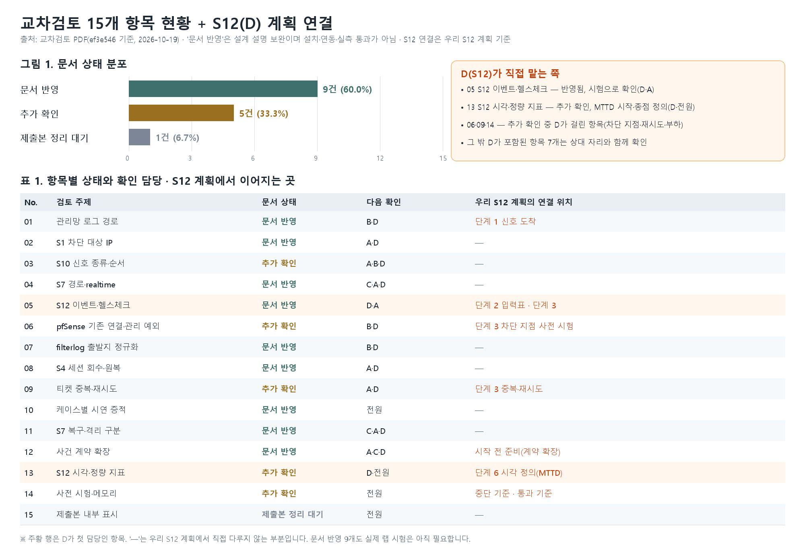
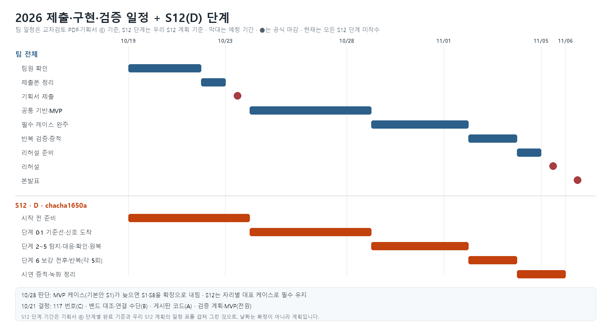

# 교차검토 PDF + 우리 S12 계획 통합본 (D · chacha1650a)

작성: 2026-10-19 · 상태: **통합 초안(팀 확인 전)**
합친 자료
- A: 교차검토 PDF `NoBugs_기획서_교차검토_표그래프_ef3e546.pdf` (ef3e546 기준, 9쪽)
- B: 우리 자료 — [S12 진행계획](S12-진행계획-D-chacha1650a.md)(main의 `team_docs/`), 자리별 토폴로지 5장(PR #13), 10/19 정리 문서

PDF는 설계 문서만 재검토한 결과이고 랩 시험은 하지 않았습니다. 이 통합본도 같은 범위이며, 설치·연동·실측은 하지 않았습니다.

## 1. 두 자료 비교: 장점과 서로 채울 점

| 구분 | 교차검토 PDF (A) | 우리 자료 (B) |
| --- | --- | --- |
| 범위 | 팀 전체 기획서 15개 검토 항목 | D(S12) 한 자리의 실행 방법 + 전체·자리별 망 구조 |
| 강점 | 상태를 3가지(문서 반영 / 추가 확인 / 제출본 정리 대기)로 나누고 항목마다 **다음 확인 담당·판정 범위**를 적음. 표·그래프로 한눈에 보임. 일정과 담당별 첫 확인 표, 10/23 전에 끝낼 3가지가 있음. 설계 근거를 **공식 제품 문서 링크**로 인용함 | 단계마다 **작업 → 산출물 → 넘어가는 조건 → 실패 분류**가 있음. 실행 1회 기록 양식, 부하 시험 중단 기준, 증적 위치가 있음. 구역·IP·흐름을 그린 **토폴로지**가 있음 |
| 약점 | 실행 방법과 기록 양식이 없음. 망 그림이 없음. 판정은 설계 재검토에 한정 | 팀 전체 현황·일정 그래프가 없음. 설계 근거 출처가 없음. 항목별 "문서 반영 / 추가 확인" 상태 구분이 없음 |
| 겹치는 부분 | S12 요청 수 이벤트 → n8n 헬스체크, 미실행 명시, 10/21 결정·10/28 판단, 자리 담당 | 같음 |

**합친 방향:** PDF의 상태 분류·담당·일정 그래프·근거 인용을 우리 S12 계획의 기록 방법·단계·토폴로지에 붙입니다. 반대로 PDF의 "다음 확인"이 우리 S12 단계 어디에서 확인되는지를 연결했습니다(그림 1의 오른쪽 열).

## 2. PDF에서 가져와 우리 S12 계획에 추가할 것

PDF의 D 관련 지적 가운데 우리 S12 계획에 **아직 빠졌거나 약한** 부분입니다. 문서 줄 번호는 PDF가 인용한 ef3e546 기준이라 최신 기획서와 다를 수 있습니다.

| # | PDF 항목 | 우리 S12 계획의 현재 상태 | 추가할 내용 | 위치 |
| --- | --- | --- | --- | --- |
| 1 | 13 S12 시각·정량 지표 | 실행 기록의 시각에 "첫 공격·조건 충족·이벤트 생성·조치 완료·회복 확인"만 있음 | **Graylog 후보 이벤트 생성**과 **n8n 최종 판정** 시각을 따로 기록. S12 MTTD의 시작·종점과 정상 업무 오탐의 집계 대상을 정함(제안은 아래) | 실행 1회 기록 양식, 단계 2·3 |
| 2 | 05 S12 이벤트·헬스체크 | 입력표에 "정상 / 요청 수만 / 응답시간만 / 전체 충족"이 있음 | **응답 없음(timeout)** 입력 행 추가 | 단계 2 입력별 기대값 표 |
| 3 | 09 티켓 중복·재시도 | 중복 방지만 있음 | **재전송, 실패 뒤 재시도, 동시 실행**에서도 차단·티켓이 중복되지 않는지 확인 | 단계 3 작업·넘어가는 조건 |
| 4 | 06 pfSense 기존 연결·관리 예외 | 차단 지점 사전 시험(앱 vs pfSense)이 있음 | 공격 IP로 한정한 state 제거 뒤에도 **관리망·n8n·정상 출발지 연결이 유지**되는지 확인 | 단계 3, 단계 4 |
| 5 | 14 사전 시험·메모리 | 중단 기준만 있음 | OOM·로그 유실·회복 지연의 **통과 기준**과 "메모리 부족 시 Wazuh manager 중심 대안"에서도 필수 증적이 유지되는지 확인. 10/23 이전 "n8n IP 차단 1회"의 최소 API·시험 대상을 정함 | 안전 규칙, 시작 전 준비 |
| 6 | 전체 표기 | 상태 표시가 "미착수"만 있음 | 항목 상태를 **문서 반영 / 추가 확인 / 제출본 정리 대기 / 검증 완료**로 구분하고 각 항목에 "판정 범위: 문서 재검토, 랩 미실행"처럼 범위를 적음 | 진행 단계 요약 표 |
| 7 | 참고 자료 | 출처 인용 없음 | n8n Webhook, Graylog Event Definitions·Alerts/Event Metadata, Netgate Reset State Table·Rule Methodology, Wazuh 권장 사양을 근거 문서로 인용(아래 3절) | 문서 끝 |

### 제안 (팀 확인 필요)

- **S12 시각 5개:** 첫 공격 → 조건 충족 → Graylog 후보 이벤트 생성 → n8n 최종 판정 → 조치 완료 → 회복 확인. S12의 MTTD는 "조건 충족 → n8n 최종 판정"을 최종 탐지로 보고, "조건 충족 → Graylog 후보 이벤트 생성"은 후보 탐지 지연으로 따로 적는 것을 제안합니다. 기획서 5.5는 MTTD 종점을 Graylog 이벤트 생성 시각으로 정하고 있어서, 이 변경은 D 혼자 정할 수 없습니다(PDF 13번과 같은 지적).
- **오탐 집계 대상:** 오탐·탐지율은 n8n 판정까지 합친 결과로 센다는 기준(리뷰 1)에 맞추고, 후보 이벤트 수는 참고 값으로 따로 기록합니다.

## 3. 근거 문서 (PDF 인용, 직접 다시 확인하기 전)

PDF가 인용한 공식 문서입니다. 설치할 버전과 다를 수 있어 구현 전에 다시 확인해야 합니다. 제가 이번에 링크를 열어 확인한 것은 아닙니다.

| 쓰임 | 문서 |
| --- | --- |
| S12 Webhook 수신·실행 간 결합 | n8n Webhook, n8n Merge |
| S12 이벤트 정의·집계 키 | Graylog Event Definitions, Event Definitions Use Case |
| 이벤트 메타데이터·시각(MTTD) | Graylog Alerts / Event Metadata |
| 차단 뒤 기존 연결 제거 | Netgate Reset State Table, Rule Methodology |
| 관제 PC 메모리 | Wazuh Quickstart recommended hardware |

링크 목록은 PDF 9쪽에 있습니다.

## 4. 10/23 제출 전에 꼭 마칠 것 3가지와 D의 몫 (PDF 1쪽 기준)

| # | PDF의 3가지 | D가 할 일 |
| --- | --- | --- |
| 1 | 남은 설계·측정 기준 합의 | S12 후보/최종 탐지·MTTD·오탐 집계, 실제 임계값(N)과 판정 기한 확정 |
| 2 | PC 연결·자원 사전 위험 확인 | Graylog·Wazuh 동시 부하, 최소 차단 경로(n8n IP 차단 1회) 시험 준비 |
| 3 | 팀원 확인과 제출본 정리 | S12 부분 확인(~10/21), 내부 표시 정리(10/22) |

## 5. 다음 단계

- 기획서 전체에 대한 피드백은 [기획서-피드백-chacha1650a.md](기획서-피드백-chacha1650a.md)에 따로 정리했습니다.
- 2절의 추가 항목 1~6은 `team_docs/S12-진행계획-D-chacha1650a.md`에 반영합니다. 같은 파일이라 별도 브랜치와 PR이 필요합니다.
- PDF와 같은 **PDF 형식**이 필요하면 따로 만들 수 있습니다.

## 6. 확인한 것과 하지 않은 것

- PDF 9쪽을 모두 읽고 쪽별 그림도 열어 봤습니다. 그림 1은 PDF의 분포(9·5·1건)와 표 항목 15개를 그대로 옮겼고, 일정은 PDF와 기획서 ⑥ 기준으로 다시 그렸습니다.
- 우리 S12 연결 위치(그림 1의 오른쪽 열)는 제가 정리한 것이며, PDF에 있는 내용이 아닙니다.
- PDF는 ef3e546 기준이고 PR #10 브랜치는 이후 커밋이 더 있어서, 줄 번호와 일부 문구가 달라졌을 수 있습니다.
- 랩 시험은 하지 않았습니다.
